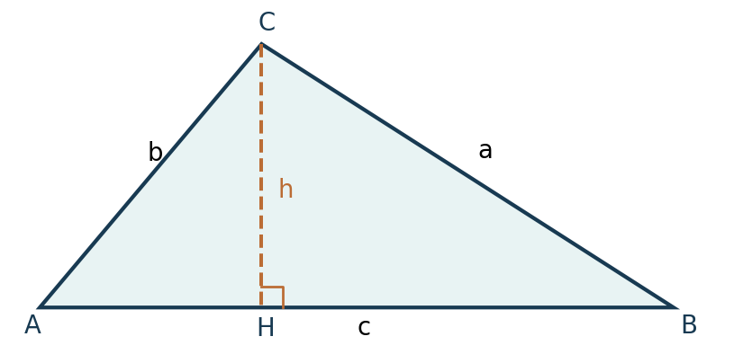
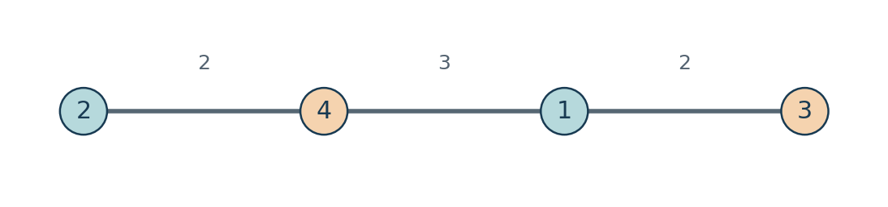
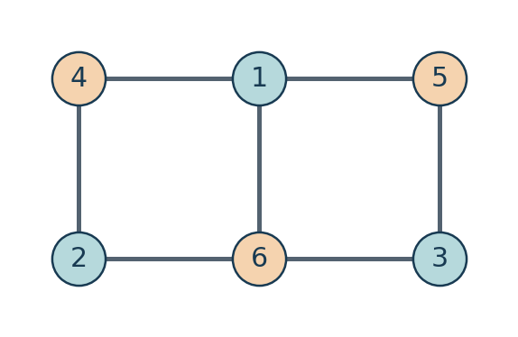

**Twelve textbooks · One teaching-first specification**

Four subjects · Three volumes each · 136 teaching chapters (one optional) · 791 concept sections

Consolidated development edition · November 2026 \| CompMath2.0 Learn redesign

## Executive summary

**Volume I builds fluency; Volume II builds mathematical depth; Volume III builds strategic problem-solving mastery.** The supplied Think Academy Olympiad Year 2 Term A lessons anchor the intermediate level. The advanced level is now explicitly directed toward difficult AIME and other demanding exact-answer competitions, with selective proof-based extensions when they serve the mathematics. It is not a transition into a separate introductory olympiad-proof course.

The twelve books are four independently paced subject ladders. Students can advance in one subject while strengthening another; the cross-subject bridge table identifies the few specific concepts needed from a different book. Competition labels are approximate learning benchmarks, not strict gates or guaranteed scores.

**Source distinction.** All 22 supplied Year 2 lessons retain their detailed concept and exploration coverage from the prior consolidated overview. The other chapters are independently designed proposals informed by AoPS public book and course descriptions, existing CompMath curriculum documentation, and mathematical prerequisites. Actual Think Academy Year 1, later Year 2 lessons and subsequent years were not provided. The new sine/cosine-law, polar and other chapters are not represented as summaries of unseen teaching materials.

## How to use this specification

The chapter is the unit of mathematical development. Every chapter has a central purpose, individually numbered concepts, application directions, and a mastery outcome. The chapter order describes the default learning path, not an inflexible schedule. Source-grounded chapters carry a Year 2 anchor label; other chapters carry a proposed label. Practice descriptions and sample calculations are instructional specifications, not a completed textbook or verified archive of contest exercises.

Identifiers such as G2.7.4 mean Geometry, Volume II, Chapter 7, Concept 4. The revised identifiers supersede the first proposal; do not use them as a destructive migration of live lesson IDs. The integrated revision retains existing chapter and concept identifiers; additions append within canonical chapters, with separate later transfer applications where warranted. C1.10 is a new foundational logic chapter. Six overlapping concept sections and the duplicated binomial lesson have been refocused without changing their IDs. A2.22 is optional enrichment, not a required gate.

# Development roadmap — read this first

This consolidated edition is the single planning baseline for the Learn redesign. It retains the 136 chapters and 791 numbered concept sections from the Integrated Teaching Edition, incorporates all eight refinements from the fifth-pass solution audit at their existing curricular homes, and preserves the full 30-problem audit and four teaching pilots at the end. Earlier drafts are historical; they are not separate sources of requirements.

## Non-negotiable design decisions

**Purpose.** Learn is a teaching resource, not a wiki of definitions. Build a question-led mathematical narrative. The reference cards, practice archive and Arena remain distinct tools and are linked only where pedagogically useful.

**Levels.** I builds fluency; II builds depth and a substantial precalculus/competition toolkit, anchored by the 22 supplied Think Academy Year 2 lessons; III develops strategic, independent problem solving for middle-to-late AIME and difficult exact-answer competitions. Proof is used to explain and justify, not as a replacement for advanced problem solving.

**Scope.** Four independently paced subject ladders; keep explicit cross-subject bridges. LOS and LOC belong together in G2.7; polar coordinates have a dedicated chapter in G2.11. No differential or integral calculus is required or taught; A2.22 is optional elementary limit and convergence intuition. Treat specialized topics as enrichment unless needed by a core route.

**Stable assets.** Preserve the existing reference cards, problem slugs, ratings and saved progress. Proposed curriculum IDs are a new authoring namespace, not permission to overwrite live lesson URLs.

## How to navigate the consolidated plan

[<u>Twelve-book shelf</u>](#twelve-book-shelf) — Volume directions and links into the chapter specifications.

[<u>Implementation and editorial standards</u>](#implementation-and-editorial-standards) — Authoring and migration standards, research and scope.

[<u>Archive-wide coverage and teaching validation</u>](#archive-wide-coverage-and-teaching-validation) — Full metadata coverage results and limitations.

[<u>Solution-level audit and teaching pilots</u>](#solution-level-audit-and-teaching-pilots) — Both 2026 AIME papers, route checks, refinements and four student-facing examples.

[<u>Acceptance tests and next authoring batch</u>](#acceptance_tests) — Concrete gates and next five model chapters.

Do not use the number of lessons or nominal topic coverage as a release gate. The success criterion is whether a learner can follow the reasoning, choose a method in an unfamiliar problem and verify the result independently.

# Execution sequence and release gates

**Stage 1 — Adopt the specification.** Use this document as the canonical proposed curriculum. Maintain stable IDs, track optional material separately, record open mathematical issues, and map old lesson IDs to new destinations before changing live URLs.

**Stage 2 — Establish the authoring standard.** Review the four completed mini-units (A1.3, G2.7, N3.4 and C3.8); write the next five pilots: G2.2 power of a point, A2.8 composite/inverse functions, C2.5 recursive counting, N2.1 CRT, and A3.3 transformed roots. Read each unit sequentially as a student. Include motivating questions, developed mathematics, contrasting examples, faded guidance, independent and delayed transfer. Do not force every lesson into identical headings.

**Stage 3 — Validate the mathematics and exercise placement.** Resolve the three numerical-only 2026 AIME routes (I \#15; II \#14 and \#15). The no-calculus alternatives to II \#6 and \#8 should be used in place of derivative-based strategies if the routes are later updated in the app. Expand solution review beyond the 30 audited problems, stratifying by subject, contest difficulty, problem role and cross-topic demands. Review actual statements and solutions; never infer prerequisites solely from tags. Use the audit status scheme in the solution appendix.

**Stage 4 — Build complete volumes.** Map each existing lesson to reuse, split, merge, rewrite, reference-only or retire. Write a complete chapter arc before authoring individual lessons. For every exercise record its canonical slug, required concepts, intended teaching role, difficulty and verification status. Use unlabeled mixed problems to assess method choice. A concept is not complete just because its theorem or card exists.

**Stage 5 — Test and migrate.** Pilot the connected Geometry II circle sequence and triangle laws, then a Volume III transfer chapter. Collect learner evidence on first steps, misconception contrasts, independent solutions and delayed transfer. Validate shelf generation, internal links, redirects and saved progress. Replace one coherent volume at a time after review; keep old URLs working until mappings are tested.

## Status at this baseline

**Established:** 12 proposed books; 136 chapters (one optional); 791 concept sections; all 22 supplied Year 2 lessons mapped; metadata scan of 19,456 appearances; eight solution-audit refinements incorporated into existing sections; four model mini-units.

**Not established:** Complete textbook manuscripts, full old-to-new lesson mapping, exercise-by-exercise verified prerequisites, independently verified solutions for the full archive, student readiness or score improvements, or live repository implementation. The 99.5% candidate topic coverage is a screening result, not an instructional outcome.

Editorial control: every future change should identify the affected curriculum ID, rationale, supporting problem or source, prerequisite impact, acceptance task, and review status. Change the curriculum only when evidence supports it; prioritize deeper teaching over expanding the topic list.

## Twelve-book shelf

| **Subject**                 | **I — Foundations**                                   | **II — Intermediate**                                               | **III — Advanced problem solving**                   |
|-----------------------------|-------------------------------------------------------|---------------------------------------------------------------------|------------------------------------------------------|
| Algebra                     | [Algebraic Foundations and Problem Solving](#a1) (10) | [Advanced Algebra and Precalculus](#a2) (22)                        | [Advanced Algebraic Problem Solving](#a3) (10)       |
| Geometry                    | [Euclidean Foundations and Visual Reasoning](#g1) (9) | [Circle Geometry, Triangle Methods and Analytic Geometry](#g2) (14) | [Advanced Geometric Problem Solving](#g3) (10)       |
| Number Theory               | [Integers, Divisibility and Remainders](#n1) (9)      | [Congruences, Arithmetic Functions and Integer Equations](#n2) (11) | [Advanced Number-Theoretic Problem Solving](#n3) (9) |
| Combinatorics & Probability | [Counting Models and Finite Probability](#c1) (10)    | [Enumeration, Recurrences and Advanced Probability](#c2) (11)       | [Advanced Combinatorial Problem Solving](#c3) (11)   |

## What changes between levels

| **Dimension** | **Volume I**                      | **Volume II**                                           | **Volume III**                                                                |
|---------------|-----------------------------------|---------------------------------------------------------|-------------------------------------------------------------------------------|
| Goal          | Fluency and elementary models     | Broad, deep mathematical toolkit                        | Independent method selection and synthesis                                    |
| Problems      | Direct, then mixed foundations    | Nonroutine concept-based applications                   | Difficult unlabeled multistep problems                                        |
| Proof         | Explain and justify basic results | Derive results and establish conditions                 | Establish necessary intermediate claims, verify completeness                  |
| Contest guide | AMC 8, AMC 10, accessible AMC 12  | Hard AMC 10/12 and approximately AIME 1–7, with overlap | Middle-to-late AIME and difficult invitational contests; selective extensions |
| Assessment    | Identify and apply a concept      | Construct a method in a recognizable family             | Discover hidden structure and produce a checked exact answer                  |

AIME position is not a reliable topic or difficulty label. A late problem may require a simple observation and an early problem may use a sophisticated formula. Curate by solution demand, prerequisite knowledge and actual difficulty ratings; retain overlap between the tiers.

## Year 2 integration map

All 22 distinct uploaded lessons map to Volume II. Trigonometric algebra lives in Algebra II; geometric applications live in Geometry II. Euler totient is approached through inclusion–exclusion in Combinatorics II and modular structure in Number Theory II.

| **Original lesson**                               | **Revised chapter** |
|---------------------------------------------------|---------------------|
| 1\. Sets and Mappings                             | [A2.1](#a2-1)       |
| 2\. Power and Exponential Functions               | [A2.2](#a2-2)       |
| 3\. Logarithms and Logarithmic Functions I        | [A2.3](#a2-3)       |
| 4\. Logarithms and Logarithmic Functions II       | [A2.4](#a2-4)       |
| 5\. Odd, Even and Periodic Functions              | [A2.5](#a2-5)       |
| 6\. Advanced Quadratic Functions                  | [A2.6](#a2-6)       |
| 7\. Special Functions                             | [A2.7](#a2-7)       |
| 8\. Composite and Inverse Functions               | [A2.8](#a2-8)       |
| 9\. Recursive Sequences                           | [A2.10](#a2-10)     |
| 10\. Inequality of Arithmetic and Geometric Means | [A2.11](#a2-11)     |
| 11\. Polygons                                     | [G2.1](#g2-1)       |
| 12\. Power of a Point Theorem                     | [G2.2](#g2-2)       |
| 13\. Cyclic Quadrilaterals I                      | [G2.3](#g2-3)       |
| 14\. Cyclic Quadrilaterals II                     | [G2.4](#g2-4)       |
| 15\. Ptolemy’s Theorem and Stewart’s Theorem      | [G2.5](#g2-5)       |
| 16\. Equations of Straight Lines and Circles      | [G2.6](#g2-6)       |
| 17\. Enumeration Basics                           | [C2.1](#c2-1)       |
| 18\. Principle of Inclusion and Exclusion         | [C2.2](#c2-2)       |
| 19\. Counting with Recurrence Relations           | [C2.5](#c2-5)       |
| 20\. Introduction to Trigonometry                 | [A2.15](#a2-15)     |
| 21\. Trigonometric Identities I                   | [A2.16](#a2-16)     |
| 22\. Trigonometric Identities II                  | [A2.17](#a2-17)     |

## Cross-subject prerequisite bridges

These are targeted conceptual bridges, not requirements to complete a whole other textbook. For example, a geometry learner needs unit-circle and inverse-trig knowledge before the triangle-law and polar chapters, but need not have completed all of Algebra II.

| **Earlier knowledge** | **Enables**     | **Reason**                                                                          |
|-----------------------|-----------------|-------------------------------------------------------------------------------------|
| [A1.5](#a1-5)         | [G2.6](#g2-6)   | Discriminants and completing the square determine intersections.                    |
| [A1.4](#a1-4)         | [N2.2](#n2-2)   | Power laws and exact arithmetic.                                                    |
| [A2.10](#a2-10)       | [C2.5](#c2-5)   | Solving recurrences; counting constructs the states.                                |
| [A2.1](#a2-1)         | [C2.2](#c2-2)   | Set operations and overlapping restrictions.                                        |
| [C2.2](#c2-2)         | [N2.4](#n2-4)   | Coprime counting and totient.                                                       |
| [A2.16](#a2-16)       | [G2.7](#g2-7)   | General-angle functions and angle relationships.                                    |
| [A2.19](#a2-19)       | [G2.7](#g2-7)   | SSA ambiguity and principal angles.                                                 |
| [A2.18](#a2-18)       | [G2.11](#g2-11) | Period, symmetry and angle parameterization.                                        |
| [G2.7](#g2-7)         | [G2.13](#g2-13) | Derivation of the dot-product angle identity.                                       |
| [A2.14](#a2-14)       | [C2.7](#c2-7)   | Partial fraction extraction of recurrence terms.                                    |
| [A2.21](#a2-21)       | [C2.10](#c2-10) | State-transition matrices and walk counts.                                          |
| [A2.20](#a2-20)       | [G3.7](#g3-7)   | Complex coordinates and rotations.                                                  |
| [A3.9](#a3-9)         | [C3.6](#c3-6)   | Roots-of-unity filters; optional cross-link.                                        |
| [N2.1](#n2-1)         | [C3.1](#c3-1)   | Residue states and digit constraints.                                               |
| [A2.13](#a2-13)       | [N2.5](#n2-5)   | Factorizations and polynomial congruences.                                          |
| [C1.4](#c1-4)         | [N2.5](#n2-5)   | Binomial coefficients before Lucas and Kummer.                                      |
| [C1.3](#c1-3)         | [N1.4](#n1-4)   | Stars and bars for ordered factor tuples (or use small exponent allocations first). |
| [G2.13](#g2-13)       | [G3.9](#g3-9)   | Dot products before Gram determinant volumes.                                       |
| [C1.10](#c1-10)       | [C2.4](#c2-4)   | Logical implications and completeness before constructive bounds.                   |

## Research-based gap audit

AoPS public curricula provide an external coverage benchmark, not a prescribed order. In particular, its intermediate algebra and precalculus courses cover a broader toolkit than the uploaded 22 lessons alone. The revised CompMath progression deliberately incorporates that breadth in Volume II and reserves Volume III for advanced use.

| **Coverage question**  | **Revised placement / decision**                                                                                                      |
|------------------------|---------------------------------------------------------------------------------------------------------------------------------------|
| Law of Sines           | [G2.7](#g2-7): Combined LOS and LOC chapter: derivations, SSA, extended sine law, Heron, cevians and optimization.                    |
| Polar Coordinates      | [G2.11](#g2-11): Dedicated polar coordinate and graph chapter, including equivalent representations, roses, intersections and conics. |
| Parametric Equations   | [G2.10](#g2-10): Separate parametric equations, motion and locus chapter.                                                             |
| Conic Sections         | [G2.9](#g2-9): Parabolas, ellipses, hyperbolas, focal definitions and intersections.                                                  |
| Rational Functions     | [A2.14](#a2-14): Domain, asymptotes, partial fractions and telescoping.                                                               |
| Inverse Trigonometric  | [A2.19](#a2-19): Principal branches, equations and geometric applications.                                                            |
| Functional Equations   | [A2.9](#a2-9): Intermediate functional reasoning and induction before the advanced book.                                              |
| Cauchy                 | [A2.12](#a2-12): Cauchy–Schwarz, weighted means and optimization.                                                                     |
| Matrices               | [A2.21](#a2-21): Systems, matrices, determinants and transformations.                                                                 |
| Vectors, Dot           | [G2.13](#g2-13): Vector representation, projections, area and geometric arguments.                                                    |
| Three-Dimensional      | [G2.14](#g2-14): 3D lines and planes, cross product, determinants, cross-sections and solids.                                         |
| Triangle Centers       | [G1.6](#g1-6): Move elementary triangle centers into foundations.                                                                     |
| Wilson                 | [N2.3](#n2-3): Modular products, exact order, primitive roots and discrete log reasoning.                                             |
| Sums of Squares        | [N2.7](#n2-7): Quadratic forms and sum-of-two-squares criterion.                                                                      |
| Rational Approximation | [N2.9](#n2-9): Continued fractions and Pell solutions.                                                                                |
| Statistics             | [C1.6](#c1-6): Descriptive statistics, weighted means and geometric probability.                                                      |
| Pigeonhole             | [C2.4](#c2-4): Intermediate existence, invariant and extremal reasoning.                                                              |
| Generating Functions   | [C2.7](#c2-7): Formal coefficient models and elementary recurrence extraction.                                                        |
| Graph Theory           | [C2.10](#c2-10): Graph degrees, walks, connectivity, trees, coloring and planarity.                                                   |

The same audit adds substantive advanced chapters for polynomial and nonlinear system problems, trigonometric summations, multi-circle configurations, complex and spatial geometry, exponent towers, valuations, digit constraints, restricted assignments, state modeling, generating functions, orbit counts and conditional random processes. Differential and integral calculus, abstract algebra, projective geometry, advanced Ramsey theory and full proof-olympiad specialization are deliberately not core requirements; selected tools may be offered later as extensions.

**Depth rule for authors.** Do not add an isolated result solely to check a coverage box. Each new chapter should explain a mathematical need, derive or motivate the relevant machinery, connect it to earlier concepts, and demonstrate a progression from direct practice to transfer. Where a concept reappears in III, the new task is strategic use rather than repeating its introductory treatment.

## Second-pass research and editorial audit

The second-pass audit reopens the 134-chapter, 692-concept revised document and checks its chapter and concept headings and selected instructional passages against public curricular benchmarks and representative contest solutions. It retains the full Year 2 anchor material, the four subject ladders, the previous chapter IDs and the revised late-AIME direction. This is not a claim of exhaustive problem-bank coverage or a reconstruction of unseen courses.

**Coverage result.** The first revision already provides a strong intermediate toolkit: combined triangle laws (G2.7), polar coordinates (G2.11), conics, matrices, generating functions, arithmetic functions and advanced probability. The second pass prioritizes genuinely missing or underdeveloped concepts, sequence repairs and transfer. The optional new A2.22 provides a precalculus bridge without making calculus a contest requirement.

| **Area**                      | **Second-pass decision**                                                                                                                                                                                                                                                                            |
|-------------------------------|-----------------------------------------------------------------------------------------------------------------------------------------------------------------------------------------------------------------------------------------------------------------------------------------------------|
| Algebra foundations           | Expand complex roots, systems, rate of change, percent/compound growth and feasible regions (A1.2–A1.8).                                                                                                                                                                                            |
| Algebra II and III            | Add root multiplicities, convergence checks, reciprocal trig graphs, elimination and determinant methods, harmonic sequences and mixed constraints.                                                                                                                                                 |
| Geometry foundations          | Add tangential figures, lattice polygons, polyhedra and net reasoning (G1.7–G1.9).                                                                                                                                                                                                                  |
| Geometry II and III           | Add cyclic/tangential area relationships, Euler line and excenters, rotated conics, envelopes, constructions, polar metric reasoning and spatial surfaces.                                                                                                                                          |
| Number theory                 | Strengthen base arithmetic, CRT solution counts, unit fractions, prime-power lifting, nonunit periods and unknown-base problems.                                                                                                                                                                    |
| Combinatorics and probability | Strengthen multinomial models, ballot paths, stopping distributions, total expectation, Euler trails, constrained grids, residue-state models and random intersections.                                                                                                                             |
| Advanced scope                | Keep uncommon general machinery as enrichment: primitive roots, full reciprocity, inversion, barycentric formalism, Carmichael periods, Möbius inversion, transfer matrices and advanced graph theory. Core progress depends on direct problem-solving competence, not knowing every named theorem. |

## Representative contest stress test

The following problems were inspected using the publicly available LIVE by Po-Shen Loh contest archive. They are original curricular diagnoses, not reproduced statements. They were chosen for contrasting mathematical structures; this sample is not a statistically representative frequency analysis or a verified exercise placement. See the source links at the end.

| **Contest problem** | **Mathematical demand**                                                                 | **Candidate home / cross-link** |
|---------------------|-----------------------------------------------------------------------------------------|---------------------------------|
| 2025 AIME I \#5     | Divisibility tests interact with restricted permutations and complementary casework.    | N1.5 → C2.1; C3.1 transfer      |
| 2025 AIME I \#6     | Tangent-length relationships plus trapezoid area and Pythagoras.                        | G1.7 → G2.5                     |
| 2024 AIME II \#10   | Recover a triangle metric from center distances and radii.                              | G2.7/G2.8 → G3.2                |
| 2024 AIME II \#11   | Center a symmetric polynomial around the mean; count overlapping integer families.      | A3.2/A3.10 → C2.2               |
| 2024 AIME II \#12   | Analyze uniqueness within a family of fixed-length intercept segments.                  | G2.10 → G3.6                    |
| 2024 AIME II \#13   | Factor a polynomial inside a product over complex roots of unity.                       | A2.20 → A3.9                    |
| 2024 AIME II \#14   | Translate a digit condition into a coprime product congruence, then minimize a modulus. | N2.1 → N3.8                     |
| 2024 AIME II \#15   | Count rectangles in a regular polygon using direction classes and metric constraints.   | G2.1 → C3.1/G3.5                |
| 2025 AIME I \#9     | Intersect a rotated parabola with its original using coordinate symmetry.               | G2.9/G2.12 → G3.6               |
| 2025 AIME I \#10    | Count constrained grid fillings by canonical blocks and forced completions.             | C2.1 → C3.1                     |
| 2025 AIME I \#12    | Factor inequalities and exploit coordinate-permutation symmetry on a plane.             | A1.8/G2.14 → A3.10              |
| 2025 AIME I \#13    | Combine geometric crossing events with indicator expectation.                           | C2.9/G1.7 → C3.10               |
| 2025 AIME I \#15    | Count power-residue fibers, classify prime valuations and recurse on smaller moduli.    | N3.3/N3.5 ↔ C3.5                |

**Editorial implication.** The contest-level difference is primarily the discovery of a model. Volume II should explicitly teach a method and then vary the data and configuration; Volume III should remove that cue and make students decide whether to factor, change coordinates, use a residue, or count a complementary family. Difficulty ratings and actual solutions should guide final placements; a problem number is only a rough benchmark.

## Prerequisite and depth refinements

- A1.5 introduces nonreal quadratic roots before A2.13 uses the fundamental theorem of algebra; A2.20 develops polar complex numbers and roots of unity. A2.18 teaches graphs and graphical intersections; A2.19 owns inverse branches and complete equations.
- N2.2 establishes direct cycles and Fermat’s theorem, previews Euler’s theorem via permutation of units, and links to N2.4 for totient and composite-modulus applications; primitive roots in N2.3 are optional.
- G1.7 introduces equal tangent lengths before G2.5; G2.8 can use the midpoint/parallel proof of the Euler line or the targeted vector prerequisite in G2.13. G2.9 rotated-conic work uses A2.21, while G2.10 introduces parameter-family geometry before G3.6.
- Separate necessary from sufficient conditions; verify solution branches, finite-domain endpoints, denominators, geometric feasibility, and initial states. Keep optional results off the core prerequisite graph. For each extension, test whether a direct elementary solution suffices before requiring more elaborate machinery.

**Depth calibration.** A named method is not a lesson unless students understand its motivating question, derive or justify it, solve at least two structurally distinct applications, and recognize when it cannot be used. Add delayed, unlabeled review problems after each cluster rather than postponing all mixed practice until the end of a volume. The IES What Works Clearinghouse practice guides on algebra instruction and organizing study support using worked examples, analyzing algebraic structure, and mixing examples with problem solving. These are general educational recommendations, not direct evidence about this app or AIME scores.

# Algebra I — Algebraic Foundations and Problem Solving

**TEXTBOOK A1 · 10 teaching chapters**

**Volume direction.** Build fluency in expressions, equations and functions before attempting formal function analysis. The goal is to move from arithmetic to algebra as a language for reasoning, not to memorize manipulation recipes.

**Entry prerequisites.** Comfort with fractions, integers, ratios and elementary arithmetic; no contest algebra assumed.

**Expected mastery.** Translate verbal conditions, manipulate expressions legally, solve and check equations, read basic graphs, and recognize when a sequence or inequality expresses structure.

**Instructional approach.** Use short proof and explanation prompts alongside numerical exercises; algebraic accuracy and representation choices matter more than speed.

## Chapter contents

| **Chapter**     | **Focus**                                       | **Basis** |
|-----------------|-------------------------------------------------|-----------|
| [A1.1](#a1-1)   | Expressions, Identities and Factoring           | Proposed  |
| [A1.2](#a1-2)   | Linear Equations and Mathematical Modeling      | Proposed  |
| [A1.3](#a1-3)   | Proportionality, Rates and Quantitative Models  | Proposed  |
| [A1.4](#a1-4)   | Exponents, Roots and Exact Arithmetic           | Proposed  |
| [A1.5](#a1-5)   | Quadratic Equations                             | Proposed  |
| [A1.6](#a1-6)   | Functions, Graphs and Coordinate Interpretation | Proposed  |
| [A1.7](#a1-7)   | Rational Expressions and Rational Equations     | Proposed  |
| [A1.8](#a1-8)   | Inequalities, Absolute Value and Bounds         | Proposed  |
| [A1.9](#a1-9)   | Sequences, Series and Patterns                  | Proposed  |
| [A1.10](#a1-10) | Polynomial Structure and Algebraic Synthesis    | Proposed  |

## A1.1 — Expressions, Identities and Factoring

**PROPOSED CHAPTER**

**Core premise and purpose.** Establish the distinction between an expression, an identity and an equation. Students learn that algebraic manipulation preserves meaning only under its stated conditions. This gives subsequent equations a reliable foundation.

**Teaching sequence.** Open with 99 × 101 and several student strategies. Compare calculation by expansion, grouping and a difference of squares. Name the underlying structure only after it has served a purpose. Move from numerical examples to general variables, then to algebraic fractions where the legal domain matters. End with an unfamiliar expression whose form must be chosen by the student, not a worksheet sorted by operation.

### A1.1.1 Algebraic notation and structure

Translate words into expressions; distinguish terms, factors, coefficients and variables. Grouping and order of operations reveal the expression’s structure. Practice writing expressions for consecutive integers and comparing structurally different but equal expressions.

### A1.1.2 Distributive law and identities

Derive $a(b + c) = ab + ac$ and the square and difference-of-squares identities using expansion or area. Recognize both directions rather than expanding reflexively. Practice mental arithmetic such as $103^{2}$ and simplifying cancellation-rich expressions.

### A1.1.3 Factoring and common structure

Extract common factors, group terms and recognize $a^{2} - b^{2} = (a - b)(a + b)$. Factoring exposes zeros and divisibility, unlike expansion. Practice choosing a factorization for expressions with repeated subexpressions.

### A1.1.4 Fractions and domain restrictions

Use common denominators and simplify rational expressions while retaining excluded values. Explain why cancellation is legal for factors but not terms. Practice checking equivalence of $\left( x^{2} - 1 \right)/(x - 1)$ and $x + 1$ and explaining the missing input.

### A1.1.5 Choosing equivalent forms

Ask students to compute $99 \cdot 101$ first by ordinary multiplication and then as $100^{2} - 1$. Next compare $x^{2} + 6x + 9$ and $(x + 3)^{2}$ when finding a zero versus evaluating at a large input. This teaches that expansion, factoring and completing squares are choices of representation, not separate chores. Practice explaining the purpose of each transformation before applying it.

### A1.1.6 Arithmetic fluency and exact computation

Open with two apparently different computations of the same quantity. Ask which representation makes the answer easier to verify; diagnose any trouble with signed arithmetic or fraction operations before introducing variables.

Add an entry diagnostic and a section on signed integers, fractions, mixed numbers, decimals, order of operations and fraction cancellation. Use distributivity and grouping to turn long calculations into short ones. The foundation book currently assumes arithmetic competence. A diagnostic prevents basic computational errors from obscuring algebraic understanding, without forcing prepared learners to repeat everything.

**Learning progression.** Evaluate 3/4 − (−2/3), compare two fraction sums without decimal approximation, and redesign 48 × 52 as a difference of squares. Require exact answers and explain the chosen representation.

**Mastery and onward direction.** Choose between expanding, factoring and retaining a form; justify legal simplification and preserve restrictions. Next: equations use these transformations to identify unknowns.

**Next in this volume:** [A1.2](#a1-2) — Linear Equations and Mathematical Modeling.

## A1.2 — Linear Equations and Mathematical Modeling

**PROPOSED CHAPTER**

**Core premise and purpose.** Turn verbal relationships into solvable equations. Emphasize that a solution is a value satisfying the original condition, and that modeling requires defining quantities before calculating.

### A1.2.1 Equivalent equations

Use reversible operations on both sides; distinguish identities, contradictions and single solutions. Practice solving equations with fractions and explaining why multiplication by a possibly zero expression needs care.

### A1.2.2 From verbal comparisons to equations

Express a relationship such as “three more than twice a quantity” as an equation; reverse the translation to check that the unknown is the intended quantity. Distinguish part–whole constraints, difference constraints and proportional relationships. Use a simple age and price example, then move to simultaneous equations in A1.2.3. Detailed rate, percentage and mixture modeling belongs to A1.3, where the choice of units and reference quantities becomes the main mathematical task.

### A1.2.3 Systems of linear equations

Interpret two simultaneous constraints as intersecting lines, solve by substitution and elimination. Practice determining unknown prices, ages or quantities; distinguish unique, inconsistent and dependent systems.

### A1.2.4 Modeling under constraints

Translate conditions into equations plus integrality or positivity requirements. A mathematically valid root may not answer the original question. Practice digit and distribution problems, checking dimensions and all stated restrictions.

### A1.2.5 Linear constraints and feasibility

Use a ticket-price problem to create two linear equations from independent totals, solve by elimination, then check that counts are nonnegative integers. Vary the totals to produce an inconsistent or dependent system. The objective is distinguishing an algebraic solution from a feasible model and recognizing when the given information cannot determine a unique answer.

### A1.2.6 Three-variable systems, consistency and efficient elimination

**Second-pass extension.** Begin with two equations in two unknowns and classify the possibilities: a unique intersection, coincident equations or parallel inconsistent equations. Extend to three variables by eliminating one variable from two different pairs of equations; count independent restrictions rather than counting equations. For a mixture model, make the total, ingredient and cost constraints explicit before elimination. A dependent equation may add no information; an inconsistent one yields an impossibility, not a value. **Practice direction:** solve a system with one redundant equation, identify the parameter that makes two lines coincide, and find a requested linear combination without recovering every unknown. This prepares for row reduction in A2.21.

**Mastery and onward direction.** Construct a model from an unfamiliar statement and check its solution. Next: powers expand the kinds of quantities an equation can represent.

**Next in this volume:** [A1.3](#a1-3) — Proportionality, Rates and Quantitative Models.

## A1.3 — Proportionality, Rates and Quantitative Models

**PROPOSED CHAPTER**

**Core premise and purpose.** Build a model from units and dependencies, rather than treating every word problem as an equation-solving trick. Direct and inverse variation become the first examples of functions whose parameters have physical meaning.

### A1.3.1 Direct, inverse and joint variation

Compare $y = kx$, $y = k/x$, and $z = kxy$. Derive the constant from a data pair, predict what happens when an input doubles, and distinguish a fixed ratio from a fixed difference. An inverse relationship is not simply any decreasing function. Explore worker-hours and scaling recipes; practice identifying the model from data before solving for the constant.

### A1.3.2 Rates, work and relative motion

Derive distance = rate times time from units. In work problems, use completed fraction per time, not total times: a worker who finishes in 6 hours and one in 3 hours complete $1/6 + 1/3 = 1/2$ of the task per hour together. Extend to leaks and changes of speed. Practice meeting and overtaking problems, piecewise travel and average speed as total distance divided by total time.

**Integrated solution-audit refinement 1.** Relative motion as gap closure; timelines for staggered starts; compare one equation in gaps vs distance systems. Related homes: A1.3.2, .6. Transfer check — 2026 AIME I \#1: set up the equation without knowing the speed or distance.

### A1.3.3 Mixtures, ratios and weighted averages

Translate concentration into amount of pure substance and conserve it through mixing. Distinguish averaging percentages with equal weights from unequal sample sizes. For 2 L at 10% and 3 L at 30%, the final concentration is 22%, not 20%. Practice replacement and dilution, ratio changes, and finding unknown weights with bounds on the answer.

### A1.3.4 Units, estimation and errors

Use dimensional analysis to check each step and interpret percentages relative to a named baseline. A 20% increase followed by a 20% decrease multiplies by $1.2(0.8)$, not 1. Develop rounding intervals and sensible bounds. Practice compound percentage changes, scale drawings and constraints with multiple units; require a reason the answer is reasonable.

### A1.3.5 Percent change, compound growth and scale

**Second-pass extension.** Distinguish percentage points, relative percentage change, and successive multipliers. Two successive increases of 20% and decreases of 20% give $1.2(0.8) = 0.96$, not the original quantity. Develop compound interest and repeated growth as $P(1 + r)^{n}$, with time units and rate periods consistent; derive the equivalent per-period multiplier rather than assuming a nominal annual rate is effective. Introduce scientific notation and sensible bounds for estimated calculations. **Practice direction:** compare successive discounts, find an unknown initial population, distinguish simple and compound growth, and recover a rate from a ratio of two observations. The exponential chapter later generalizes these discrete models to real inputs.

### A1.3.6 Rate models: stages, currents and moving reference frames

Begin with two equal-distance legs at different speeds. Predict whether the ordinary average of the speeds is correct, then calculate total time to expose the distinction between averaging speeds and averaging travel times.

**Transfer bridge (audit refinement 1).** Use staggered-start gap closure as a contrasting rate model.

Develop distance-time tables, segment-specific rates, relative velocity and signed direction. For upstream/downstream problems distinguish still-water speed from current speed. Use total distance/total time for average speed and isolate waiting time. Word problems require identifying which quantity is measured in which reference frame; a single generic rate formula is insufficient.

**Learning progression.** Start with a simple round trip, then a moving walkway, then overtaking after a head start, ending with a multistage journey whose unknown speed is constrained by arrival time.

### A1.3.7 Money, allocation and everyday quantitative constraints

Ask whether two successive percentage changes cancel. Draw a bar for the original quantity, and label every later percentage by its own reference amount; then use the same habit for a fair split and an age equation.

Model unit prices, discounts, taxes and change with explicit baselines; express fair splitting and weighted contributions through equations. Extend to ages and time-based comparisons with a shared time parameter. Covers recurring elementary competition contexts without turning the book into financial mathematics. Students learn to distinguish total, rate, difference and proportional share.

**Learning progression.** Find the original price from a discounted price; split a bill in unequal ratios; compare age relationships before and after a common shift.

### A1.3.8 Rounding, clock angles and elapsed time

A reported measurement of 12.4 does not identify one exact value. Have students sketch the possible interval; then contrast that interval problem with the continuous relative movement of two clock hands.

Treat rounding as an interval rather than equality, including tie conventions when specified. Model minute and hour hand rates (6 and 0.5 degrees/minute), take angular differences modulo 360 and distinguish the smaller angle. Keep weekday residues in N1.5.6; elapsed time and time-zone offsets are linear quantities. The latest outline includes modular calendar/clock residues but not continuous relative angular motion; discrete and continuous models must not be conflated.

**Learning progression.** Reverse a rounded measurement to get an admissible interval; find when hands coincide or form a right angle; solve a travel schedule spanning midnight.

**Mastery and onward direction.** Choose a model and preserve units, quantities and assumptions through the calculation. Next: solve exact algebraic expressions with exponents and radicals.

**Next in this volume:** [A1.4](#a1-4) — Exponents, Roots and Exact Arithmetic.

## A1.4 — Exponents, Roots and Exact Arithmetic

**PROPOSED CHAPTER**

**Core premise and purpose.** Develop exact computation with powers and radicals as prerequisites for quadratic equations, geometric ratios and exponential functions. Present laws as consequences of repeated multiplication rather than isolated rules.

### A1.4.1 Integer exponent laws

Derive product, quotient and power laws; explain zero and negative exponents for nonzero bases. Practice expressing $2^{15}/8^{3}$ as a single power and comparing numbers without evaluating them.

### A1.4.2 Radicals and fractional powers

Connect square and cube roots with inverse powers; use principal square roots and explain $\sqrt{x^{2}} = |x|$. Practice simplifying nested factors and converting rational exponents on their valid real domains.

### A1.4.3 Rationalizing and conjugates

Use $(a + b)(a - b) = a^{2} - b^{2}$ to eliminate a radical denominator; explain why multiplication by a nonzero conjugate preserves value. Practice expressions such as $1/\left( \sqrt{3} + 1 \right)$ and telescoping reciprocal radicals.

### A1.4.4 Exact comparison and estimation

Bound radicals between nearby squares, compare positive expressions by squaring, and use sensible approximations only after establishing exact relationships. Practice ranking irrational quantities and detecting sign pitfalls.

### A1.4.5 Equations with powers and radicals

Solve $\sqrt{x + 4} = x$ by first imposing $x \geq 0$, then squaring; $x^{2} - x - 4 = 0$ has two roots but only the positive one qualifies. Contrast with a cubic root equation where cubing is reversible over the reals. Practice radical equations, comparison of fractional exponents and finding exact values without decimals.

**Mastery and onward direction.** Manipulate exact radicals and exponents with correct signs and domains. Next: solve quadratic equations whose roots may be irrational.

**Next in this volume:** [A1.5](#a1-5) — Quadratic Equations.

## A1.5 — Quadratic Equations

**PROPOSED CHAPTER**

**Core premise and purpose.** Introduce the first major nonlinear equation family. The chapter develops alternative methods and shows how roots, coefficients and geometric representations express the same information.

### A1.5.1 Solving by factoring

Apply the zero-product property after setting an equation to zero. Practice factoring monic and nonmonic quadratics, and decide when factoring is efficient rather than forcing it.

### A1.5.2 Completing the square

Rewrite $x^{2} + bx$ as $(x + b/2)^{2} - b^{2}/4$; derive the quadratic formula. Practice exact roots and transformations that make a perfect square visible.

### A1.5.3 Discriminant and real roots

Use $b^{2} - 4ac$ to count real solutions, including repeated roots. Practice finding parameters for which a quadratic has two, one or no real roots.

### A1.5.4 Vieta’s formulas

For roots $r,s$, derive $r + s = - b/a$ and $rs = c/a$ by coefficient comparison. Evaluate $r^{2} + s^{2}$ without solving; construct a quadratic with specified root sum and product.

### A1.5.5 Modeling and root selection

Translate area, motion and consecutive-integer conditions to quadratics. Practice discarding extraneous or contextually impossible roots and explaining why two algebraic solutions can represent distinct configurations.

### A1.5.6 Root relationships before root calculation

If $r,s$ are roots of $x^{2} - 5x + 3 = 0$, then $r^{2} + s^{2} = 25 - 6 = 19$. Ask for $1/r + 1/s$, then for the polynomial whose roots are $r + 1,s + 1$. This gives the student a reason to learn Vieta beyond memorization and introduces the target-first reasoning of higher polynomial chapters. Practice checking root signs using sums, products and the discriminant.

### A1.5.7 Complex roots as an early algebraic bridge

**Second-pass extension.** After real quadratic solutions are exhausted, define $i^{2} = - 1$ and distinguish a negative discriminant from no solution in the complex numbers. Work with $a + bi$, basic arithmetic, conjugates and $z\overline{z} = a^{2} + b^{2}$. Explain why nonreal roots of a real quadratic come in conjugate pairs. **Practice direction:** solve a quadratic with negative discriminant, recover real coefficients from a conjugate pair, and simplify a quotient by multiplying by a conjugate. Keep polar form, roots of unity and geometry in A2.20; the purpose here is to make the number system complete enough for later polynomial work.

**Mastery and onward direction.** Select a solving method, interpret discriminants and use Vieta. Next: treat a quadratic as a function rather than only an equation.

**Next in this volume:** [A1.6](#a1-6) — Functions, Graphs and Coordinate Interpretation.

## A1.6 — Functions, Graphs and Coordinate Interpretation

**PROPOSED CHAPTER**

**Core premise and purpose.** Teach functions as input-output rules and graphs as sets of points. This prepares the more rigorous sets, domains, monotonicity and composition work in Algebra II.

### A1.6.1 Function notation and evaluation

Distinguish an equation from a rule assigning one output to each input. Read $f(2)$, solve $f(x) = 2$, and identify a function from a table or graph. Practice distinguishing input and output conditions.

### A1.6.2 Linear and quadratic graphs

Interpret slope, intercepts, parabola opening and vertex; connect zeros to intersections with the axis. Practice sketching from equations and recovering a simple equation from graphical information.

### A1.6.3 Graph transformations

Explain shifts, reflections and stretches by following points: $f(x - h) + k$ and $- f(x)$. Practice matching equations to graphs and explaining why a horizontal shift has the opposite sign inside the argument.

### A1.6.4 Domain, range and intersections

Introduce allowed inputs and possible outputs through denominators, radicals and finite graph restrictions. Solve intersections by equating outputs and check both domains. Practice graph-based solution counts.

### A1.6.5 From tables to transformations

Build $y = (x - 2)^{2} + 3$ from the points of $y = x^{2}$: $\left( u,u^{2} \right)$ becomes $\left( u + 2,u^{2} + 3 \right)$. Determine the minimum without graphing every point. Then restrict inputs to $x \geq 4$ and compare the range with the unrestricted graph. Practice locating intercepts and counting solutions to $f(x) = k$ from an explicitly restricted graph.

### A1.6.6 Average rate of change, intercepts and graph-based feasibility

**Second-pass extension.** Read the secant slope $\left\lbrack f(b) - f(a) \right\rbrack/(b - a)$ as average change per input unit. Explain why it is constant for a linear function and can vary for a quadratic. Translate roots, fixed points and intersections into the equations $f(x) = 0$, $f(x) = x$, and $f(x) = g(x)$. Compare exact algebraic solutions against visible graph intervals, including endpoints and open circles. **Practice direction:** use a graph to locate solutions before computing them, compare average speeds from distance-time data, and determine the number of intersections as a horizontal line moves. This is a conceptual bridge to monotonicity and parameter-based equations, not an introduction to differentiation.

**Mastery and onward direction.** Move between equation, table and graph fluently. Next: inequalities describe entire regions and ranges instead of isolated solutions.

**Next in this volume:** [A1.7](#a1-7) — Rational Expressions and Rational Equations.

## A1.7 — Rational Expressions and Rational Equations

**PROPOSED CHAPTER**

**Core premise and purpose.** Extend ordinary fractions to variable expressions. The central distinction is between a simplified formula and the original domain; the chapter connects factoring with equations, rates and graphs.

### A1.7.1 Algebraic fractions and common denominators

Factor first to identify common factors and least common denominators. For $\left( x^{2} - 1 \right)/(x - 1)$ the simplified rule is $x + 1$ but $x = 1$ remains excluded. Practice addition and subtraction with distinct polynomial denominators, including negative factors; explain why terms cannot be canceled across addition.

### A1.7.2 Complex fractions and reciprocal substitutions

Rewrite a quotient of rational expressions by multiplication by a reciprocal, tracking every nonzero denominator. Use $u = x + 1/x$ to simplify repeated reciprocal expressions. Practice nested fractions and symmetric denominators; compare a direct common-denominator approach with a substitution and justify the allowed values of $u$.

### A1.7.3 Solving rational equations

Clear denominators only after excluding their zeros. Solve $1/(x - 1) + 1/(x + 1) = 1$ by multiplying by $x^{2} - 1$ and verify the resulting candidates in the original. Practice rate equations, equations with parameter-dependent excluded values and cases where a polynomial root is extraneous.

### A1.7.4 Reciprocal graphs and asymptotes

Explore $y = 1/x$ and $y = a/(x - h) + k$ as a transformed hyperbola. Distinguish a vertical asymptote from a removable hole. Use intercepts, symmetry and monotonicity to sketch both branches. Practice matching equations to graphs and counting intersections with horizontal and sloped lines.

**Mastery and onward direction.** Manipulate rational expressions with their original domains, solve rational equations, and recognize reciprocal graph structure. Next: extend these ideas to inequalities and, in A2, partial fractions.

**Next in this volume:** [A1.8](#a1-8) — Inequalities, Absolute Value and Bounds.

## A1.8 — Inequalities, Absolute Value and Bounds

**PROPOSED CHAPTER**

**Core premise and purpose.** Develop order reasoning and introduce optimization without calculus. Students learn to describe all possible values and to distinguish a valid bound from an attained extremum.

### A1.8.1 Order-preserving operations

Solve linear inequalities, reverse direction under multiplication by a negative number and represent solutions on number lines. Practice compound inequalities and intersecting restrictions.

### A1.8.2 Sign analysis for products and quotients

Locate zeros and excluded points, partition the line and test signs. Practice $(x - 2)(x + 3) > 0$ and rational inequalities, with careful endpoint inclusion.

### A1.8.3 Absolute value as distance

Use $|x - a|$ as distance and solve equations and inequalities by interval or case analysis. Practice distances to two fixed points and piecewise-linear expressions.

### A1.8.4 Squares and elementary bounds

Use $t^{2} \geq 0$ and vertex form to derive bounds; introduce equality conditions, e.g. $x^{2} - 6x + 10 \geq 1$. Practice minimizing a quadratic on a restricted interval and maximizing a rectangle’s area with fixed perimeter.

### A1.8.5 Piecewise feasibility and endpoint checks

Solve $|x - 1| + |x - 4| = 5$ by locating the breakpoints 1 and 4; the expression is constant at 3 between them and grows outside. Connect to distance rather than automatically square. Practice integer solutions of inequalities, strict versus weak bounds and finding a minimum on a closed interval that excludes the vertex of a quadratic.

### A1.8.6 Two-variable inequalities and feasible regions

**Second-pass extension.** Extend one-variable sign reasoning to half-planes, including strict boundaries and intersections of restrictions. Derive why a linear objective over a bounded convex polygon reaches an extreme at a vertex (or along an entire edge): along a segment, its value is a weighted average of endpoint values. Distinguish continuous from integer feasible points. **Practice direction:** translate a production or mixture model into a polygon, find its vertices and exact extrema, and then solve an integer-restricted version where merely rounding the continuous optimum fails. Revisit feasibility in advanced systems and three-dimensional coordinate regions.

**Mastery and onward direction.** Solve inequality systems and prove elementary extrema with equality. Next: sequences and sums use these algebraic habits with indexed quantities.

**Next in this volume:** [A1.9](#a1-9) — Sequences, Series and Patterns.

## A1.9 — Sequences, Series and Patterns

**PROPOSED CHAPTER**

**Core premise and purpose.** Introduce discrete functions and the distinction between observing a pattern and proving it. Students learn to identify additive and multiplicative growth and calculate finite sums efficiently.

### A1.9.1 Arithmetic sequences

Derive $a_{n} = a_{1} + (n - 1)d$ and the arithmetic sum by pairing terms. Practice missing terms, sum constraints and indexing traps.

### A1.9.2 Geometric sequences

Derive $a_{n} = a_{1}r^{n - 1}$ and the finite sum by subtracting a shifted copy; handle $r = 1$ separately. Practice growth, decay and ratios of consecutive terms.

### A1.9.3 Telescoping and finite differences

Cancel intermediate terms in a sum such as $\sum_{k = 1}^{n}1/\left\lbrack k(k + 1) \right\rbrack$. Examine first and second differences as clues to linear and quadratic sequences. Practice converting a term into a difference.

### A1.9.4 Recursive definitions and cycles

Generate terms from earlier ones, distinguish an initial condition from the recurrence and detect periodic behavior only when a state repeats. Practice simple recurrence tables, parity cycles and long-index values.

### A1.9.5 Finite versus infinite sums

Pair the first and last terms of an arithmetic progression; subtract a shifted geometric sum to derive the formula, handling ratio one separately. For an infinite geometric series, show that the remainder tends to zero only when the absolute ratio is less than one. Practice repeating decimals, bounces and sums where a pattern must be established before extrapolation.

**Mastery and onward direction.** Identify additive, multiplicative, telescoping or periodic structure and justify a sum. Next: polynomial algebra unifies the factor and root methods used earlier.

**Next in this volume:** [A1.10](#a1-10) — Polynomial Structure and Algebraic Synthesis.

## A1.10 — Polynomial Structure and Algebraic Synthesis

**PROPOSED CHAPTER**

**Core premise and purpose.** Consolidate early algebra into reusable reasoning. Move beyond quadratics to polynomial factors and symmetric expressions, while keeping proof accessible.

### A1.10.1 Polynomial arithmetic and degree

Define degree and coefficients; multiply and divide polynomials, and explain cancellation of leading terms. Practice identifying the highest-degree term without expanding all terms.

### A1.10.2 Factor and remainder theorems

Derive $P(x) = (x - a)Q(x) + P(a)$; use evaluation to find remainders and roots. Practice finding missing coefficients and factoring a cubic with one known root.

### A1.10.3 Substitution and symmetric expressions

Name repeated quantities such as $x + 1/x$ or $x + y$ and $xy$. Use identities to evaluate higher powers. Practice equations quadratic in $x^{2}$ and reciprocal expressions with domain checks.

### A1.10.4 Choosing a representation

Compare equation solving, graphing, factoring, substitution and bounds on the same problem. Practice mixed AMC-style tasks without labels; require students to explain the clue that motivated their method.

### A1.10.5 Polynomial long division and reverse reconstruction

Divide $x^{3} - 2x + 1$ by $x - 1$ using long division, align missing coefficient positions and verify by multiplying quotient and divisor and adding the remainder. Compare synthetic division for a linear divisor. Rather than re-prove A1.10.2, use the remainder theorem as a check. Practice division by a quadratic, finding a missing coefficient from a prescribed quotient and remainder, and reconstructing a polynomial from its division data. High-degree interpolation belongs to A2.13.

**Mastery and onward direction.** Solve multi-step algebra problems and select representations deliberately. Readiness for A2: algebraic manipulation, quadratics, graphs, inequalities and finite sums.

# Algebra II — Advanced Algebra and Precalculus

**TEXTBOOK A2 · 22 teaching chapters (one optional)**

**Volume direction.** Anchor volume: retain the uploaded Year 2 algebra and trigonometry sequence, supplementing it where the broader CompMath curriculum needs continuity. Shift from computation to structure: domains, symmetry, inverses, general recurrences and identities.

**Entry prerequisites.** A1 or equivalent facility with quadratics, exponent laws, graphs, inequalities and arithmetic/geometric sums. Basic geometry (G1) supports trigonometry.

**Expected mastery.** Analyze functions rigorously, solve parameter-dependent equations, derive recurrence solutions and prove classical inequalities; use trig and complex representations for exact computation.

**Instructional approach.** Year 2 Lessons 1–10 and 20–22 supply the core; additional chapters complete the algebraic progression. Use G2 alongside this volume, not as a strict prerequisite chain for all chapters.

## Chapter contents

| **Chapter**     | **Focus**                                                     | **Basis**           |
|-----------------|---------------------------------------------------------------|---------------------|
| [A2.1](#a2-1)   | Sets and Mappings                                             | Year 2 L1           |
| [A2.2](#a2-2)   | Power and Exponential Functions                               | Year 2 L2           |
| [A2.3](#a2-3)   | Logarithms and Logarithmic Functions I                        | Year 2 L3           |
| [A2.4](#a2-4)   | Logarithms and Logarithmic Functions II                       | Year 2 L4           |
| [A2.5](#a2-5)   | Odd, Even and Periodic Functions                              | Year 2 L5           |
| [A2.6](#a2-6)   | Advanced Quadratic Functions                                  | Year 2 L6           |
| [A2.7](#a2-7)   | Special Functions                                             | Year 2 L7           |
| [A2.8](#a2-8)   | Composite and Inverse Functions                               | Year 2 L8           |
| [A2.9](#a2-9)   | Functional Equations and Mathematical Induction               | Proposed            |
| [A2.10](#a2-10) | Recursive Sequences                                           | Year 2 L9           |
| [A2.11](#a2-11) | Inequality of Arithmetic and Geometric Means                  | Year 2 L10          |
| [A2.12](#a2-12) | Cauchy–Schwarz, Weighted Means and Optimization               | Proposed            |
| [A2.13](#a2-13) | Advanced Polynomials and Symmetric Expressions                | Proposed            |
| [A2.14](#a2-14) | Rational Functions, Partial Fractions and Asymptotic Behavior | Proposed            |
| [A2.15](#a2-15) | Introduction to Trigonometry                                  | Year 2 L20          |
| [A2.16](#a2-16) | Trigonometric Identities I                                    | Year 2 L21          |
| [A2.17](#a2-17) | Trigonometric Identities II                                   | Year 2 L22          |
| [A2.18](#a2-18) | Trigonometric Functions, Graphs and Equations                 | Proposed            |
| [A2.19](#a2-19) | Inverse Trigonometric Functions and Trigonometric Equations   | Proposed            |
| [A2.20](#a2-20) | Complex Numbers and Roots of Unity                            | Proposed            |
| [A2.21](#a2-21) | Matrices, Linear Systems and Linear Transformations           | Proposed            |
| [A2.22](#a2-22) | Limits, Continuity and Convergence (Optional)                 | Proposed enrichment |

## A2.1 — Sets and Mappings

**YEAR 2 ANCHOR · Original Lesson 1**

**Core premise.** Sets provide a formal language for describing mathematical objects; mappings and functions describe relationships between them. The chapter establishes notation, logic, domains and correspondence for the rest of the course.

### A2.1.1 Definition and properties of sets

A set is a well-defined collection of distinct elements. Membership is written $x \in A$; nonmembership is $x \notin A$. Study empty, finite and infinite sets, cardinality $|A|$, and the common number sets $\mathbb{N},\mathbb{Z},\mathbb{Q},\mathbb{R}$. The defining properties are determinacy, uniqueness and independence from order. **Significance:** precision about what belongs to a collection underlies solution sets and counting. **Practice:** classify numbers, distinguish an element from a singleton set, and determine cardinality from algebraic conditions.

### A2.1.2 Representations of sets

Translate between roster notation, set-builder notation and interval notation. For example, $\{ 2,4,6,8\}$ can be written $\{ x \in \mathbb{Z}:0 < x < 10,\ 2 \mid x\}$. Intervals may be open, closed, half-open or unbounded. **Significance:** the best representation simplifies inequalities and domains. **Practice:** describe coordinate regions, integers with remainder restrictions, perfect squares and solution sets.

### A2.1.3 Relationships in sets

Distinguish subsets, proper subsets and equal sets. An $n$-element set has $2^{n}$ subsets, $2^{n} - 1$ proper subsets and, when $n \geq 1$, $2^{n} - 2$ nonempty proper subsets. **Significance:** each element gives a binary include/exclude decision, connecting sets with combinatorics. **Practice:** count restricted subsets and find parameters for which one equation-defined set is contained in another.

### A2.1.4 Intersection, union and complement

The intersection $A \cap B$ contains elements in both; the union $A \cup B$ contains elements in either. The difference $A\backslash B$ contains elements in A but not B; the complement $A^{c} = U\backslash A$ is relative to a universal set U. Use Venn diagrams, disjointness and set identities. **Significance:** these are the foundations of logical conditions, simultaneous inequalities and inclusion–exclusion. **Practice:** find parameter-dependent intersections, complements and validate set identities.

### A2.1.5 Mappings

A mapping $f:A \rightarrow B$ assigns each input exactly one output. Distinguish images, preimages, one-to-one mappings and one-to-one correspondences. **Significance:** bijections allow difficult counting objects to be matched with simpler ones. **Practice:** recognize valid mappings, analyze correspondences and count mappings with ordering restrictions.

### A2.1.6 Functions

A numerical function $y = f(x)$ assigns one output to each input in its domain. Distinguish independent/dependent variables, domain, range, evaluation and graphs; equal formulas with different domains need not define the same function. **Significance:** the basis for all subsequent function analysis. **Practice:** identify valid graphs, evaluate piecewise rules and determine domains containing radicals or denominators.

### A2.1.7 Extension — Russell’s paradox

The barber paradox illustrates the inconsistency of unrestricted set definitions. **Significance:** rigorous definitions and logical consistency matter even in seemingly simple constructions.

*Source: Lesson 1 workbook, pp. 2–23.*

**Mastery and onward direction.** Use precise set notation, justify set relationships and distinguish mappings from functions. Next: investigate specific families of functions.

**Next in this volume:** [A2.2](#a2-2) — Power and Exponential Functions.

## A2.2 — Power and Exponential Functions

**YEAR 2 ANCHOR · Original Lesson 2**

**Core premise.** Study the difference between a varying base and a varying exponent, using graphs and monotonicity to reason about growth, decay and inequalities.

### A2.2.1 Definition of power functions

A power function has form $f(x) = x^{\alpha}$ with fixed real exponent $\alpha$. Polynomial powers, reciprocals and radicals are examples; the real domain depends on the exponent. **Significance:** power functions are elementary building blocks for more complicated algebraic functions. **Practice:** identify true power functions and determine allowable parameters and domains.

### A2.2.2 Properties and graphs of power functions

Every power function passes through $(1,1)$. On positive inputs, positive exponents give increasing functions and negative exponents decreasing ones. Integer powers have even or odd symmetry; negative powers exclude zero and approach zero as positive x grows. For $\alpha > 1$ growth accelerates on positive inputs, whereas $0 < \alpha < 1$ gives slowing growth. Compare $x^{2},x,\sqrt{x},1/x$. **Significance:** graph shape and monotonicity reveal behavior without explicit numerical evaluation. **Practice:** match graphs to exponents, identify intersections, asymptotes and symmetry.

### A2.2.3 Power comparison

Compare powers by equalizing bases or exponents, or inserting intermediate expressions, for example $3^{4} < 4^{4} < 4^{5}$. Pay attention to negative exponents and bases between zero and one. **Significance:** exact comparisons of huge or irrational values are possible without computing them. **Practice:** order fractional powers and solve power inequalities.

### A2.2.4 Properties of exponents

For appropriately defined expressions, $a^{m}a^{n} = a^{m + n}$, $\left( a^{m} \right)^{n} = a^{mn}$, $a^{- n} = 1/a^{n}$, and $a^{m/n} = \sqrt[n]{a^{m}}$. **Significance:** these identities support logarithms, geometric sequences and algebraic simplification. **Practice:** rewrite radicals and evaluate expressions with fractional or negative exponents.

### A2.2.5 Definition of exponential functions

The basic exponential is $f(x) = b^{x}$ with $b > 0$, $b \neq 1$; scaled forms are $ab^{x}$ with nonzero a. Unlike a power function, the base is fixed and the exponent varies. **Significance:** models multiplicative growth and decay. **Practice:** recognize exponential forms, find valid parameters and model repeated division or growth.

### A2.2.6 Properties and graphs of exponential functions

The basic exponential has domain $\mathbb{R}$, positive range, horizontal asymptote $y = 0$, and passes through $(0,1)$. It increases for $b > 1$ and decreases for $0 < b < 1$; a negative scale reverses monotonicity. **Significance:** exponential equations and inequalities can often be reduced to ordinary algebra by comparing exponents. **Practice:** solve exponential equations, rank bases from graphs, determine inequalities valid for all inputs and exploit symmetry in sums of values.

*Source: Lesson 2 workbook, PDF pp. 2–19.*

**Mastery and onward direction.** Compare power and exponential behavior, solve exponent equations and preserve domains. Next: invert exponentiation with logarithms.

**Next in this volume:** [A2.3](#a2-3) — Logarithms and Logarithmic Functions I.

## A2.3 — Logarithms and Logarithmic Functions I

**YEAR 2 ANCHOR · Original Lesson 3**

**Core premise.** Logarithms reverse exponentiation and transform multiplicative relationships into additive ones. This chapter focuses on logarithmic algebra and domain-aware manipulation.

### A2.3.1 Definition of logarithms

$\log_{b}a = x$ if and only if $b^{x} = a$, with $a > 0$, $b > 0$, $b \neq 1$. Common logarithms have base 10 and natural logarithms base e. Fundamental values: $\log_{b}1 = 0$, $\log_{b}b = 1$. **Significance:** logarithms solve equations in which unknowns appear in exponents. **Practice:** convert between logarithmic and exponential equations, solve for bases or arguments, and determine valid parameters (including polynomial arguments and variable bases).

### A2.3.2 One-to-one correspondence

For an admissible fixed base, $\log_{b}x = \log_{b}y$ implies $x = y$, and $b^{x} = b^{y}$ implies $x = y$. **Significance:** equal outputs can be converted into equal inputs without losing information, provided domain restrictions are respected. **Practice:** solve logarithmic equations with polynomial arguments and eliminate logarithms from relationships between unknowns.

### A2.3.3 Properties and operations of logarithms

For positive arguments, the core identities are

$$\log_{b}(MN) = \log_{b}M + \log_{b}N,\quad\quad\log_{b}(M/N) = \log_{b}M - \log_{b}N,$$

$$\log_{b}\left( M^{k} \right) = k\log_{b}M.$$

**Significance:** these laws turn products, quotients and powers into manageable sums and differences. **Practice:** evaluate sums of logarithms, simplify radicals and reciprocal expressions, solve nested logarithmic equations and apply identities in competition problems. Do not distribute a logarithm over addition.

### A2.3.4 Change-of-base formula

$$\log_{a}b = \frac{\log_{c}b}{\log_{c}a},\quad\quad\log_{a}b\,\log_{b}a = 1,$$

$$\log_{a}b\,\log_{b}c = \log_{a}c.$$

The bases and arguments must be valid wherever the formulas are used. **Significance:** a common base reveals cancellations in multi-base expressions; chains can telescope to simple values. **Practice:** simplify logarithmic products, solve multi-base systems, and handle extensions involving sequences of logarithms and integer restrictions.

*Source: Lesson 3 slides, pp. 1–12.*

**Mastery and onward direction.** Translate between exponential and logarithmic forms, derive the laws and simplify chains of logarithms. Next: analyze logarithms as functions.

**Next in this volume:** [A2.4](#a2-4) — Logarithms and Logarithmic Functions II.

## A2.4 — Logarithms and Logarithmic Functions II

**YEAR 2 ANCHOR · Original Lesson 4**

**Core premise.** Move from manipulating logarithms to analyzing them as functions, emphasizing graphs, domain, monotonicity, extrema and parameter-dependent equations.

### A2.4.1 Definition of logarithmic functions

The basic function $f(x) = \log_{b}x$ has domain $(0,\infty)$ and range $\mathbb{R}$, with $b > 0$ and $b \neq 1$. For $\log_{b}\left( g(x) \right)$, require $g(x) > 0$; combine this with any additional denominator or radical constraints. **Significance:** domain analysis prevents extraneous solutions and reveals the actual structure of composite expressions. **Practice:** find domains combining logs and radicals, locate x-intercepts by setting the argument equal to one, and find points independent of the base. Examples include $\sqrt{2 - x} + \ln(x - 1)$, whose domain is $(1,2\rbrack$, and $\log_{2}\left( x^{2} - 2x - 3 \right)$, whose domain is $( - \infty, - 1) \cup (3,\infty)$.

### A2.4.2 Graphs and properties of logarithmic functions

Every basic logarithmic graph passes through $(1,0)$, with vertical asymptote $x = 0$. It increases for $b > 1$, decreases for $0 < b < 1$, and $\log_{1/b}x = - \log_{b}x$. The graph of $\log_{b}x$ is the reflection of $b^{x}$ across $y = x$. **Significance:** the base controls whether an inequality is preserved or reversed; graph shape gives ranges and extrema on restricted domains. **Practice:** compare logarithmic values, rank bases from graphs, calculate maxima/minima, and determine ranges.

### A2.4.3 Applications — advanced logarithmic equations and inequalities

The later explorations combine variable bases, logarithmic/exponential systems, quadratic arguments, and equations with parameter-dependent numbers of roots. A typical workflow is to impose domain restrictions, split cases according to whether the base exceeds one, transform to algebra, solve, and check against the original domain. **Significance:** these problems integrate graph reasoning, quadratic algebra and logarithmic identities. **Practice:** find parameters yielding a unique solution, reject inadmissible roots and solve AMC/AIME-style logarithmic equations.

*Source: Lesson 4 slides, pp. 1–11; Section 4.3 synthesizes the explorations.*

### A2.4.4 Logarithms, integer powers and digit counts

Compare the sizes of 999 and 1000. The digit count changes at powers of ten, not at equal additive increments. Translate this observation into an inequality before introducing the logarithm formula.

Use b^(d−1) ≤ n \< b^d for n ≥ 1 in integer base b ≥ 2; derive d = floor(log_b n)+1. Discuss exact-power endpoints, logarithmic comparisons and how a bounded estimate establishes an integer threshold. Directly connects logarithms with number theory and avoids approximate answers that change the digit count.

**Learning progression.** Determine the length of a large power, compare two huge powers by common logarithms, and bound the smallest exponent meeting an integer-size condition.

**Mastery and onward direction.** Find logarithmic domains, ranges and solution sets, including variable bases. Next: generalize monotonicity and symmetry beyond particular function families.

**Next in this volume:** [A2.5](#a2-5) — Odd, Even and Periodic Functions.

## A2.5 — Odd, Even and Periodic Functions

**YEAR 2 ANCHOR · Original Lesson 5**

**Core premise.** Structural properties of functions allow their behavior to be inferred without knowing every individual value. Monotonicity, symmetry and repetition are central tools in functional equations.

### A2.5.1 Increasing and decreasing functions

For $x_{1} < x_{2}$, a strictly increasing function satisfies $f\left( x_{1} \right) < f\left( x_{2} \right)$ and a strictly decreasing one satisfies $f\left( x_{1} \right) > f\left( x_{2} \right)$. Non-strict versions allow equality. **Significance:** compare values, solve inequalities, prove uniqueness and find extrema without calculus. **Practice:** read monotonic intervals from graphs, prove monotonicity algebraically, and determine parameter values giving a specified behavior.

### A2.5.2 Odd and even functions

Even functions obey $f( - x) = f(x)$ (y-axis symmetry); odd functions obey $f( - x) = - f(x)$ (180° rotation about the origin). The domain must be symmetric about zero. The zero function may be both, while many functions are neither. Examples: $x^{2}$ is even and $x^{3}$ odd. **Significance:** knowing one side determines the other. **Practice:** classify polynomial, rational and absolute-value functions, reconstruct pieces and solve parameter conditions.

### A2.5.3 Decomposition into odd and even components

For a symmetric domain, every function has a unique decomposition into even and odd parts:

$$f(x) = \underset{\text{even}}{\underbrace{\frac{f(x) + f( - x)}{2}}} + \underset{\text{odd}}{\underbrace{\frac{f(x) - f( - x)}{2}}}.$$

**Significance:** decompose a complicated object into simpler structures. **Practice:** prove the formula and recover unknown even/odd components from a combined expression.

### A2.5.4 Generalized symmetry

A graph has symmetry about $x = a$ if $f(a + x) = f(a - x)$, and central symmetry about $(a,b)$ if $f(a + x) + f(a - x) = 2b$, on the corresponding domain. **Significance:** shifted symmetry exposes hidden structure in polynomial and functional equations. **Practice:** find cubic centers, determine coefficients from symmetry and locate extrema through paired values.

### A2.5.5 Definition of periodic functions

A positive T is a period when $f(x + T) = f(x)$ throughout the domain (with the domain invariant under the shift). The fundamental period is the smallest positive period, if one exists. **Significance:** huge arguments can be reduced to one cycle; this anticipates trigonometry. **Practice:** evaluate large-index values such as $f(2012)$ by finding a repeating pattern.

### A2.5.6 Common periodic relations

If $f(x + a) = - f(x)$ for $a > 0$, then $f(x + 2a) = f(x)$. Multiple axes or centers of symmetry can also imply periodic behavior. **Significance:** discover properties of unknown functions using repeated substitutions rather than explicit formulas. **Practice:** derive periods from functional equations, combine symmetry conditions and reduce large arguments in competition problems.

*Source: Lesson 5 slides, pp. 1–19; decomposition is treated in a proof exploration.*

**Mastery and onward direction.** Infer parity, symmetry, monotonicity and periodicity from properties or equations. Next: exploit these structural properties for quadratic optimization.

**Next in this volume:** [A2.6](#a2-6) — Advanced Quadratic Functions.

## A2.6 — Advanced Quadratic Functions

**YEAR 2 ANCHOR · Original Lesson 6**

**Core premise.** Use quadratics as tools for optimization, integer problems, parameter analysis and proof, rather than merely solving routine equations.

### A2.6.1 Forms of quadratic functions

| **Form**  | **Expression**                                          | **Main use**            |
|-----------|---------------------------------------------------------|-------------------------|
| Standard  | $ax^{2} + bx + c$                                       | Coefficients            |
| Vertex    | $a(x - h)^{2} + k$                                      | Extrema and symmetry    |
| Factored  | $a\left( x - r_{1} \right)\left( x - r_{2} \right)$     | Real roots and signs    |
| Symmetric | $a\left( x - r_{1} \right)\left( x - r_{2} \right) + k$ | Points of equal value k |

Here $a \neq 0$. Review completing the square, $\Delta = b^{2} - 4ac$ and Vieta’s relations $r_{1} + r_{2} = - b/a$, $r_{1}r_{2} = c/a$. A real factored form exists when $\Delta \geq 0$. **Significance:** different forms make different information immediately visible. **Practice:** reconstruct a parabola from its axis, shape and distances between intercepts.

### A2.6.2 Properties of quadratic functions

The vertex is $\left( - b/(2a), - \Delta/(4a) \right)$. For $a > 0$ the graph opens upward, decreases before the vertex and increases afterward; for $a < 0$ the behavior reverses. The discriminant determines the number of real roots. **Significance:** optimization and root counting can be done without differentiation. **Practice:** compare function values by distance from the axis, determine parameters and evaluate the number of roots in specified intervals.

### A2.6.3 Integer quadratic equation problems

The first exploration investigates quadratics with integer-valued outputs, integer coefficients, divisibility and prime restrictions. **Significance:** integer constraints require number-theoretic structure in addition to algebra. **Practice:** prove integrality of values, recover possible coefficients and analyze quadratics that produce primes at consecutive integers.

### A2.6.4 General quadratic equation proofs

Use quadratic roots, extrema and discriminants to establish existence and bounds. **Significance:** an equation can be an instrument of proof rather than only a calculation. **Practice:** prove identities involving compositions of quadratics, bound expressions when roots lie in an interval and investigate evenly spaced roots. A geometric exploration asks whether a triangle with distinct side lengths can be transformed into a right triangle by adding or subtracting a common quantity from its sides; this translates a geometric existence question into a quadratic one.

*Source: Lesson 6 slides, pp. 1–12; Sections 6.3–6.4 organize the explorations.*

**Mastery and onward direction.** Select a quadratic representation for optimization, root conditions or integer proofs. Next: handle functions with different rules or discontinuities.

**Next in this volume:** [A2.7](#a2-7) — Special Functions.

## A2.7 — Special Functions

**YEAR 2 ANCHOR · Original Lesson 7**

**Core premise.** Analyze functions with changing rules, sharp corners, discontinuities and integer outputs using careful casework and graphical reasoning.

### A2.7.1 Piecewise functions

A piecewise function uses different formulas on distinct parts of its domain, for example $f(x) = x^{2}$ for $x < 0$ and $f(x) = 2x + 1$ for $x \geq 0$. **Significance:** conditions determine which rule applies; endpoints must be treated carefully. **Practice:** graph mixed linear/quadratic pieces, find ranges and extrema, combine functions with different domains and find parameters for exactly two roots.

### A2.7.2 Absolute-value functions

$|x| = x$ for $x \geq 0$ and $|x| = - x$ for $x < 0$. It measures distance from zero; $|x - a|$ measures distance from a. **Significance:** algebraic equations may be reframed as distance problems; sums of absolute values give piecewise-linear optimization. **Practice:** sketch shifted graphs, compare intersections and determine parameters for inequalities valid at every input.

### A2.7.3 Definition of floor and ceiling functions

$\lfloor x\rfloor$ is the greatest integer not exceeding x, $\lceil x\rceil$ the least integer not less than x, and the fractional part is $\{ x\} = x - \lfloor x\rfloor$. **Significance:** connect continuous real inputs with discrete integers, useful in number theory and counting. **Practice:** evaluate positive, negative and nested floor expressions.

### A2.7.4 Properties of floor and ceiling functions

$$\lfloor x\rfloor \leq x < \lfloor x\rfloor + 1,\quad\lfloor x + n\rfloor = \lfloor x\rfloor + n\ \left( n \in \mathbb{Z} \right),$$

$$\lfloor - x\rfloor = - \lceil x\rceil.$$

The floor of a sum is either the sum of the floors or one larger. **Significance:** integer-valued equations become ordinary inequalities. **Practice:** prove floor identities, handle negative arguments and solve equations with real unknowns.

### A2.7.5 Graphs of floor and ceiling functions

The floor graph is a staircase: $\lfloor x\rfloor = k$ on $\lbrack k,k + 1)$, while the ceiling takes value k on $(k - 1,k\rbrack$. Both have integer range and jumps at integers. **Significance:** intersections of staircases and other graphs reveal solution counts. **Practice:** count roots and determine parameters yielding exactly three solutions.

### A2.7.6 Applications — maximum and minimum functions

For $M(x) = \max\left( f(x),g(x) \right)$ and $m(x) = \min\left( f(x),g(x) \right)$, determine where the graphs intersect and which dominates on each interval. **Significance:** upper and lower envelopes integrate casework, graph analysis and optimization. **Practice:** minimize an upper envelope, maximize a lower envelope of linear functions and solve parameter-dependent optimization problems.

*Source: Lesson 7 slides, pp. 1–13; applications are synthesized from the explorations.*

**Mastery and onward direction.** Analyze piecewise, absolute-value, floor and envelope functions with complete cases. Next: combine and reverse function rules.

**Next in this volume:** [A2.8](#a2-8) — Composite and Inverse Functions.

## A2.8 — Composite and Inverse Functions

**YEAR 2 ANCHOR · Original Lesson 8**

**Core premise.** Understand how functions interact, how one operation can be applied inside another, and when a function can be reversed.

**Teaching sequence.** Ask whether every numerical rule can be undone. Compose a doubling rule and a translation in both orders, then construct an inverse by reversing the operations. Compare a quadratic on its full domain with a restricted branch and connect the horizontal-line test to uniqueness. Build toward a composition problem that determines an inverse value without deriving the inverse formula.

### A2.8.1 Definition of composite functions

Composition applies functions sequentially: $(g \circ f)(x) = g\left( f(x) \right)$. For $f(x) = x^{2}$ and $g(x) = 2x$, $g\left( f(x) \right) = 2x^{2}$ while $f\left( g(x) \right) = 4x^{2}$. **Significance:** complex functions can be assembled from simpler components. **Practice:** evaluate compositions and recover functions from shifted expressions such as $f(x - 1)$.

### A2.8.2 Properties of composite functions

Composition is generally not commutative but is associative: $f \circ (g \circ h) = (f \circ g) \circ h$. The composite domain consists of inputs in the inner domain whose outputs lie in the outer domain. **Significance:** operation order and hidden domain restrictions are essential. **Practice:** find domains of nested radical/rational functions, reconstruct rules by substitution and analyze repeated composition. For a function with domain $\lbrack 0,1\rbrack$, the expression $f(1/x)$ requires $x \geq 1$.

### A2.8.3 Definition of inverse functions

An inverse reverses a one-to-one function on its range: $f^{- 1}\left( f(x) \right) = x$, and $f\left( f^{- 1}(y) \right) = y$. The horizontal line test detects injectivity; restricting a domain can make an inverse possible. **Significance:** inverse relationships explain logarithms, roots and equation solving. **Practice:** recognize invertible graphs, derive inverse rules and account for domain restrictions.

### A2.8.4 Properties of inverse functions

The inverse exchanges domain and range; its graph is the reflection across $y = x$. For example, $x^{2}$ on $\lbrack 0,\infty)$ has inverse $\sqrt{x}$. Strict monotonicity is preserved (increasing or decreasing); an odd bijection on symmetric sets has an odd inverse. A self-inverse function satisfies $f\left( f(x) \right) = x$. **Significance:** inverse relationships often reveal values without explicitly calculating the entire inverse. **Practice:** invert logarithmic, exponential, rational and radical functions, prove symmetry, compute individual inverse values and pair terms in sums of inverse-function values.

*Source: Lesson 8 slides, pp. 2–16.*

**Mastery and onward direction.** Determine valid composite domains and invert one-to-one functions. Next: use repeated function application to study recursive sequences.

**Next in this volume:** [A2.9](#a2-9) — Functional Equations and Mathematical Induction.

## A2.9 — Functional Equations and Mathematical Induction

**PROPOSED CHAPTER**

**Core premise and purpose.** Bridge function analysis and recurrence modeling. Introduce the logical tools needed for proving a formula on integers and finding unknown values from functional conditions before Volume III introduces more challenging strategies.

### A2.9.1 Direct proof, converse and counterexample

Distinguish an implication from its converse and a necessary from a sufficient condition. Work examples of even/odd functions and invertibility where a statement is true in one direction only. Practice identifying a missing hypothesis, repairing a false statement and constructing a simple counterexample. The goal is trustworthy reasoning within problems, not a separate formal logic unit.

### A2.9.2 Induction and strong induction

Establish a base case and show how validity at $n$ yields validity at $n + 1$. Derive a geometric sum and prove a proposed recurrence solution by induction. Use strong induction when a step depends on several smaller indices, such as proving every integer above one has a prime factorization. Practice finite sum identities and recurrence inequalities, checking the first allowable index and exactly what the induction hypothesis supplies.

### A2.9.3 Elementary functional equations

Treat $f(x + y)$ or $f(xy)$ as a condition relating values rather than a known formula. Substitute zero, one, equal inputs and opposites to obtain usable identities; solve for particular values before attempting a general form. Practice finite-domain and integer-domain problems with complete value tables. Explain why a relation for all real inputs may require additional conditions for uniqueness.

### A2.9.4 Functional symmetry and shift equations

Derive periodicity from $f(x + h) = f(x)$ and odd-like relations from $f(x + h) = - f(x)$; use differences to recover values recursively when the shift is nonzero. Practice combining two reflections, computing a distant value and checking whether a proposed function actually meets all equations. Link the Year 2 symmetry chapter to recurrence and future functional equation problems.

### A2.9.5 Composition, inverses and functional constraints

Use the domain and one-to-one requirements of inverses when interpreting equations such as $f\left( f(x) \right) = x$. Explore involutions and finite cycles; distinguish a function that is its own inverse from the identity function. Practice recovering a composition rule and determining whether a given value is forced by the hypotheses. Next: advanced algebra will use more strategic substitutions and iteration.

### A2.9.6 Quantifiers, counterexamples and proof of equivalence

**Second-pass extension.** Distinguish a statement that holds for every input from one holding for at least one input. In an equation-solving problem, prove implications in both directions or mark a nonreversible step and check candidates. Use induction to establish a formula, but not to infer a limit from a numerical pattern. **Practice direction:** distinguish an injective condition from its converse, disprove a false identity with a boundary input, and show both necessity and sufficiency of a proposed functional relation. This proof literacy is embedded in problem solving, not a separate proof-competition track.

### A2.9.7 Defined operations, identities and algebraic structure

Give the rule x ★ y = x+y+xy and ask whether repeated use can be simplified. Compute (x★y)+1=(x+1)(y+1), so ordinary multiplication explains the unfamiliar operation. Only then generalize to tests for properties.

Given x ★ y = a specified expression, test closure, commutativity, associativity and identities through general substitution; distinguish a left and right identity and check domain constraints. Use equations involving repeated operations, then compare them with composition. Defined-operation problems ask students to reason from an unfamiliar rule. This is an excellent bridge from function notation to functional equations without abstract group theory.

**Learning progression.** Evaluate a new binary operation, find its identity if one exists, give a counterexample to associativity, and solve a nested operation equation by revealing an ordinary product or sum.

**Mastery and onward direction.** Prove sequence identities and use basic function relations to recover unknown values; justify transformations and recognize whether a relation uniquely specifies a function.

**Next in this volume:** [A2.10](#a2-10) — Recursive Sequences.

## A2.10 — Recursive Sequences

**YEAR 2 ANCHOR · Original Lesson 9**

**Core premise.** Define a sequence through its preceding terms and convert recursive information into explicit formulas or efficient computations.

### A2.10.1 Recursive sequences and telescoping

A recurrence and initial conditions determine subsequent terms. For instance $a_{n + 1} = a_{n} + 2$, $a_{1} = 5$ yields $a_{n} = 2n + 3$. Known differences can be added:

$$a_{n} = a_{1} + \sum_{k = 1}^{n - 1}\left( a_{k + 1} - a_{k} \right).$$

**Significance:** local differences reveal global behavior. **Practice:** find general terms when differences are arithmetic or geometric, such as $a_{n} = a_{n - 1} + 3^{n - 1}$.

### A2.10.2 First-order linear recurrences with constant coefficients

For $a_{n + 1} = pa_{n} + q$, arithmetic and geometric sequences are special cases. If $p \neq 1$, shift by the fixed point $c = q/(1 - p)$ so that $a_{n + 1} - c = p\left( a_{n} - c \right)$. **Significance:** transform an unfamiliar recurrence into a geometric sequence. **Practice:** use auxiliary sequences, geometric sums and initial values to obtain explicit terms.

### A2.10.3 First-order nonhomogeneous recurrence relations

More general rules take form $a_{n + 1} = p(n)a_{n} + q(n)$. Depending on the structure, use summation, products, normalization or an auxiliary sequence. **Significance:** variable coefficients model more flexible processes. **Practice:** simplify consecutive-fraction products, analyze factorial-like sequences and select transformations that make a recurrence manageable.

### A2.10.4 Second-order linear recurrences

For $a_{n + 2} = pa_{n + 1} + qa_{n}$, the characteristic equation is $r^{2} - pr - q = 0$. With distinct roots, $a_{n} = Ar_{1}^{n} + Br_{2}^{n}$ (with indexing adjusted as needed); for a nonzero repeated root, $a_{n} = (A + Bn)r^{n}$. Initial terms fix the constants. **Significance:** a systematic method for Fibonacci-type sequences. **Practice:** derive a Fibonacci formula and solve second-order recurrences.

### A2.10.5 Fixed-point methods — extension

If $a_{n + 1} = f\left( a_{n} \right)$, a fixed point satisfies $f(c) = c$. For linear-fractional recurrences such as $a_{n + 1} = \left( pa_{n} + q \right)/\left( ra_{n} + s \right)$, fixed points can suggest substitutions producing arithmetic or geometric sequences. **Significance:** connects function analysis and nonlinear recursion. **Practice:** identify fixed points and transformed sequences, checking exceptional values and denominators.

### A2.10.6 Applications — recursive modeling

The Tower of Hanoi satisfies $T_{n} = 2T_{n - 1} + 1$ with $T_{0} = 0$, hence $T_{n} = 2^{n} - 1$. Ball-passing problems similarly track the number of ways to arrive at a state. **Significance:** recurrence relations count processes, not only numerical patterns. **Practice:** derive rules from smaller configurations, setting base cases and interpreting terms; this prepares Chapter C2.5.

*Source: Lesson 9 slides, pp. 1–13.*

### A2.10.7 Convergence of recurrences and stable fixed points

**Second-pass extension.** A fixed point alone does not show a sequence approaches it. For $a_{n + 1} = pa_{n} + q$ with $p \neq 1$, subtract $L = q/(1 - p)$ to get $a_{n} - L = p^{n - 1}\left( a_{1} - L \right)$; convergence to $L$ follows for $|p| < 1$. Compare $p = - 1$ (oscillation), $|p| > 1$ (generally divergence), and an initial value at the fixed point. For a nonlinear recurrence, first establish an invariant interval and then a monotone bound or a direct contraction estimate before taking limits. **Practice direction:** classify sequences from parameters; test a tempting but invalid fixed-point argument; find a limit only after proving existence. This supports advanced random-process and iterative-map reasoning.

### A2.10.8 Infinite nested radicals and continued substitutions

Compare the first few finite truncations of a nested radical before proposing a limit. Ask why solving a fixed-point equation is not, by itself, evidence of convergence.

Treat finite truncations as a recurrence; justify monotonicity and boundedness before using a fixed-point equation for a limit. Example: x₁=√2, xₙ₊₁=√(2+xₙ) is increasing and bounded by 2, so its limit is 2. Differentiate candidate limits from convergence itself; use algebraic contraction or monotone bounds, not calculus. Fixed-point manipulation is already present, but infinite nested expressions deserve an explicit warning against solving a limit equation without establishing that a limit exists.

**Learning progression.** Evaluate a nested radical using finite truncations, solve a rational continued expression by iteration, and construct a counterexample in which a fixed point exists but an iteration does not converge.

**Mastery and onward direction.** Derive explicit or transformed recurrence solutions and justify initial conditions. Next: establish bounds and equality cases; the counting series reuses recurrence modeling.

**Next in this volume:** [A2.11](#a2-11) — Inequality of Arithmetic and Geometric Means.

## A2.11 — Inequality of Arithmetic and Geometric Means

**YEAR 2 ANCHOR · Original Lesson 10**

**Core premise.** Establish bounds and optimize expressions without calculus using AM–GM and related inequality techniques.

### A2.11.1 Definition and properties of AM–GM

For nonnegative real numbers,

$$\frac{a + b}{2} \geq \sqrt{ab},\quad\quad\frac{a_{1} + \cdots + a_{n}}{n} \geq \sqrt[n]{a_{1}a_{2}\cdots a_{n}}.$$

Equality holds exactly when all inputs are equal. The two-variable case follows from $\left( \sqrt{a} - \sqrt{b} \right)^{2} \geq 0$. **Significance:** with a fixed sum, the product is maximized by equal inputs; with a fixed positive product, the sum is minimized by equal inputs. **Practice:** prove $a^{2} + b^{2} \geq 2ab$ and $a^{3} + b^{3} + c^{3} \geq 3abc$ for appropriate nonnegative variables; extend to more variables.

### A2.11.2 Mean inequality chain

For positive a and b, the means are

| **Mean**               | **Formula**                             |
|------------------------|-----------------------------------------|
| Harmonic (HM)          | $2ab/(a + b)$                           |
| Geometric (GM)         | $\sqrt{ab}$                             |
| Arithmetic (AM)        | $(a + b)/2$                             |
| Root mean square (RMS) | $\sqrt{\left( a^{2} + b^{2} \right)/2}$ |

They obey $HM \leq GM \leq AM \leq RMS$, with equality when all inputs coincide. For a=2, b=8, the means are 3.2, 4, 5 and approximately 5.831. **Significance:** choose bounds appropriate to reciprocal, product, sum or squared expressions. **Practice:** prove the chain algebraically/geometrically, use reciprocal sums and interpret a fuel-cost averaging problem.

### A2.11.3 Applications — optimization

For $x > 0$, $x + 1/x \geq 2$ with equality at $x = 1$. Rewrite terms to achieve a constant sum or product, then check whether equality is possible in the original domain. **Significance:** finding the right grouping converts optimization into an inequality. **Practice:** ranges of rational functions, maximum products under linear constraints and minima involving reciprocals.

### A2.11.4 Applications — advanced inequality proofs

Nesbitt’s inequality for positive a,b,c is

$$\frac{a}{b + c} + \frac{b}{c + a} + \frac{c}{a + b} \geq \frac{3}{2}.$$

**Significance:** intermediate inequalities, symmetry and substitutions often avoid lengthy expansion. **Practice:** prove symmetric inequalities, apply AM–GM repeatedly, choose useful products and track equality cases.

*Source: Lesson 10 slides, pp. 1–11; Sections 10.3–10.4 group practice applications.*

**Mastery and onward direction.** Apply AM–GM and the mean chain with correct conditions, identify sharp equality cases and prove symmetric inequalities. Next: exploit algebraic structure in higher-degree polynomials.

**Next in this volume:** [A2.12](#a2-12) — Cauchy–Schwarz, Weighted Means and Optimization.

## A2.12 — Cauchy–Schwarz, Weighted Means and Optimization

**PROPOSED CHAPTER**

**Core premise and purpose.** Continue directly from AM–GM. Introduce a second general mechanism for inequalities: the nonnegative squared length of a difference between vectors or lists of numbers. This should be intermediate core, not deferred entirely to proof olympiad algebra.

### A2.12.1 Cauchy–Schwarz from squares

Prove $\left( \sum a_{i}b_{i} \right)^{2} \leq \left( \sum a_{i}^{2} \right)\left( \sum b_{i}^{2} \right)$ using the quadratic $\sum\left( a_{i}t - b_{i} \right)^{2} \geq 0$ or the sum of pairwise squares. Derive equality from proportional vectors, including zero-vector cases. Explore how the inequality bounds a linear expression under a sum-of-squares constraint; practice maximizing $3x + 4y$ when $x^{2} + y^{2} = 1$ and explain why the upper bound is achieved.

### A2.12.2 Engel form and reciprocal sums

Apply Cauchy–Schwarz to $a_{i} = x_{i}/\sqrt{y_{i}}$ and $b_{i} = \sqrt{y_{i}}$ for $y_{i} > 0$, obtaining $\sum x_{i}^{2}/y_{i} \geq \left( \sum x_{i} \right)^{2}/\sum y_{i}$. Work from the two-term case to Nesbitt and denominator-sum problems. Practice bounding $a^{2}/(a + b) + b^{2}/(b + c) + c^{2}/(c + a)$ with positive variables, identifying equality rather than merely obtaining a bound.

### A2.12.3 Weighted AM–GM and power means

Derive rational weights by repeating terms in ordinary AM–GM; discuss real weights as an optional extension requiring a limiting argument. Use weighted inequalities for uneven exponents, e.g. maximize $x^{2}y$ given $x + y = s > 0$ by applying AM–GM to $x/2,x/2,y$. Explain how equality determines the optimizer and why replacing weighted terms by equal unweighted terms may give a nonsharp result.

### A2.12.4 Rearrangement and ordered products

Compare $ax + by$ with $ay + bx$ when $a \geq b$ and $x \geq y$; their difference is $(a - b)(x - y) \geq 0$. Extend the swap argument to sorted lists and Chebyshev’s sum inequality. Practice matching lengths or weights to maximize a total, and identify when a bound requires opposite ordering. In A3, revisit these techniques for proof and generalization.

### A2.12.5 Choosing between bounds

For fixed sum, fixed product, fixed sum of squares or reciprocal constraints, identify what stays constant and which theorem exposes that invariant. Use the same problem with AM–GM and completing the square, or Cauchy and geometry, to compare elegance and sharpness. Practice parameter-dependent ranges with equality and boundary cases; include a counterexample in which an apparently plausible equality point violates the original domain.

**Mastery and onward direction.** Prove and apply the principal intermediate inequalities, establish sharp equality cases and choose a useful formulation. Next: use these bounds in rational functions, polynomial and trigonometric optimization.

**Next in this volume:** [A2.13](#a2-13) — Advanced Polynomials and Symmetric Expressions.

## A2.13 — Advanced Polynomials and Symmetric Expressions

**PROPOSED CHAPTER**

**Core premise and purpose.** Extend Algebra I’s factor and root methods to higher-degree polynomials. The purpose is to find information about roots and expressions without explicitly solving every equation; this also prepares characteristic equations, complex roots and proof algebra.

### A2.13.1 Higher-degree Vieta and power sums

Derive elementary symmetric coefficients by expanding the product of linear factors. Newton sums connect power sums to those coefficients. Practice calculating $r^{3} + s^{3} + t^{3}$ from a cubic and avoiding unjustified assumptions about real roots.

**Transfer bridge (audit refinement 2).** Use Vieta to extract the requested symmetric quantity before solving individual roots.

### A2.13.2 Root transformations

Construct a polynomial whose roots are reciprocals, shifts or powers of original roots. Use $x^{n}P(1/x)$ only with care about zero roots and degree. Practice transforming equations and comparing root intervals.

**Transfer bridge (audit refinement 2).** Connect transformed roots to signed-output collisions in A3.3.6.

### A2.13.3 Polynomial interpolation and identities

Use values at sufficiently many points with a degree bound to determine a polynomial; prove equality by root counting. Practice reconstructing a quadratic from three values and detecting when insufficient data leaves infinitely many possibilities.

### A2.13.4 Factorization and integer-root constraints

Use rational-root candidates, divisibility of coefficients and modular checks to restrict factors. Practice integer-coefficient polynomials with prescribed roots, and factor expressions using sums/differences of cubes or substitution.

### A2.13.5 Interpolation, multivariable structure and root feasibility

Use $P(x) - P(a)$ divisible by $x - a$ and compare expressions after substituting $x = y$ to detect a multivariable factor. Explore recovering a quadratic from three distinct values and using coefficient constraints to determine a symmetric polynomial quantity. Practice rational roots, conjugates and root multiplicities; more demanding interpolation and Newton sums appear in A3.

### A2.13.6 Root multiplicities, sign charts and polynomial shape

**Second-pass extension.** Use the factorization $P(x) = (x - r)^{m}Q(x)$, $Q(r) \neq 0$, to distinguish crossing at odd multiplicity from touching at even multiplicity. Develop the leading-term description of end behavior, relate multiplicity to degree, and explain that a polynomial of degree $n$ has at most $n$ distinct roots. The fundamental theorem of algebra provides exactly $n$ complex roots counted with multiplicity; separate that theorem from real-root existence arguments. **Practice direction:** reconstruct a polynomial from a graph with specified multiplicities, determine parameter values for a double root, and use sign charts to count solutions of a polynomial inequality. Cross-link A2.20 for complex roots.

### A2.13.7 Special factorization and radical structure

Present a fourth power plus four as an apparent non-factorable sum. Ask what square could be added and subtracted to manufacture a difference of squares. Have learners verify the factors rather than memorize them.

Extend known identities to differences/sums of powers, Sophie Germain’s identity a⁴+4b⁴=(a²−2ab+2b²)(a²+2ab+2b²), and difference-of-squares constructions. Derive denesting through (√u±√v)² and verify nonnegative branch conditions. Students should recognize why a form is engineered to factor, rather than accumulate formula cards; factorization connects algebra, primality and exact radical evaluation.

**Learning progression.** Factor x⁴+4, use the factorization to rule out primality for a family of integers, and solve a nested-radical equation with a branch check.

**Mastery and onward direction.** Recover global information about a polynomial from roots, evaluations and structure. Next: trigonometry introduces exact functions whose multiple-angle identities also produce polynomial relations.

**Next in this volume:** [A2.14](#a2-14) — Rational Functions, Partial Fractions and Asymptotic Behavior.

## A2.14 — Rational Functions, Partial Fractions and Asymptotic Behavior

**PROPOSED CHAPTER**

**Core premise and purpose.** Extend polynomial division and factorization to rational functions. The central objective is to choose representations that reveal domain, graph shape and cancellation in a sum; this is a missing intermediate bridge between functions and advanced summation.

### A2.14.1 Domain, holes, zeros and poles

Factor numerator and denominator, identify common factors and record excluded inputs before cancellation. Analyze $\left( x^{2} - 1 \right)/\left( x^{2} - 3x + 2 \right) = (x + 1)/(x - 2)$ away from both 1 and 2: the graph has a hole at 1 and a pole at 2. Practice distinguishing a removable discontinuity from an asymptote and using zero multiplicity to predict the sign on intervals.

### A2.14.2 Polynomial division and asymptotes

Divide $P$ by $Q$ to obtain $P/Q = S + R/Q$ with $\deg R < \deg Q$. If $Q$ is nonconstant, the remainder fraction tends to zero as $|x|$ grows. Compare horizontal, slant and higher-degree polynomial asymptotic behavior, using degree and leading coefficients. Practice sketching rational functions without calculus, including which side of an asymptote the graph approaches and intersections with a line.

### A2.14.3 Partial fractions with distinct linear factors

Explain why $1/\left\lbrack (x - a)(x - b) \right\rbrack$ decomposes into a sum of two simpler fractions when $a \neq b$. Multiply by the denominator and compare coefficients or evaluate at the roots. For $1/\left\lbrack x(x + 1) \right\rbrack$, obtain $1/x - 1/(x + 1)$. Practice multi-factor decompositions and sums where adjacent terms cancel; connect to A2 recursive sequences and finite telescoping.

### A2.14.4 Repeated and irreducible factors

For a repeated factor $(x - a)^{m}$, include terms with denominators $(x - a),\ldots,(x - a)^{m}$; for an irreducible quadratic over the reals, use a linear numerator. Derive the form by coefficient comparison rather than memorize it. Practice decomposing $1/\left\lbrack x(x + 1)^{2} \right\rbrack$ and $(2x + 1)/\left( x\left( x^{2} + 1 \right) \right)$ and verify by recombination. Explain that complex factorization offers a different representation, not a requirement.

### A2.14.5 Rational equations and parameter analysis

Convert $P(x)/Q(x) = k$ into $P(x) - kQ(x) = 0$, excluding zeros of $Q$. Investigate ranges through discriminants and graph behavior. Practice finding the range of $x/\left( x^{2} + 1 \right)$ using the discriminant or AM–GM, and determine values of $k$ that yield zero, one or two preimages. Include cases where the degree drops at exceptional parameters.

### A2.14.6 Applications to sums and recurrences

Decompose rational summands to telescope; use the same decomposition on generating functions in C2 after recurrence modeling. Compare $\sum 1/\left\lbrack k(k + 1) \right\rbrack$ with sums that telescope at a gap of two. Practice recovering a closed form from a partial fraction representation and proving it by induction. The goal is recognizing cancellation before performing algebra.

**Mastery and onward direction.** Choose factored, divided or partial-fraction form deliberately, justify domains and use these forms to solve range, graph and sum problems. Next: sharpen bounds and functional reasoning.

**Next in this volume:** [A2.15](#a2-15) — Introduction to Trigonometry.

## A2.15 — Introduction to Trigonometry

**YEAR 2 ANCHOR · Original Lesson 20**

**Core premise.** Similar right triangles share invariant ratios connecting side lengths and angles. These ratios enable exact geometric calculations and prepare the transition to trigonometric functions.

### A2.15.1 Definition of acute-angle trigonometry

Relative to an acute angle $\theta$ in a right triangle, $\sin\theta = \text{opposite}/\text{hypotenuse}$, $\cos\theta = \text{adjacent}/\text{hypotenuse}$, $\tan\theta = \text{opposite}/\text{adjacent}$, and $\cot\theta = \text{adjacent}/\text{opposite}$. A radius-one circle also illustrates these ratios. **Significance:** convert angle information into side-length information and vice versa. **Practice:** recover all ratios from one given ratio and combine ratios with side constraints.

### A2.15.2 Trigonometric values of special angles

| **Angle** | **Sine**     | **Cosine**   | **Tangent**  |
|-----------|--------------|--------------|--------------|
| 0°        | 0            | 1            | 0            |
| 30°       | $1/2$        | $\sqrt{3}/2$ | $\sqrt{3}/3$ |
| 45°       | $\sqrt{2}/2$ | $\sqrt{2}/2$ | 1            |
| 60°       | $\sqrt{3}/2$ | $1/2$        | $\sqrt{3}$   |
| 90°       | 1            | 0            | Undefined    |

The endpoint values use the extended definitions. **Significance:** derive exact values from familiar triangles rather than decimal approximation. **Practice:** evaluate combinations of special angles and derive 15° values through geometric constructions.

### A2.15.3 Ranges of acute-angle trigonometry

For $0^{\circ} < \theta < 90^{\circ}$, sine and cosine are between 0 and 1, tangent and cotangent are positive. Sine and tangent increase while cosine and cotangent decrease. **Significance:** compare angles and reject impossible algebraic roots. **Practice:** compare values, solve equations with acute-angle restrictions and bound expressions.

### A2.15.4 Relationships between trigonometric functions

$$\sin^{2}\theta + \cos^{2}\theta = 1,\quad\tan\theta = \frac{\sin\theta}{\cos\theta},\quad\tan\theta\cot\theta = 1.$$

Also $1 + \tan^{2}\theta = 1/\cos^{2}\theta$, $\sin\left( 90^{\circ} - \theta \right) = \cos\theta$, and $\tan\left( 90^{\circ} - \theta \right) = \cot\theta$. **Significance:** reduce multiple functions to one variable. **Practice:** evaluate expressions from a given tangent and apply quadratic algebra to sine/cosine expressions.

### A2.15.5 Solving right triangles

Combine the ratios, the Pythagorean theorem and complementary acute angles to recover all unknown lengths and angles from sufficient information. **Significance:** complex figures often become right triangles after auxiliary constructions. **Practice:** medians, angle bisectors, trapezoids, triangle areas and multiple right-triangle configurations.

### A2.15.6 Applications — geometric modeling

Translate angles of depression, heights and distances into labeled diagrams and choose the ratio connecting known and unknown quantities. **Significance:** apply exact trigonometry to verbal situations. **Practice:** model distances and heights with right triangles.

*Source: Lesson 20 slides, pp. 1–13.*

**Mastery and onward direction.** Use exact right-triangle ratios, their ranges and basic identities. Next: define trigonometric functions for arbitrary angles.

**Next in this volume:** [A2.16](#a2-16) — Trigonometric Identities I.

## A2.16 — Trigonometric Identities I

**YEAR 2 ANCHOR · Original Lesson 21**

**Core premise.** Generalize trigonometry to arbitrary angles with the unit circle and establish the angle-addition and subtraction formulas needed for Chapter A2.17.

### A2.16.1 Definition of angles

An angle is a rotation of a ray around a fixed vertex from an initial to a terminal side. Counterclockwise rotations are positive, clockwise negative. Coterminal angles differ by $360^{\circ}k$ or $2k\pi$, $k \in \mathbb{Z}$. In standard position the initial side lies on the positive x-axis; terminal sides on axes belong to no quadrant. Radians measure angle as arc length divided by radius, and $180^{\circ} = \pi$ radians. Common conversions: 30° = $\pi/6$, 45° = $\pi/4$, 60° = $\pi/3$, 90° = $\pi/2$, 270° = $3\pi/2$. **Significance:** trigonometric functions extend beyond acute angles and radians prepare calculus. **Practice:** quadrant identification, degree/radian conversions and reducing rotations such as $1840^{\circ}$ and $- 1840^{\circ}$.

### A2.16.2 Definition of trigonometric functions

For terminal point $(x,y)$ on the unit circle, $\cos\theta = x$, $\sin\theta = y$, and $\tan\theta = y/x$ when $x \neq 0$. For any nonzero terminal point with $r = \sqrt{x^{2} + y^{2}}$, sine is $y/r$ and cosine $x/r$.

| **Quadrant** | **Sine** | **Cosine** | **Tangent** |
|--------------|----------|------------|-------------|
| I            | \+       | \+         | \+          |
| II           | \+       | −          | −           |
| III          | −        | −          | \+          |
| IV           | −        | \+         | −           |

**Significance:** sine and cosine become coordinate functions of circular motion, with signs determined by geometry. **Practice:** recover exact values in different quadrants, choose signs of square roots and handle undefined ratios.

### A2.16.3 Basic trigonometric identities

Same-angle identities (where defined):

$$\sin^{2}\theta + \cos^{2}\theta = 1,\quad\tan\theta = \frac{\sin\theta}{\cos\theta},\quad\cot\theta = \frac{\cos\theta}{\sin\theta},$$

$$\sec\theta = 1/\cos\theta,\quad\csc\theta = 1/\sin\theta,\quad\tan\theta\cot\theta = 1,$$

$$1 + \tan^{2}\theta = \sec^{2}\theta,\quad\quad 1 + \cot^{2}\theta = \csc^{2}\theta.$$

Angle-reduction formulas (called induction formulas in the slides) exploit symmetry and periodicity:

| **Angle**        | **Sine**       | **Cosine**     | **Tangent**    |
|------------------|----------------|----------------|----------------|
| $- \theta$       | $- \sin\theta$ | $\cos\theta$   | $- \tan\theta$ |
| $\pi - \theta$   | $\sin\theta$   | $- \cos\theta$ | $- \tan\theta$ |
| $\pi + \theta$   | $- \sin\theta$ | $- \cos\theta$ | $\tan\theta$   |
| $\pi/2 - \theta$ | $\cos\theta$   | $\sin\theta$   | $\cot\theta$   |
| $\pi/2 + \theta$ | $\cos\theta$   | $- \sin\theta$ | $- \cot\theta$ |
| $2k\pi + \theta$ | $\sin\theta$   | $\cos\theta$   | $\tan\theta$   |

**Significance:** reduce large, negative or unfamiliar angles; connect with Chapter A2.5 parity and periodicity. **Practice:** simplify expressions with 420°, 750°, −315° and integer multiples of $\pi$. In the exploration $f(n) = \sin(n\pi/4)$, the period is 8 and each full eight-term cycle sums to zero, allowing a 2023-term sum to be evaluated through cancellation rather than listing terms.

### A2.16.4 Sum and difference identities for sine

$$\sin(\alpha \pm \beta) = \sin\alpha\cos\beta \pm \cos\alpha\sin\beta.$$

The slides use geometric projection diagrams. **Significance:** sine is not additive; these identities correctly decompose a combined angle. **Practice:** derive $\sin 75^{\circ} = \left( \sqrt{6} + \sqrt{2} \right)/4$, and recognize products in reverse. For example, $\sin 14^{\circ}\cos 16^{\circ} + \sin 76^{\circ}\cos 74^{\circ} = \sin 30^{\circ} = 1/2$ by complementary-angle reduction followed by sine addition.

### A2.16.5 Sum and difference identities for cosine

$$\cos(\alpha \pm \beta) = \cos\alpha\cos\beta \mp \sin\alpha\sin\beta.$$

**Significance:** exact values and compressed expressions; later connections include vector dot products. **Practice:** derive $\cos 75^{\circ} = \left( \sqrt{6} - \sqrt{2} \right)/4$ and recognize $\cos 50^{\circ}\cos 20^{\circ} + \sin 50^{\circ}\sin 20^{\circ} = \cos 30^{\circ} = \sqrt{3}/2$. This reverse recognition prepares auxiliary-angle and product-to-sum methods.

### A2.16.6 Sum and difference identities for tangent

$$\tan(\alpha \pm \beta) = \frac{\tan\alpha \pm \tan\beta}{1 \mp \tan\alpha\tan\beta}.$$

Derived by dividing the sine and cosine identities, where all expressions are defined. **Significance:** turn rational combinations of tangents into single-angle functions. **Practice:** $\tan 15^{\circ} = 2 - \sqrt{3}$ and simplify $\left( \sqrt{3} - \tan(\pi/3 - \alpha) \right)/\left( 1 + \sqrt{3}\tan(\pi/3 - \alpha) \right) = \tan\alpha$ by recognizing tangent subtraction.

### A2.16.7 Applications — combining trigonometric functions

For example, $\frac{1}{2}\sin\alpha + \frac{\sqrt{3}}{2}\cos\alpha = \sin\left( \alpha + 60^{\circ} \right) = \cos\left( \alpha - 30^{\circ} \right)$. **Significance:** compress terms into one shifted function, simplifying equations and optimization; anticipates the formal auxiliary-angle method in Chapter A2.17. **Practice:** identify special-angle coefficients and rewrite shifted combinations.

### A2.16.8 Applications — systems of trigonometric equations

Given $\sin\alpha + \sin\beta = 1$ and $\cos\alpha + \cos\beta = 0$, square and add to get $1 = 2 + 2\cos(\alpha - \beta)$, so $\cos(\alpha - \beta) = - 1/2$. **Significance:** elimination, squaring and substitution create familiar identities without separately solving each angle. **Practice:** systems with two or three angles, quadrant restrictions and finding angle differences from combined conditions.

### A2.16.9 Extension — trigonometric inequalities and optimization

The extension asks for the maximum of $\tan B$ in a triangle satisfying $\sin(2A + B) = 2\sin B$. Sine’s range, triangle angle restrictions, tangent monotonicity and attainable equality must be checked. **Significance:** optimization integrates identities, geometry and inequality reasoning, preparing Chapter A2.17.

*Source: Lesson 21 slides, pp. 1–17. Sections 21.1–21.6 follow the original concepts; 21.7–21.9 organize practice and extension topics.*

**Mastery and onward direction.** Use unit-circle signs, angle reductions and addition formulas both forward and backward. Next: derive identities involving multiples, products and powers.

**Next in this volume:** [A2.17](#a2-17) — Trigonometric Identities II.

## A2.17 — Trigonometric Identities II

**YEAR 2 ANCHOR · Original Lesson 22**

**Core premise.** Transform expressions containing multiple angles, powers, products and sums. The chapter combines trigonometry with algebraic manipulation and optimization.

### A2.17.1 Double-angle formulae

$$\sin 2\theta = 2\sin\theta\cos\theta,$$

$$\cos 2\theta = \cos^{2}\theta - \sin^{2}\theta = 2\cos^{2}\theta - 1 = 1 - 2\sin^{2}\theta,$$

$$\tan 2\theta = \frac{2\tan\theta}{1 - \tan^{2}\theta}.$$

Derive these from the addition identities with equal angles. **Significance:** express two related angles in terms of one. **Practice:** evaluate double-angle expressions from shifted trigonometric values, simplify and extract unknown angle information.

### A2.17.2 Half-angle formulae

$$\sin\frac{\theta}{2} = \pm \sqrt{\frac{1 - \cos\theta}{2}},\quad\quad\cos\frac{\theta}{2} = \pm \sqrt{\frac{1 + \cos\theta}{2}},$$

$$\tan\frac{\theta}{2} = \frac{\sin\theta}{1 + \cos\theta} = \frac{1 - \cos\theta}{\sin\theta}.$$

Choose signs from the quadrant of $\theta/2$; use quotient forms only where defined. **Significance:** obtain exact values for unfamiliar half-angles and simplify nested radicals. **Practice:** recover sine/cosine from double-angle data and select correct signs.

### A2.17.3 Triple-angle formulae

$$\sin 3\theta = 3\sin\theta - 4\sin^{3}\theta,\quad\quad\cos 3\theta = 4\cos^{3}\theta - 3\cos\theta,$$

$$\tan 3\theta = \frac{3\tan\theta - \tan^{3}\theta}{1 - 3\tan^{2}\theta}.$$

**Significance:** connect trigonometric values with cubic polynomials. **Practice:** derive identities and recognize cubic expressions as triple-angle functions.

### A2.17.4 Power-reducing formulae

$$\cos^{2}\theta = \frac{1 + \cos 2\theta}{2},\quad\sin^{2}\theta = \frac{1 - \cos 2\theta}{2},\quad\sin\theta\cos\theta = \frac{1}{2}\sin 2\theta.$$

**Significance:** replace powers with multiple angles to reveal cancellation, extrema or simpler polynomial structure. **Practice:** sums of powers, optimization and expressions involving multiple angles.

### A2.17.5 Sum-to-product and product-to-sum identities

$$\sin A + \sin B = 2\sin\frac{A + B}{2}\cos\frac{A - B}{2},$$

$$\sin A - \sin B = 2\cos\frac{A + B}{2}\sin\frac{A - B}{2},$$

$$\cos A + \cos B = 2\cos\frac{A + B}{2}\cos\frac{A - B}{2},$$

$$\cos A - \cos B = - 2\sin\frac{A + B}{2}\sin\frac{A - B}{2}.$$

$$\sin A\cos B = \frac{1}{2}\left\lbrack \sin(A + B) + \sin(A - B) \right\rbrack,$$

$$\cos A\cos B = \frac{1}{2}\left\lbrack \cos(A + B) + \cos(A - B) \right\rbrack,$$

$$\sin A\sin B = \frac{1}{2}\left\lbrack \cos(A - B) - \cos(A + B) \right\rbrack.$$

**Significance:** change the form of expressions to expose regular angle spacing and cancellation. **Practice:** exact products, converting sums to products and simplifying long trigonometric expressions.

### A2.17.6 Auxiliary angle formulae

For $(a,b) \neq (0,0)$, let $R = \sqrt{a^{2} + b^{2}}$ and choose $\phi$ with $\cos\phi = a/R$, $\sin\phi = b/R$. Then

$$a\sin x + b\cos x = R\sin(x + \phi).$$

The general sinusoidal form is $A\sin(\omega x + \phi) + C$. Over all real x with nonzero frequency, extrema are $C \pm |A|$. For example $3\sin x + 4\cos x$ has range $\lbrack - 5,5\rbrack$. **Significance:** collapse two functions into one whose range and period are known. **Practice:** rewrite linear combinations, simplify squared expressions via power reduction and find extrema, checking any restricted domain.

### A2.17.7 Applications — trigonometric summations and telescoping

Use product-to-sum identities, symmetry and complementary angles to create telescoping sums, e.g. $\sum_{k = 1}^{n}\left( u_{k + 1} - u_{k} \right) = u_{n + 1} - u_{1}$. **Significance:** large sums and products can collapse instead of requiring individual evaluations; combines the function symmetry and recursive sequence chapters with the addition formulas. **Practice:** advanced AIME sums of equally spaced sines, integer-valued expressions and ratios of trigonometric summations.

*Source: Lesson 22 slides, pp. 1–15; Section 22.7 synthesizes advanced exploration problems.*

**Mastery and onward direction.** Transform trigonometric expressions, exploit telescoping and find exact extrema. Next: analyze the resulting functions and their graphs and equations.

**Next in this volume:** [A2.18](#a2-18) — Trigonometric Functions, Graphs and Equations.

## A2.18 — Trigonometric Functions, Graphs and Equations

**PROPOSED CHAPTER**

**Core premise and purpose.** Develop the function-analysis perspective on trigonometry after the identity chapters. This is the natural next step beyond the supplied excerpt (its course outline lists transformations of trig functions); the detailed content here is proposed, not taken from an uploaded lesson.

### A2.18.1 Sine, cosine and tangent graphs

Derive domain, range, periods, zeros, symmetry and tangent asymptotes from the unit circle. Practice sketching a full period and reading intervals of monotonicity.

### A2.18.2 Amplitude, phase and frequency

Analyze $A\sin(\omega x + \phi) + C$ and its cosine analogue; derive period $2\pi/|\omega|$ when $\omega \neq 0$. Practice recovering parameters from graphs and comparing shifts with vertical translations.

### A2.18.3 Graphical solutions and periodic intersections

Use graph intersections, reference angles and periodicity to locate and count solutions on a bounded interval. Compare graphical predictions with exact values. A2.19 develops inverse branches and full symbolic solution families; do not repeat that treatment here.

### A2.18.4 Trigonometric optimization and modeling

Use auxiliary angles, substitutions and range restrictions to find exact extrema. Practice periodic motion, minimum/maximum combinations and equations containing multiple angular frequencies; distinguish a global range from a restricted one.

### A2.18.5 Graph transformations and periodic modeling

Given $y = 3\sin(2x - \pi/3) + 1$, factor the argument to identify phase shift $\pi/6$, amplitude 3, period $\pi$ and range $\lbrack - 2,4\rbrack$. Practice determining an equation from maxima/minima and a period, and locating all intersections within a time interval. Compare graph-based bounds with algebraic auxiliary-angle methods.

### A2.18.6 Reciprocal trigonometric graphs and asymptotes

Build cotangent, secant and cosecant by transforming sine and cosine graphs through reciprocal and quotient relationships. Mark zero denominators, sign intervals, symmetry and periods before sketching. Explain why secant and cosecant have disconnected ranges. Practice a transformed reciprocal graph, a threshold inequality on a stated interval and all undefined points. Leave principal branches and inverse-function equations to A2.19.

**Mastery and onward direction.** Solve trig equations with complete solution sets and analyze transformed graphs. Next: inverse trigonometric functions provide exact angle recovery and complete symbolic solution families.

**Next in this volume:** [A2.19](#a2-19) — Inverse Trigonometric Functions and Trigonometric Equations.

## A2.19 — Inverse Trigonometric Functions and Trigonometric Equations

**PROPOSED CHAPTER**

**Core premise and purpose.** Separate the problem of finding an angle from the problem of evaluating a trigonometric function. Inverse functions have deliberately restricted domains and outputs, while ordinary trigonometric equations generally have infinitely many solutions.

### A2.19.1 Principal branches and graphs

Restrict sine to $\lbrack - \pi/2,\pi/2\rbrack$, cosine to $\lbrack 0,\pi\rbrack$ and tangent to $( - \pi/2,\pi/2)$ to define their inverses. Reflect the restricted graphs over $y = x$; derive domains and principal ranges. Practice evaluating inverse trig exactly and explaining why $\arcsin\left( \sin x \right)$ is not always $x$.

### A2.19.2 Compositions and inverse identities

Draw a right triangle or use the unit circle to express $\cos\left( \arcsin x \right) = \sqrt{1 - x^{2}}$ on $\lbrack - 1,1\rbrack$. Derive related formulas and signs from the principal ranges. Practice simplification of nested inverse trig functions, including negative inputs and relations such as $\arcsin x + \arccos x = \pi/2$.

### A2.19.3 Complete solutions of elementary equations

For $\sin x = s$, identify the principal angle and the supplementary angle, adding multiples of $2\pi$; use corresponding cosine symmetry and tangent period $\pi$. Practice solving in degrees or radians, over a bounded interval or over all reals. Count boundary solutions exactly once when branches coincide.

### A2.19.4 Algebraic transformations and multi-angle equations

Use $u = \sin x$ or $u = \cos x$, factor polynomial expressions, and reject values outside the permitted range. For multiple-angle equations, solve for the entire angular argument before dividing by the frequency. Practice equations with squared terms, products and denominators; never divide by a factor without checking its zero branch.

### A2.19.5 Inverse trig in geometry and modeling

Use inverse functions to recover angles from ratios, slopes or dot products; distinguish the principal arctangent from the actual quadrant of a vector. Practice ambiguous SSA triangle data, angle between two lines and finding all times in a periodic model satisfying a threshold. Coordinate with Geometry II’s triangle laws and polar coordinates.

**Mastery and onward direction.** Compute principal inverse values, solve complete trigonometric equations and interpret angular constraints without losing branches.

**Next in this volume:** [A2.20](#a2-20) — Complex Numbers and Roots of Unity.

## A2.20 — Complex Numbers and Roots of Unity

**PROPOSED CHAPTER**

**Core premise and purpose.** Introduce complex numbers as an extension that makes polynomial root structure and plane rotations more uniform. The goal is algebraic and geometric fluency, not merely arithmetic with $i$.

### A2.20.1 Algebra and conjugation

Define $i^{2} = - 1$, perform operations in $a + bi$, and use conjugates for division and modulus. Practice solving quadratic equations with negative discriminant and simplifying exact complex expressions.

### A2.20.2 Complex plane and polar form

Interpret modulus and argument, and multiply numbers by multiplying moduli and adding arguments. Practice rotations, distances and arguments with correct quadrants; connect to the unit circle.

### A2.20.3 De Moivre’s theorem and roots

Derive powers of $r\left( \cos\theta + i\sin\theta \right)$ using angle addition, find all $n$th roots and represent them as equally spaced points. Practice powers, roots and regular polygons.

### A2.20.4 Roots of unity and cancellation

Use geometric sums to establish $1 + \zeta + \cdots + \zeta^{n - 1} = 0$ for a nontrivial $n$th root of unity. Practice sums, products and polynomial factorization; relate cancellation to trigonometric sums.

### A2.20.5 Exponential notation and complex roots

Define $e^{i\theta}$ in this precalculus context as $\cos\theta + i\sin\theta$ and justify its product rule from angle addition, without claiming a calculus proof of Euler’s formula. Solve $z^{n} = w \neq 0$ by taking the nth root of the modulus and dividing arguments with all $n$ branches; use De Moivre for exact powers. Practice sums of roots of unity, complex conjugate factors and basic complex-plane geometry.

**Mastery and onward direction.** Use complex numbers to simplify exact algebra and rotation problems. Readiness for A3: function structure, inequalities, polynomials, recurrences and the ability to justify identities.

**Next in this volume:** [A2.21](#a2-21) — Matrices, Linear Systems and Linear Transformations.

## A2.21 — Matrices, Linear Systems and Linear Transformations

**PROPOSED CHAPTER**

**Core premise and purpose.** Treat a matrix as a rule acting on a vector rather than an array of numbers. Connect systems, coordinate transformations and recurrences; reserve abstract linear algebra for optional advanced work.

### A2.21.1 Matrices and multiplication

Represent a system $Ax = b$ and derive matrix multiplication by composing two linear rules. Work with row/column dimensions; compute $AB$ and $BA$ for a shear and rotation to see why order matters. Practice recovering a transformation from the images of basis vectors and distinguishing scalar multiplication from matrix multiplication.

### A2.21.2 Determinants and geometric meaning

For $A = \begin{pmatrix}
a & b \\
c & d
\end{pmatrix}$, interpret $ad - bc$ as signed area scaling of the unit square. Derive the formula from a parallelogram; zero means a collapse to a line or point. Practice computing areas of transformed figures and interpreting negative determinants as orientation reversal.

### A2.21.3 Inverse matrices and solving systems

Derive the two-by-two inverse by solving $Ax = e_{1},e_{2}$ when the determinant is nonzero. Compare substitution, elimination and inverse methods; classify singular systems as inconsistent or having infinitely many solutions. Practice parameter-dependent systems and recover an unknown vector or original figure from its image.

### A2.21.4 Rotations, reflections, scaling and composition

Construct rotation matrices using sine and cosine addition formulas; construct reflections across an axis and across a line through the origin using composition. Distinguish an affine translation from a linear transformation. Practice combining transformations, finding inverse images and identifying the effect on distances and angles.

### A2.21.5 Matrix powers and recurrence states

Express a second-order recurrence as $\binom{a_{n + 1}}{a_{n}} = \begin{pmatrix}
p & q \\
1 & 0
\end{pmatrix}\binom{a_{n}}{a_{n - 1}}$. Interpret repeated multiplication as repeated state transitions. Practice computing short Fibonacci powers and counting walks with adjacency matrices. Optional: identify fixed directions and simple diagonalizable cases; do not require spectral theory for core problems.

### A2.21.6 Gaussian elimination, rank and linear-system classification

**Second-pass extension.** Interpret elementary row operations as reversible operations on the equations of a system. Work with augmented matrices and derive row-echelon form; identify pivot variables and free parameters. Classify systems as unique, inconsistent or infinitely many solutions, including rectangular coefficient matrices. Show the determinant test for a square invertible matrix and distinguish a zero determinant from inconsistency. **Practice direction:** solve a three-variable parameter system, exhibit all solutions when rank is deficient, and use elimination to compute one target linear form directly. Introduce Cramer’s rule for small nonsingular systems as an alternative, not a replacement for elimination.

### A2.21.7 Determinant computation and change of coordinates

**Second-pass extension.** Build determinant intuition from signed area and volume, then show what swapping rows, scaling a row or adding a row multiple does to a determinant. Compute a 3-by-3 determinant by expansion or elimination; explain cofactors and the adjugate for small matrices. Derive determinant multiplicativity geometrically or algebraically in a small dimension. **Practice direction:** compare methods for a sparse 3-by-3 matrix, detect a singular parameter, and interpret a negative determinant as orientation reversal. Use the change-of-basis viewpoint to prepare rotated conics; the geometry chapter owns geometric interpretation.

**Mastery and onward direction.** Use small matrices as transformations and recurrence operators, and recognize determinant and invertibility conditions. Next: use coordinate geometry and more advanced proof or discrete models.

**Optional next chapter:** [A2.22](#a2-22) — Limits, Continuity and Convergence.

## A2.22 — Limits, Continuity and Convergence (Optional Precalculus Enrichment)

**PROPOSED CHAPTER · OPTIONAL ENRICHMENT**

**Core premise and purpose.** Understand how functions or sequences behave near a point or far along their domain, even when direct evaluation is impossible. Limits unify asymptotes, infinite geometric series, and stable recurrence behavior. This is a precalculus bridge, not an AMC/AIME prerequisite or an introduction to differential and integral techniques. The chapter is available after A2.10 and A2.14; its end-of-volume position protects the existing numbering and makes it optional.

### A2.22.1 Intuitive limits and one-sided behavior

Distinguish a limit from the function’s value at a point. Use tables and graphs to investigate approaching from each side; a finite two-sided limit exists only when the finite one-sided limits agree. Compare a removable hole, jump, vertical asymptote and oscillatory example. **Practice direction:** read piecewise-function limits, recover a parameter that joins two pieces, and construct a function whose value at the point differs from its limit. Explain what numerical sampling suggests but cannot establish.

### A2.22.2 Algebraic limit techniques and restrictions

Use factoring, rationalization and equivalent expressions on punctured neighborhoods to simplify indeterminate forms. For instance, $\left( x^{2} - 4 \right)/(x - 2) = x + 2$ for $x \neq 2$, so the limit at 2 is 4 even though the original function is undefined there. Derive limits of rational functions at infinity by dividing by the highest relevant power, distinguishing finite horizontal asymptotes and unbounded behavior. **Practice direction:** simplify radical quotients without substituting prematurely, classify holes versus poles, and compare graph-based and exact algebraic predictions.

### A2.22.3 Continuity, intermediate values and root existence

A function is continuous at a point if its value exists and equals its limit there. Study polynomials and rational functions on their domains, plus joins of piecewise definitions. State the intermediate value theorem for a continuous function on a closed interval: if endpoint values strictly straddle a target, some interior input attains it. Explain why it does not establish uniqueness; add monotonicity or another argument. **Practice direction:** justify that an equation has at least one real root in a specified interval, construct a discontinuous counterexample, and prove existence and uniqueness separately. Link to A3.3 and A3.5.

### A2.22.4 Sequence convergence and infinite geometric series

Define convergence as terms remaining arbitrarily close to a limit eventually. Derive the finite geometric sum and use $r^{n} \rightarrow 0$ for $|r| < 1$ to obtain $\sum_{k = 0}^{\infty}ar^{k} = a/(1 - r)$. Handle $a = 0$, $r = 1$ and $r = - 1$ distinctly. Compare bounded oscillatory sequences with monotone bounded sequences; a bounded sequence need not converge. **Practice direction:** model a repeating decimal and geometric area subdivision, classify parameterized geometric sequences and compute a sum only after checking convergence. Cross-link N1.5, A2.10 and C2.9.

### A2.22.5 Bounds, squeeze reasoning and the number e

Use a comparison to prove a limit when a quantity lies between two expressions approaching the same number. Motivate $e$ by repeated compounding through $(1 + 1/n)^{n}$ and compare it with the exponential base studied in A2.2. A formal existence proof of this limit and classical trig-limit proofs are optional enrichment; no derivatives are required. **Practice direction:** use explicit upper and lower bounds for a sequence, compare compounding periods, and identify why a fixed-point equation alone cannot prove convergence. A separate calculus curriculum can later build on this chapter.

**Mastery and onward direction.** Interpret limits, justify continuity and root existence, establish simple convergence conditions, and connect them to sequences, asymptotes and iterative processes. No Volume III core problem should require general calculus.

# Algebra III — Advanced Algebraic Problem Solving

**TEXTBOOK A3 · 10 teaching chapters**

**Volume direction.** Move from knowing techniques to recognizing hidden algebraic structure in unfamiliar exact-answer problems. The focus is difficult AIME and invitational problems, not a survey of proof-olympiad theory.

**Entry prerequisites.** Algebra II including polynomials, inequalities, functions, recurrences, trigonometry and complex numbers. Matrix and partial-fraction familiarity is useful in later chapters.

**Expected mastery.** Choose useful variables, derive constraints, eliminate with minimal expansion, establish sharp bounds, and combine methods independently; communicate a verified exact answer.

**Instructional approach.** Start each chapter with a deceptively approachable exploration; move from guided structural examples to unlabeled mixed problems. Proofs justify transformations and completeness, rather than being the sole objective.

## Chapter contents

| **Chapter**     | **Focus**                                           | **Basis** |
|-----------------|-----------------------------------------------------|-----------|
| [A3.1](#a3-1)   | Strategic Substitutions and Hidden Variables        | Proposed  |
| [A3.2](#a3-2)   | Advanced Systems of Equations                       | Proposed  |
| [A3.3](#a3-3)   | Advanced Polynomial Structure and Root Problems     | Proposed  |
| [A3.4](#a3-4)   | Advanced Inequalities and Constrained Optimization  | Proposed  |
| [A3.5](#a3-5)   | Functional Equations, Iteration and Hidden Symmetry | Proposed  |
| [A3.6](#a3-6)   | Advanced Recurrences and Discrete Dynamics          | Proposed  |
| [A3.7](#a3-7)   | Advanced Summation, Products and Series             | Proposed  |
| [A3.8](#a3-8)   | Advanced Trigonometric Algebra                      | Proposed  |
| [A3.9](#a3-9)   | Advanced Complex Numbers and Roots of Unity         | Proposed  |
| [A3.10](#a3-10) | Algebraic Synthesis: Late AIME and Beyond           | Proposed  |

## A3.1 — Strategic Substitutions and Hidden Variables

**PROPOSED CHAPTER**

**Core premise and purpose.** An apparently complicated equation often has fewer effective degrees of freedom than its notation suggests. Learn to identify a substitution from the expression’s symmetry, repetition or reciprocal structure before doing extensive calculation.

**Teaching sequence.** Start with a difficult-looking equation that contains one repeated expression; withhold the substitution. Let students try expansion briefly, then ask what stays unchanged when the unknown changes. Compare a reciprocal-variable route, a symmetric substitution and an engineered factorization; analyze lost roots. End with a mixed problem that admits two valid solution paths and ask learners to justify their choice.

### A3.1.1 Reciprocal expressions and invariant combinations

For $x \neq 0$, set $u = x + 1/x$; then $x^{2} + x^{- 2} = u^{2} - 2$ and higher powers obey $S_{n + 1} = uS_{n} - S_{n - 1}$. For real $x$, $|u| \geq 2$. Practice solving reciprocal quartics and recovering all branches of $x$ from $u$. Ask why reducing degree is useful even if the original variable is never required.

### A3.1.2 Nested radicals and conjugate substitutions

When $\sqrt{a + b\sqrt{c}}$ may equal $\sqrt{m} + \sqrt{n}$, compare $m + n = a$, $4mn = b^{2}c$ with sign restrictions. Use $\sqrt{x + 1} - \sqrt{x}$ as a variable and recover the sum from their product. Practice radical equations where repeated squaring produces extraneous roots; compare rationalization and substitution.

### A3.1.3 Homogeneity, scaling and ratios

A homogeneous relation is unchanged in structure under common scaling. Normalize a nonzero quantity, such as setting $u = a/b$ or imposing $a + b + c = 1$ for positive variables. Practice finding ratios from equations and homogeneous extrema; distinguish permitted normalization from imposing an extra constraint on a nonhomogeneous problem.

### A3.1.4 Substitutions that linearize nonlinear equations

Recognize repeated blocks $x^{2} + x$, $a^{x}$, $\log_{b}x$, or fractional transformations. For a quartic built from $x(x + 1)$, solve the lower-degree equation first, then solve every admissible quadratic. Practice selecting an intermediate variable that is sufficient for the requested answer, and preserve the range of that intermediate variable.

### A3.1.5 Reversibility and economical elimination

An elegant reduction must not silently add or lose solutions. Track excluded denominators, branches, signs and exceptional values; use a second representation to check. Practice comparing two approaches to a symmetric equation: expansion versus substitution. The final challenge should conceal the substitution and ask for a symmetric statistic rather than the roots themselves.

### A3.1.6 Engineered factorizations and substitutions

Begin with a polynomial expression whose obvious expansions obscure its zeros. Ask students to recognize a disguised difference of squares, or introduce a repeated radical expression as a variable. Contrast the factorization route with substitution; check every branch of an equation after squaring. Practice an unlabeled problem with an integer constraint, then compare which representation minimizes computation.

**Mastery and onward direction.** Detect reciprocal, homogeneous and repeated structures; solve the reduced problem and verify all lifted candidates. Next: systems require choosing several compatible hidden variables.

**Next in this volume:** [A3.2](#a3-2) — Advanced Systems of Equations.

## A3.2 — Advanced Systems of Equations

**PROPOSED CHAPTER**

**Core premise and purpose.** Study nonlinear systems as networks of constraints. The objective is to extract the requested invariant, not necessarily compute every unknown.

### A3.2.1 Symmetric systems and elementary symmetric variables

With $s = x + y$, $p = xy$, convert $x^{2} + y^{2} = s^{2} - 2p$ and $x^{3} + y^{3} = s^{3} - 3sp$. For three variables use $e_{1},e_{2},e_{3}$ and Newton sums. Practice finding symmetric outputs from mixed constraints and checking that a candidate polynomial actually has the required real or positive roots.

### A3.2.2 Cyclic systems and subtraction

Subtract paired equations to expose factors such as $(x - y)(x + y - z)$. Separate equal-variable branches from distinct-variable branches; a cyclic system need not be fully symmetric. Practice cyclic quadratic systems and equations where an apparent cancellation loses the equal-root family. Use positivity to eliminate sign branches only when justified.

### A3.2.3 Rational and exponential systems

Choose logarithms, reciprocals or a common base to convert nonlinear relationships into simpler systems. For $a^{x} = b^{y} = c^{z}$ with positive bases and nonzero logs, introduce the common exponent or log and derive ratios. Practice systems with variable bases, denominators and mixed products; verify original domains rather than just transformed equations.

### A3.2.4 Elimination, resultants and intersections

Substitute or eliminate a variable by forming a suitable linear combination; interpret remaining roots as intersection candidates. Introduce the resultant informally through eliminating one variable from two low-degree polynomials, not a full determinant theory. Practice counting intersections of quadratics and rational curves, including tangency and degeneracy.

### A3.2.5 Constraints and target quantities

Use a relation such as $x^{2} + y^{2} = 1$ to parameterize a system by an angle or slope. If only $x + y$ or $xy$ is required, find that directly. Practice solving for a target invariant under multiple equations, compare algebraic and geometric methods, and require proof of completeness when the problem asks for all solutions.

**Mastery and onward direction.** Choose variables and eliminate efficiently, preserve branches, and extract target quantities without needless solving. Next: polynomial roots provide a systematic language for such invariants.

**Next in this volume:** [A3.3](#a3-3) — Advanced Polynomial Structure and Root Problems.

## A3.3 — Advanced Polynomial Structure and Root Problems

**PROPOSED CHAPTER**

**Core premise and purpose.** Develop polynomial machinery as a strategy for extracting information from roots, repeated patterns and values at special points, particularly when explicit roots are inaccessible.

### A3.3.1 Newton sums and transformed roots

Derive power-sum recurrences from the polynomial equation satisfied by each root. For roots of $t^{3} - at^{2} + bt - c = 0$, use $p_{k} = ap_{k - 1} - bp_{k - 2} + cp_{k - 3}$ for $k \geq 3$ with correct initial values. Practice reciprocal roots, squared roots, shifted roots and constructing their polynomial without solving the original cubic.

### A3.3.2 Root geometry and discriminants

Explore repeated roots through factorization, and for polynomials use the common-root criterion with the formal derivative as an optional algebraic tool. Use signs at selected points, continuity and degree bounds to locate roots; count multiplicities carefully. Practice parameter values for repeated roots and distinguishing existence of a real root from uniqueness.

### A3.3.3 Interpolation and finite differences

A degree-at-most-$n$ polynomial is determined by $n + 1$ distinct values. Derive Lagrange interpolation from basis polynomials that vanish at other nodes; for equally spaced arguments use finite differences. Practice evaluating an unknown polynomial at a new point and recognizing that a degree bound is essential. Compare interpolation with clever factorization.

### A3.3.4 Polynomial divisibility and remainders

Use congruence modulo $P(x)$ to reduce high powers. If $P$ divides $Q$, compare roots with multiplicity or perform division. Practice remainders modulo $x^{2} - x - 1$, $x^{n} - 1$, and products of linear factors; derive root-of-unity evaluations of coefficient sums. Avoid assuming common distinct roots imply divisibility with repeated factors.

### A3.3.5 Functional polynomial identities

Compare coefficients, special values, degree and leading terms in identities such as $P(x + 1) - P(x) = Q(x)$. Explore when a polynomial vanishes on infinitely many points and why a degree argument then forces zero. Practice constructing polynomials with prescribed symmetry, integer values or root patterns, and checking existence of each proposed solution.

### A3.3.6 Rational and algebraic root transformations

Use reciprocal polynomials, conjugate pairs, rational-root tests and factorization over real or complex numbers. Practice high-degree equations where a cleverly chosen factor reduces the computation; contrast roots of an equation with zeros removed by domain restrictions in a rational expression. Extension: use a cubic resolvent only if it clarifies the problem.

**Integrated solution-audit refinement 2.** Requested symmetric quantity; transformed roots; count signed outputs and prove collisions/existence. Related homes: A2.13.1–2; A3.3.6. Transfer check — 2026 AIME I \#6, II \#11: do not compute roots when a symmetric expression suffices.

### A3.3.7 Root-location and intersection-count problems

**Second-pass extension.** Use the polynomial’s factorization, sign changes, continuity and degree constraints to bound the number and location of real roots. A sign change implies at least one root on an interval, not exactly one; an even-multiplicity root can be missed by a sign-change test. Where appropriate, compare two expressions by monotonicity or use a derivative-free factorization of their difference. **Practice direction:** find the possible counts of roots as a line moves across a polynomial graph, locate a common root without solving the full system, and verify a suspected repeated root by division. Optional derivative-based shortcuts may be compared but are not required.

**Mastery and onward direction.** Extract polynomial information from structure, values and constraints rather than formulaic root solving. Next: use inequalities to constrain feasible values.

**Next in this volume:** [A3.4](#a3-4) — Advanced Inequalities and Constrained Optimization.

## A3.4 — Advanced Inequalities and Constrained Optimization

**PROPOSED CHAPTER**

**Core premise and purpose.** Focus on attainable exact extrema and method selection. Build on AM–GM and Cauchy–Schwarz rather than reintroducing a list of inequalities.

### A3.4.1 Choosing equality cases before choosing a bound

Inspect a problem’s symmetry and constraints to predict where equality may occur; then construct a bound whose equality requirements match. For positive $x + y = 10$, compare product maximization and reciprocal-sum minimization. Practice cases with unequal fixed weights, boundaries or integer restrictions where equal variables are impossible.

### A3.4.2 Weighted inequalities and supporting bounds

Use weighted AM–GM with rational weights via repeated factors, weighted Cauchy–Schwarz, and tangent-line bounds for elementary convex functions (prove algebraically when possible). Practice bounding $a/x + b/y$ under $x + y = c$ and checking equality ratios. Distinguish an upper bound from the exact maximum, especially on an open domain.

### A3.4.3 Rearrangement, Chebyshev and ordering

Derive the two-term swap inequality $(a - b)(c - d) \geq 0$ for similarly ordered pairs. Extend by swaps to rearrangement and derive Chebyshev for sorted sequences. Practice pairing numbers to maximize sums of products or minimize distances; if equality allows ties, classify them. Compare with Cauchy when order information is known.

### A3.4.4 Symmetric constraints and reduction to two variables

For positive $a,b,c$ with fixed sum, use $p = a + b + c$, $q = ab + bc + ca$, $r = abc$ to simplify symmetric targets. Explore smoothing two variables while holding their sum; justify whether the target is monotone in their product. Practice optimization where two variables become equal, and avoid treating symmetry alone as proof of this fact.

### A3.4.5 Discriminant, range and feasibility methods

To find the range of a rational expression, set it equal to $t$ and characterize existence of a real input. For $x/\left( 1 + x^{2} \right)$, a discriminant gives $|t| \leq 1/2$; check $t = 0$ separately. Practice multivariable quadratic constraints, parameter intervals and extrema on restricted domains; compare graph, inequality and discriminant methods.

### A3.4.6 Discrete and piecewise optimization

Analyze endpoints, changes of rule, nearest integers and monotonicity on intervals. Optimize expressions containing floors, absolute values or integer variables by identifying candidate breakpoints and proving that the candidate list is exhaustive. Practice mixed algebra/geometry constraints and compare an attainable discrete maximum with the continuous relaxation.

### A3.4.7 Symmetric inequalities and equality-driven reduction

Start from a symmetric constrained product whose balanced configuration is a plausible extremum. Ask which bound can be attained and whether the equality conditions respect all original restrictions.

Develop substitutions based on sum/product, ordered variables, and reduction to two variables only when justified. Derive the cubic Schur inequality for nonnegative variables by ordering, or keep it as an enrichment example; avoid using it as a universal shortcut. The advanced goal is to choose a sharp bound and certify equality, not learn many named inequalities.

**Learning progression.** Compare an AM–GM, Cauchy–Schwarz and ordering solution to a constrained product problem; test whether equality is compatible with integer constraints; solve a symmetric extremum with a verified reduction.

**Mastery and onward direction.** Choose a bound aligned with its constraints, demonstrate attainability, and distinguish continuous from discrete extrema. Next: unknown functions supply another kind of structural constraint.

**Next in this volume:** [A3.5](#a3-5) — Functional Equations, Iteration and Hidden Symmetry.

## A3.5 — Functional Equations, Iteration and Hidden Symmetry

**PROPOSED CHAPTER**

**Core premise and purpose.** Use functional relations to evaluate otherwise inaccessible quantities and discover the constraints of an unknown function. Proof is a tool for recovering information, not a separate olympiad track.

### A3.5.1 Strategic substitution and special values

Insert values that make arguments equal, zero or opposite; record consequences before guessing a formula. For $f(x + y) = f(x) + f(y)$, derive $f(0) = 0$ and integer scaling. Practice determining finitely many values from functional identities; do not assert linearity over the reals without an additional regularity condition.

### A3.5.2 Injectivity, surjectivity and cancellation

Distinguish $f(a) = f(b)$ implying $a = b$ from the converse; derive injectivity when a relation forces equality of inputs. Practice solving functional equations with compositions and inverse constraints, showing the necessary existence of preimages rather than assuming them.

### A3.5.3 Iteration and fractional-linear maps

Analyze $f^{n}(x)$ as repeated composition, not exponentiation. For $f(x) = (ax + b)/(cx + d)$, associate a matrix and examine fixed points, finite order and exceptional poles. Practice evaluating distant iterates, using conjugate substitutions to simplify iteration, and tracking whether every intermediate value is defined.

### A3.5.4 Shift relations, periodicity and finite differences

If $f(x + h) - f(x)$ is a known expression, telescope along a lattice; if it is zero, infer a period. Combine reflection identities to derive shifts and solve for large-index values. Practice reconstructing a function on a restricted discrete domain and identifying which values remain undetermined on other orbits.

### A3.5.5 Functional modeling and piecewise constraints

Translate equations of graphs and inverse maps into relations between values; use monotonicity and domain information to restrict candidate functions. Practice max/min operators, floor-dependent functional relations and recursively defined functions. A final problem should require choosing a strategic input, not merely solving for coefficients of a guessed polynomial.

**Mastery and onward direction.** Derive usable identities and evaluate iterates or unknown values with all domain and regularity assumptions visible. Next: repeated relations become sequence models.

**Next in this volume:** [A3.6](#a3-6) — Advanced Recurrences and Discrete Dynamics.

## A3.6 — Advanced Recurrences and Discrete Dynamics

**PROPOSED CHAPTER**

**Core premise and purpose.** Go beyond standard characteristic equations by discovering changes of variables and exploiting invariants in difficult recurrences. The focus is exact evaluations, periods and closed forms.

### A3.6.1 Normalization of variable-coefficient recurrences

For $a_{n + 1} = p_{n}a_{n} + q_{n}$, divide by a nonzero product of the $p_{i}$ to convert the relation to a telescoping sum. Practice factorial-scaled recurrences, products of rational terms and initial exceptional indices; handle any zero multiplier separately. Compare with direct iteration on small values.

### A3.6.2 Higher-order recurrences and repeated roots

Derive characteristic equations for constant coefficients; explain repeated-root terms such as $nr^{n}$ by substitution, and distinguish zero characteristic roots requiring special initial handling. Practice finding a small set of unknown constants, evaluating a target term via matrix powers and avoiding large radical expressions when integer recurrences suffice.

### A3.6.3 Nonlinear recurrences via substitutions

For reciprocal, quadratic or fractional-linear recurrences, test inversion, translation and ratio substitutions. Explore $a_{n + 1} = a_{n}/\left( 1 + a_{n} \right)$ where $1/a_{n}$ increases by one whenever defined. Practice detecting invariant combinations, fixed points and cases where a denominator vanishes.

### A3.6.4 Periods, state vectors and modular recurrences

A deterministic recurrence modulo $m$ has finitely many states, but repetition gives eventual periodicity, not always periodicity from the first term. Use invertible state transitions to establish purely periodic behavior. Practice last-digit Fibonacci-type problems and determining exact periods by verifying a full repeated state.

### A3.6.5 Generating functions and recurrence comparison

Represent a sequence by a formal power series; derive a rational generating function from its recurrence and initial terms. Use partial fractions or coefficient recurrences to extract answers. Practice sums of recurrence terms, weighted sums and alternative closed forms. Compare algebraic recurrence solution, matrix solution and generating function; coordinate with C2/C3.

### A3.6.6 Convergence, cycling and hidden recurrence states

Use the iteration x ↦ 1−x on a nonfixed initial value as a counterexample to the assumption that a fixed point guarantees convergence. Contrast an alternating cycle with the increasing bounded nested radical from A2.10. For a rational recurrence, identify a change of variable that exposes a geometric or periodic sequence, prove the allowed domain and verify the initial values. Challenge: distinguish exact periodicity from convergence without calculus.

**Mastery and onward direction.** Create transformations for nonstandard recurrences, track exceptional states and choose efficient evaluation methods. Next: advanced summation provides many of the transformations needed here.

**Next in this volume:** [A3.7](#a3-7) — Advanced Summation, Products and Series.

## A3.7 — Advanced Summation, Products and Series

**PROPOSED CHAPTER**

**Core premise and purpose.** Develop ways to collapse large expressions before calculating. Students should recognize hidden cancellation, rearrange sums safely, and use exact finite identities to solve contest problems.

### A3.7.1 Telescoping through differences and products

Rewrite a summand as $F(k + 1) - F(k)$ or a factor as $F(k + 1)/F(k)$. Use partial fractions, rationalization and trig identities to discover the pattern. Practice products like $\prod_{k = 2}^{n}\left( 1 - 1/k^{2} \right)$ and sums with gaps or shifted indices; check every boundary term.

### A3.7.2 Finite differences and sums of powers

Use $(k + 1)^{m} - k^{m}$ and telescoping to derive sums of powers inductively. Show how polynomial finite differences lower degree, and use binomial-coefficient basis functions as discrete antiderivatives. Practice weighted arithmetic progressions and sums of polynomial expressions without memorizing a long table of formulas.

### A3.7.3 Rearranging double sums and convolution

Describe the integer index region explicitly before switching order. For $\sum_{i = 1}^{n}{\sum_{j = 1}^{i}j}$, count how often each $j$ appears. Practice triangular arrays, nested weighted sums and binomial convolution; draw a grid to guard against endpoints and missing terms.

**Cross-subject transfer.** Bridge to N1.4.1: regroup a double geometric series by products of indices to obtain divisor counts; bound the remaining tail.

### A3.7.4 Arithmetic–geometric and infinite geometric series

For $\sum_{k = 1}^{n}kr^{k - 1}$, subtract a shifted copy or derive from the finite geometric polynomial using formal differentiation. Treat $r = 1$ separately. For infinite sums, explain convergence when $|r| < 1$ and why finite identities cannot be blindly extended. Practice repeating decimals, self-similar series and finite-to-infinite comparisons.

### A3.7.5 Alternating sums, symmetry and roots-of-unity filters

Pair terms with reflected indices, use $(1 + x)^{n}$ at $x = 1, - 1$ and extend to suitable roots of unity. Practice sums over indices in an arithmetic progression, products of shifted terms and exact trigonometric sums. Explain the cancellation mechanism instead of applying a memorized formula without checking index classes.

### A3.7.6 Harmonic sequences, weighted sums and infinite products

**Second-pass extension.** If $1/a_{n}$ is arithmetic and all denominators are nonzero, translate a harmonic sequence into an ordinary arithmetic progression of reciprocals. For weighted geometric sums, compare a sum with its shifted multiple to generate cancellation; for example $(1 - r)\sum_{k = 1}^{n}kr^{k - 1} = \sum_{k = 0}^{n - 1}r^{k} - nr^{n}$. Develop finite telescoping products as ratios of adjacent terms; for an infinite limit, first establish convergence of the resulting expression. **Practice direction:** find a missing term of a harmonic progression, evaluate a weighted finite sum with a boundary term, and compare an infinite product with a telescoping sum of logarithms when positive and convergent.

**Mastery and onward direction.** Identify a cancellation or counting representation and calculate exact sums with correct boundaries. Next: use analogous methods for trigonometric expressions.

**Next in this volume:** [A3.8](#a3-8) — Advanced Trigonometric Algebra.

## A3.8 — Advanced Trigonometric Algebra

**PROPOSED CHAPTER**

**Core premise and purpose.** Assume the full A2 identity toolkit. Develop strategic angle transformations, algebraic reductions and exact computations in problems that conceal the relevant identity.

### A3.8.1 Trigonometric polynomial substitutions

Express multiple angles using powers of sine/cosine; set $u = \cos x$ and reduce the equation to a polynomial with $- 1 \leq u \leq 1$. Derive the recurrence for $\cos nx$ from angle addition. Practice recovering trigonometric values from cubic equations and rejecting roots outside the range or angle interval.

### A3.8.2 Equations with multiple frequencies and branch control

Factor expressions using sum-to-product or group terms as an auxiliary angle. Solve on a specified interval by counting all periodic branches, and compare to a graph or unit-circle construction. Practice equations involving $\sin 2x$, $\cos 3x$, and tangent denominators; verify no solution was lost through division by a trig function.

### A3.8.3 Tangent half-angle and rational parameterization

Set $t = \tan(x/2)$ to obtain $\sin x = 2t/\left( 1 + t^{2} \right)$ and $\cos x = \left( 1 - t^{2} \right)/\left( 1 + t^{2} \right)$. Identify the excluded angle class $x \equiv \pi\ (mod\ 2\pi)$ and test separately. Practice converting equations into rational ones and connecting the parameter to rational points on a circle.

### A3.8.4 Products and sums of evenly spaced angles

Use $\sin 2x = 2\sin x\cos x$ repeatedly to telescope cosine products, and use product-to-sum or complex exponentials for evenly spaced sums. Practice products with doubling angles, sums over regular polygons and exact evaluation of ratios. Teach students to notice angle spacing and choose a useful direction of an identity.

### A3.8.5 Trigonometric inequalities and geometric parameters

Combine range, auxiliary angles, polynomial substitution and triangle conditions. Optimize expressions involving both $\sin x$ and $\cos 2x$, including restricted intervals where global equality is not possible. Practice parameter-dependent root counts and constraints on angle sums, then compare a geometric argument with an algebraic one.

**Mastery and onward direction.** Select identities and representations autonomously, solve complete angle constraints, and recognize hidden telescoping. Next: complex roots often make the same angular structure algebraic.

**Next in this volume:** [A3.9](#a3-9) — Advanced Complex Numbers and Roots of Unity.

## A3.9 — Advanced Complex Numbers and Roots of Unity

**PROPOSED CHAPTER**

**Core premise and purpose.** Use complex numbers as a computational and representational tool for difficult algebra and geometry, not a disconnected course in complex analysis.

### A3.9.1 Polynomial roots and conjugate structure

Apply the fundamental theorem of algebra and conjugate pairing for real coefficients. Reconstruct real factors from nonreal roots; use modulus and argument to interpret powers. Practice finding sums of reciprocal or transformed roots without evaluating each one; preserve multiplicities.

### A3.9.2 Roots of unity and geometric sums

For $\zeta^{n} = 1$ with $\zeta \neq 1$, derive $1 + \zeta + \cdots + \zeta^{n - 1} = 0$. Use rotations and cyclotomic factorizations at small $n$. Practice products of distances from a vertex of a regular polygon to other vertices via $\left( x^{n} - 1 \right)/(x - 1)$ evaluated at 1, and distinguish primitive roots from arbitrary roots.

### A3.9.3 Roots-of-unity filters and coefficient problems

Average $F\left( \zeta^{j} \right)$ over the $n$ roots to retain terms of degree divisible by $n$; multiply by $\zeta^{- rj}$ for residue class $r$. Practice binomial coefficients restricted by index modulo 3 or 4. Explain orthogonality of finite geometric sums and compare with recurrence counting in C3.

### A3.9.4 Complex equations and loci

Translate $|z - a| = r$, $|z - a| = |z - b|$ and argument conditions into geometric loci. Practice intersections of circles and lines, finding extrema of $|z - a|$ under a complex constraint, and distinguishing equalities of arguments modulo $2\pi$ from ordinary equality.

### A3.9.5 Complex and matrix methods for repeated transformations

Represent a planar rotation by multiplication by a unit complex number, compare with a 2D rotation matrix and use powers to analyze repeated transformations. Practice compound rotations, spirals and recurrence sequences whose characteristic roots are complex. Use the representation which keeps the computation real or exact most efficiently.

**Mastery and onward direction.** Exploit roots of unity, conjugation and complex geometry for exact answers. Next: practice mixing these representations with other algebraic tools without a topic label.

**Next in this volume:** [A3.10](#a3-10) — Algebraic Synthesis: Late AIME and Beyond.

## A3.10 — Algebraic Synthesis: Late AIME and Beyond

**PROPOSED CHAPTER**

**Core premise and purpose.** Consolidate the book with deliberate mixed problem sequences. The learner must decide what to represent, which constraints matter and which tool reduces the problem fastest.

### A3.10.1 Reverse engineering from the requested quantity

Read the target before expanding: a symmetric expression suggests Vieta; a product suggests factorization or logs; a range suggests a feasibility argument. Practice problems where a long direct computation is possible but a target-aware substitution avoids it. Compare two complete solutions and identify where they diverge.

### A3.10.2 Multi-technique investigations

Design a sequence involving an equation with reciprocals, a polynomial relation and an integer or positivity condition. Start with guided prompts, then remove them. Practice transferring a method between algebraic and geometric settings, such as using a discriminant to count circle intersections or a trigonometric substitution to parameterize a quadratic constraint.

### A3.10.3 Exact-answer verification and error recovery

Check domains, endpoints, extraneous roots, equality cases and numerical sanity with small cases. Practice diagnosing intentionally flawed solutions; a correct contest answer can conceal invalid reasoning. Require an alternate verification of the final quantity even when the route is lengthy.

### A3.10.4 Problem selection, time and transfer

Train with unlabeled sets from difficult AMC 12, middle/late AIME and selected invitational contests, calibrated by actual solution complexity and prerequisites, not problem number alone. Use delayed hints: representation, intermediate lemma, then computation. After each set, write a short reflection on the decisive insight and solve a structurally related problem with different surface details.

### A3.10.5 Unlabeled algebra-to-counting and algebra-to-geometry transfer

**Second-pass extension.** Require students to solve for a mathematical structure before counting its solutions. Use an independently designed sequence of problems: symmetric constraints imply a factor vanishes, after which integer solutions are counted with overlap; a parameter-dependent rational equation is recast as a line–curve intersection; a quadratic-form inequality is converted into an ordered region. **Practice direction:** write a one-sentence recognition cue only after completing each solution, compare algebraic and geometric routes, and test whether the result remains valid when positivity or integrality is changed. Use 2024 AIME II \#11 and 2025 AIME I \#12 as candidate capstone links, not as copied exercises.

**Mastery and onward direction.** Solve an unfamiliar advanced algebra problem with a defensible strategy, a checked exact answer and an explanation of the key insight. Use this as a readiness benchmark for further specialized mathematics, not a proof-olympiad requirement.

# Geometry I — Euclidean Foundations and Visual Reasoning

**TEXTBOOK G1 · 9 teaching chapters**

**Volume direction.** Build geometric literacy from definitions, diagrams, angle relations and triangle structure. The student should learn to justify a relationship instead of treating a drawn picture as evidence.

**Entry prerequisites.** Arithmetic, fractions, ratios and elementary equations (A1 Chapters 1–3 are helpful). No proof background required.

**Expected mastery.** Use congruence, similarity, area and elementary circle and coordinate methods to solve multi-step problems; distinguish a statement from its converse.

**Instructional approach.** Require labeled diagrams and short reasons for each new relation. Introduce numerical and proof exercises together, including figures not drawn to scale.

## Chapter contents

| **Chapter**   | **Focus**                                     | **Basis** |
|---------------|-----------------------------------------------|-----------|
| [G1.1](#g1-1) | Angles, Lines and Geometric Argument          | Proposed  |
| [G1.2](#g1-2) | Triangle Congruence and Isosceles Structure   | Proposed  |
| [G1.3](#g1-3) | Similarity, Ratios and Parallel Lines         | Proposed  |
| [G1.4](#g1-4) | Right Triangles and Special Lengths           | Proposed  |
| [G1.5](#g1-5) | Area, Quadrilaterals and Decomposition        | Proposed  |
| [G1.6](#g1-6) | Triangle Centers, Incircles and Circumcircles | Proposed  |
| [G1.7](#g1-7) | Polygons and Elementary Circle Geometry       | Proposed  |
| [G1.8](#g1-8) | Coordinate Geometry and Rigid Transformations | Proposed  |
| [G1.9](#g1-9) | Solid Geometry and Integrated Foundations     | Proposed  |

## G1.1 — Angles, Lines and Geometric Argument

**PROPOSED CHAPTER**

**Core premise and purpose.** Start with the structure of a geometric diagram. Establish which properties follow from definitions, which are given and which must be proved; this supports the entire proof curriculum.

### G1.1.1 Points, segments, rays and angles

Identify endpoints, angle notation and segment lengths; distinguish a line from a ray or segment. Practice reconstructing a figure from a written description and stating assumptions explicitly.

### G1.1.2 Parallel lines and angle chasing

Use vertical, supplementary, corresponding and alternate interior angles. Prove the triangle angle sum using a parallel through a vertex. Practice multi-line angle chains and use converses only with proper hypotheses.

### G1.1.3 Perpendiculars and bisectors

Define perpendicular lines, midpoint, angle bisector and perpendicular bisector; recognize equality from marks rather than visual appearance. Practice finding unknown angles and establishing equal distances.

### G1.1.4 Elementary proof structure

Link given facts to a conclusion, cite the reason at each step and test converses with counterexamples. Practice rewriting an informal angle chase as a short deductive argument.

### G1.1.5 Angle chasing as an equation system

Given parallel lines and a transversal, label one angle $x$ and propagate corresponding, alternate and supplementary relationships. Work a triangle with an extended side, checking that the exterior angle equals the two remote interior angles. Practice diagrams with apparently equal angles that are not marked; use deductions rather than scale or appearance.

**Mastery and onward direction.** Construct and justify an angle chain from a diagram. Next: use angle and side information to establish triangle equality.

**Next in this volume:** [G1.2](#g1-2) — Triangle Congruence and Isosceles Structure.

## G1.2 — Triangle Congruence and Isosceles Structure

**PROPOSED CHAPTER**

**Core premise and purpose.** Develop the triangle as the basic rigid geometric object. Congruence lets students transfer side and angle information without calculating it individually.

**Teaching sequence.** Use two diagrams that look congruent but have different marked data. Decide what is known, what must be proved and which congruence condition suffices. Discover equal base angles from a construction, then hide that triangle inside a larger figure. Progress from explicit marks to a problem requiring one auxiliary equal-length segment.

### G1.2.1 Triangle existence and classification

Use the strict triangle inequality and classify by side or angle type. Practice testing integer side triples and distinguishing a degenerate configuration from a proper triangle.

### G1.2.2 Congruence criteria

Derive or justify SSS, SAS, ASA/AAS and right-triangle hypotenuse-leg; explain why SSA is not generally sufficient. Practice selecting congruent triangles and matching corresponding vertices.

### G1.2.3 Isosceles and equilateral triangles

Prove equal-side/equal-angle converses and the altitude-median-angle-bisector coincidence in an isosceles triangle. Practice hidden isosceles triangles and equilateral constructions.

### G1.2.4 Auxiliary constructions

Add a midpoint, altitude, angle bisector or copied triangle when it creates a useful congruence. Practice proving equal segments by constructing an appropriate pair rather than assuming symmetry.

### G1.2.5 Congruence in constructions

Use SSS to prove that the median to the base of an isosceles triangle is perpendicular to the base and bisects the vertex angle. Contrast with SSA, which is not generally a congruence criterion. Practice kite configurations, equal perpendicular distances and drawing a valid counterexample to a false congruence argument.

### G1.2.6 Hidden isosceles triangles and angle constraints

Starting with equal radii, equal marked segments or a constructed reflection, ask which triangle is isosceles even when its orientation is unfamiliar. Derive equal base angles and the converse, then use a second isosceles triangle to transfer an angle. Contrast with a visually symmetric figure whose equalities are not given. Practice an angle chase, a length calculation and a mixed problem where drawing one equal segment unlocks congruence.

**Mastery and onward direction.** Choose a valid congruence criterion and explain its consequences. Next: similarity relaxes congruence to equal shape with different size.

**Next in this volume:** [G1.3](#g1-3) — Similarity, Ratios and Parallel Lines.

## G1.3 — Similarity, Ratios and Parallel Lines

**PROPOSED CHAPTER**

**Core premise and purpose.** Build the most important bridge between geometry and algebra. Similar figures preserve angle relationships while scaling lengths, enabling indirect measurement and area calculations.

### G1.3.1 Triangle similarity

Use AA, proportional SSS and SAS similarity; identify corresponding vertices and scale factors. Practice obtaining missing lengths from nested and overlapping triangles.

### G1.3.2 Parallel-line proportionality

Derive segment ratios from lines parallel to triangle sides; use the midpoint theorem and its converse. Practice finding lengths in intercepted parallel-line configurations.

### G1.3.3 Scale and area

Prove that similar figures with length ratio $k$ have area ratio $k^{2}$. Practice nested triangles, shadows, maps and ratios between shaded regions without computing absolute sizes.

### G1.3.4 Angle bisectors and ratio reasoning

Prove the internal angle-bisector theorem using an auxiliary parallel or area ratios. Practice dividing a side in a given ratio and reconstructing a triangle’s side lengths.

### G1.3.5 Similarity as an invariant ratio

Draw a segment parallel to one side of a triangle; prove two triangles similar and derive proportional sides. Vary the segment’s position to derive area scaling as the square of the length ratio. Practice nested triangles, shadow problems and recovering a missing length without assuming sides that merely look parallel.

**Mastery and onward direction.** Recognize similar triangles even when rotated or embedded in a larger figure. Next: right-triangle geometry gives exact metric formulas.

**Next in this volume:** [G1.4](#g1-4) — Right Triangles and Special Lengths.

## G1.4 — Right Triangles and Special Lengths

**PROPOSED CHAPTER**

**Core premise and purpose.** Develop a reliable metric toolbox before general circle and polygon problems. Emphasize construction of right triangles through perpendiculars, not just applying a formula to a marked one.

### G1.4.1 Pythagorean theorem and converse

Connect squared lengths with areas and prove or justify the theorem. Practice unknown diagonal and distance calculations, including checking whether a triangle is right.

### G1.4.2 Pythagorean triples and special triangles

Derive the $1:1:\sqrt{2}$ and $1:\sqrt{3}:2$ ratios geometrically. Recognize scaled triples and use exact radicals. Practice cutting squares and equilateral triangles into useful pieces.

### G1.4.3 Altitudes in right triangles

Use similarity to derive the geometric mean relationships for the altitude and projected legs on the hypotenuse. Practice finding lengths through nested right triangles.

### G1.4.4 Right-triangle ratio preview

Define acute sine, cosine and tangent as ratios preserved by similarity; derive special-angle values geometrically. Practice simple height and slope questions. Full arbitrary-angle definitions belong in A2, not here.

### G1.4.5 Pythagorean structure in composite figures

Derive the altitude-to-hypotenuse relationships using three similar triangles and use $h^{2} = pq$ to recover a missing segment. Compare with the 3–4–5, 5–12–13 and 30–60–90 structures. Practice exact diagonals in rectangles and triangles with a perpendicular dropped outside the figure; check whether a right angle has been proved.

**Mastery and onward direction.** Construct and solve a right triangle using exact lengths. Next: use base-height relationships to compare areas of non-right figures.

**Next in this volume:** [G1.5](#g1-5) — Area, Quadrilaterals and Decomposition.

## G1.5 — Area, Quadrilaterals and Decomposition

**PROPOSED CHAPTER**

**Core premise and purpose.** Treat area as a flexible invariant rather than a collection of unrelated formulas. Build from triangles to quadrilaterals and irregular regions, using decomposition and shared bases.

### G1.5.1 Triangle area and shared heights

Derive $\lbrack ABC\rbrack = bh/2$; compare triangles sharing a base, height or included angle. Practice area ratios with medians and points on the same line.

### G1.5.2 Parallelograms and special quadrilaterals

Use definitions and converse tests for parallelograms, rectangles, rhombi and squares; establish diagonal properties. Practice proving a quadrilateral type from midpoint or parallel relations.

### G1.5.3 Trapezoids and polygonal area

Derive the trapezoid area by decomposition and use triangle sums to compute irregular areas. Practice shaded-region subtraction and rearrangement of equivalent areas.

### G1.5.4 Medians and area partition

Prove medians bisect triangle area and introduce the centroid ratio by similarity/area. Practice partitioning a triangle into equal-area pieces and tracking ratios along cevians.

### G1.5.5 Area ratios and decomposition

For two triangles on the same base with vertices on parallel lines, prove equal areas. If they share a height but have bases in ratio $2:3$, the areas have that same ratio. Practice shaded polygons, trapezoid and parallelogram dissections, and locating a missing region by subtracting known pieces. Connect area ratios to similarity rather than using length ratios interchangeably.

### G1.5.6 Composite regions and circular cutouts

Begin with a rectangle containing a circular or polygonal cutout. Ask learners to calculate the same area using addition, subtraction and a decomposition with shared regions. Establish which pieces are disjoint before summing; distinguish overlapping area from perimeter. Move to a shaded sector or interlocking shapes with an auxiliary rectangle, then a mixed problem where the most efficient decomposition is not obvious.

**Mastery and onward direction.** Choose a decomposition or ratio method without calculating unnecessary lengths. Next: use these tools for regular figures and circular regions.

**Next in this volume:** [G1.6](#g1-6) — Triangle Centers, Incircles and Circumcircles.

## G1.6 — Triangle Centers, Incircles and Circumcircles

**PROPOSED CHAPTER**

**Core premise and purpose.** Develop the internal structure of a triangle after students know congruence, similarity and area. The goal is to understand why several concurrent constructions exist and how their definitions become powerful distance and area relations.

### G1.6.1 Perpendicular bisectors and circumcenter

Prove the perpendicular-bisector locus and show the three bisectors concur because two equal-distance relations imply the third. Locate the circumcenter in acute, right and obtuse triangles. Practice finding a circumradius of a right triangle and reconstructing a circle from three noncollinear points; never assume the center lies inside the triangle.

### G1.6.2 Angle bisectors, incenter and incircle

Prove that points on an internal bisector are equidistant from the sides using right-triangle congruence; show the incenter is the intersection of internal bisectors. Connect tangent segments from a vertex to equal lengths. Practice finding tangency lengths from side lengths and derive $\lbrack ABC\rbrack = rs$ by adding three base-height triangle areas.

### G1.6.3 Medians and centroid

Derive concurrency and the 2:1 ratio with midpoint similarity or coordinates; distinguish the centroid from the incenter and circumcenter. Practice recovering medians or coordinates from a given centroid and using the six equal-area subtriangles. Compare the special case when several centers coincide in an equilateral triangle.

### G1.6.4 Altitudes and orthocenter

Prove concurrence by constructing the larger triangle whose side midpoints are the original vertices, reducing altitudes to perpendicular bisectors. Draw acute, right and obtuse examples. Practice angle chasing involving altitudes, and explain why extensions of sides may be necessary.

### G1.6.5 Heron’s formula and triangle area synthesis

Connect $s = (a + b + c)/2$ and $\lbrack ABC\rbrack = \sqrt{s(s - a)(s - b)(s - c)}$ to the base-height formula via squared lengths; derive it or use a guided derivation after algebra prerequisites. Practice finding the inradius from three sides, comparing areas of triangles with equal perimeter, and rejecting degenerate side triples.

**Mastery and onward direction.** Construct and distinguish the four classical centers, derive core radius and area relationships, and use centers in proofs. Next: polygons and circles generalize the same loci and angle ideas.

**Next in this volume:** [G1.7](#g1-7) — Polygons and Elementary Circle Geometry.

## G1.7 — Polygons and Elementary Circle Geometry

**PROPOSED CHAPTER**

**Core premise and purpose.** Introduce regularity, arc length and circle area in a unified chapter on symmetric figures. Reserve advanced inscribed-angle and power-of-a-point arguments for G2 while giving sufficient foundational experience here.

### G1.7.1 Polygon angles and regularity

Derive the interior-angle sum $(n - 2)180^{\circ}$ by triangulation and exterior-angle sum by turning. Practice recovering side counts and using symmetry in regular pentagons and hexagons.

### G1.7.2 Radius, chord and tangent

Define center, radius, chord, diameter and tangent; prove a perpendicular radius bisects a chord and that the radius to a tangent point is perpendicular to it. Practice chord lengths via right triangles.

### G1.7.3 Arcs, sectors and circular area

Use angle fractions of a full revolution for arc length and sector area. Practice annuli, shaded sectors and combinations of circular and polygonal regions; distinguish arc length from chord length.

### G1.7.4 Inscribed angles and basic cyclicity

Derive the inscribed-angle theorem in accessible cases and establish Thales’ theorem (angle in a semicircle). Practice same-chord angles and opposite angles of an inscribed quadrilateral; G2 develops recognition and proof criteria systematically.

### G1.7.5 Circle angles and arcs

Derive an inscribed angle from central angles using isosceles triangles; distinguish the arc that excludes the angle vertex. Use a semicircle to establish a right angle and compare sector area with arc length. Practice regular polygon angles and composite circular areas; save power of a point and cyclic quadrilateral proofs for G2.

### G1.7.6 Tangential quadrilaterals and equal tangent lengths

**Second-pass extension.** Begin with the two tangent segments from a common external point, proved equal by congruent right triangles. If a convex quadrilateral has an incircle tangent to all four sides, write each side as the sum of two tangent lengths; derive Pitot’s necessary relation $a + c = b + d$ and area $K = rs$. Do not present the side-sum relation alone as proof that an arbitrary supplied quadrilateral has an incircle. **Practice direction:** find the missing side of a tangential trapezoid, use the inradius as half its height, and derive a product constraint from equal tangents. Return to the general classification in G2.5 and advanced multi-circle chapter.

### G1.7.7 Rolling circles, belts and tangent arcs

Mark one point on a disk rolling along a straight edge and track one complete turn. Then let it roll around a corner and ask what extra rotation is caused by the turn of the tangent direction.

Unwrap arc length, track center trajectories around a polygon, and separate center-path distance from rotation angle. For non-slipping external rolling along a circle, account for both travel and frame rotation; for belts, join common tangent segments and the appropriate arcs. These configurations combine arc length, tangency and motion and are not just ordinary sector calculations.

**Learning progression.** Compute revolutions along a straight segment, roll a disk around a convex polygon, and calculate the length of a belt around two equal or unequal circles using tangent geometry.

**Mastery and onward direction.** Calculate areas and lengths in common polygon and circle diagrams and recognize basic circle-angle relations. Next: represent geometry with coordinates.

**Next in this volume:** [G1.8](#g1-8) — Coordinate Geometry and Rigid Transformations.

## G1.8 — Coordinate Geometry and Rigid Transformations

**PROPOSED CHAPTER**

**Core premise and purpose.** Introduce an algebraic representation of Euclidean figures without replacing geometric reasoning. Connect graph concepts from A1 to slopes, distances and transformations.

### G1.8.1 Coordinates, midpoint and distance

Derive midpoint and distance formulas from averaging and Pythagoras. Practice determining a missing endpoint and recognizing equal lengths from coordinates.

### G1.8.2 Slopes and equations of lines

Use rise/run, point-slope form and intersections; derive parallel and perpendicular slope rules with vertical-line exceptions. Practice constructing medians and perpendicular bisectors analytically.

### G1.8.3 Translations, reflections and rotations

Track points under basic transformations and show that rigid motions preserve distance and angle. Practice reflections across axes and $y = x$, and rotations by multiples of 90° about the origin.

### G1.8.4 Coordinate area and method selection

Compute areas with base-height or decomposition; introduce the signed determinant for triangle area. Practice placing a figure conveniently on axes and comparing analytic and synthetic solutions.

### G1.8.5 Coordinates and area

Derive the midpoint and distance formulas from components. Use a line through two points to find slope and a perpendicular line; treat a vertical line separately. Compute triangle area by a rectangle decomposition or determinant. Practice lattice polygons, midpoint conditions and reflections across axes; show why coordinate equations must preserve the geometric domain.

### G1.8.6 Lattice polygons, shoelace and boundary points

**Second-pass extension.** Develop the shoelace formula from signed triangular areas; check orientation and translate the polygon without changing its area. For a segment joining lattice points, the number of integer steps along it is $\gcd\left( |\Delta x|,|\Delta y| \right)$, so the number of lattice points including endpoints is one more. Use gcd counts for a polygon boundary without counting vertices twice. Introduce Pick’s theorem $K = I + B/2 - 1$ for simple lattice polygons, motivate it through grid subdivisions and keep its hypotheses visible. **Practice direction:** compute an area by two methods, count lattice boundary points of a slanted triangle, and solve for interior points. Link to N1.3 and C2.6.

### G1.8.7 Paper folding and reflection geometry

Fold or sketch a corner of a rectangle landing at a point on the opposite side. Locate points on the crease by equal distances from the original and reflected corner before calculating its slope.

Model a crease as a perpendicular bisector when a point is folded to another point. Fold a line onto a line via angle bisectors, track image points and intersect valid edges. Distinguish the infinite supporting line from the actual sheet. A common contest archetype links elementary transformations and spatial imagination; reflection is known but folding-specific constraints are missing.

**Learning progression.** Fold a rectangle corner to a side, find a crease equation, recover a folded length using congruence, and reject a candidate crease whose overlap lies outside the sheet.

**Mastery and onward direction.** Choose coordinates to simplify a problem, not merely to calculate every point. Next: extend area and length to three dimensions.

**Next in this volume:** [G1.9](#g1-9) — Solid Geometry and Integrated Foundations.

## G1.9 — Solid Geometry and Integrated Foundations

**PROPOSED CHAPTER**

**Core premise and purpose.** Develop elementary spatial reasoning and consolidate the year’s geometry. Solid problems are decomposed into familiar planar cross-sections; mixed tasks check whether students can select the appropriate tool without a chapter label.

### G1.9.1 Prisms, cylinders and surface area

Distinguish cross-sectional area, height and lateral area; derive volume as base area times height for prisms and cylinders. Practice units, nets and composite solids.

### G1.9.2 Pyramids, cones and spheres

Study standard volume and surface-area results with geometric motivation; distinguish slant height from perpendicular height. Practice scaling volumes by $k^{3}$ and surface areas by $k^{2}$.

### G1.9.3 Spatial right triangles

Find face and space diagonals and distances by successive applications of Pythagoras. Practice unfolding a box net to compare surface routes and identify valid paths.

### G1.9.4 Mixed geometric investigations

Combine angle chasing, similarity, area ratios, circle geometry and coordinates. Ask students to draw an auxiliary line and compare two solutions. Practice progressively harder AMC-style problems with full reasoning.

### G1.9.5 Scale and dimensional reasoning

Compare similar solids with scale factor $k$: edge lengths scale by $k$, surface areas by $k^{2}$, and volumes by $k^{3}$. Explore a cube’s face diagonal and space diagonal using two right triangles. Practice prisms, pyramids, cylinders and composite solids, finding missing height from volume and checking which surfaces are actually exposed.

### G1.9.6 Regular polyhedra, nets and surface shortest paths

**Second-pass extension.** Distinguish a regular polygon from a regular polyhedron; build or draw nets of the five Platonic solids and count faces, edges and vertices by incidences. Verify $V - E + F = 2$ on convex polyhedra and derive the restrictions on identical regular faces meeting at a vertex. Use unfolding to turn a surface path on a box into a planar straight segment, compare different valid nets, and reject unfolded routes that miss the required face boundaries. **Practice direction:** count shared edges of a dodecahedron, find an admissible shortest surface path and use scale factors for area and volume. C2.10 owns the graph-theoretic extension.

### G1.9.7 Unit-cube arrangements, views and exposed surface

Build a three-cube line and then an L-shaped stack. Count shared faces and exposed faces, and ask which features cannot be recovered from a top view alone.

Use layers and occupied lattice cells to model cube stacks; count visible or painted faces by subtracting shared faces. For N cubes sharing E face adjacencies, exposed face count is 6N−2E before any external coverage. Treat orthographic views as height constraints rather than unique reconstructions. Directly covers AMC spatial visualization families that conventional solid-volume formulas do not teach.

**Learning progression.** Count painted cubes of a cut large cube by number of painted faces; infer possible stack sizes from top/front/side views; find exposed area after removing an interior or exterior cube.

**Mastery and onward direction.** Demonstrate foundational geometry fluency and the ability to justify constructions. Readiness for G2: similarity, right triangles, circle angles, area and basic coordinates.

# Geometry II — Circle Geometry, Triangle Methods and Analytic Geometry

**TEXTBOOK G2 · 14 teaching chapters**

**Volume direction.** The supplied Year 2 geometry sequence is the spine of this volume. Develop geometric invariants, hidden circles, metric theorems and coordinate methods, then extend into trigonometric geometry and multi-theorem triangle problems.

**Entry prerequisites.** G1 or equivalent; familiarity with triangle congruence/similarity, basic circle angles, Pythagoras, exact radicals and simple line equations. A2’s trigonometry chapters support later triangle work.

**Expected mastery.** Construct concyclicity proofs, apply power of a point and Ptolemy, use coordinates and tangency conditions, and solve multi-stage metric problems through sine/cosine laws and cevian tools.

**Instructional approach.** Year 2 Lessons 11–16 are retained as full chapters. Sine/cosine laws and subsequent chapters are proposed additions; the uploaded course outline lists two later sine/cosine-law lessons, but those lessons themselves were not supplied.

## Chapter contents

| **Chapter**     | **Focus**                                               | **Basis**  |
|-----------------|---------------------------------------------------------|------------|
| [G2.1](#g2-1)   | Polygons                                                | Year 2 L11 |
| [G2.2](#g2-2)   | Power of a Point Theorem                                | Year 2 L12 |
| [G2.3](#g2-3)   | Cyclic Quadrilaterals I                                 | Year 2 L13 |
| [G2.4](#g2-4)   | Cyclic Quadrilaterals II                                | Year 2 L14 |
| [G2.5](#g2-5)   | Ptolemy’s Theorem and Stewart’s Theorem                 | Year 2 L15 |
| [G2.6](#g2-6)   | Equations of Straight Lines and Circles                 | Year 2 L16 |
| [G2.7](#g2-7)   | Law of Sines and Law of Cosines                         | Proposed   |
| [G2.8](#g2-8)   | Triangle Centers, Cevians and Concurrency               | Proposed   |
| [G2.9](#g2-9)   | Conic Sections and Algebraic Loci                       | Proposed   |
| [G2.10](#g2-10) | Parametric Equations and Curves                         | Proposed   |
| [G2.11](#g2-11) | Polar Coordinates and Polar Graphs                      | Proposed   |
| [G2.12](#g2-12) | Geometric Transformations and Similarity Maps           | Proposed   |
| [G2.13](#g2-13) | Vectors, Dot Products and Analytic Geometry             | Proposed   |
| [G2.14](#g2-14) | Three-Dimensional Analytic Geometry and Advanced Solids | Proposed   |

## G2.1 — Polygons

**YEAR 2 ANCHOR · Original Lesson 11**

**Core premise.** Regular polygons have symmetries that let complex configurations be decomposed into familiar triangles and quadrilaterals. Geometry problems often become exact length or area calculations after the right construction.

### G2.1.1 Definition and properties of regular polygons

A regular polygon is both equilateral and equiangular. Its center is the common center of the circumcircle and incircle; the circumradius joins the center to a vertex, and the apothem is the perpendicular distance to a side. The area is half the perimeter times the apothem. **Significance:** symmetry reduces independent quantities and provides congruent central triangles. **Practice:** identify radii, apothems and regular-polygon relationships.

### G2.1.2 Interior, exterior and central angles

For a regular n-gon, each interior angle is $(n - 2)180^{\circ}/n$ and each exterior and central angle is $360^{\circ}/n$. **Significance:** recover the number of sides from angle information. **Practice:** find unknown angles in overlapping pentagons/hexagons, infer the number of sides from partial diagrams and analyze repeated turns.

### G2.1.3 Regular hexagons

Six equilateral triangles form a regular hexagon; its side equals the circumradius, and its area is $3\sqrt{3}s^{2}/2$. **Significance:** equilateral and 30°–60°–90° triangles enable exact computations. **Practice:** area ratios of concentric hexagons, shaded regions formed by diagonals and midpoint configurations.

### G2.1.4 Bird-head model and area ratios

When corresponding included angles are equal or supplementary, $\lbrack ADE\rbrack/\lbrack ABC\rbrack = (AD \cdot AE)/(AB \cdot AC)$. **Significance:** obtain area ratios without computing heights. **Practice:** prove area relations involving arbitrary interior points and find quadrilateral areas inside hexagons.

### G2.1.5 Regular dodecagons

A regular dodecagon has twelve sides and 30° central angles. Decompose it into triangles and squares. **Significance:** recognize elementary geometric components inside a complicated polygon. **Practice:** calculate shaded areas with a central hexagon or overlapping polygons.

### G2.1.6 Regular octagons

Eight sides and 45° central angles yield isosceles right triangles and square/rectangular decompositions. **Significance:** special triangle ratios and the Pythagorean theorem give exact lengths. **Practice:** differences of shaded areas, overlapping regions and inscribed octagons with alternating lengths.

### G2.1.7 Advanced polygon configurations

Explore regular pentagons, pentagrams and equiangular hexagons with unequal sides. **Significance:** extend symmetry and similarity to partially regular figures. **Practice:** ratios of nested pentagon areas and unknown side lengths from area constraints in equiangular hexagons.

*Source: Lesson 11 slides, pp. 3–16.*

### G2.1.8 Geometric incidence, dissections and region counts

Draw four intersecting lines in general position, then make three concurrent. Count pairs of lines and distinct intersection points separately. Insert one line at a time and explain the number of new regions.

Distinguish pairs of intersecting lines from distinct intersection points and count a point of multiplicity k as k choose 2 pairs. Derive the incremental region rule when a line meets existing lines in t distinct points; extend to chord arrangements with explicit general-position assumptions. Use coordinate or direction classes for grid polygons. The tree includes distinct geometry-counting leaves; C2.1 already teaches figure enumeration but the incidence and region mechanisms need their own practice.

**Learning progression.** Count grid squares by size/orientation; correct intersection counts at concurrent lines; compare maximal region counts with degeneracies. Use the same diagram for geometry and counting rather than duplicate lessons.

**Mastery and onward direction.** Decompose regular polygons into known triangles and derive angle and area relationships. Next: investigate invariant lengths in circles.

**Next in this volume:** [G2.2](#g2-2) — Power of a Point Theorem.

## G2.2 — Power of a Point Theorem

**YEAR 2 ANCHOR · Original Lesson 12**

**Core premise.** Products of certain segment lengths remain invariant as a line through a fixed point cuts a circle. This provides a direct bridge between circle geometry and algebra.

### G2.2.1 Review — central and inscribed angles

A central angle has its vertex at the circle center; an inscribed angle has its vertex on the circumference. An inscribed angle is half its intercepted arc measure. Angles subtending the same arc are equal, and an angle subtending a diameter is right. **Significance:** these relationships establish similar triangles and underlie power of a point. **Practice:** angle chasing and recognizing equal angles.

### G2.2.2 Intersecting chords theorem

If chords AB and CD meet at an interior point P,

$$PA \cdot PB = PC \cdot PD.$$

**Significance:** replaces an unknown chord segment with an algebraic product relation. **Practice:** find chord lengths using radius, midpoint and diameter information, often combining the theorem with similar triangles.

### G2.2.3 Tangent–secant theorem

If PT is tangent to the circle and the secant from external P meets the circle at A and B, then $PT^{2} = PA \cdot PB$. **Significance:** links tangent and secant lengths without needing a direct right triangle. **Practice:** tangent lengths, semicircles, tangent circles and Pythagorean calculations.

### G2.2.4 Intersecting secants theorem

Two secants from an external point P give $PA \cdot PB = PC \cdot PD$, where distances are measured from P to the near and far intersections. **Significance:** all secants through a fixed point share an invariant. **Practice:** set up length equations across different secants.

### G2.2.5 Power of a fixed point

For circle center O and radius r, the signed power is $Pow(P) = OP^{2} - r^{2}$. It is negative inside, zero on the circle, and positive outside. For an interior point the unsigned chord product is $r^{2} - OP^{2}$. **Significance:** unifies the three configurations and connects synthetic and analytic geometry. **Practice:** concentric circles, center distances and equal products involving multiple circles.

### G2.2.6 Advanced applications

Combine angle bisectors, similar triangles, tangent-circle configurations, inscribed squares and auxiliary constructions with the invariant product. **Significance:** recognize when adding a line or a circle makes a hidden product available. **Practice:** prove segment equalities, establish ratios and solve multistep problems rather than merely substitute into a theorem.

*Source: Lesson 12 slides, pp. 1–13.*

**Mastery and onward direction.** Recognize chord and tangent configurations and justify signed power. Next: use circle structure to establish hidden concyclicity.

**Next in this volume:** [G2.3](#g2-3) — Cyclic Quadrilaterals I.

## G2.3 — Cyclic Quadrilaterals I

**YEAR 2 ANCHOR · Original Lesson 13**

**Core premise.** Four points lying on a common circle creates additional geometric relationships. Discovering hidden circles unlocks angle and length proofs.

### G2.3.1 Concyclic points

Points are concyclic if one circle passes through them. Three noncollinear points determine a unique circle; a fourth point need not lie on it. **Significance:** a circle need not be drawn explicitly for its theorems to apply. **Practice:** recognize potential circumcircles in complex configurations.

### G2.3.2 Definition and properties of cyclic quadrilaterals

A cyclic quadrilateral has all four vertices on one circle. In cyclic order its opposite angles are supplementary: $\angle A + \angle C = \angle B + \angle D = 180^{\circ}$. Inscribed angles also transfer angle information between chords. A cyclic parallelogram is a rectangle, and a cyclic rhombus is a square. **Significance:** link apparently unrelated parts of a figure. **Practice:** prove angle equalities and parallelism in intersecting-circle figures.

### G2.3.3 Determination of cyclic quadrilaterals

| **Criterion**    | **What to establish**                                                    |
|------------------|--------------------------------------------------------------------------|
| Equidistance     | Four points are equidistant from a common center.                        |
| Common diameter  | Two right angles subtend the same segment.                               |
| Equal angles     | Equal angles subtend the same segment from the same side.                |
| Opposite angles  | Opposite interior angles sum to 180°.                                    |
| Exterior angle   | An exterior angle equals the opposite interior angle.                    |
| Segment products | The converse of power of a point holds in the appropriate configuration. |

**Significance:** prove a circle exists instead of merely using a given circle. **Practice:** chain equal angles, detect right-angle configurations, and use segment products to establish concyclicity.

### G2.3.4 Applications — angle chasing and geometric proofs

The warm-up introduces Brahmagupta’s geometric theorem for a cyclic quadrilateral with perpendicular diagonals: a perpendicular from their intersection to one side bisects the opposite side. Later explorations involve altitudes, midpoints, angle bisectors, parallel chords and intersecting circles. **Significance:** reason backward from a desired conclusion, selecting the easiest cyclicity criterion and auxiliary construction. **Practice:** prove sets of points concyclic, establish parallel/perpendicular lines and derive midpoint relations via angles and similarity.

*Source: Lesson 13 slides, pp. 1–10.*

**Mastery and onward direction.** Prove four points concyclic from an appropriate criterion, then extract new angle or length relations. Next: solve longer configurations with multiple circles.

**Next in this volume:** [G2.4](#g2-4) — Cyclic Quadrilaterals II.

## G2.4 — Cyclic Quadrilaterals II

**YEAR 2 ANCHOR · Original Lesson 14**

**Core premise.** Integrate cyclic quadrilateral criteria and earlier circle theorems into more demanding olympiad proofs. This lesson is predominantly problem-driven; the sections below organize its applications thematically.

### G2.4.1 Review and strategic selection of cyclicity criteria

Revisit equidistance, right angles, equal subtended angles, supplementary opposite angles, exterior angles and products of intersecting segments. **Significance:** choosing an efficient criterion is often harder than applying it. **Practice:** angle proofs in pentagons, hidden cyclic quadrilaterals in equilateral triangles and similarity in trapezoids.

### G2.4.2 Tangent–chord theorem

The angle between a tangent and a chord equals the corresponding inscribed angle subtending that chord in the alternate segment. **Significance:** transfer angle information from a tangent into a circle; useful when the center is unknown or irrelevant. **Practice:** intersecting circles and tangents, angle-bisector relationships and concyclicity of configurations with tangent lines.

### G2.4.3 Perpendicular chords and arc relationships

For perpendicular intersecting chords AC and BD, with vertices A,B,C,D in cyclic order, the arcs AB and CD sum to 180°, as do AD and BC. **Significance:** perpendicularity yields complementary or supplementary angle relationships that can be transferred to other circles. **Practice:** establish cyclic quadrilaterals involving tangents and combine perpendicular chords with angle relations.

### G2.4.4 Converse of power of a point

When two suitably positioned intersecting lines give $PA \cdot PB = PC \cdot PD$ (with the correct signed or interior/exterior segment interpretation), the four endpoints are concyclic. **Significance:** length information proves a circle’s existence when angle chasing is difficult. **Practice:** use common points or chords to establish equal products, then infer concyclicity.

### G2.4.5 Comprehensive geometry proofs

Combine tangency, power of a point, cyclicity, similarity and auxiliary constructions in one solution. **Significance:** train flexible, proof-oriented reasoning rather than isolated theorem recognition. **Practice:** prove common tangency, analyze squares inscribed in circles, and establish hidden concyclicity in multi-circle configurations. Work backward from the target and select intermediate equalities that make it accessible.

*Source: Lesson 14 slides, review and Problems 1–12, pp. 1–10.*

**Mastery and onward direction.** Construct multistep geometric proofs using cyclicity, tangency and power. Next: add stronger metric relationships through Ptolemy and Stewart.

**Next in this volume:** [G2.5](#g2-5) — Ptolemy’s Theorem and Stewart’s Theorem.

## G2.5 — Ptolemy’s Theorem and Stewart’s Theorem

**YEAR 2 ANCHOR · Original Lesson 15**

**Core premise.** Advanced metric theorems connect many lengths in a figure through a single equation, reducing the need for repeated angle calculations or similar-triangle constructions.

### G2.5.1 Ptolemy’s theorem

For a cyclic quadrilateral ABCD in cyclic order,

$$AC \cdot BD = AB \cdot CD + AD \cdot BC.$$

The product of the diagonals equals the sum of products of opposite sides. A proof uses an auxiliary point on a diagonal and similar triangles; the slides also present trigonometric corollaries. **Significance:** relate six distances in one equation. **Practice:** distances from a point on an equilateral triangle’s circumcircle, inscribed squares and cyclic diagonals.

### G2.5.2 Generalized Ptolemy inequality

For a convex quadrilateral,

$$AC \cdot BD \leq AB \cdot CD + AD \cdot BC,$$

with equality for a cyclic quadrilateral (also for four collinear points in the appropriate order in the degenerate case). **Significance:** a circle-specific equality extends to a geometric bound, connecting with inequalities. **Practice:** upper and lower bounds on products of lengths, sometimes using AM–GM.

### G2.5.3 Converse of Ptolemy’s theorem

A nondegenerate convex quadrilateral satisfying Ptolemy’s equality is cyclic. **Significance:** another metric criterion for proving concyclicity. **Practice:** recognize side/diagonal product relationships that reveal hidden circles.

### G2.5.4 Advanced applications of Ptolemy’s theorem

The explorations combine equilateral triangles, regular pentagons, angle ratios, concentric circles and perpendicular projections. One links to the Simson line: the perpendicular feet from a point on a triangle’s circumcircle to the lines containing its sides are collinear. **Significance:** algebraic identities can lead to striking geometric conclusions. **Practice:** compute exact lengths and ratios and prove geometric relationships by manipulating the theorem.

### G2.5.5 Stewart’s theorem

In triangle ABC, let D lie on BC. Write $a = BC = m + n$, $b = AC$, $c = AB$, $m = BD$, $n = DC$, $d = AD$. Then

$$b^{2}m + c^{2}n = a\left( d^{2} + mn \right).$$

The chapter also derives this from Ptolemy’s theorem. **Significance:** compute cevian lengths from side lengths and base subdivisions, without measuring angles. **Practice:** medians and other interior segments, specified cevians and AMC/AIME geometry problems.

*Source: Lesson 15 slides, pp. 1–12.*

### G2.5.6 Cyclic, tangential and bicentric quadrilaterals

**Second-pass extension.** Distinguish a circumcircle from an incircle. For a cyclic quadrilateral, derive Brahmagupta’s area identity $K^{2} = (s - a)(s - b)(s - c)(s - d)$ by splitting along a diagonal, using opposite supplementary angles and eliminating the cosine. For a tangential quadrilateral use equal tangent lengths and $K = rs$. A bicentric figure satisfies both sets of restrictions; its areas and side sums can be compared. Introduce Bretschneider’s general area formula only as enrichment and show that the cyclic case maximizes area for fixed feasible sides. **Practice direction:** compute a cyclic quadrilateral’s area from four sides, combine Ptolemy with area, solve a tangential trapezoid by radius and side sum, and test whether a proposed bicentric configuration is feasible. Do not confuse Brahmagupta’s area formula with the perpendicular-diagonal theorem in G2.3.

**Mastery and onward direction.** Use Ptolemy and Stewart to relate multiple lengths, and recognize equality or converse conditions. Next: translate geometric constraints into coordinate equations.

**Next in this volume:** [G2.6](#g2-6) — Equations of Straight Lines and Circles.

## G2.6 — Equations of Straight Lines and Circles

**YEAR 2 ANCHOR · Original Lesson 16**

**Core premise.** Represent geometric objects by equations and geometric constraints by algebraic conditions. This bridges the Algebra II function sequence with the preceding Geometry II circle chapters.

### G2.6.1 Positional relationship of two lines

For nonvertical lines $y = m_{1}x + b_{1}$ and $y = m_{2}x + b_{2}$, unequal slopes imply intersection, equal slopes and unequal intercepts imply distinct parallel lines, and identical slope/intercept imply coincidence. Perpendicular nonvertical lines have $m_{1}m_{2} = - 1$; vertical/horizontal cases are handled separately. Other forms are $y - y_{1} = m\left( x - x_{1} \right)$, $Ax + By + C = 0$, and $x/a + y/b = 1$ for nonzero intercepts. **Significance:** turn parallelism and perpendicularity into algebraic tests. **Practice:** recover unknown equations and slopes, and find lines preserved by the transformation $(x,y) \mapsto (4x + 2y,x + 3y)$ (an introduction to invariance, with a later connection to linear algebra).

### G2.6.2 Distance formulas

$$d(A,B) = \sqrt{\left( x_{2} - x_{1} \right)^{2} + \left( y_{2} - y_{1} \right)^{2}},$$

$$d\left( \left( x_{0},y_{0} \right),Ax + By + C = 0 \right) = \frac{\left| Ax_{0} + By_{0} + C \right|}{\sqrt{A^{2} + B^{2}}}.$$

Parallel lines with identical A,B coefficients and constants $C_{1},C_{2}$ have separation $\left| C_{1} - C_{2} \right|/\sqrt{A^{2} + B^{2}}$. **Significance:** perpendicular distances simplify heights, tangency, chord lengths and geometric optimization. **Practice:** find points at specified distances from lines and use distances as perpendicular heights.

### G2.6.3 Symmetry

The reflection of $P\left( x_{1},y_{1} \right)$ through $M\left( x_{0},y_{0} \right)$ is $Q = \left( 2x_{0} - x_{1},2y_{0} - y_{1} \right)$. Reflection across line l requires PQ perpendicular to l and its midpoint on l. **Significance:** reflections preserve distances and angles; transforming an entire configuration can simplify a proof. **Practice:** find symmetric points and axes between circles. In the reflected-light-ray problem, reflect the target circle across the x-axis to turn the problem into a direct tangent calculation.

### G2.6.4 Equation of a circle

Standard form is $(x - a)^{2} + (y - b)^{2} = r^{2}$, centered at $(a,b)$. General form $x^{2} + y^{2} + Dx + Ey + F = 0$ gives center $( - D/2, - E/2)$ and radius $\sqrt{D^{2} + E^{2} - 4F}/2$ by completing the square. A nondegenerate real circle requires $D^{2} + E^{2} - 4F > 0$. **Significance:** connect quadratic algebra and geometric loci. **Practice:** find circles through three noncollinear points and circumcircles of triangles given by side equations. Either solve the general-form coefficients or intersect perpendicular bisectors.

### G2.6.5 Positional relationship between a circle and a point

For center $(a,b)$ and point $\left( x_{0},y_{0} \right)$, let $S = \left( x_{0} - a \right)^{2} + \left( y_{0} - b \right)^{2} - r^{2}$. A negative S means inside, zero means on the circle, and positive means outside. **Significance:** translate containment into an inequality; S is precisely signed power of a point (Chapter G2.2). **Practice:** classify points and interpret circular inequalities as plane regions.

### G2.6.6 Positional relationship between a circle and a line

Let d be the perpendicular distance from the center to the line. If $d < r$, the line has two intersections; if $d = r$, it is tangent; if $d > r$, it does not intersect. Alternatively substitute the line equation into the circle equation: the resulting quadratic has two, one or zero real roots according to whether $\Delta > 0$, $\Delta = 0$ or $\Delta < 0$. A chord cut by a line at distance d has length $2\sqrt{r^{2} - d^{2}}$. **Significance:** connect intersection counts with quadratic discriminants. **Practice:** find tangent equations, parameter ranges and chord lengths. For the semicircle $y = 1 + \sqrt{4 - x^{2}}$ and $y = k(x - 2) + 4$, two intersections require respecting the upper semicircle restriction, not merely a positive discriminant.

### G2.6.7 Applications — two circles

Let d be the center distance and radii $r_{1},r_{2}$. Externally disjoint: $d > r_{1} + r_{2}$; externally tangent: equality; intersecting twice: $\left| r_{1} - r_{2} \right| < d < r_{1} + r_{2}$; internally tangent: $d = \left| r_{1} - r_{2} \right|$ for distinct circles; nested without contact: $d < \left| r_{1} - r_{2} \right|$. Coincident circles are a separate case. **Significance:** relative position reduces to comparisons of three lengths. **Practice:** parameters for tangency and recovering a radius from a chord before comparing circles.

### G2.6.8 Applications — loci and trajectory curves

A locus is the set of points satisfying a condition. A moving line through a fixed point P cuts a circle centered at C in a chord AB with midpoint M. Since $CM\bot AB$ (except when M=C, handled as a limiting or endpoint case), M lies on the circle with diameter CP. If P is interior, the full circle is the locus. **Significance:** analyze entire families of configurations; combines coordinate geometry and concyclicity. **Practice:** derive trajectory equations by eliminating variables and compute extra areas or lengths under additional conditions.

### G2.6.9 Applications — optimization

Interpret an algebraic quotient as a slope or a formula as a geometric distance. The practice problem asks to optimize $(y - 1)/(x + 4)$ when $y = |x - 1| + |x + 2|$ and $- 3 \leq x \leq 3$. It is the slope from $( - 4,1)$ to $(x,y)$; extrema are 4 at $x = - 3$ and $2/5$ at $x = 1$. **Significance:** geometry reveals structure hidden in algebra; combines the advanced quadratic, special-function and AM–GM chapters. **Practice:** minimize intercept-triangle areas, products of segment lengths and areas of quadrilaterals formed by perpendicular projections.

*Source: Lesson 16 slides, pp. 1–14. Sections 16.1–16.6 follow the numbered concepts; 16.7–16.9 synthesize the explorations. The apparent reversed comparison on p. 8 is corrected: two intersections occur for d \< r.*

### G2.6.10 Common tangents and three-circle configurations

Draw radii perpendicular to a shared tangent. Translate one center parallel to the tangent to reveal a right triangle, and compare the external and internal cases by observing which radii add or subtract.

Existing G3.3.3 already names common tangents. Move direct outer/inner tangent-length derivations into G2 as a short bridge: replace radii by difference or sum to form a right triangle. In G3, combine common tangents with power, center lines, equal tangent lengths and sign-aware distances. The distinction between learning a standard tool and discovering a multi-circle configuration strengthens II-to-III progression.

**Learning progression.** Compute an outer tangent segment, decide whether an inner tangent exists, then recover a hidden radius in a configuration of three tangent circles. Descartes remains optional.

**Mastery and onward direction.** Analyze lines, circles, tangencies and loci analytically; choose between synthetic and analytic methods. Next: extend trigonometric ratios to general triangles.

**Next in this volume:** [G2.7](#g2-7) — Law of Sines and Law of Cosines.

## G2.7 — Law of Sines and Law of Cosines

**PROPOSED CHAPTER**

**Core premise and purpose.** Unify acute-angle trigonometry, the unit circle and triangle geometry into a full chapter on solving arbitrary triangles. The central question is how three sides and three angles constrain each other when no right angle is given. Both laws, their derivations, competing use cases, and difficult applications are essential. The Year 2 course overview names later law-of-sines-and-cosines lessons, but these details are independently authored because those slides were not supplied.

**Teaching sequence.** Begin with a triangle that cannot be split into a convenient right triangle. Derive area from an altitude, then the sine law by comparing area expressions; derive the cosine law from projection and Pythagoras. Use a triangle with two possible SSA solutions to show why inverse functions need geometric validation. Follow with circumradius, Heron and a cevian problem; finish with a configuration in which students must decide which law is economical and whether the supplied data determine a unique triangle.

### G2.7.1 Triangle notation, data and solvability

Fix $a = BC$, $b = CA$, $c = AB$ opposite $A,B,C$ and recall $A + B + C = \pi$. Distinguish SSS, SAS, ASA/AAS and SSA data; AAA specifies shape but not size. Begin by asking why knowing two sides and an included angle is different from knowing two sides and a nonincluded angle. Practice classifying given data, checking the triangle inequality and determining whether a triangle exists before computing any missing values.

### G2.7.2 Sine area formula and its geometric proof

Drop an altitude from a vertex, so the height is a side length multiplied by the sine of the included angle. Derive $\lbrack ABC\rbrack = \frac{1}{2}bc\sin A = \frac{1}{2}ca\sin B = \frac{1}{2}ab\sin C$, including obtuse angles where the perpendicular foot lies outside the triangle. For sides 7 and 10 with included angle $150^{\circ}$, the area is $35/2$. Practice shared-angle area ratios, obtaining an angle from an area, and recognizing the ambiguity of a given sine value. This identity is the shortest route to the sine law.

### G2.7.3 Law of Sines (LOS): derivation and direct applications

Equating the three area expressions gives $a/\sin A = b/\sin B = c/\sin C$. Use ASA or AAS data to find missing sides and angles, emphasizing that a common scale factor relates all three ratios. For $A = 30^{\circ}$, $B = 45^{\circ}$, $a = 6$, obtain $b = 6\sqrt{2}$ and $C = 105^{\circ}$. Practice exact values, multi-triangle diagrams sharing a side, and ratios of sides opposite related angles. Sine-law calculations should use opposite pairs, not adjacent sides.

### G2.7.4 Extended sine law and circumradius

Prove $a/\sin A = 2R$ by drawing a diameter or using the chord formula, including obtuse angles through supplementary inscribed angles. Combine this with area to obtain $\lbrack ABC\rbrack = abc/(4R)$. Practice finding circumradii, chord lengths in regular polygons, radii from side and area data, and relationships between two triangles sharing a circumcircle. Connect to Year 2 polygons, cyclic figures and Ptolemy; recognize when the diameter is the hidden invariant.

### G2.7.5 Law of Cosines (LOC): derivation and direct applications

Use coordinates or an altitude to derive $a^{2} = b^{2} + c^{2} - 2bc\cos A$. Explain the cross term as the effect of the included angle and verify that $A = 90^{\circ}$ recovers Pythagoras. Compare acute and obtuse cases: the opposite side squared is smaller or larger than $b^{2} + c^{2}$. Practice SAS data (e.g. sides 5 and 7 with included angle $60^{\circ}$ give $\sqrt{39}$), and SSS data using $\cos A = \left( b^{2} + c^{2} - a^{2} \right)/(2bc)$. Check the cosine range and triangle inequality before accepting a result.

### G2.7.6 The SSA ambiguous case and inverse trigonometric reasoning

If $A,a,b$ are given, then $\sin B = b\sin A/a$. An admissible sine value can correspond to $B$ or $180^{\circ} - B$, but each candidate must satisfy $A + B < 180^{\circ}$. Use a circle intersecting a ray to visualize zero, one or two solutions. For acute $A$, compare $a$ to the altitude $b\sin A$ and to $b$; discuss obtuse $A$ separately. Practice classifying SSA cases, finding both exact triangles where possible, and explaining why an inverse sine function returns only its principal value.

### G2.7.7 Heron’s formula and radius relations

Derive Heron’s formula from $K = bc\sin A/2$ and LOC by expanding $16K^{2} = 4b^{2}c^{2} - \left( b^{2} + c^{2} - a^{2} \right)^{2}$ into $(a + b + c)( - a + b + c)(a - b + c)(a + b - c)$. Combine $K = rs$ and $K = abc/(4R)$ to relate inradius, circumradius and side lengths. For the 13–14–15 triangle, $s = 21$, $K = 84$, $r = 4$, $R = 65/8$. Practice recovering a missing radius or side from mixed data, and verify equality and feasibility constraints.

### G2.7.8 Medians, angle bisectors, cevians and quadrilaterals

Apply LOC to the two subtriangles of a cevian, using supplementary angles to cancel cosine terms and derive Stewart’s theorem; specialize to Apollonius’s median identity. Apply LOS to compare two sides adjacent to an angle bisector. For a cyclic quadrilateral, use supplementary angles and LOC to connect both diagonals to side data; compare with Ptolemy rather than treating the results as unrelated. Practice exact lengths in triangles with a divided base, cyclic trapezoids and regular polygons.

### G2.7.9 Multitriangle modeling and choosing the right law

Use bearings, heights, distances and angles of elevation/depression to convert a verbal description into a labeled network of triangles. Determine which triangle has sufficient data first. LOS is natural when an opposite side-angle pair is known; LOC is natural for SAS or SSS; area or similarity may be shorter if only a ratio is needed. Practice finding the distance between two observation points and an inaccessible target, a diagonal in a nonrectangular quadrilateral, and a polygon area using successive triangles. Include one problem where applying LOC everywhere is inefficient.

### G2.7.10 Trigonometric geometry proofs and extremal problems

Use the sine area formula to derive trigonometric Ceva: for concurrent internal cevians, the product of the three appropriate sine ratios equals 1 (prove via ordinary Ceva and the sine law). Use LOC as a quadratic relation to study possible side lengths or angles, and $K = bc\sin A/2$ to maximize area for fixed sides. Practice proving ratios in a configuration without finding the angles, establishing attainable maxima, and comparing a trig proof with a purely synthetic proof. Advanced directed-angle versions belong in Geometry III.

**Mastery and onward direction.** Derive both laws, solve arbitrary triangles including ambiguous cases, combine area and radius relations, recognize suitable applications and use trigonometry in proofs. Next: analytic and vector methods make angle, distance and coordinate constraints systematic.

**Next in this volume:** [G2.8](#g2-8) — Triangle Centers, Cevians and Concurrency.

## G2.8 — Triangle Centers, Cevians and Concurrency

**PROPOSED CHAPTER**

**Core premise and purpose.** Unify triangle length and ratio relationships rather than introducing every named center independently. The focus is on how a geometric condition locates a point and constrains associated segments.

### G2.8.1 Circumcenter, incenter, centroid and orthocenter

Establish existence by perpendicular bisectors, angle bisectors, medians and altitudes. Practice locating centers in acute, right and obtuse triangles and relating them to radii, areas and side lengths.

### G2.8.2 Internal/external angle bisectors and mass points

Develop the ratio theorem and its external analogue with directed lengths where needed. Practice area/mass-point ratios for cevians meeting in one point, and verify consistency before assigning masses.

### G2.8.3 Ceva and Menelaus

Prove concurrency and collinearity criteria by area or similarity; handle extensions with directed ratios. Practice finding a missing segment ratio and using a converse to establish concurrency.

### G2.8.4 Metric cevian applications

Apply Stewart’s theorem to medians and bisectors, derive the median-length formula and compare alternative methods. Practice mixing length constraints with ratio information, avoiding overdetermined calculations.

### G2.8.5 Concurrency, collinearity and area methods

Derive ordinary Ceva from area ratios for concurrent internal cevians, then develop signed Menelaus for a transversal using parallel-line similarity. Practice recovering a missing division ratio, checking whether lines actually concur and comparing mass points with an area argument. Use Stewart for lengths, not merely ratios; link to the LOS/LOC chapter and advanced trig Ceva.

### G2.8.6 Euler line, excenters and radius relations

**Second-pass extension.** Use vector coordinates with the circumcenter as origin: if the vertex vectors are $u,v,w$ of equal length, the orthocenter vector is $u + v + w$ and the centroid is one third of this sum. Deduce the Euler line and $HG = 2GO$ in the non-equilateral case. Construct the three excenters from one internal and two external angle bisectors; derive $K = r_{a}(s - a)$ and analogues via signed area decomposition. Introduce the nine-point circle through the midpoints as a homothetic image of the circumcircle. **Practice direction:** locate centers in obtuse triangles, compute an exradius from area and semiperimeter, and use center collinearity to recover a missing distance. G3.2 will combine these relations under less direct constraints.

### G2.8.7 Distance-to-sides invariants and directional projections

Move a point inside an equilateral triangle and measure its three perpendicular distances to the sides. Ask why the total never changes; partition the same area three ways to explain the observation.

Derive Viviani’s relation for an interior point of an equilateral triangle by partitioning its area into three triangles of equal base. Generalize to weighted distances in any triangle. Use unit-direction vectors whose sum is zero for symmetric polygon configurations; distinguish unsigned interior distances from signed extensions. Builds a useful bridge between area ratios, trigonometry, and vectors; a complete AIME paper explicitly motivates this family (2023 I \#12).

**Learning progression.** Recover a missing perpendicular distance, derive the weighted relation for unequal sides, then solve a common-angle configuration by projections rather than searching for individual coordinates.

### G2.8.8 Angle-bisector metrics, symmedians and conjugate directions

Compare a median and an angle bisector in a scalene triangle. Reflect the median about the angle bisector and ask how its side-intersection ratio changes. Derive the answer using familiar ratios rather than introduce a list of named points.

Derive the internal/external angle bisector theorem and length formula from Stewart; establish the symmedian ratio as the square of adjacent side ratio through sine or area relationships. Teach isogonality via reflection about an angle bisector, not a catalog of triangle centers. Adds a selected powerful triangle technique missing explicitly from the master while retaining a late-AIME rather than proof-olympiad focus.

**Learning progression.** Find a cevian ratio in a tangent configuration; compare the median and symmedian; solve one challenge using equal-angle reflections. More exotic named centers stay in Reference.

**Mastery and onward direction.** Prove a point of concurrency or collinearity and calculate a cevian using a suitable method. Next: coordinate loci provide an alternative to triangle-specific constructions.

**Next in this volume:** [G2.9](#g2-9) — Conic Sections and Algebraic Loci.

## G2.9 — Conic Sections and Algebraic Loci

**PROPOSED CHAPTER**

**Core premise and purpose.** Move from circles to all familiar quadratic curves. Define each conic by a geometric distance condition, derive its equation and study how the curve constrains intersections and extrema. This is the geometric counterpart of intermediate quadratic algebra.

### G2.9.1 Parabolas as focus–directrix loci

Set distance to a focus $(0,p)$ equal to distance to the directrix $y = - p$. Squaring gives $x^{2} = 4py$; relate the sign of $p$ to orientation, and translations to the vertex form. Practice finding a focus/directrix, reconstructing an equation from a focal condition and distinguishing the geometric parameter from the quadratic coefficient. Include lines tangent to a parabola via the discriminant.

### G2.9.2 Ellipses and constant distance sums

Start from two foci at $( \pm c,0)$ and the condition $PF_{1} + PF_{2} = 2a$, $a > c$. Derive $x^{2}/a^{2} + y^{2}/b^{2} = 1$ with $b^{2} = a^{2} - c^{2}$. Practice identifying vertices, foci and eccentricity from equations, including a circle as the equal-axis special case. Compare an ellipse with a stretched circle and use the parametrization $\left( a\cos t,b\sin t \right)$ later.

### G2.9.3 Hyperbolas and constant distance differences

Use $\left| PF_{1} - PF_{2} \right| = 2a$ with $0 < a < c$; derive $x^{2}/a^{2} - y^{2}/b^{2} = 1$, $c^{2} = a^{2} + b^{2}$. Explore two branches and asymptotes $y = \pm (b/a)x$. Practice identifying the transverse axis, translating the center, and interpreting $xy = k$ as a rotated rectangular hyperbola. Check which branch satisfies a signed rather than absolute distance condition.

### G2.9.4 Completing the square and classifying conics

Compare quadratic equations with no $xy$ term; normalize coefficients and identify real, empty or degenerate loci. For $4x^{2} + 9y^{2} - 8x + 18y - 23 = 0$, complete both squares before reading the center and semiaxes. Optional: use rotation matrices to remove mixed terms and explain why discriminant $B^{2} - 4AC$ helps classify the quadratic part but does not alone guarantee a nondegenerate real curve.

### G2.9.5 Intersections, tangency and constrained extrema

Substitute a parametric line into a conic and use the quadratic discriminant, while checking whether the required branch is present. Practice finding tangent slopes, areas bounded by chord endpoints, and extrema of linear expressions over an ellipse using Cauchy–Schwarz. Connect to the Year 2 semicircle problem and explain why a full conic solution can create extraneous points for a restricted arc.

**Integrated solution-audit refinement 3.** Algebraic tangent lines to parabolas, normal vectors and tangency at symmetric points. Related homes: G2.9.5; G3.6.2. Transfer check — 2026 AIME II \#6: derive tangent slope via discriminant, not calculus.

### G2.9.6 Focal and reflective properties (extension)

Use equal-angle or distance minimization arguments to investigate reflection in a parabola and ellipse; motivate why focal distances rather than an arbitrary coordinate may simplify a geometric question. Practice deriving a tangent relation at a specified point and comparing a synthetic argument with the coordinate proof. Keep optical applications mathematical, not a prerequisite for contest core.

### G2.9.7 Rotated conics and mixed quadratic terms

**Second-pass extension.** Treat a general quadratic $Ax^{2} + Bxy + Cy^{2} + Dx + Ey + F = 0$ as a locus, not automatically as a real nondegenerate conic. Substitute $x = X\cos\theta - Y\sin\theta$, $y = X\sin\theta + Y\cos\theta$ and choose $\theta$ so the $XY$ coefficient vanishes; derive the condition $\tan 2\theta = B/(A - C)$ when the expression is defined, using a separate case for $A = C$. Translate and complete squares in the rotated coordinates; check degeneracy and reality. **Practice direction:** classify $xy = 1$, determine the axes of an ellipse with a cross term, and find an intersection after rotating the coordinate frame. G2.6 and A2.21 supply prerequisite tools. This deserves core enrichment for precalculus even if uncommon in AIME.

**Mastery and onward direction.** Identify and derive the main conics, analyze their loci and intersections and choose coordinate or geometric methods. Next: parametric equations describe a locus as a moving point rather than only an implicit equation.

**Next in this volume:** [G2.10](#g2-10) — Parametric Equations and Curves.

## G2.10 — Parametric Equations and Curves

**PROPOSED CHAPTER**

**Core premise and purpose.** Describe points by a common parameter rather than as one output for every input. Learn to trace curves and moving configurations while preserving their domains, orientation and repeated points.

### G2.10.1 Parametric representation and elimination

Define $\left( x(t),y(t) \right)$ as a map from a parameter interval into the plane. For $x = 2\cos t,y = 3\sin t$, eliminate $t$ to obtain an ellipse; retain the parameter interval and direction of traversal. Practice line segments, circles and trajectories, including examples where eliminating $t$ gives extra points. Distinguish a curve as a point set from its parametrization.

### G2.10.2 Parametric lines and segments

Derive $P(t) = P_{0} + t\left( P_{1} - P_{0} \right)$ from vector displacement; $0 \leq t \leq 1$ traces the segment, while all real $t$ gives the line. Practice finding intersections of moving points, solving for a shared time and distinguishing an intersection of paths from a simultaneous collision.

### G2.10.3 Trigonometric parameterizations

Use $\left( a\cos t,b\sin t \right)$ to describe an ellipse and $\left( h + r\cos t,k + r\sin t \right)$ to trace a circle. Explore orientation, repeated tracing and phase shifts. Practice recovering coordinates at a specified angle, determining intersections and maximizing a linear coordinate combination with auxiliary angles.

### G2.10.4 Elimination, restrictions and tracing

Eliminate a parameter from $x = t^{2},y = t^{3}$ to obtain $y^{2} = x^{3}$ with $x \geq 0$; explain why the parameter range can restrict which branch is traced. Practice sketching curves from tables, using direction arrows and comparing different parameterizations of the same locus.

### G2.10.5 Motion and trajectory problems

Describe moving objects with a common parameter; solve for meetings, closest approaches and positions subject to time constraints. For linear paths, minimize squared distance as a quadratic in time; check interval endpoints. Practice a moving midpoint locus and a reflected trajectory without requiring differentiation.

### G2.10.6 Parametric curve families and envelopes

**Second-pass extension.** Differentiate the roles of the point parameter and a family parameter. A set of lines or segments can sweep a region whose boundary is not any one entire member. Use fixed-length intercept segments with endpoints $\left( \cos t,0 \right)$ and $\left( 0,\sin t \right)$ on the first-quadrant axes: their union has a curved boundary. Investigate the special point at which neighboring segments meet in the limit; derive the boundary by optimizing the intercept equation or an algebraic inequality rather than assuming calculus. **Practice direction:** compare a traced curve with a swept region, check parameter restrictions, and find a point lying on exactly one family member. 2024 AIME II \#12 is a candidate advanced transfer link in G3.6.

**Mastery and onward direction.** Parameterize a locus or motion, eliminate parameters with domain restrictions and interpret orientation and timing. Next: polar coordinates exploit radial and angular structure.

**Next in this volume:** [G2.11](#g2-11) — Polar Coordinates and Polar Graphs.

## G2.11 — Polar Coordinates and Polar Graphs

**PROPOSED CHAPTER**

**Core premise and purpose.** Describe a point by its direction and distance from a pole. Distinguish polar graphing from the polar form of complex numbers: this chapter is about representing curves and geometric constraints in a different coordinate system.

### G2.11.1 Polar coordinates and equivalent representations

Define $(r,\theta)$ relative to a pole and a polar axis, with $x = r\cos\theta$, $y = r\sin\theta$, $r^{2} = x^{2} + y^{2}$. For negative $r$, use $(r,\theta) = ( - r,\theta + \pi)$; note that the origin has no unique angle. Convert exact Cartesian points to polar coordinates with quadrant checks, compare different representations of the same point and compute distances with the cosine law. The connection to complex polar form is made explicit without conflating the two topics.

### G2.11.2 Polar equations of lines and circles

Derive $r\cos(\theta - \phi) = d$ for a line with unit normal angle $\phi$, and $r = 2a\cos\theta$ for a circle centered at $(a,0)$ through the origin. Convert between Cartesian and polar forms while checking whether division by $r$ removes the pole. Practice recognizing circles, rays and lines from their equations and finding intersections by geometry or substitution.

### G2.11.3 Graphing polar curves and symmetry

Plot $r = a\cos(n\theta)$, $r = a + b\cos\theta$ and $r = a\theta$ through sample values, zero crossings, periodicity and sign of $r$. Derive the petal count for integer $n$ by analyzing repeated directions and signed radius; investigate cardioids, limaçons and spirals with simple parameters. Practice finding a parameter interval that traces each curve once, and identify symmetry by checking equivalent point representations rather than relying only on a sign rule.

### G2.11.4 Polar intersections and metric applications

Two polar graphs can meet even when their radii differ at the same chosen angle: alternate angles or negative radii can describe the same point. Work intersections of $r = 2$ and $r = 4\sin\theta$, explicitly test the origin, and use geometry to verify multiplicity. Find distances and triangle areas using $\frac{1}{2}r_{1}r_{2}\left| \sin\left( \theta_{1} - \theta_{2} \right) \right|$. Practice regular-polygon and rotating-point configurations; polar area integration belongs to calculus, outside this ladder.

### G2.11.5 Polar conics and focus-based equations

For a conic with focus at the pole, use the ratio of focal distance to directrix distance to derive an equation of the form $r = ed/\left( 1 + e\cos\theta \right)$ for an appropriately placed directrix and nonnegative radius on the chosen branch. Explore how eccentricity changes the curve. Practice converting simple polar conics to Cartesian form and preserving valid branches.

### G2.11.6 Radial distance, sectors and geometric interpretation

Use $d^{2} = r_{1}^{2} + r_{2}^{2} - 2r_{1}r_{2}\cos\left( \theta_{1} - \theta_{2} \right)$ for nonnegative radii, or convert coordinates when signs differ. Practice distance and angle problems involving polar points, bounded regions and sector areas by elementary geometry. General polar area integration is a later calculus extension, not a prerequisite.

### G2.11.7 Cylindrical and spherical coordinates (extension)

Extend polar coordinates to $(r,\theta,z)$ and to $(\rho,\theta,\phi)$ with $\phi$ measured from the positive $z$-axis. Derive $x = \rho\sin\phi\cos\theta$, $y = \rho\sin\phi\sin\theta$, $z = \rho\cos\phi$. Practice converting points and recognizing cylinders, spheres and cones. Explicitly note that other texts use different conventions for the angles.

### G2.11.8 Polar metric formulas and exact region reasoning

**Second-pass extension.** Derive $|P - Q|^{2} = r_{1}^{2} + r_{2}^{2} - 2r_{1}r_{2}\cos\left( \theta_{1} - \theta_{2} \right)$ by the cosine law for nonnegative radii and by the coordinate dot product for signed radii. Distinguish polar distance from radial difference, and use equivalent representations when checking intersections. Develop area of sectors with constant radius and compare curve areas using symmetry, decomposition and known circles; do not require polar integration for a precalculus core. **Practice direction:** solve chord distances on polar graphs, identify duplicate points at the pole, and compute an exact shared region when it decomposes into sectors and triangles. An optional calculus cross-link may later cover general polar area integrals.

**Mastery and onward direction.** Convert coordinate systems, trace polar graphs, identify symmetry and intersections, and use polar representations in metric problems. Next: vectors and spatial coordinates generalize these methods.

**Next in this volume:** [G2.12](#g2-12) — Geometric Transformations and Similarity Maps.

## G2.12 — Geometric Transformations and Similarity Maps

**PROPOSED CHAPTER**

**Core premise and purpose.** Develop rigid motions and similarity transformations as tools for geometric problem solving. Use them to make separated segments adjacent, simplify reflected paths and relate similar figures. Vector calculations and spatial geometry are taught in their own chapters.

### G2.12.1 Similarity transformations and homothety

Describe a dilation from a center, including negative scale factors; connect parallel sides and ratios. Practice nested similar figures, tangent circles and centers of homothety.

### G2.12.2 Translations and rotations

Follow a displacement or a rotation about a point; use equal lengths and oriented angles to determine the image. Compose two translations by adding displacements. Practice constructing images of triangles, solving exact lengths in rotated square or equilateral configurations and tracking orientation.

### G2.12.3 Reflections and shortest paths

Unfold a reflection into a straight segment when the reflected point lies in an admissible region. Practice broken-line distance minimization and reflected tangent rays, linking back to G2.6.

### G2.12.4 Compositions, symmetries and fixed points

Compose two reflections across intersecting lines to obtain a rotation through twice the angle; for parallel axes obtain a translation. Work polygon symmetries and repeated transformations, asking whether a point or line stays fixed. Practice distinguishing transformations with the same effect on one point from identical transformations.

**Integrated solution-audit refinement 4.** Composition of rotations about different centers; translation and vector closure. Related homes: G2.12.4; G3.4.4. Transfer check — 2026 AIME I \#5, \#10: recover angle/translation and choose valid orientation.

### G2.12.5 Scale, areas and centers of similarity

Use positive or negative dilation factors to relate parallel segments, similar polygons and circles. Derive the scale-squared law for area and find centers of homothety from corresponding points. Practice nested figures and tangent circles, preparing advanced spiral similarity without requiring it now.

### G2.12.6 Geometric constructions as executable reasoning

**Second-pass extension.** Make constructions part of the solution process: given a distance, locus or angle condition, build candidate points as intersections of circles and lines. Use a perpendicular bisector for equal distances, an angle bisector for equal distances from sides, and a circle with diameter $AB$ for a right angle subtending $AB$. Teach necessity, construction, sufficiency and number of solutions, including tangency and impossible data. **Practice direction:** construct a circle tangent to a line through a specified point, recover a triangle from side and median information, and locate all points with two given distance constraints. Extend to shortest paths by reflecting or unfolding. This is more useful to the core than an isolated list of named construction theorems.

### G2.12.7 Rolling and folding as transformations

Return to a folded rectangle and a rolling disk, now using coordinates and reflections to locate endpoints and center trajectories. A fold is an isometry, not a translation of every point of the sheet. In a polygonal rolling path, track tangent direction along each segment and at each corner. Transfer: a belt length with unequal radii, or a crease determined by intersection constraints; confirm contact and sheet boundaries.

**Mastery and onward direction.** Choose a rigid motion or similarity map to simplify geometry and justify invariant lengths, angles and ratios.

**Next in this volume:** [G2.13](#g2-13) — Vectors, Dot Products and Analytic Geometry.

## G2.13 — Vectors, Dot Products and Analytic Geometry

**PROPOSED CHAPTER**

**Core premise and purpose.** Build a genuine vector toolbox from coordinate displacement, not a brief reference to vector arithmetic. The chapter develops directed quantities, projections, angle relationships and analytic proofs that become useful in Geometry III.

### G2.13.1 Vector representation and linear combinations

Distinguish a point from a free vector; derive displacement, addition, scaling and the norm. Interpret $P = A + t(B - A)$ as an affine point on a line and restrict $t$ for a segment or ray. Practice section formulas, centroid calculations and recovering a point from two independent directions; introduce negative parameters as external division.

### G2.13.2 Dot product, orthogonality and angles

Derive $u \cdot v = \parallel u \parallel \parallel v \parallel \cos\theta$ by expanding the squared norm of $u - v$ and comparing with the cosine law. Establish perpendicularity through a zero dot product for nonzero vectors. Practice checking triangle type, proving equal angles and finding a missing vector with specified norm and angle.

### G2.13.3 Projections and distances

Decompose $u$ into a component along $v$ and an orthogonal component, using ${proj}_{v}u = (u \cdot v)/(v \cdot v)\, v$. Derive the foot of a perpendicular to a parametric line and recover the point-to-line formula. Practice reflecting a point, minimizing distance and finding a tangent or chord midpoint without solving multiple coordinate equations.

### G2.13.4 Determinants, oriented area and collinearity

Use $u_{x}v_{y} - u_{y}v_{x}$ as twice signed triangle area, interpret the sign as orientation, and use zero to detect parallel vectors. Practice polygon area through shoelace decomposition and concurrency proofs involving area ratios. Distinguish the signed quantity used in a proof from the nonnegative geometric area required for an answer.

### G2.13.5 Vector proofs and strategic origins

Prove the midpoint theorem, Varignon’s theorem and centroid concurrency using vector averages. For an orthocenter proof, choose the circumcenter as origin and use equal norms of vertex vectors. Practice translating a synthetic proof into a vector proof and choosing the origin that simplifies the most terms; prepare for complex geometry and barycentric coordinates in G3.

**Mastery and onward direction.** Use vectors for angle, distance, area and incidence, and decide when vector methods are more efficient than synthetic or ordinary coordinate solutions. Next: extend to lines and planes in space.

**Next in this volume:** [G2.14](#g2-14) — Three-Dimensional Analytic Geometry and Advanced Solids.

## G2.14 — Three-Dimensional Analytic Geometry and Advanced Solids

**PROPOSED CHAPTER**

**Core premise and purpose.** Translate spatial figures into coordinates, planes and cross-sections. This chapter makes Volume II solid geometry a genuine progression from basic volume formulas rather than an isolated application of Pythagoras.

### G2.14.1 Lines and planes in space

Use $P = P_{0} + tu$ for a line and $n \cdot \left( P - P_{0} \right) = 0$ for a plane. Classify lines as intersecting, parallel, coincident or skew, and planes by normal vectors. Practice finding line-plane intersections and checking whether four points are coplanar; explain why a two-dimensional slope criterion cannot classify skew lines.

**Integrated solution-audit refinement 5.** Signed distances, angle-bisector planes, affine interpolation of heights; opposite-edge symmetry. Related homes: G2.14.1–3; G3.9.3. Transfer check — 2026 AIME I \#12, II \#12: construct 3D coordinates and verify equal face distances.

### G2.14.2 Cross product and triple product

Define $u \times v$ by orthogonality, right-hand orientation and magnitude $\parallel u \parallel \parallel v \parallel \sin\theta$; derive its component formula from a determinant. Use $\left| u \cdot (v \times w) \right|$ for parallelepiped volume and divide by 6 for a tetrahedron. Practice computing plane normals, triangle areas in space and volume from coordinates; include degenerate cases with zero determinant.

**Transfer bridge (audit refinement 5).** Connect signed distances and symmetry to affine height interpolation.

### G2.14.3 Angles, projections and shortest distances

Calculate angles between lines, planes and a line and plane through dot products and normal vectors. Derive point-to-plane distance $\left| n \cdot \left( P - P_{0} \right) \right|/ \parallel n \parallel$ and discuss the common perpendicular between skew lines. Practice shortest paths and perpendicular projections in a cube or tetrahedron; avoid confusing the angle with a plane and the angle with its normal.

**Transfer bridge (audit refinement 5).** Use the angle-bisector plane and verify face distances.

### G2.14.4 Cross-sections and nets

Intersect a solid with a plane by finding edge intersection points, then connect points sharing a face. Practice cross-sections of cubes and prisms, diagonal slices and shortest paths on unfolded surfaces. Distinguish a valid net from a shape that overlaps when folded, and verify that a proposed shortest straight path remains on the intended faces.

### G2.14.5 Similar solids, frustums and inscribed spheres

Use length, area and volume scale factors $k,k^{2},k^{3}$ to derive frustum volumes by subtracting similar pyramids or cones. For a right circular frustum, derive $V = \frac{\pi h}{3}\left( R^{2} + Rr + r^{2} \right)$. Practice volume ratios, sphere-plane cross sections and tangency of a sphere to faces; derive the radius from equal perpendicular distances when applicable.

### G2.14.6 Three-dimensional matrices (extension)

Extend 2D matrix composition to three basis directions; use a $3 \times 3$ determinant for signed volume scale and compare reflections and rotations. Practice transforming coordinates and solving small systems. Cross-reference A2 matrix basics; teach only the linear algebra needed for spatial geometry, with abstract eigenvalue theory optional.

### G2.14.7 Spatial coordinates, sections of spheres and curved surfaces

**Second-pass extension.** Represent a sphere by squared distance from its center, and distinguish it from a solid ball. Intersect a sphere with a plane at distance $d$ to derive the cross-section radius $\sqrt{R^{2} - d^{2}}$, including the tangent and disjoint cases. Recognize cylinders, cones and common quadric surfaces from their equations; derive plane sections and check the domain rather than using a picture alone. **Practice direction:** calculate the area of a sphere’s planar section, the intersection circle of two spheres, and a plane section of a cube with vertices found by interpolation. Keep general quadric classification optional; emphasize distance, projection and exact volumes.

**Mastery and onward direction.** Set up and solve spatial metric and incidence problems using geometry or vectors, with clear checks for degeneracy and domain. Next: Geometry III applies these tools to difficult metric problems and strategic transformations.

# Geometry III — Advanced Geometric Problem Solving

**TEXTBOOK G3 · 10 teaching chapters**

**Volume direction.** Turn the substantial geometric toolkit of Geometry II into independent solution strategies for difficult numerical geometry, with proofs of useful intermediate relationships and selected advanced transformations.

**Entry prerequisites.** Geometry II, Algebra II trigonometry, coordinate methods, vectors and exact radicals. Complex-number methods require the corresponding A2 chapter.

**Expected mastery.** Recognize hidden configurations, find auxiliary constructions, choose between synthetic, trig, coordinate and complex methods, and compute exact lengths, areas and volumes under challenging constraints.

**Instructional approach.** Use increasingly complex diagrams, ask students to mark what is given versus inferred, and compare multiple solutions. New theorems earn their place by solving concrete hard problems.

## Chapter contents

| **Chapter**     | **Focus**                                              | **Basis** |
|-----------------|--------------------------------------------------------|-----------|
| [G3.1](#g3-1)   | Auxiliary Constructions and Strategic Angle Chasing    | Proposed  |
| [G3.2](#g3-2)   | Advanced Triangle Configurations and Metric Relations  | Proposed  |
| [G3.3](#g3-3)   | Advanced Circle Configurations and Radical Axes        | Proposed  |
| [G3.4](#g3-4)   | Spiral Similarity, Rotations and Homothety             | Proposed  |
| [G3.5](#g3-5)   | Advanced Trigonometric Geometry                        | Proposed  |
| [G3.6](#g3-6)   | Advanced Coordinate Geometry, Loci and Conics          | Proposed  |
| [G3.7](#g3-7)   | Vector, Barycentric and Complex Geometry               | Proposed  |
| [G3.8](#g3-8)   | Inversion and Selected Advanced Circle Transformations | Proposed  |
| [G3.9](#g3-9)   | Advanced Solid Geometry and Spatial Reasoning          | Proposed  |
| [G3.10](#g3-10) | Geometric Synthesis: Late AIME and Beyond              | Proposed  |

## G3.1 — Auxiliary Constructions and Strategic Angle Chasing

**PROPOSED CHAPTER**

**Core premise and purpose.** Train the student to discover useful structure in a diagram, not simply recognize a named theorem after it is provided. The same configuration can require different constructions depending on the requested quantity.

### G3.1.1 Directed angles and robust configuration reasoning

Use angles modulo $180^{\circ}$ between lines to express parallelism and cyclicity without assuming a particular drawing order. Practice configurations where an intersection is outside a triangle; compare ordinary interior angles with their directed counterparts. Keep length signs separate from angle conventions.

### G3.1.2 Constructing equal triangles and similar triangles

Extend a side, reflect a point, or construct a parallel line to produce congruent or similar triangles with known sides. Work a cevian problem first by tracing the ratio that must be found, then constructing a triangle that realizes it. Practice choosing an auxiliary point from the desired relation rather than drawing all possible lines.

### G3.1.3 Creating hidden circles

Look for perpendicularity, a common segment subtending equal angles, or supplementary angles. Construct a circle through three suitable points and establish that a fourth lies on it. Practice difficult figures where a hidden cyclic quadrilateral transfers a known angle or produces a power equation that directly determines a missing length.

### G3.1.4 Auxiliary equilateral and isosceles triangles

Construct rotations or equal sides to connect separated lengths. A $60^{\circ}$ rotation preserves distances and can turn three seemingly unrelated segments into sides of a triangle. Practice exact distance sums in triangles and polygons; establish the orientation and which rotated point is needed before drawing.

### G3.1.5 Choosing a solution route

Compare synthetic angle chasing with a coordinate or trigonometric solution to the same nontrivial configuration. Ask which given information is most naturally used by each representation and which introduces the fewest unknowns. Practice an unlabeled diagram requiring one auxiliary construction and a short final metric calculation.

### G3.1.6 Configuration repair and geometric inequalities

**Second-pass extension.** Teach students to manufacture a known relation rather than search passively for named theorems. Given sums or differences of distances, consider reflection, rotation, extension of a segment or copying a triangle; identify whether the intended equality point is inside the allowed region. A point minimizing the sum of distances to three vertices may be a Fermat point with three 120-degree angles, or a vertex if an angle is at least 120 degrees. Derive the interior bound by an equilateral-triangle rotation and triangle inequality; treat the boundary separately. **Practice direction:** compare an algebraic minimization with a rotation solution and explain why the equality case can or cannot be attained. Cross-link G3.2 and G3.4.

**Mastery and onward direction.** Form an actionable intermediate goal and construct the missing geometric relationship. Next: triangle metric structures supply targets for these constructions.

**Next in this volume:** [G3.2](#g3-2) — Advanced Triangle Configurations and Metric Relations.

## G3.2 — Advanced Triangle Configurations and Metric Relations

**PROPOSED CHAPTER**

**Core premise and purpose.** Develop a network of relationships among cevians, centers and lengths. Rather than memorize a theorem for every special point, derive quantities from common area, ratio and circle arguments.

### G3.2.1 Cevian networks and signed ratios

Combine Ceva, Menelaus, angle-bisector and Stewart relations with mass points or barycentric coordinates. Derive a ratio using area first, then convert it to a length if needed. Practice intersecting cevians and external divisions; use signed segment conventions consistently and identify the cases in which ordinary positive mass points are insufficient.

### G3.2.2 Incenter, circumcenter and excenter geometry

Use tangency lengths $s - a$, $s - b$, $s - c$ to parameterize a triangle. Derive or apply Euler’s $OI^{2} = R(R - 2r)$, and use $K = rs = abc/(4R)$ to convert between radii, area and sides. Practice triangles with specified center distances or incircle contact lengths; check $R \geq 2r$ and triangle inequality.

### G3.2.3 Orthocenter, nine-point circle and pedal figures

Find cyclic quadrilaterals formed by altitude feet and use reflection of the orthocenter in a side onto the circumcircle. Derive the nine-point radius $R/2$ by homothety; examine right and obtuse configurations. Practice obtaining distances among centers, finding a pedal-triangle area and using a degenerate pedal triangle to identify the Simson line.

### G3.2.4 Apollonius circles and ratio constraints

For fixed points $A,B$, derive the locus $PA/PB = k$ by squaring distances; it is a circle for $k \neq 1$ and a perpendicular bisector for $k = 1$. Use this locus to find possible locations of triangle vertices under ratio constraints. Practice intersection and tangency problems involving angle bisectors, fixed ratios and prescribed circumradii.

### G3.2.5 Special metric identities and extremal configurations

Develop median identities, generalized Pythagorean relations and projection-based decompositions as needed. Explore minimizing sums of distances by reflecting across a line; use rotation for three-point distance configurations. Practice proving a lower bound is achieved at a valid point and identifying when an extremum instead occurs at a vertex.

### G3.2.6 Choosing a directional or cevian representation

Revisit the weighted distance-to-sides relation from G2.8, then conceal it inside a configuration of two triangles and projected lengths. Ask which distances contribute to an area sum and which require signed extensions. Compare a projection solution with an angle-bisector or symmedian route when applicable. Practice a late-AIME-style target length that can be determined without recovering every vertex.

**Mastery and onward direction.** Choose the triangle relation that reduces the number of unknowns, and derive or justify any auxiliary identity. Next: extend these arguments to interacting circles.

**Next in this volume:** [G3.3](#g3-3) — Advanced Circle Configurations and Radical Axes.

## G3.3 — Advanced Circle Configurations and Radical Axes

**PROPOSED CHAPTER**

**Core premise and purpose.** Use the constant-power principle to coordinate several circles at once. The emphasis is finding lengths, tangency conditions and common structures in complex diagrams.

**Teaching sequence.** Present a diagram of three circles with an apparently unrelated target length. First mark all known tangencies and common chords; compare power of a point with common-tangent right triangles. Use radical axes when a shared power condition simplifies the drawing, not merely because the theorem is available. The independent task should hide the auxiliary construction, and the worked review should compare a synthetic and a coordinate route.

### G3.3.1 Common chords and radical axes

Subtract circle equations to obtain a linear equation for points of equal power. For intersecting circles this is the common chord line, but for disjoint circles the radical axis still exists if centers differ. Practice locating intersections indirectly, determining lengths of common chords and using perpendicularity to the center line.

### G3.3.2 Radical center and coaxial systems

Equal powers with respect to circles 1 and 2 and to circles 2 and 3 imply equal powers to 1 and 3. Establish the radical-center relation and discuss parallel/coincident axes. Practice finding a common point, unknown center or distance without solving three pairs of quadratic equations; distinguish coaxial families from arbitrary triples.

### G3.3.3 Tangent circles and common tangents

Use radii, center distances and right triangles to derive external/internal common tangent lengths, respectively $\sqrt{d^{2} - \left( r_{1} - r_{2} \right)^{2}}$ and $\sqrt{d^{2} - \left( r_{1} + r_{2} \right)^{2}}$ when defined. Practice nested tangent circles, chains of circles and configurations with shared tangency lines; classify possible arrangements before squaring.

### G3.3.4 Advanced power and Ptolemy combinations

Combine power products and Ptolemy to solve cyclic figures with multiple unknown segments. Use chord intersection ratios to select the shortest elimination route. Practice constructing an auxiliary cyclic quadrilateral, identifying a useful product invariant and finding a diagonal without computing all angles; check signs and which segments belong to the same secant.

### G3.3.5 Tangency and circle packing extensions

Model mutually tangent circles using signed curvatures or coordinate center distances. Introduce Descartes’ circle theorem as optional, with its internal/external sign convention, after deriving elementary cases. Practice small chains of tangent circles in a triangle or between parallel lines and compare the curvature shortcut with a direct geometric solution.

### G3.3.6 Finding a common-tangent construction

Start from three circles with incomplete radius and center-distance data; do not label a line as the useful common tangent in the first diagram. Construct a tangent or perpendicular radius, use the G2.6 sum/difference geometry, and combine it with signed powers or equal tangent lengths. Test both internal and external arrangements and reject impossible contact configurations.

**Mastery and onward direction.** Extract common power, tangent and cyclic relations from multi-circle problems; use advanced results only under verified hypotheses. Next: rotations and similarity explain many hidden circle structures.

**Next in this volume:** [G3.4](#g3-4) — Spiral Similarity, Rotations and Homothety.

## G3.4 — Spiral Similarity, Rotations and Homothety

**PROPOSED CHAPTER**

**Core premise and purpose.** Use transformations to map one segment or triangle onto another. Instead of treating every equality as a separate angle-chasing step, identify a single transformation that explains several relations at once.

### G3.4.1 Rotations and equal-length constructions

Represent a rotation by a center and directed angle; derive equal radii and preserved angles. Work $60^{\circ}$ and $90^{\circ}$ constructions in equilateral and square configurations, using a rotated endpoint to make separated segments adjacent. Practice distance sums, perpendicularity and recovering an unknown side from the image triangle.

### G3.4.2 Homothety and tangent circles

A homothety centered at $O$ sends $P$ to $O + k(P - O)$; negative $k$ reverses direction. Establish parallel corresponding lines, area scaling and internal/external centers of similarity for two circles. Practice nested similar polygons, tangent lines to two circles and scaling configurations where the center is not a visible vertex.

### G3.4.3 Spiral similarity centers

Combine rotation and dilation with a common center; a complex representation is $z \mapsto o + \lambda(z - o)$, $\lambda \neq 0,1$. Given two ordered corresponding segments, solve for $\lambda$ and the center or construct it with circles. Practice locating centers from angles and side ratios, and using the resulting similar triangles to relate unknown products.

### G3.4.4 Composition of transformations

Compose reflections to produce translations or rotations; compose homotheties to produce a homothety or translation depending on factors. Practice repeated folding, multiple reflections and transformations of a polygon. Compare synthetic construction, vector algebra and complex multiplication; choose the simplest representation for the requested image.

**Transfer bridge (audit refinement 4).** Compose rotations around different centers; verify the resulting translation and orientation.

### G3.4.5 Mixed geometry applications

Use spiral similarities in cyclic quadrilaterals and intersecting segment configurations. Practice problems in which an auxiliary circle identifies the transformation center, then compute exact ratios and lengths. A challenge should require choosing between a rotation construction and Ptolemy; students explain why the chosen path reduces the algebra.

**Mastery and onward direction.** Recognize when a similarity or rotation links disjoint pieces of a configuration and exploit it quantitatively. Next: trigonometry handles configurations where exact angles and ratios remain central.

**Next in this volume:** [G3.5](#g3-5) — Advanced Trigonometric Geometry.

## G3.5 — Advanced Trigonometric Geometry

**PROPOSED CHAPTER**

**Core premise and purpose.** Build on the complete LOS/LOC chapter. Learn to use trigonometric relationships strategically in multi-triangle, cyclic and constrained geometry, rather than applying laws to every triangle indiscriminately.

### G3.5.1 Sine-law networks and common scale factors

Find shared side-angle pairs and circumradii across several triangles; use $a/\sin A = 2R$ to move between chord lengths and angles. Practice diagrams with nested triangles and regular polygons where a ratio is accessible without finding the common scale. Verify which inscribed angle subtends the correct chord.

### G3.5.2 Cosine-law elimination and cevian problems

Apply LOC to two triangles sharing a side, using supplementary angles to cancel cosine terms. Derive generalized length relations and solve a quadratic in a missing side. Practice cyclic quadrilaterals with known side sums, diagonals and angle constraints; compare with Stewart and Ptolemy to avoid redundant equations.

### G3.5.3 Trigonometric Ceva and Menelaus

Develop the sine-ratio form of concurrency by applying LOS and cancellation to the three triangles; use directed signs for external cases. Practice locating an unknown angle in a concurrent-cevian diagram and proving concurrency as an intermediate step. For nonconcurrent configurations, check whether the corresponding collinearity theorem is the appropriate tool.

### G3.5.4 Triangle area, radius and constrained optimization

Combine $K = bc\sin A/2$, Heron, $K = rs$ and $K = abc/(4R)$. Optimize area or perimeter subject to a fixed chord, radius or side sum; convert to a single angular parameter when possible. Practice equality cases, endpoint configurations and sharp bounds; ensure the candidate triangle is nondegenerate when required.

### G3.5.5 Trigonometric polygon geometry

Use central angles, chord lengths, diagonal ratios and exact trig identities to solve regular and equiangular polygon problems. Practice pentagon golden ratios, inscribed hexagons with nonuniform side lengths and areas formed by multiple diagonals. Use symmetry to pair terms and roots of unity when a long angular sum occurs.

**Mastery and onward direction.** Create efficient trigonometric equations across multiple triangles and verify all angular branches. Next: analytic methods can encode the same constraints in variables.

**Next in this volume:** [G3.6](#g3-6) — Advanced Coordinate Geometry, Loci and Conics.

## G3.6 — Advanced Coordinate Geometry, Loci and Conics

**PROPOSED CHAPTER**

**Core premise and purpose.** Turn difficult geometry into a small and well-chosen system of equations. Build on G2 conics, polar coordinates and distance formulas; focus on deciding which coordinate system makes the conditions simple.

### G3.6.1 Strategic coordinate placement

Choose an origin at a center or midpoint, axes along perpendicular or symmetry directions and a convenient scale when only ratios are required. Practice placing a triangle with vertices $(0,0),(b,0),(u,v)$ versus centering it at the circumcenter. Compare variable counts and identify when a synthetic lemma eliminates a parameter.

### G3.6.2 Intersections and tangency as discriminants

Parameterize a line or substitute its equation into a circle or conic. Use the discriminant to find tangency and intersection counts; check the branch, interval and degenerate parameter cases. Practice tangent chords, families of lines through a fixed point and semicircle intersections with multiple constraints.

**Transfer bridge (audit refinement 3).** Require an elementary discriminant/normal-vector route for parabola tangency.

### G3.6.3 Loci, envelopes and inverse constraints

Derive the locus of a moving point by eliminating a parameter, then verify the converse and excluded points. Practice chord midpoints, reflected paths, distance-ratio loci and intersections of moving lines. An envelope of a family may be identified by repeated-root/tangency conditions; treat algebraic degeneracies explicitly.

### G3.6.4 Conics and focus-based optimization

Use an ellipse’s constant distance sum and hyperbola’s distance difference to simplify path-length problems. Work tangency or closest-point problems with parameterization and geometric inequalities, avoiding calculus when an exact contest argument suffices. Practice area of triangles inscribed in conics and intersection counts under restrictions.

### G3.6.5 Polar and parametric problem solving

Use direction-angle and radial distance to encode rotating lines, rays and circles. Solve polar intersections by accounting for nonunique representations, and use $x = a\cos t,y = b\sin t$ for ellipse motion. Practice maximum distances, chord endpoints and angular sweeps; optional polar sector area can be approached via geometric decomposition or stated as a calculus extension.

### G3.6.6 Intersections of transformed curves and uniqueness of family members

**Second-pass extension.** Work in the original curve’s natural coordinate system. A point lies on a rotated curve precisely when the inverse-rotated point lies on the original; symmetry may replace a quartic elimination with a linear relation, but prove that the selected candidate belongs to both curves and meets quadrant restrictions. Then analyze envelopes using a family parameter and the number of admissible family members through a point. **Practice direction:** solve a rotated-parabola intersection by coordinates and symmetry; compare the solution with direct elimination; analyze the boundary case of a fixed-length sliding segment. Candidate links: 2025 AIME I \#9 and 2024 AIME II \#12.

**Mastery and onward direction.** Choose a coordinate representation, derive a correct locus or exact metric solution and check all restrictions. Next: vectors and complex coordinates generalize the same approach.

**Next in this volume:** [G3.7](#g3-7) — Vector, Barycentric and Complex Geometry.

## G3.7 — Vector, Barycentric and Complex Geometry

**PROPOSED CHAPTER**

**Core premise and purpose.** Compare algebraic models of geometry and use them to reduce long synthetic arguments or coordinate expansions. Each representation must earn its use by simplifying a particular structure.

### G3.7.1 Dot products and vector constraints

Use $u \cdot v = \parallel u \parallel \parallel v \parallel \cos\theta$ to extract perpendicularity, angle and squared distance constraints. Expand a norm only when it produces canceling terms. Practice finding angles between cevians, projections onto lines and exact distances in coordinate configurations with equal norms.

### G3.7.2 Affine and barycentric coordinates

Represent $P = (xA + yB + zC)/(x + y + z)$ with nonzero denominator; interpret weights through signed area ratios. Derive midpoint and cevian formulas and solve concurrency by proportional weights. Practice mass-point problems with external points and compare with ordinary coordinates when metric rather than incidence data dominate.

### G3.7.3 Complex representation of circles and lines

Set a circumcircle to the unit circle so $\bar{z} = 1/z$ for its points. Express collinearity using a real complex ratio and perpendicularity using a purely imaginary ratio. Practice finding intersections, reflections and orthocenters with compact conjugate relations; handle coincident points and nonzero denominator assumptions.

### G3.7.4 Complex rotations and geometric sums

Multiply by $e^{i\theta}$ to rotate; use roots of unity for regular polygons and sum their coordinates or distance powers. Practice computing distances between constructed points and deriving polygon identities. Compare a complex solution with trigonometric addition and vector rotation matrices.

### G3.7.5 Selecting the representation and verifying results

Solve the same hard problem with two approaches, for example a cyclic polygon by complex coordinates and synthetic similarity. Identify what each method makes invariant and where hidden degeneracy may enter. Practice translating a coordinate result back into the geometric quantity requested, including absolute rather than directed distance.

**Mastery and onward direction.** Use vector, affine or complex methods as deliberate solution choices and switch representation when it saves work. Next: inversion provides a nonlinear transformation of circle geometry.

**Next in this volume:** [G3.8](#g3-8) — Inversion and Selected Advanced Circle Transformations.

## G3.8 — Inversion and Selected Advanced Circle Transformations

**PROPOSED CHAPTER**

**Core premise and purpose.** Introduce inversion as a selective advanced tool for particularly difficult tangency and multiple-circle problems. This is not required for all late AIME problems; it is useful when simpler circle relationships are obscured.

### G3.8.1 Definition, reciprocal distances and angle behavior

For center $O$ and positive radius $k$, map $P \neq O$ to $P\prime$ on ray $OP$ with $OP \cdot OP\prime = k^{2}$. Derive $P\prime Q\prime = k^{2}PQ/(OP \cdot OQ)$ by similar triangles. Practice tracking points and ratios; explain that inversion is undefined at the center and reverses local orientation while preserving angle magnitude.

### G3.8.2 Images of lines and circles

Show a line not through $O$ maps to a circle through $O$, and a circle through $O$ maps to a line not through $O$. A line through $O$ maps to itself minus $O$; a circle not through $O$ maps to another circle. Practice choosing the inversion radius to fix selected points and drawing valid images of tangencies.

### G3.8.3 Transforming tangent configurations

Choose a tangency point as inversion center to turn two tangent circles through that point into parallel lines. Practice a chain of circles tangent to both, using spacing or similarity after inversion to compute a requested original length. Verify which objects pass through the center and which do not.

### G3.8.4 Combining inversion with power and homothety

Relate the choice of radius to a known power product so paired intersection points may exchange. Practice a configuration where inversion changes a difficult length product into a straight-line or circle relation. Compare a direct radical-axis approach and keep inversion optional when it introduces more unknowns.

### G3.8.5 Transfer and limits

Select problems where inversion genuinely reduces complexity, not just where it can be applied. Include an example where Ptolemy or similar triangles is shorter. Optional extension: use inversion in a proof of a classical inequality or tangency configuration only after the metric interpretation is understood.

**Mastery and onward direction.** Recognize suitable inversion centers and recover original distances correctly. Next: advanced spatial problems demand different projections and representations.

**Next in this volume:** [G3.9](#g3-9) — Advanced Solid Geometry and Spatial Reasoning.

## G3.9 — Advanced Solid Geometry and Spatial Reasoning

**PROPOSED CHAPTER**

**Core premise and purpose.** Extend Volume II’s vectors and plane equations into difficult three-dimensional exact-answer problems. Develop a strategy for reducing space to informative two-dimensional sections.

### G3.9.1 Cross-sections and projected configurations

Identify the intersection plane, compute edge intersection points and connect points sharing a face. Practice cube and tetrahedron slices, diagonal sections of prisms and areas of non-obvious polygons. Use orthographic projection only after tracking length distortion; choose a section preserving the desired angle or length.

### G3.9.2 Spatial angles and shortest distances

Use dot products, plane normals and orthogonal projections to compute dihedral angles and distances between skew lines. Derive the skew-line distance $\left| (P - Q) \cdot (u \times v) \right|/ \parallel u \times v \parallel$ for nonparallel directions. Practice choosing valid plane normals and handling parallel cases separately.

### G3.9.3 Inscribed and circumscribed solids

Use equal distances to faces or vertices to find inradii and circumradii. Decompose a tangential polyhedron into pyramids to get $V = rS/3$ when an insphere touches every face. Practice spheres in cones, cylinders and tetrahedra, and chains of tangent spheres via suitable axial sections.

**Transfer bridge (audit refinement 5).** Use opposite-edge symmetry to reduce tetrahedron center coordinates.

### G3.9.4 Tetrahedral volumes and determinant methods

Compute volume from $\left| u \cdot (v \times w) \right|/6$ for a tetrahedron with three edge vectors at one vertex. Compare base-height methods and volume ratios from affine coordinates. Practice recovering heights, angles or intersection points from volume information; optional Cayley–Menger determinant can be introduced as a check, not a mandatory formula.

### G3.9.5 Surface paths, unfoldings and optimization

Unfold adjacent faces so a shortest path becomes a line segment, then test whether it crosses the intended edges in order. Compare multiple valid nets and path types. Practice distances on cubes and boxes, volume extrema under surface constraints, and exact area/volume decompositions involving intersections of solids.

### G3.9.6 Volume by slicing, packing and spatial feasibility

**Second-pass extension.** Use Cavalieri-style comparison of sections of equal area, similar cross-sections in pyramids and cones, and subtraction of volumes. Compare determinant volume with a base-height computation; establish which solid is actually inscribed before optimizing. In packing problems, express center distances using radii and contact conditions, then check whether the arrangement fits all bounding planes. **Practice direction:** solve a tetrahedron with constrained opposite edges using midpoint coordinates; find a sphere fitting a tetrahedral or pyramidal configuration; and compare volumes of two solids from equal parallel sections. Treat general packing-density results as optional, not expected contest prerequisites.

### G3.9.7 Spatial volume from pairwise metrics and Gram determinants

Give the lengths of three edges from a single corner and their pairwise angles, without coordinates. Ask what determines volume even when no edge is vertical. Reconstruct dot products, then compare a height-based and determinant-based calculation.

Start with scalar triple product in G2.14; in G3 derive V² = det(MᵀM), where columns of M are the three edge vectors. Entries of the Gram matrix are squared lengths and dot products; face diagonals determine dot products up to signs. Verify feasible matrices and account for reversals of edge directions. This supplies a focused advanced model for volume problems whose coordinates are hidden; 2023 AIME I \#13 is a concrete benchmark. Avoid requiring spectral theory: a three-by-three determinant or geometric height calculation suffices.

**Learning progression.** Recover pairwise dot products from a parallelogram’s diagonals; compute a box volume from a diagonal Gram matrix; compare two noncongruent oblique solids with the same face shapes.

**Mastery and onward direction.** Reduce spatial geometry to a useful section, projection or determinant and verify the resulting configuration. Next: integrate all geometric techniques in unlabeled hard problems.

**Next in this volume:** [G3.10](#g3-10) — Geometric Synthesis: Late AIME and Beyond.

## G3.10 — Geometric Synthesis: Late AIME and Beyond

**PROPOSED CHAPTER**

**Core premise and purpose.** Practice selecting and combining methods without chapter labels. Every problem should expose a reusable decision, not merely add one more unusual geometric configuration.

### G3.10.1 Reading the diagram and planning backward

Mark known lengths, equal angles, tangencies and target quantities; identify one or two intermediate claims likely to unlock the problem. Practice choosing a hidden circle, a strategic coordinate origin or an area ratio before calculation. Require a short explanation distinguishing what the diagram suggests from what has been proved.

### G3.10.2 Multi-stage metric problems

Build problems combining triangle laws, circle power, similarity and algebraic elimination. Begin with a guided diagram and progressively remove hints. Practice exact lengths or areas where a new relation must be established before numerical computation; compare the length and robustness of alternative methods.

### G3.10.3 Competing representations and method recovery

Select one difficult circle or triangle problem and solve it synthetically, analytically or trigonometrically. Examine why a first attempt stalls and what change of representation exposes. Practice identifying a theorem’s missing hypothesis and adding a construction rather than applying the theorem prematurely.

### G3.10.4 Timed mixed practice and validation

Use hard AMC 12, AIME and invitational problems with real prerequisite tags; reserve long olympiad proofs as optional extensions. Check positivity, geometric existence, order of intersections, endpoint cases and dimensional consistency. After solving, record the one key recognition cue and attempt a related unfamiliar problem.

**Mastery and onward direction.** Independently select and justify a strategy for difficult planar or spatial geometry and compute a checked exact answer.

# Number Theory I — Integers, Divisibility and Remainders

**TEXTBOOK N1 · 9 teaching chapters**

**Volume direction.** Build number-theoretic reasoning from the structure of integers. Unlike ordinary algebra, number theory often asks which values are possible at all; exact divisibility, remainders and bounds become central tools.

**Entry prerequisites.** Comfort with integer arithmetic, fractions and simple algebra (A1 Chapters 1–3).

**Expected mastery.** Recognize divisibility and prime-factor structure, compute gcd/lcm and arithmetic functions, solve elementary congruences and integer equations, and justify impossibility using residues.

**Instructional approach.** Use explicit examples and small counterexamples. Require students to explain why a divisibility claim follows, not merely verify it for examples.

## Chapter contents

| **Chapter**   | **Focus**                                           | **Basis** |
|---------------|-----------------------------------------------------|-----------|
| [N1.1](#n1-1) | Integers, Divisibility and Parity                   | Proposed  |
| [N1.2](#n1-2) | Primes and Unique Factorization                     | Proposed  |
| [N1.3](#n1-3) | Greatest Common Divisors and Least Common Multiples | Proposed  |
| [N1.4](#n1-4) | Divisors, Factorials and Prime Exponents            | Proposed  |
| [N1.5](#n1-5) | Digits, Bases and Rational Representations          | Proposed  |
| [N1.6](#n1-6) | Integer Parts, Rationality and Exact Number Sense   | Proposed  |
| [N1.7](#n1-7) | Modular Arithmetic and Linear Congruences           | Proposed  |
| [N1.8](#n1-8) | Elementary Diophantine Equations                    | Proposed  |
| [N1.9](#n1-9) | Integrated Integer Problem Solving                  | Proposed  |

## N1.1 — Integers, Divisibility and Parity

**PROPOSED CHAPTER**

**Core premise and purpose.** Establish the basic relation $a \mid b$ and the distinction between arithmetic equality and integer divisibility. Students discover that restrictions such as parity reveal information without determining an exact value.

### N1.1.1 Divisibility and multiples

Define $a \mid b$ through $b = ak$ for an integer $k$ and nonzero divisor $a$. Derive transitivity and closure under integer linear combinations. Practice proving divisibility of expressions and distinguishing factors from multiples.

### N1.1.2 Parity and residue classes

Express even and odd integers as $2k$ and $2k + 1$; derive parity of sums and products. Practice impossibility arguments and classify squares and products without direct calculation.

### N1.1.3 Divisibility tests

Derive tests for 2, 3, 4, 5, 9 and 11 from base-ten place values. Practice recovering missing digits and explaining why a test works rather than treating it as a trick.

### N1.1.4 Counting multiples

Count multiples of $d$ through $n$ using $\lfloor n/d\rfloor$; handle interval endpoints and simple overlaps. Practice integers divisible by one or two specified divisors, linking to C1 counting.

### N1.1.5 Divisibility as an equation

Write $a \mid b$ as $b = ak$ for an integer $k$ and use this representation to prove divisibility of sums and differences. Include negative dividends and distinguish division by zero from zero as a multiple of nonzero integers. Practice parity arguments and constructing examples/counterexamples before formal congruences.

**Mastery and onward direction.** Express and prove elementary divisibility conditions. Next: prime factorization gives a canonical description of positive integers.

**Next in this volume:** [N1.2](#n1-2) — Primes and Unique Factorization.

## N1.2 — Primes and Unique Factorization

**PROPOSED CHAPTER**

**Core premise and purpose.** Develop primes as the multiplicative building blocks of positive integers. This provides the central representation for divisor counting, gcd/lcm, factorials and arithmetic functions.

### N1.2.1 Prime and composite integers

Define primes, distinguish 1 from primes, and prove that a composite integer has a prime factor at most its square root. Practice efficient primality testing and the sieve of Eratosthenes.

### N1.2.2 Fundamental theorem of arithmetic

Establish existence and uniqueness of prime factorization (the full uniqueness argument uses Euclid’s lemma, justified via gcd in the next chapter). Practice factoring numbers and comparing prime exponent vectors.

### N1.2.3 Powers and perfect powers

A positive integer is a square precisely when all prime exponents are even, and similarly for higher powers. Practice finding the smallest multiplier that makes an integer a perfect square or cube.

### N1.2.4 Prime-based reasoning

Use prime factors to show that products have prescribed divisibility and that some equations have no integer solutions. Practice factor pairs, prime-power conditions and Euclid’s proof of infinitely many primes.

### N1.2.5 Prime factorization as a representation

Factor 360 as $2^{3} \cdot 3^{2} \cdot 5$ and use exponent parity to decide whether a product is a square. Ask for the least positive multiplier making 360 a cube. Practice perfect powers and missing prime exponents; show why a composite factorization into arbitrary factors lacks the uniqueness of prime factorization.

### N1.2.6 Primality tests and structural compositeness

Ask whether checking all divisors below a number is necessary to establish primality. Pair complementary divisors and show why at least one is at most the square root.

Justify trial division only through √n, use modular exclusions and factors of aⁿ−bⁿ; connect special factorization with A2.13. Teach the distinction between a necessary prime condition and a sufficient primality test. Prevents incorrect reasoning such as treating a Fermat-test survivor as definitely prime; supports exact finite search in advanced problems.

**Learning progression.** Prove a candidate prime by checking small primes, identify composite powers from factorization, then solve a finite prime search with a bound.

**Mastery and onward direction.** Translate integer conditions into prime-exponent constraints. Next: compare factorizations through gcd and lcm.

**Next in this volume:** [N1.3](#n1-3) — Greatest Common Divisors and Least Common Multiples.

## N1.3 — Greatest Common Divisors and Least Common Multiples

**PROPOSED CHAPTER**

**Core premise and purpose.** Study how integers share factors and how multiples overlap. This chapter connects the Euclidean algorithm, prime-exponent representations and the structure of linear combinations.

### N1.3.1 GCD and LCM from factorizations

Use minimum and maximum prime exponents to compute gcd and lcm; derive $\gcd(a,b)lcm(a,b) = ab$ for positive integers. Practice reconstructing pairs from product and gcd.

### N1.3.2 Euclidean algorithm

Prove $\gcd(a,b) = \gcd(b,a\ mod\ b)$ by common-divisor equivalence. Practice long gcd calculations efficiently, including expressions such as $\gcd(n,n + k)$.

### N1.3.3 Bézout and Euclid’s lemma

Trace Euclidean steps backward to express the gcd as an integer linear combination; derive Euclid’s lemma when one factor is coprime to the divisor. Practice proving cancellation and basic divisibility statements.

### N1.3.4 Coprimality and fraction reduction

Characterize relatively prime integers, use gcd to reduce ratios and avoid assumptions about pairwise versus collective coprimality. Practice integer conditions involving fractions and consecutive integers.

### N1.3.5 Euclidean algorithm and linear combinations

Work $\gcd(84,30) = \gcd(30,24) = \gcd(24,6) = 6$ and reverse steps to write 6 as an integer linear combination. Explain why common divisors are unchanged by subtraction. Practice gcd of expressions with unknown integers, lcm scheduling and the identity $ab = \gcd(a,b)lcm(a,b)$ for positive integers.

**Mastery and onward direction.** Choose between factorization and Euclid for gcd/lcm questions. Next: count and sum divisors without listing them individually.

**Next in this volume:** [N1.4](#n1-4) — Divisors, Factorials and Prime Exponents.

## N1.4 — Divisors, Factorials and Prime Exponents

**PROPOSED CHAPTER**

**Core premise and purpose.** Study multiplicative quantities by counting exponent choices. Factorials and powers supply structured examples that prepare the valuation techniques of N2.

**Teaching sequence.** List the divisors of 36 systematically, then replace the list with the independent choices of prime exponents. Count divisors, sum them, and find the exponent of a prime in a factorial. Only after these are understood, distribute exponents across factor tuples. End with a constraint that requires interpreting the exponent model rather than applying a memorized divisor formula.

### N1.4.1 Divisor counting

For $n = \prod p_{i}^{e_{i}}$, derive $\tau(n) = \prod\left( e_{i} + 1 \right)$ by choosing each exponent independently. Practice finding numbers with specified divisor counts and counting square divisors.

### N1.4.2 Sum and product of divisors

Derive $\sigma(n) = \prod\left( 1 + p_{i} + \cdots + p_{i}^{e_{i}} \right)$; pair complementary divisors to understand their product. Practice proper-divisor sums and constraints involving divisor pairs.

### N1.4.3 Factorial prime exponents

Count multiples of $p,p^{2},\ldots$ in $n!$ to derive $v_{p}(n!) = \sum_{j \geq 1}^{}\lfloor n/p^{j}\rfloor$. Practice trailing zeros, highest powers dividing factorials and simple binomial divisibility.

### N1.4.4 Comparing integer structures

Use prime exponents and divisors to constrain possible $n$, not just evaluate a given number. Practice smallest integers with a fixed divisor count and explain why allocating larger exponents to smaller primes often lowers the number.

### N1.4.5 Divisor counting and factorials

Every divisor of $2^{3}3^{2}5$ chooses one exponent from each independent range, giving $4 \cdot 3 \cdot 2 = 24$ divisors. Separate even, odd and square divisors by exponent restrictions. Count factors of 5 in a factorial by multiples of 5, 25, and so on. Practice divisor products and trailing zeros before general valuation theory.

### N1.4.6 Factor tuples and multiplicative distributions

List ordered factorizations of 12 into three positive factors and discover that the exponents of 2 and 3 can be allocated independently. Teach the counting formula only after the distribution model is clear.

For n=∏pᵢ^eᵢ, distribute each exponent among k labeled factors with nonnegative parts; the ordered positive factor-tuple count is ∏ binom(eᵢ+k−1,k−1). If factors must exceed one, use inclusion–exclusion. For unordered tuples, justify symmetry or handle repeats rather than divide by k! reflexively. Connects divisors and stars and bars; the current outline discusses divisor counts but the several-factor archetype deserves explicit instruction.

**Learning progression.** Count ordered triples with product 72; exclude factors equal to one; compare with unordered factorizations and explain why uniform overcounting can fail.

**Mastery and onward direction.** Compute and reason with prime exponents, divisor functions and factorials. Next: use place-value structure to investigate digits and representations.

**Next in this volume:** [N1.5](#n1-5) — Digits, Bases and Rational Representations.

## N1.5 — Digits, Bases and Rational Representations

**PROPOSED CHAPTER**

**Core premise and purpose.** Treat the representation of an integer as an algebraic object. Digits are coefficients of powers of a base, which connects divisibility, equations and modular reasoning.

### N1.5.1 Positional notation and base conversion

Write place-value sums using a fixed base $b$ (digits $d_{i}$ give $\sum d_{i}b^{i}$). Convert between decimal and other bases by division and remainders. Practice unknown-base equations.

### N1.5.2 Digit sums and reversal

Express a two-digit number as $10a + b$ and generalize. Derive differences between a number and its reversal; use bounds $0 \leq d_{i} < b$. Practice digit-sum and reversed-number constraints.

### N1.5.3 Fractions and repeating decimals

Explain long division as a finite remainder process; classify terminating decimals by reduced denominator factors 2 and 5. Practice converting repeating decimals into fractions by subtracting shifted copies.

### N1.5.4 Restricted digit problems

Combine place value, congruences and finite casework to solve cryptarithms and digit conditions. Practice distinguishing leading-zero cases and using carry constraints to eliminate candidates.

### N1.5.5 Representing decimals as fractions

Use place value to write a terminating decimal as a fraction; for $x = 0.\overline{27}$ subtract $x$ from $100x$ to obtain $x = 27/99 = 3/11$. Extend to a nonrepeating prefix and a repeated block. Practice conversion in both directions, base-dependent termination and using exact fractions rather than truncated decimal approximations.

### N1.5.6 Digital roots, alternating sums and arithmetic calendars

**Second-pass extension.** Derive digit-sum divisibility from $10 \equiv 1\ (mod\ 9)$ and alternating sums from $10 \equiv - 1\ (mod\ 11)$. Generalize to arbitrary bases using $b - 1$ and $b + 1$; use the last-digit restrictions separately. Develop day-of-week and clock problems as modular arithmetic on seven or twelve residues, accounting for leap-day rules when the problem specifies a calendar. **Practice direction:** recover a missing digit using divisibility by 9 and 11, analyze digit reversals, and find a future weekday by adding an exact day count. The point is choosing a representation, not memorizing isolated divisibility rules.

**Mastery and onward direction.** Translate between numerical representations and algebraic constraints. Next: develop remainder arithmetic as a general language.

**Next in this volume:** [N1.6](#n1-6) — Integer Parts, Rationality and Exact Number Sense.

## N1.6 — Integer Parts, Rationality and Exact Number Sense

**PROPOSED CHAPTER**

**Core premise and purpose.** Develop the bridge between arithmetic and algebra when outputs must be integers. Floors, divisibility and rationality supply exact counts and obstruction arguments needed in later number theory.

### N1.6.1 Quotient–remainder and floor

Derive $n = d\lfloor n/d\rfloor + r$, $0 \leq r < d$ for positive integer $d$, including negative $n$. Use floor differences to count multiples in arbitrary intervals. Practice schedules, periodic events and quotient constraints; explain why truncation toward zero fails for negative inputs.

### N1.6.2 Rational versus irrational numbers

Use a reduced fraction and prime divisibility to prove $\sqrt{2}$ irrational; generalize to nonsquare integers and rational powers using prime exponents. Show that terminating or repeating decimals represent rational numbers. Practice determining which radical combinations are rational and identifying an invalid proof that sums of two irrationals are always irrational.

### N1.6.3 Base arithmetic and carries

Work addition, multiplication and division in an arbitrary integer base, explicitly tracking carries and digit restrictions. Derive the divisibility rule for a divisor of $b - 1$ or $b + 1$ from place value. Practice recovering an unknown base from a numeral equation and counting carry patterns; check every digit is smaller than the base.

### N1.6.4 Exact bounds and rounding

Compare rational fractions by positive-denominator cross multiplication; bound irrational numbers by neighboring squares. Convert inequalities such as $a \leq n < b$ into integer candidate intervals using floors/ceilings. Practice estimating large powers without decimals and finding exact counts under a strict inequality.

**Mastery and onward direction.** Use quotient, remainder, base arithmetic and exact inequalities reliably. Next: congruences formalize repeated residue patterns.

**Next in this volume:** [N1.7](#n1-7) — Modular Arithmetic and Linear Congruences.

## N1.7 — Modular Arithmetic and Linear Congruences

**PROPOSED CHAPTER**

**Core premise and purpose.** Introduce congruence as equality of remainders modulo a positive integer. It permits a finite representation of infinitely many integers and reveals patterns inaccessible through ordinary equality.

### N1.7.1 Definition and arithmetic

Write $a \equiv b\ (mod\ m)$ iff $m \mid (a - b)$. Prove that addition, subtraction and multiplication preserve congruence. Practice reducing large expressions and using negative representatives.

### N1.7.2 Powers and residue patterns

Generate small tables of powers modulo $m$; explain why repetition of a remainder creates a cycle under fixed multiplication. Practice units digits, last two digits and divisibility of sums of powers.

### N1.7.3 Linear congruences and cancellation

Solve $ax \equiv b\ (mod\ m)$ using gcd; show that a solution exists iff $\gcd(a,m) \mid b$. Practice finding all solutions in a full residue system and detecting invalid modular division.

### N1.7.4 Squares and modular obstructions

Compute square residues modulo 4, 8 and 3. Use an impossible residue to rule out integer solutions; explain why passing a residue test is only necessary, not sufficient. Practice parity and square-equation contradictions.

### N1.7.5 Residue cycles and units digits

List the powers of 7 modulo 10 and obtain the cycle $7,9,3,1$; use it to calculate $7^{2026}\ mod\ 10$. Explain that the repeated residue forces future repetitions because multiplication is deterministic. Practice negative residues, modular addition and multiplication and simple divisibility tests; avoid cancellation without invertibility.

**Mastery and onward direction.** Reason reliably with congruences, including cancellation conditions. Next: combine divisibility and congruences in integer equations.

**Next in this volume:** [N1.8](#n1-8) — Elementary Diophantine Equations.

## N1.8 — Elementary Diophantine Equations

**PROPOSED CHAPTER**

**Core premise and purpose.** Study equations whose unknowns must be integers. The goal is to find every solution or prove none exists by transforming the constraints into a finite or parametrized set.

### N1.8.1 Linear Diophantine equations

Use Bézout to solve $ax + by = c$ when $\gcd(a,b) \mid c$, then parametrize all solutions. Practice imposing positivity or bounds on the parameter and counting solutions.

### N1.8.2 Factorization method

Transform equations such as $xy = x + y + k$ into $(x - 1)(y - 1) = k + 1$; enumerate factor pairs with signs. Practice verifying that the transformed solutions satisfy the original equation.

### N1.8.3 Bounds and finite search

Use positivity, monotonicity or size to restrict variables before enumeration. Practice integer triples and reciprocal equations, showing explicitly why no values outside the bound work.

### N1.8.4 Pythagorean triples

Develop the primitive parametrization from coprime factors of $c^{2} - a^{2} = b^{2}$, including parity conditions; allow scaling for nonprimitive triples. Practice counting triples under a perimeter bound and distinguishing primitive from scaled cases.

### N1.8.5 Integer solutions and parameter bounds

For $3x + 5y = 23$, first find one integer solution, then write all solutions by shifting $x$ by 5 and $y$ by -3. Impose positivity and check endpoints to count valid pairs. Practice factorable equations and divisibility constraints; show why solving over real numbers does not answer an integer-counting question.

**Mastery and onward direction.** Solve basic integer equations completely with factorization, congruences and bounds. Next: integrate methods without topic labels.

**Next in this volume:** [N1.9](#n1-9) — Integrated Integer Problem Solving.

## N1.9 — Integrated Integer Problem Solving

**PROPOSED CHAPTER**

**Core premise and purpose.** Consolidate foundations by selecting a representation: prime factors, residues, digit expressions or parametrized solutions. Emphasize completeness of enumeration and proof of impossibility.

### N1.9.1 Method selection

Identify whether a condition concerns factors, remainders, digits or exact equality. Practice mixed problems where multiple techniques seem plausible and explain the most useful first transformation.

### N1.9.2 Necessary and sufficient conditions

Separate modular obstructions from existence proofs; check candidate solutions after all reductions. Practice finding an integer that meets several constraints and proving all such integers have a given form.

### N1.9.3 Multiple conditions and casework

Combine gcd, lcm, digit bounds and congruences. Practice solving divisibility puzzles with disjoint cases and no omissions, linking to C1’s counting principles.

### N1.9.4 Proof and generalization

After solving a numerical case, replace a constant by a parameter and derive a condition. Practice proving elementary statements for all integers and constructing counterexamples to false converses.

### N1.9.5 Mixed integer investigation

Design a problem with a two-digit numeral satisfying a divisibility constraint and a bound, then compare a residue-based enumeration with direct digit equations. Follow with a divisor problem where prime exponent structure is shorter than listing. Assess whether the student can select a representation and prove completeness rather than simply calculate with a labeled rule.

### N1.9.6 Figurate numbers and exact integer bounds

Arrange counters into triangles, grow one row at a time, and relate the figure to a sum of consecutive integers. Later contrast this additive structure with divisibility patterns of recursively generated integers.

Develop triangular numbers $T_{n} = n(n + 1)/2$ and differences of consecutive squares. Translate membership into an integer discriminant test or a monotone bound, rather than relying on pattern guessing. Connects geometric representations of integer sequences with finite search and exact bounds.

**Learning progression.** Find the first triangular number exceeding a threshold, count triangular numbers in an interval and solve a figurate-number equation with a checked integer root.

### N1.9.7 Squares and powers between exact bounds

Find how many squares lie in an interval by bounding their integer roots, checking whether each endpoint is included. Extend to perfect cubes and mixed perfect-power restrictions, using prime factorization to detect overlap. Practice counting positive squares in a range, finding the next square after a threshold and excluding overlap between squares and cubes. Link to A2.4 logarithmic thresholds rather than approximate a boundary numerically.

**Mastery and onward direction.** Solve unfamiliar AMC-style integer problems with complete reasoning. Readiness for N2: gcd/Bézout, prime exponents, residue arithmetic and integer equations.

# Number Theory II — Congruences, Arithmetic Functions and Integer Equations

**TEXTBOOK N2 · 11 teaching chapters**

**Volume direction.** Develop a dedicated intermediate number-theory volume at the same conceptual level as the uploaded Year 2 course. Shift from individual calculations to the structure of residue systems, periodic powers, multiplicative functions and constrained equations.

**Entry prerequisites.** N1; algebraic factoring, exponent laws and sequences from A1; C2 inclusion–exclusion supports Euler’s totient function but is not required for the earlier chapters.

**Expected mastery.** Solve simultaneous congruences, calculate orders and modular powers, use valuations and arithmetic functions, and analyze integer equations by structural constraints.

**Instructional approach.** This is proposed coverage, not a reconstruction of the unprovided Think Academy Year 1 or later number-theory lessons. The totient and coprime-counting material in Year 2 Lesson 18 is explicitly shared with C2.

## Chapter contents

| **Chapter**     | **Focus**                                                      | **Basis** |
|-----------------|----------------------------------------------------------------|-----------|
| [N2.1](#n2-1)   | Modular Inverses and the Chinese Remainder Theorem             | Proposed  |
| [N2.2](#n2-2)   | Modular Powers, Orders and Periodicity                         | Proposed  |
| [N2.3](#n2-3)   | Wilson’s Theorem, Residue Products and Primitive Roots         | Proposed  |
| [N2.4](#n2-4)   | Euler’s Totient Function and Arithmetic Functions              | Proposed  |
| [N2.5](#n2-5)   | Valuations, Factorials and Divisibility of Expressions         | Proposed  |
| [N2.6](#n2-6)   | Quadratic Residues and Modular Obstructions                    | Proposed  |
| [N2.7](#n2-7)   | Sums of Squares and Integer Quadratic Forms                    | Proposed  |
| [N2.8](#n2-8)   | Advanced Diophantine Equations and Bounds                      | Proposed  |
| [N2.9](#n2-9)   | Rational Approximation, Continued Fractions and Pell Equations | Proposed  |
| [N2.10](#n2-10) | Periodic Decimals, Bases and Residue Structure                 | Proposed  |
| [N2.11](#n2-11) | Number-Theoretic Synthesis                                     | Proposed  |

## N2.1 — Modular Inverses and the Chinese Remainder Theorem

**PROPOSED CHAPTER**

**Core premise and purpose.** Build from N1’s linear congruences to systems of simultaneous periodic conditions. The key is that congruences represent whole arithmetic progressions, which may be intersected constructively.

### N2.1.1 Units and modular inverses

Establish that $a$ has an inverse modulo $m$ iff $\gcd(a,m) = 1$ using Bézout. Practice computing inverses by Euclid and solving modular fractions only when the denominator is invertible.

### N2.1.2 General linear congruences

Reduce by the gcd when it divides the right side and derive the full solution class modulo $m/d$. Practice counting distinct solutions modulo $m$ and proving no solution in incompatible cases.

### N2.1.3 Chinese remainder theorem

For pairwise coprime moduli, construct a unique solution modulo their product using inverses or successive substitution. Practice recovering an integer from multiple remainders and selecting the smallest positive representative.

**Transfer bridge (audit refinement 6).** Model divisor residue constraints with coupled exponent parities.

### N2.1.4 Noncoprime moduli

Derive compatibility $a \equiv b\ (mod\ \gcd(m,n))$ for two conditions and uniqueness modulo the lcm when compatible. Practice schedule cycles and systems with overlapping moduli.

### N2.1.5 A complete CRT construction

Solve $x \equiv 2\ (mod\ 3)$, $x \equiv 3\ (mod\ 5)$, $x \equiv 2\ (mod\ 7)$ by successive substitution to obtain $23\ (mod\ 105)$. Verify all three residues and then count representatives in a bounded interval. Compare with inverse-based construction and a noncoprime incompatible system; demonstrate why uniqueness is modulo the product only for coprime moduli.

### N2.1.6 Polynomial congruences and idempotents by prime powers

**Second-pass extension.** For $x(x - 1) \equiv 0\ (mod\ m)$, note consecutive factors are coprime. If $m = \prod p_{i}^{e_{i}}$, each prime power divides exactly one factor; therefore each prime-power component offers the two residues 0 and 1, and CRT combines them into $2^{\omega(m)}$ classes. Contrast this with cancellation in a composite modulus, where zero divisors exist. **Practice direction:** enumerate solutions modulo 60, count without enumerating all classes, and recover an integer from an interval restriction. This prepares unknown-base problems in N3.8 and modular solvability in N3.5.

**Mastery and onward direction.** Solve general congruence systems and prove compatibility. Next: exploit residue cycles to compute large powers.

**Next in this volume:** [N2.2](#n2-2) — Modular Powers, Orders and Periodicity.

## N2.2 — Modular Powers, Orders and Periodicity

**PROPOSED CHAPTER**

**Core premise and purpose.** Explain why powers can be reduced using periods and why those periods depend on coprimality. Students move from empirical cycles to provable structure.

### N2.2.1 Repeated squaring

Compute powers efficiently by binary decomposition and reduce at each multiplication. Practice last digits and large modular exponents without computing enormous integers.

### N2.2.2 Fermat’s little theorem

Prove $a^{p - 1} \equiv 1\ (mod\ p)$ for prime $p$ not dividing $a$ via a permutation of nonzero residues. Practice exponent reduction and divisibility identities; handle $p \mid a$ separately.

### N2.2.3 Multiplicative order

Define the smallest positive $d$ with $a^{d} \equiv 1\ (mod\ m)$ for units; prove that every return exponent is divisible by $d$. Practice finding exact orders by testing divisors of a known period.

### N2.2.4 Nonunit powers and CRT

Distinguish periodic behavior of units from eventual periodicity when a base shares factors with the modulus. Practice splitting into prime-power components, tracking vanishing residues and reconstructing by CRT.

### N2.2.5 Fermat and Euler as period bounds

Use Fermat for prime moduli and compute exact cycles by direct multiplication for composite moduli. Establish from the permutation of the reduced residue classes that the number of units is a common exponent (the Euler theorem preview); N2.4 develops the formula for that number and its applications. Practice choosing the shortest established period and handling nonunits by CRT and prime-power divisibility.

**Mastery and onward direction.** Justify exponent reductions rather than blindly applying Fermat. Next: count the units to extend Fermat’s result to composite moduli.

**Next in this volume:** [N2.3](#n2-3) — Wilson’s Theorem, Residue Products and Primitive Roots.

## N2.3 — Wilson’s Theorem, Residue Products and Primitive Roots

**PROPOSED CHAPTER**

**Core premise and purpose.** Investigate the multiplicative structure behind modular exponentiation. Fermat and Euler give bounds on possible periods; this chapter studies why certain residues pair off and when a single residue generates every unit.

### N2.3.1 Inverse pairing and Wilson’s theorem

For prime $p$, pair nonzero residues with their inverses; show the self-inverse residues satisfy $(x - 1)(x + 1) \equiv 0\ (mod\ p)$, giving $(p - 1)! \equiv - 1\ (mod\ p)$. Explain why the prime hypothesis matters and prove the converse for integers greater than one. Practice factorial remainders near $p$, e.g. express $(p - 3)!$ using Wilson and modular inverses.

### N2.3.2 Orders and subgroup structure

Review the least positive $d$ with $a^{d} \equiv 1\ (mod\ n)$ for a unit. Show by division with remainder that $d$ divides any exponent producing 1; use Euler and factorization to test candidate orders efficiently. Practice orders modulo small primes and composite moduli, and connect to decimal periods. Distinguish exact order from a convenient multiple.

### N2.3.3 Primitive roots (intermediate extension)

Define a generator of the multiplicative group modulo a prime and test a candidate $g$ by checking $g^{(p - 1)/q} ≢ 1$ for each prime factor $q$ of $p - 1$. Use small primes such as 7 and 11 to generate complete tables. Do not assume all moduli admit primitive roots; prove existence modulo primes later in N3 or cite it as a theorem with conditions.

### N2.3.4 Discrete logarithms and congruence solving

With a primitive root modulo a prime, translate multiplication into addition of exponents modulo $p - 1$. Solve small equations $x^{k} \equiv a\ (mod\ p)$ by writing $x = g^{t}$, reducing to a linear congruence. Practice counting nonzero solutions and handle zero separately. Explain why the discrete logarithm is not an ordinary real logarithm and can be computationally hard for large moduli.

### N2.3.5 Residue products and application selection

Compare Fermat, Euler, Wilson and direct cycles on different tasks. Use products of units and self-inverse elements to explore why composite moduli behave differently, e.g. modulo 8 every unit is its own inverse. Practice factorial expressions, root counts and exponent constraints; require justification of invertibility before cancellation.

**Mastery and onward direction.** Justify inverse pairing, compute orders and use primitive-root representations in suitable small prime moduli. Next: derive general unit counts and arithmetic functions.

**Next in this volume:** [N2.4](#n2-4) — Euler’s Totient Function and Arithmetic Functions.

## N2.4 — Euler’s Totient Function and Arithmetic Functions

**PROPOSED CHAPTER**

**Core premise and purpose.** Unify coprime counting and modular multiplication. This chapter develops the number-theoretic depth of Year 2 Lesson 18’s totient application; C2 treats the same formula from inclusion–exclusion.

### N2.4.1 Totient and coprime counts

Define $\varphi(n)$ and derive $n\prod_{p \mid n}^{}(1 - 1/p)$ via inclusion–exclusion. Practice counting numbers coprime to 60 and identifying qualifying residues in large intervals.

### N2.4.2 Multiplicative arithmetic functions

Use CRT and prime-exponent independence to explain why $\varphi$, $\tau$ and $\sigma$ are multiplicative on coprime factors, not generally completely multiplicative. Practice prime-power formulas and reconstructing function values from factorizations.

### N2.4.3 Euler’s theorem and orders

Use multiplication by a unit to permute reduced residues, deriving $a^{\varphi(n)} \equiv 1\ (mod\ n)$. Practice order-divisibility and exponent reductions, retaining coprimality assumptions.

### N2.4.4 Totient identities and inverse questions

Prove $\sum_{d \mid n}^{}\varphi(d) = n$ by partitioning integers according to gcd. Pair coprime residues to compute their sum for $n > 1$. Practice constraints such as finding possible integers with a small totient.

### N2.4.5 Totient as a counting and modular bridge

Compute $\varphi(60) = 60(1 - 1/2)(1 - 1/3)(1 - 1/5) = 16$ and explain each excluded set using inclusion–exclusion. Then classify reduced fractions with denominator 60 and use Euler to reduce a modular exponent. Practice counting units and verifying coprimality, distinguishing the count of units from the order of one particular unit.

**Mastery and onward direction.** Compute and prove totient relationships and use them for modular powers. Next: finer prime-exponent information handles divisibility of large expressions.

**Next in this volume:** [N2.5](#n2-5) — Valuations, Factorials and Divisibility of Expressions.

## N2.5 — Valuations, Factorials and Divisibility of Expressions

**PROPOSED CHAPTER**

**Core premise and purpose.** Make prime exponents into a systematic tool. Instead of factoring huge numbers, track the exponent of each relevant prime and exploit additive valuation rules.

**Teaching sequence.** Compute the highest power of 5 dividing a small factorial by direct listing, then count multiples of 5, 25 and higher powers. Compare a factorial valuation with a binomial valuation and with a residue calculation. Use base-p carries and coefficient congruences to show Kummer and Lucas answer different questions. Finish by asking which information is actually requested: exponent, remainder or existence.

### N2.5.1 The p-adic valuation

For nonzero integers, define $v_{p}(n)$ and prove product and quotient rules where meaningful; establish $v_{p}(a + b) \geq \min\left( v_{p}(a),v_{p}(b) \right)$ when the sum is nonzero, with equality for unequal valuations. Practice exact exponents without factoring full products.

### N2.5.2 Legendre’s formula and digit sums

Derive factorial valuations by counting multiples and relate them to base-$p$ digit sums. Practice trailing zeros in arbitrary bases and highest prime powers dividing factorial ratios.

### N2.5.3 Binomial coefficient divisibility

Use $v_{p}(n!) - v_{p}(k!) - v_{p}\left( (n - k)! \right)$; connect carries in base $p$ to the valuation (derive or motivate Kummer’s theorem). Practice deciding when a binomial coefficient is odd or divisible by a prime power.

### N2.5.4 Structured differences of powers

Factor $a^{n} - b^{n}$ and analyze repeated factors and valuations; use simple cases of exponent lifting with hypotheses stated explicitly. Practice determining the highest power of a prime in expressions rather than applying an unrestricted LTE formula.

### N2.5.5 Prime valuations in a factorial ratio

Find $v_{2}(10!) = 5 + 2 + 1 = 8$ and $v_{2}\left( \binom{10}{4} \right) = v_{2}(10!) - v_{2}(4!) - v_{2}(6!) = 1$. Practice exact factorial divisibility, least exponent thresholds and comparing factors in products without expansion. Explain when the valuation of a sum requires more information than its summands’ valuations.

### N2.5.6 Binomial coefficients modulo primes

Examine the middle coefficients of (1+x)^5 modulo 5. The simplification reveals why base-5 digits, not a giant factorial, are the right representation for a large coefficient.

**Transfer bridge (audit refinement 7).** Bridge to C3.6.4 for cyclic polynomial reduction modulo a prime.

Use (1+x)^p ≡ 1+x^p (mod p) by divisibility of interior coefficients. Expand from base-p digits to motivate Lucas’s theorem: for digit pairs nᵢ,kᵢ, binom(n,k) ≡ ∏binom(nᵢ,kᵢ) mod p. Distinguish this residue computation from Kummer’s valuation/carry method already in N2.5.3. Closes a real taxonomy gap: testing divisibility does not determine the actual residue. This connects coefficient methods, bases and congruences.

**Learning progression.** Find binomial parity from binary digits; compute a coefficient mod 5 without factorials; count nonzero entries in a row of Pascal’s triangle. Full prime-power generalizations optional.

**Mastery and onward direction.** Determine exact prime exponents in structured integers. Next: residue tables become deeper tools for quadratic and power constraints.

**Next in this volume:** [N2.6](#n2-6) — Quadratic Residues and Modular Obstructions.

## N2.6 — Quadratic Residues and Modular Obstructions

**PROPOSED CHAPTER**

**Core premise and purpose.** Develop a systematic approach to deciding whether congruences involving squares can have solutions. The focus is on using necessary conditions to restrict equations and build proofs, not yet on full quadratic reciprocity.

### N2.6.1 Square residue tables

Compute squares modulo small primes and composite moduli; exploit $x$ and $- x$ giving the same square. Practice ruling out integer equations using mod 4, 8, 3 and 5.

### N2.6.2 Quadratic congruences

Solve simple congruences by factoring, testing residues and CRT. Practice $x^{2} \equiv 1\ (mod\ m)$ and show why a composite modulus can have more than two solutions.

### N2.6.3 Powers and residue criteria

Use Fermat and order arguments to derive restrictions on square residues modulo odd primes. Practice proving nonsolvability using a power computation and distinguish a necessary test from a constructive solution.

### N2.6.4 Combining moduli

Choose moduli based on coefficient structure or prime factors; combine restrictions to shrink possible residues. Practice problems with squares, cubes and integer triples that need more than one modulus.

### N2.6.5 Modular squares and simultaneous restrictions

List squares modulo 8 as 0, 1, 4 and modulo 3 as 0, 1. Combine the restrictions to eliminate candidates for a sum-of-squares equation; then bound and enumerate the surviving integers. Practice using a contradiction to rule out a solution and identify why passing these tests alone does not establish existence.

**Mastery and onward direction.** Choose modular obstructions strategically and justify their limits. Next: apply them to more advanced integer equations.

**Next in this volume:** [N2.7](#n2-7) — Sums of Squares and Integer Quadratic Forms.

## N2.7 — Sums of Squares and Integer Quadratic Forms

**PROPOSED CHAPTER**

**Core premise and purpose.** Connect square residues, factorization and geometric representations. This chapter makes sums of squares and integer lengths a coherent intermediate topic rather than an isolated olympiad theorem.

### N2.7.1 Square tests and difference of squares

Use gaps between squares and residues modulo 4, 8 and other useful moduli to constrain integer squares. Factor $x^{2} - y^{2} = (x - y)(x + y)$, noting the two factors have the same parity. Practice representing a given integer as a difference of squares and counting valid pairs, including zero or negative components when allowed.

### N2.7.2 Sum of two squares and multiplication identity

Show $\left( a^{2} + b^{2} \right)\left( c^{2} + d^{2} \right) = (ac - bd)^{2} + (ad + bc)^{2}$ by expansion or complex multiplication. Explain why a prime congruent to 3 modulo 4 dividing $a^{2} + b^{2}$ must divide both $a$ and $b$, using the absence of a square root of $- 1$. Practice constructing representations and ruling out impossible ones using prime exponents.

### N2.7.3 Sum-of-two-squares criterion

State the full theorem: a positive integer is representable as a sum of two integer squares exactly when every prime congruent to 3 modulo 4 appears with even exponent. Prove necessity; motivate sufficiency via the prime theorem and the multiplication identity, giving a clearly labeled optional proof. Practice classifying numbers by factorization and recovering possible lengths in lattice geometry.

### N2.7.4 Pythagorean triples and rational circle points

Parameterize rational points on the unit circle by the slope of a line through a known point; derive the primitive triple form with parity and gcd restrictions. Practice finding integer right triangles with fixed hypotenuse or perimeter and using representations as sums of squares. Connect to Geometry I and the tangent-half-angle method in Algebra III.

### N2.7.5 Quadratic integer equations and modular bounds

For $ax^{2} + by^{2} = c$ with positive coefficients, obtain finite bounds for $x,y$ and refine candidates with congruences. Practice integer-distance and lattice point problems, distinguishing necessary residue tests from a complete constructive solution. For indefinite forms preview the Pell chapter, where finite bounds on both variables need not exist.

**Mastery and onward direction.** Use square residues, factorization and sum-of-squares structure to classify integer lengths and solve bounded quadratic equations. Next: combine them with continued fractions and harder integer constraints.

**Next in this volume:** [N2.8](#n2-8) — Advanced Diophantine Equations and Bounds.

## N2.8 — Advanced Diophantine Equations and Bounds

**PROPOSED CHAPTER**

**Core premise and purpose.** Study families of integer equations where algebraic manipulation alone does not guarantee completeness. The chapter combines factorization, parameterization, modular restrictions and bounding arguments.

### N2.8.1 Product and reciprocal equations

Transform rational relations such as $1/x + 1/y = 1/n$ to $(x - n)(y - n) = n^{2}$ with positivity constraints. Practice counting all solutions via factor pairs rather than brute force.

### N2.8.2 Linear constraints and coin problems

Use residue classes and parameterized solutions for $ax + by = n$ with nonnegative variables. Prove the two-denomination Frobenius bound for coprime positive denominations and explore representations for particular amounts.

### N2.8.3 Quadratic forms and Pell-type equations

Introduce $x^{2} - Dy^{2} = 1$ through a nonsquare positive integer $D$, generate solutions by multiplying $x + y\sqrt{D}$ and distinguish generation from proving completeness. Practice basic Pell recurrences and congruence restrictions.

### N2.8.4 Extremal bounds and finite enumeration

Use ordering of unknowns and inequalities to reduce a search. Practice sums of reciprocals, integer triangles and constrained polynomial equations, proving that the case split covers every candidate.

### N2.8.5 Reversible Diophantine transformations

For $xy + x + y = 11$, rewrite as $(x + 1)(y + 1) = 12$ and classify positive integer pairs by divisors. Compare with a linear parameter family and an equation requiring a modular obstruction. Practice finding all solutions under given bounds and testing cases where a factor can vanish; use reversibility to justify completeness.

### N2.8.6 Unit fractions and divisor parameterization

**Second-pass extension.** For positive integers $x,y$, convert $1/x + 1/y = 1/n$ into $(x - n)(y - n) = n^{2}$. Establish $x,y > n$ before using positive divisor pairs; distinguish ordered and unordered solutions and recover the original variables to prove completeness. Extend to $a/x + b/y = c$ by multiplying and shifting factors, imposing congruences on the reconstructed integers. **Practice direction:** count representations for a specified $n$, find the smallest $n$ with a target count, and determine when asymmetric coefficients eliminate factor pairs. This joins algebraic manipulation with divisor counting and is a high-yield route into difficult integer equations.

### N2.8.7 Exponential Diophantine constraints

Ask learners to solve an integer equation involving two powers. Before enumerating exponents, rule out residue classes and prove a finite bound; explicitly distinguish necessary conditions from a complete solution.

Combine modular restrictions, prime valuations, monotone bounds and factorization for equations involving integer powers. Distinguish a search with a proved finite range from an unbounded exponential Diophantine problem; do not imply that all such equations have a general elementary solution. Extends the existing integer-equation toolkit without importing advanced olympiad theorems as prerequisites.

**Learning progression.** Rule out a square-plus-power equation modulo small integers; bound an exponent from a given size; solve a finite family by valuation and verify all survivors.

**Mastery and onward direction.** Solve intermediate Diophantine problems with a complete solution set or impossibility proof. Next: connect recurring remainders with rational representations.

**Next in this volume:** [N2.9](#n2-9) — Rational Approximation, Continued Fractions and Pell Equations.

## N2.9 — Rational Approximation, Continued Fractions and Pell Equations

**PROPOSED CHAPTER**

**Core premise and purpose.** Give approximation and quadratic integer equations a coherent development. The central question is how to find particularly good rational approximations and use them to construct infinite families of exact integer solutions.

### N2.9.1 Rational approximation and Farey neighbors

Compare fractions by cross products; derive the mediant $(a + c)/(b + d)$ lying between $a/b$ and $c/d$ for positive denominators. Investigate neighboring reduced fractions satisfying $bc - ad = 1$ and why no fraction with smaller denominator lies strictly between them. Practice bounding irrational numbers and finding fractions subject to denominator limits.

### N2.9.2 Continued fractions and Euclidean algorithm

Write a rational number as successive integer parts and reciprocals; connect termination to the Euclidean algorithm. Derive convergent recurrences $p_{k} = a_{k}p_{k - 1} + p_{k - 2}$ and $q_{k} = a_{k}q_{k - 1} + q_{k - 2}$ with standard initial conditions. Practice expanding rationals and reconstructing fractions, including the two possible finite endings.

### N2.9.3 Irrational continued fractions and approximation

Expand $\sqrt{2} = \left\lbrack 1;\overline{2} \right\rbrack$ by rationalizing the reciprocal of the fractional part. Show consecutive convergents have determinant $\pm 1$ and alternating errors for the positive irrational case. Practice computing convergents and comparing exact errors without decimal approximation. State best-approximation properties with precise conditions as an extension, not an unsupported blanket claim.

### N2.9.4 Pell equations and solution generation

Investigate $x^{2} - Dy^{2} = 1$ for positive nonsquare $D$. Show multiplication of $x + y\sqrt{D}$ preserves the norm, so one positive solution generates others. For $D = 2$, use $3 + 2\sqrt{2}$ to generate $17 + 12\sqrt{2}$. Explain how continued fractions find the fundamental solution; distinguish proving generation of solutions from proving that every positive solution arises this way (developed in Number Theory III).

### N2.9.5 Applications to integer constraints

Connect Pell-type equations to triangular-square numbers, consecutive-square relations and near-integer radicals. Practice converting a geometric or arithmetic condition to a norm equation, checking parity or positivity in the reverse transformation, and comparing finite search with recurrence generation. Treat negative Pell equations separately; they need not have solutions for all $D$.

**Mastery and onward direction.** Use continued fractions and norm-preserving recurrences to construct exact integer solutions and recognize when approximation is the right representation. Next: apply residue and valuation arguments to other integer structures.

**Next in this volume:** [N2.10](#n2-10) — Periodic Decimals, Bases and Residue Structure.

## N2.10 — Periodic Decimals, Bases and Residue Structure

**PROPOSED CHAPTER**

**Core premise and purpose.** Revisit digit and decimal questions with the modular tools of N2. The aim is to prove exact periods and recover integer information from representations.

### N2.10.1 Decimal periods and orders

Relate long-division remainders for reduced denominators coprime to 10 to the order of 10 modulo the denominator. Practice finding exact periods and separating terminating prefixes when factors 2 or 5 occur.

### N2.10.2 Base-dependent divisibility

Generalize digit tests using powers of the base modulo a divisor. Practice divisibility in nondecimal bases and characterize when digit sums or alternating sums provide a valid test.

### N2.10.3 Carry and digit constraints

Use place-value equations and bounds on carries; exploit congruences to reduce enumeration. Practice missing-digit and multiple-base problems with explicit leading-digit constraints.

### N2.10.4 Repeating strings and cyclic transformations

Convert repeated blocks into fractions, express rotations by multiplication modulo $b^{k} - 1$, and check nonunique representations. Practice exact rational values and cyclic-number properties.

### N2.10.5 Periods in arbitrary bases

For a reduced fraction $a/q$ in base $b$, remove from $q$ all factors shared with $b$ to find the nonterminating part’s denominator $q\prime$. The exact repeating period, when $q\prime > 1$, is the order of $b$ modulo $q\prime$. Practice identifying preperiod length using prime exponents and recovering an unknown denominator from a period condition.

**Mastery and onward direction.** Interpret digit and decimal problems through modular structure. Next: integrate number-theoretic tools with counting and algebra.

**Next in this volume:** [N2.11](#n2-11) — Number-Theoretic Synthesis.

## N2.11 — Number-Theoretic Synthesis

**PROPOSED CHAPTER**

**Core premise and purpose.** Prepare for advanced number-theoretic problem solving by emphasizing representation and method selection rather than named techniques. Problems should span several earlier chapters and require justified choices.

### N2.11.1 Counting under arithmetic restrictions

Use floor counts, CRT and totient blocks to count integers meeting multiple residue or coprimality constraints. Practice long intervals and avoiding overlap via inclusion–exclusion.

### N2.11.2 Constructing integer examples

Turn required congruences, divisibility and bounds into a constructive procedure. Practice finding an integer with prescribed prime-exponent or remainder properties and proving minimality if requested.

### N2.11.3 Combining valuations and congruences

Use valuations for multiplicity and modular arithmetic for residue restrictions, recognizing when one cannot replace the other. Practice expressions involving factorials, powers and prime divisibility.

### N2.11.4 Mixed proof and exact-answer problems

Solve increasingly challenging AIME-style and introductory olympiad problems; compare at least two solutions when available and state necessary hypotheses. Practice proof repair, not merely answer checking.

### N2.11.5 Intermediate number-theory investigation

Mix a modular exponent problem, a divisor-function reconstruction, an integer equation with a finite bound and a decimal-period question. Require each solution to state why its candidate list is complete and choose a second verification. The goal is readiness for advanced exact-answer problems, not preparation for a separate proof contest.

**Mastery and onward direction.** Confidently combine congruences, arithmetic functions, valuations and Diophantine methods. Readiness for N3: exact order reasoning, modular obstructions, prime-exponent proofs and complete integer solution arguments.

# Number Theory III — Advanced Number-Theoretic Problem Solving

**TEXTBOOK N3 · 9 teaching chapters**

**Volume direction.** Develop strategic exact-answer problem solving with integer constraints, large exponents, divisibility, Diophantine equations and arithmetic functions. Prioritize useful contest machinery and complete classification over specialized abstract number theory.

**Entry prerequisites.** Number Theory II, Algebra II polynomial and recurrence methods, and elementary counting. Modular inverses, CRT, orders, valuations and integer bounds must be familiar.

**Expected mastery.** Solve difficult integer problems by choosing a representation, reducing to finite candidates or structured families, and justifying completeness; verify computations without expanding enormous integers.

**Instructional approach.** Begin with small residues or factor patterns, motivate a general tool, then use it in progressively less transparent exact-answer problems. Specialized results are optional unless they have a clear computational purpose.

## Chapter contents

| **Chapter**   | **Focus**                                                       | **Basis** |
|---------------|-----------------------------------------------------------------|-----------|
| [N3.1](#n3-1) | Strategic Modular Arithmetic and Simultaneous Constraints       | Proposed  |
| [N3.2](#n3-2) | Orders, Power Towers and Periodic Residues                      | Proposed  |
| [N3.3](#n3-3) | Prime Valuations, Factorials and Exponent Lifting               | Proposed  |
| [N3.4](#n3-4) | Arithmetic Functions, Divisor Sums and Multiplicative Structure | Proposed  |
| [N3.5](#n3-5) | Quadratic Residues and Modular Solvability                      | Proposed  |
| [N3.6](#n3-6) | Advanced Diophantine Equations and Integer Bounds               | Proposed  |
| [N3.7](#n3-7) | Pell Equations, Norms and Structured Integer Sequences          | Proposed  |
| [N3.8](#n3-8) | Advanced Digits, Bases and Carry Problems                       | Proposed  |
| [N3.9](#n3-9) | Advanced Integer Extremes, Floors and Mixed Number Theory       | Proposed  |

## N3.1 — Strategic Modular Arithmetic and Simultaneous Constraints

**PROPOSED CHAPTER**

**Core premise and purpose.** Move beyond single congruences to problems where different moduli express different parts of the same structure. Learn to choose a modulus that exposes useful information.

### N3.1.1 Choosing informative moduli

Test residues of squares, cubes and factorials modulo small primes and prime powers. A modulus should eliminate candidates or reveal a period, not simply be large. Practice parity, last digits, impossible integer equations and mixed constraints; build a residue table only when a structural argument is unavailable.

**Transfer bridge (audit refinement 6).** Contrast invertible and nonunit prime-exponent residues.

### N3.1.2 Noncoprime CRT and reconstruction

For $x \equiv a\ (mod\ m)$, $x \equiv b\ (mod\ n)$, prove solvability exactly when $a \equiv b\ (mod\ \gcd(m,n))$, with solutions modulo the lcm. Practice multiple overlapping moduli and finding a least positive solution in a bounded interval. Verify every original congruence after combining.

### N3.1.3 Congruences with unknown moduli or divisors

Translate $n \mid f(n)$ into a divisibility statement for a simpler remainder by polynomial division. Practice divisors of expressions such as $n^{2} + 3n + 7$ and simultaneous divisibility conditions involving unknown primes. Distinguish solving for the variable from solving for the modulus; bound candidates using gcd identities.

### N3.1.4 Modular equations with nonunits

Before dividing a congruence by $a$, account for $d = \gcd(a,m)$; the modulus after legal cancellation becomes $m/d$. Practice linear and nonlinear congruences with multiple residue classes and zero divisors. Use prime-power factorization to classify solutions instead of assuming a field structure.

### N3.1.5 Reconstruction with interval constraints

Combine residue classes with integer bounds to count or locate candidates. Express admissible integers as $r + kt$ and use floor/ceiling endpoints, then impose additional parity or digit conditions. Practice finding a unique unknown integer from apparently insufficient modular information and explain why the specified interval guarantees uniqueness.

**Mastery and onward direction.** Select moduli strategically, combine constraints and classify all valid integer solutions. Next: use orders and periods to handle huge exponents.

**Next in this volume:** [N3.2](#n3-2) — Orders, Power Towers and Periodic Residues.

## N3.2 — Orders, Power Towers and Periodic Residues

**PROPOSED CHAPTER**

**Core premise and purpose.** Study large exponents without direct computation. The key is identifying the correct period, including noncoprime bases and nested exponent conditions.

### N3.2.1 Exact orders and factor tests

For a unit $a$ modulo $m$, its order divides $\varphi(m)$. Test divisors by repeatedly removing prime factors from a candidate period. Practice finding the smallest exponent giving 1, solving exponent congruences and using order conditions to restrict a prime divisor of $a^{n} - 1$.

### N3.2.2 Power towers and recursive exponent reduction

Reduce exponents modulo a valid period only when the base is a unit. For nonunits split the modulus into prime powers; if $p \mid a$, compare the exponent with the valuation threshold beyond which the residue is zero. Practice last digits of nested exponentials and CRT reconstruction, tracking whether the exponent is large enough for saturation.

### N3.2.3 Cycles of sequences and rational decimals

Model recurrence values modulo $m$ using state pairs or vectors; identical states repeat future behavior. Practice Fibonacci-like last digits, periodic decimals and repetition counts. Distinguish a repeated output from a repeated state; use invertibility when claiming the cycle starts at the initial state.

### N3.2.4 Primitive roots and modular power equations

When a generator is known for the nonzero residues modulo a prime, write $x = g^{t}$ and reduce $x^{k} = a$ to an exponent congruence. Practice counting roots and finding residues for small primes; compare with direct tables and CRT for composites. Avoid requiring discrete-log computation for large arbitrary primes.

### N3.2.5 Modular products and factorials

Use Wilson’s theorem, inverse pairing and block decomposition to simplify factorial residues. Practice $(p - k)!\ (mod\ p)$ for small $k$, products of all units and nested powers involving factorial exponents. Link factorial divisibility to the next chapter; cancellation requires a unit.

### N3.2.6 Carmichael periods and efficient nonunit exponent towers (extension)

**Second-pass extension.** For a modulus factored into prime powers, compare the least common multiple of orders of units with Euler’s totient bound. Introduce the Carmichael function as a common exponent of all units, with the exceptional $2^{k}$ behavior stated or derived in small cases. Do not reduce exponents of nonunits by a unit period; for $a = p^{v}u$ determine when $a^{e}$ is zero modulo $p^{k}$, otherwise retain the exact small exponent information. **Practice direction:** compare exact order, totient and common-exponent methods, find a large tower remainder by CRT, and explain why an exponent reduced to zero can still correspond to a positive valuation. Optional theory is not needed when a direct cycle suffices.

**Mastery and onward direction.** Reduce giant powers using correct periods or saturation thresholds, and identify when CRT is the decisive move. Next: compute exact prime exponents rather than just residues.

**Next in this volume:** [N3.3](#n3-3) — Prime Valuations, Factorials and Exponent Lifting.

## N3.3 — Prime Valuations, Factorials and Exponent Lifting

**PROPOSED CHAPTER**

**Core premise and purpose.** Use $v_{p}(n)$ to measure exact divisibility. The aim is to turn enormous products and sums into manageable additive exponent calculations.

### N3.3.1 Valuation algebra and cancellation

Use $v_{p}(ab) = v_{p}(a) + v_{p}(b)$ and $v_{p}(a + b) \geq \min\left( v_{p}(a),v_{p}(b) \right)$ with equality when valuations differ. If valuations are equal, factor the common power and inspect the residual sum. Practice rational integer expressions and highest-power divisibility, with $v_{p}(0)$ treated separately.

### N3.3.2 Legendre, trailing zeros and binomial valuations

Derive $v_{p}(n!) = \sum_{j \geq 1}^{}\lfloor n/p^{j}\rfloor$ by counting multiples. Use differences of factorial valuations for binomial coefficients; introduce the base-$p$ digit-sum formula and Kummer’s carry interpretation as an extension. Practice trailing zeros in arbitrary bases, least factorial meeting a divisibility threshold and exact divisibility of combinations.

### N3.3.3 Lifting the exponent (LTE)

For odd prime $p$ dividing $x - y$ with $p \nmid xy$, derive or motivate $v_{p}\left( x^{n} - y^{n} \right) = v_{p}(x - y) + v_{p}(n)$. Treat the sum form for odd $n$ and the special 2-adic even-exponent formula separately. Practice finding the highest power dividing a large exponential difference, explicitly checking every hypothesis.

### N3.3.4 GCD identities and prime divisors of powers

Derive $\gcd\left( a^{m} - 1,a^{n} - 1 \right) = a^{\gcd(m,n)} - 1$ for integer $a > 1$ via Euclidean reduction. Factor sums and differences of powers into useful blocks. Practice constraints on prime divisors, combining order with valuation and finding exact gcds of huge expressions without expansion.

### N3.3.5 Optimization with prime exponents

Translate a divisor-count, product or factorial condition into bounds on nonnegative prime exponents. Practice finding least integers with a prescribed divisor count or divisibility property; compare exponent assignments using prime ordering and prove no smaller candidate is possible.

### N3.3.6 Lifting power residues and counting fibers

**Second-pass extension.** Use binomial expansion of $\left( x + tp^{k} \right)^{j}$ to determine how changing a representative affects its power modulo $p^{k + 1}$. When the linear coefficient $jx^{j - 1}$ is a unit, one digit correction is determined; when it is divisible by $p$, analyze the higher terms and valuation rather than assume unique lifting. Distinguish the image of a power map from the number of preimages of each image residue. **Practice direction:** tabulate squares or cubes modulo a small prime power, generalize their attainable residue classes, and count solutions to a sum-of-powers congruence using valuations and recurrence. Link 2025 AIME I \#15 as a candidate capstone spanning C3.5.

**Mastery and onward direction.** Track exact divisibility, use LTE only under its conditions, and combine valuations with orders and gcds. Next: optimize or evaluate arithmetic functions.

**Next in this volume:** [N3.4](#n3-4) — Arithmetic Functions, Divisor Sums and Multiplicative Structure.

## N3.4 — Arithmetic Functions, Divisor Sums and Multiplicative Structure

**PROPOSED CHAPTER**

**Core premise and purpose.** Exploit the fact that prime factorization can make a difficult counting or summation problem separate into independent prime-power contributions.

### N3.4.1 Multiplicative functions and prime-power tables

Derive $\tau\left( p^{e} \right) = e + 1$, $\sigma\left( p^{e} \right) = \left( p^{e + 1} - 1 \right)/(p - 1)$ and $\varphi\left( p^{e} \right) = p^{e} - p^{e - 1}$. Extend to coprime factors via unique factorization. Practice reverse-engineering possible integers from specified divisor counts, sums or totients; remember multiplicative does not mean completely multiplicative.

**Integrated solution-audit refinement 6.** Prime-exponent state constraints; CRT and parity coupling; contrast nonunit residue cases. Related homes: N2.1.3; N3.1.1; N3.4.1. Transfer check — 2026 AIME I \#8: count rather than list divisors.

### N3.4.2 Divisor products and weighted divisor sums

Pair each divisor $d$ with $n/d$ to obtain $\prod_{d \mid n}^{}d = n^{\tau(n)/2}$. For weighted sums, factor $\sum_{d \mid n}^{}d^{k}$ over prime powers. Practice ratios of divisor functions, perfect-square constraints on divisor products and sums over only even or square divisors.

### N3.4.3 Counting coprime integers in intervals

Use inclusion–exclusion over distinct prime factors with floor terms to count integers in a bounded interval, not just one full residue block. Derive $\sum_{d \mid n}^{}\varphi(d) = n$ by classifying integers by gcd. Practice counts and sums of fractions in reduced form and coprime sequences with a large index.

### N3.4.4 Möbius inversion and gcd classification (extension)

Define $\mu(n)$ from squarefree prime factors and derive $\sum_{d \mid n}^{}\mu(d) = 0$ for $n > 1$. Invert a divisor-sum relation with finite rearrangement. Practice counting primitive pairs or objects with exact gcd from counts with gcd divisible by $d$. Use direct inclusion–exclusion if it is simpler.

### N3.4.5 Extremal divisor-function problems

To minimize an integer for a prescribed exponent pattern, assign larger exponents to smaller primes by swapping. Enumerate multiplicative partitions of a given divisor count and compare candidates using bounds. Practice smallest numbers with specified divisor counts, abundant/divisor-sum conditions and constrained exponents.

**Mastery and onward direction.** Choose prime-power factorization or gcd grouping and evaluate exact counts or extrema efficiently. Next: quadratic residues provide strong solvability restrictions.

**Next in this volume:** [N3.5](#n3-5) — Quadratic Residues and Modular Solvability.

## N3.5 — Quadratic Residues and Modular Solvability

**PROPOSED CHAPTER**

**Core premise and purpose.** Use the structure of squares modulo primes and prime powers to classify candidates, solve congruences and rule out integer solutions. Reciprocity is optional, not the central objective.

### N3.5.1 Square residues and Euler’s criterion

For odd prime $p$, show nonzero squares form $(p - 1)/2$ residues by pairing $x$ and $- x$. Apply Euler’s criterion $a^{(p - 1)/2} \equiv \pm 1\ (mod\ p)$ for nonzero $a$. Practice testing solvability and counting roots of quadratic congruences without exhaustive lists.

### N3.5.2 Completing squares modulo integers

For odd prime $p$ with $p \nmid a$, transform $ax^{2} + bx + c \equiv 0$ into $(2ax + b)^{2} \equiv b^{2} - 4ac$. Practice zero, one or two roots modulo primes; examine what fails when 2 or $a$ is not invertible. Combine local classifications using CRT for composite moduli.

### N3.5.3 Lifting roots to prime powers

Given a root $r$ of $f(x) \equiv 0\ (mod\ p^{k})$, test $r + tp^{k}$ modulo $p^{k + 1}$. Expand to obtain a linear condition on $t$; if $f\prime(r) ≢ 0\ (mod\ p)$, a unique lift exists. Practice small prime powers and cases where the derivative vanishes, which can yield none or several lifts.

### N3.5.4 Legendre symbols and selected reciprocity tools

Introduce multiplicativity and the supplementary criteria for $- 1$ and 2; use them to simplify square-residue tests. State quadratic reciprocity as an optional method with prime hypotheses, rather than require its full proof. Practice deciding solvability at a medium prime by a sequence of smaller residue tests.

### N3.5.5 Modular obstructions with bounds

Combine residue restrictions with magnitude bounds, parity and factorization to reduce an integer equation to a short candidate list. Practice sums of squares, difference of powers and integer triangles; explain why passing every tested modulus is not generally proof of integer solvability.

**Mastery and onward direction.** Classify quadratic congruences and combine local obstructions with global constraints. Next: turn these restrictions into complete Diophantine solutions.

**Next in this volume:** [N3.6](#n3-6) — Advanced Diophantine Equations and Integer Bounds.

## N3.6 — Advanced Diophantine Equations and Integer Bounds

**PROPOSED CHAPTER**

**Core premise and purpose.** Develop systematic strategies for equations over integers: factor, parameterize, bound and reconstruct. The focus is finding every valid solution or proving that none exists, with exact-answer tasks throughout.

**Teaching sequence.** Give a finite integer equation in which straightforward algebra leaves many candidates. Ask students to generate necessary constraints by parity, residues, factorization and size, then compare which filter cuts the search most efficiently. Require a complete bound before enumeration and verify all surviving candidates. The final mixed problem should not identify itself as a modular or valuation problem.

### N3.6.1 Linear families and constrained solutions

Use Bézout to parameterize $ax + by = c$ as $x = x_{0} + (b/g)t$, $y = y_{0} - (a/g)t$; impose positivity, upper bounds and congruences on $t$. Practice counting lattice solutions and finding optimum linear quantities. Include a zero-coefficient case and verify the gcd condition first.

### N3.6.2 Factorization and divisor classification

Transform $xy + ax + by = c$ into $(x + b)(y + a) = c + ab$. Enumerate positive and negative divisors as appropriate; if the product is zero, handle each factor-zero family. Practice reciprocal equations, integer roots of rational expressions and systems where factorization bounds both unknowns.

### N3.6.3 Quadratic forms and Pythagorean triples

Develop primitive triples $\left( m^{2} - n^{2},2mn,m^{2} + n^{2} \right)$ with coprimality and parity conditions. Practice integer right triangles, rational points on a circle and perimeter/divisibility restrictions. Use completing squares for general quadratic forms and compare modular constraints before enumerating candidates.

### N3.6.4 Bounding, descent and finite search

Use monotonicity, inequalities and gaps between consecutive squares or powers to obtain a finite interval. If an equation implies a smaller positive solution, use descent to prove impossibility. Practice exponential Diophantine problems and integer extrema; avoid treating a search over a few examples as completeness.

### N3.6.5 Frobenius-type problems and integer feasibility

For coprime positive $a,b$, explore representability by $ax + by$ with $x,y \geq 0$ via residue representatives modulo $a$. Derive the largest nonrepresentable integer $ab - a - b$ when both exceed 1. Practice restricted coin counts, least representable values and extensions to three denominations by finite residue tables, not an invalid two-variable formula.

### N3.6.6 Exponential constraints as a sequence of filters

Provide a finite exponential equation without a named method. Try modular obstructions, valuations, and size bounds in different orders; explain why a failed residue condition eliminates all candidates of that class. Distinguish elimination from existence. Require an exhaustive finite search certificate and substitution of every surviving solution.

**Mastery and onward direction.** Transform a nonlinear integer condition into reversible finite candidates or a structured parameter family. Next: norm equations produce infinite but predictable families.

**Next in this volume:** [N3.7](#n3-7) — Pell Equations, Norms and Structured Integer Sequences.

## N3.7 — Pell Equations, Norms and Structured Integer Sequences

**PROPOSED CHAPTER**

**Core premise and purpose.** Use the interaction between algebraic identities, continued fractions and recurrence to solve integer constraints that ordinary factoring cannot resolve.

### N3.7.1 Norm-preserving multiplication

For $x + y\sqrt{D}$, the norm is $x^{2} - Dy^{2}$; multiplication multiplies norms. Build solutions from a fundamental positive solution and derive the corresponding integer recurrence. Practice generating solutions for $D = 2,3$ and extracting a requested term or residue without writing huge radicals.

### N3.7.2 Continued fractions and completeness

Use convergents of $\sqrt{D}$ to locate a minimal positive Pell solution; connect the periodic expansion to the equation. For advanced work, justify why positive solutions of norm 1 are powers of the fundamental unit via division and a minimality argument. Practice identifying the next solution and checking no intervening solution exists.

### N3.7.3 Generalized and negative Pell equations

Analyze $x^{2} - Dy^{2} = k$ for selected small $k$; multiplication by a norm-1 unit preserves $k$, but multiple starting families may exist. Practice translating triangular-square and near-square conditions into equations; use residue obstructions and bounds to identify seeds. Do not assume every generalized equation is solvable.

### N3.7.4 Integer recurrences and divisibility patterns

Examine sequences from norm equations or linear recurrences modulo $m$. Use state periods and parity to identify terms meeting extra conditions. Practice least index or number of solutions below a size bound; use monotone growth and exact comparisons to avoid approximations that change integer counts.

### N3.7.5 Approximation as an integer tool

Use rational approximations and convergents to constrain expressions involving irrational numbers. Practice finding best candidates under denominator bounds, near-integer radicals and sums involving floors of irrational multiples. Distinguish a useful approximation from a proof of the precise floor or nearest integer.

### N3.7.6 Fibonacci divisibility and companion recurrences

Generate the first terms and observe gcd patterns, then derive the addition identity from the recurrence. Using gcd(F_m,F_n)=F_gcd(m,n) as a result to establish via Euclidean reduction, compute a large gcd without evaluating the terms. Contrast Lucas companion sequences and use residue cycles to investigate possible divisibility. Proof of general identities supports exact-answer problems; specialized recurrence theory is enrichment.

**Mastery and onward direction.** Recognize norm equations, generate and classify relevant solutions, and combine recurrence with modular filters. Next: exploit positional integer representations.

**Next in this volume:** [N3.8](#n3-8) — Advanced Digits, Bases and Carry Problems.

## N3.8 — Advanced Digits, Bases and Carry Problems

**PROPOSED CHAPTER**

**Core premise and purpose.** Treat digits as coefficients in a polynomial with a fixed integer argument. Combine modular arithmetic, carries, combinatorics and bounds to solve difficult representation questions.

### N3.8.1 Positional constraints and carry bounds

Represent an unknown-base numeral as a polynomial in the base and derive explicit bounds from the legal digit range. Compare two representations through coefficient and carry constraints. Practice palindromes, reversals and a finite search over possible bases; recover digits and check the original numeral. Save the advanced coprimality and CRT minimization strategy for N3.8.6.

### N3.8.2 Carries as hidden variables

Represent column addition by $a_{i} + b_{i} + c_{i} = d_{i} + bc_{i + 1}$, with digits in range and carries constrained. Practice cryptarithms, no-carry sums and multiplication patterns; combine finite-state recurrence with modular checks. Explicitly distinguish leading zero restrictions and repeated versus distinct letters.

### N3.8.3 Digit sums and modular invariants

Derive $n \equiv$ digit sum modulo $b - 1$ and alternating digit sum modulo $b + 1$. Apply digit sums to iterative operations and divisibility; practice finding possible outputs under digit-count constraints. A residue match is necessary, not always sufficient; reconstruct the actual digits.

### N3.8.4 Repeating blocks, decimals and orders

Express repeated blocks as geometric sums; analyze the period of a reduced fraction after removing base factors from its denominator. Practice decimal expansions with prescribed period and counting possible numerators. Distinguish exact period from a multiple and terminating decimals from nonterminating expansions.

### N3.8.5 Digit counting with arithmetic restrictions

Use casework, inclusion–exclusion or state recursion to count numerals meeting a digit condition and a congruence. For bounded integers use a prefix state that tracks whether the numeral already lies below the limit. Practice counts with distinct digits, prescribed sums and remainders; coordinate with C3 advanced enumeration.

### N3.8.6 Unknown bases, coprimality and extremal prime-factor constraints

**Second-pass extension.** Translate a numeral into a polynomial in its base, and express digit restrictions as explicit inequalities. If a condition reduces to $m \mid t(t - 1)$, assign each prime power of $m$ to one of the coprime consecutive factors, then use CRT to count admissible $t$ values in the exact digit interval. To minimize a modulus with a specified number of classes, compare products of distinct smallest primes rather than searching arbitrary integers. **Practice direction:** solve an unknown-base divisibility problem, prove that reconstructed digits lie in range, and minimize the base after excluding boundary classes. 2024 AIME II \#14 is a candidate transfer problem for this chapter.

**Mastery and onward direction.** Model digits and carries exactly, combine representation with arithmetic and count or recover valid numbers. Next: integrate integer and algebraic methods.

**Next in this volume:** [N3.9](#n3-9) — Advanced Integer Extremes, Floors and Mixed Number Theory.

## N3.9 — Advanced Integer Extremes, Floors and Mixed Number Theory

**PROPOSED CHAPTER**

**Core premise and purpose.** Close gaps between number theory, algebra and counting through problems involving integer parts, lattice constraints and sharp bounds.

### N3.9.1 Floor sums and lattice counts

Interpret $\sum_{k = 1}^{n}\lfloor ak/b\rfloor$ as counting integer lattice points below a line. Pair complementary residues for coprime $a,b$ and derive $\sum_{k = 1}^{b - 1}\lfloor ak/b\rfloor = (a - 1)(b - 1)/2$. Practice noncoprime cases, shifted intervals and floor identities using quotient–remainder reasoning.

### N3.9.2 Fraction and denominator constraints

Use reduced fractions, Farey neighbors and gcd conditions to enumerate rationals between bounds. Practice sums of rational numbers with specified denominators and integer values of rational expressions. Compare direct interval counting, totient grouping and mediant constructions; verify endpoints carefully.

### N3.9.3 Discrete optimization and extremal integers

Use real inequalities to restrict integer candidates, then classify attainable values. Practice minimizing lcm or product under sum and gcd constraints, and maximizing divisor counts under a size bound. Check whether the continuous equality case is integral; construct a valid nearby extremum and prove optimality.

### N3.9.4 Integer existence and construction

Use pigeonhole on residues, CRT and explicit constructions to obtain an integer with a prescribed property. Practice finite thresholds, sequences of composite integers and zero-sum blocks. Introduce infinite descent only in a concrete problem where it proves that a candidate family cannot exist.

### N3.9.5 Integrated late-AIME problem laboratory

Mix order, valuation, factorization, digit and counting constraints without indicating which method to use. Use exact arithmetic checks and alternative solutions. Design progression from a guided solution skeleton to difficult contest sets, including one problem in which the key is a simple observation rather than advanced machinery.

**Mastery and onward direction.** Combine integer constraints and advanced arithmetic methods to produce complete, checked solutions to unfamiliar problems. Specialized reciprocity or proof olympiad theory remains an optional further path.

# Combinatorics & Probability I — Counting Models and Finite Probability

**TEXTBOOK C1 · 9 teaching chapters**

**Volume direction.** Build the ability to define precisely what is being counted and to count each object once. Probability begins as counting under a uniform finite model, then develops more general weighted outcomes.

**Entry prerequisites.** Arithmetic, fractions and simple algebra. A1 sequences and elementary set notation help but can be studied alongside this book.

**Expected mastery.** Use sum and product rules, permutations, combinations, complementary counting and basic probability. Explain why a model is valid, rather than applying a formula from keywords.

**Instructional approach.** Start with small enumerations and diagrams before using general expressions. Include both direct computation and short combinatorial explanations.

## Chapter contents

| **Chapter**     | **Focus**                                               | **Basis** |
|-----------------|---------------------------------------------------------|-----------|
| [C1.1](#c1-1)   | Counting Objects, Sets and Cases                        | Proposed  |
| [C1.2](#c1-2)   | Permutations and Combinations                           | Proposed  |
| [C1.3](#c1-3)   | Restricted Arrangements and Distributions               | Proposed  |
| [C1.4](#c1-4)   | Binomial Coefficients and Combinatorial Identities      | Proposed  |
| [C1.5](#c1-5)   | Finite Probability and Conditional Events               | Proposed  |
| [C1.6](#c1-6)   | Statistics, Weighted Averages and Geometric Probability | Proposed  |
| [C1.7](#c1-7)   | Expected Value and Simple Distributions                 | Proposed  |
| [C1.8](#c1-8)   | Paths, Recursion and Discrete Models                    | Proposed  |
| [C1.9](#c1-9)   | Integrated Counting and Probability                     | Proposed  |
| [C1.10](#c1-10) | Elementary Logic, Deduction and Constraints             | Proposed  |

## C1.1 — Counting Objects, Sets and Cases

**PROPOSED CHAPTER**

**Core premise and purpose.** Begin by defining an outcome and determining when two outcomes are considered the same. Students learn to make a complete classification before trying to count it.

### C1.1.1 Sets, lists and ordered tuples

Distinguish unordered selections from ordered arrangements, repetitions from distinct objects and empty from nonempty cases. Practice describing a sample space explicitly and checking whether two descriptions denote the same outcome.

### C1.1.2 Systematic enumeration

List small configurations in lexicographic order, using tables and trees to avoid omissions. Practice counting two- and three-digit numbers with restrictions and explaining why every allowed outcome appears once.

### C1.1.3 Addition principle and disjoint cases

Add counts only for mutually exclusive cases that exhaust the possibilities; use a classification by first digit or number of selected objects. Practice repairing overlapping case splits.

### C1.1.4 Multiplication principle

Count a sequence of choices when each branch has the stated number of continuations; if counts vary, sum over branches. Practice outfits, routes and codes, distinguishing independent choices from merely sequential ones.

### C1.1.5 Addition versus multiplication

Count outfits by choosing a shirt and then pants, and compare with selecting a single item from disjoint categories. Ask what happens if choices depend on earlier decisions: split into cases rather than blindly multiply equal counts. Practice small trees and tables, and use exact enumeration as a check for the counting model.

**Mastery and onward direction.** Define the objects and give a complete, nonoverlapping count. Next: use this framework to count standard arrangements and selections efficiently.

**Next in this volume:** [C1.2](#c1-2) — Permutations and Combinations.

## C1.2 — Permutations and Combinations

**PROPOSED CHAPTER**

**Core premise and purpose.** Develop the foundational formulas from construction histories. Students learn to distinguish selecting, ordering and assigning rather than memorizing which keyword maps to which formula.

**Teaching sequence.** Count a line of three named objects using a tree. Then change the task from ordering all objects to choosing a subset, and ask which outcomes the old counting process repeats. Derive combinations by explaining the overcount; distinguish the model of choosing two from pairing everyone. Finish with a small problem where labels or restrictions determine which model is appropriate.

### C1.2.1 Permutations of distinct objects

Derive $P(n,k) = n(n - 1)\cdots(n - k + 1)$ and $n!$ by sequential choices. Practice arranging digits, ranking contestants and counting partial orders with specified first or last positions.

### C1.2.2 Combinations and uniform overcounting

Derive $\binom{n}{k} = P(n,k)/k!$ by counting orderings of each chosen subset; explain why division requires equal multiplicity. Practice committees, pairs and symmetry $\binom{n}{k} = \binom{n}{n - k}$.

### C1.2.3 Repeated objects

Count arrangements of a multiset by dividing by factorials of repeated multiplicities, and derive why each distinct string has that many labeled representations. Practice repeated letters and digit arrangements with leading zeros.

### C1.2.4 Selection with restrictions

Use cases to count committees with minimum/maximum requirements; decide when a complement is simpler. Practice restricted selections with disjoint categories and check that categories partition the objects.

### C1.2.5 Why division corrects order

Choose three distinct students from five by first ordering them: $5 \cdot 4 \cdot 3$ sequences. Each group occurs $3!$ times, so divide to obtain 10 groups. Contrast with an arrangement of repeated symbols where the multiplicity depends on repetitions. Practice combinations, permutations and mixed role assignments, deriving the correct multiplicity each time.

### C1.2.6 Pairings and perfect matchings

Pair six people into three unlabeled teams. Fix one person and count possible partners, then repeat on the remaining people. Compare this with the incorrect approach of independently choosing three pairs.

Count pair partitions by matching a fixed first object to one of 2n−1 partners and recursing: Mₙ=(2n−1)Mₙ₋₁, M₀=1. Equivalently (2n)!/(2ⁿ n!). Distinguish choosing disjoint pairs from pairing all objects and distinguish labeled versus unlabeled pairs. Pairs appear in probability, seating and graph questions; they are not simply choosing two elements once.

**Learning progression.** Count pairings of six people; impose a forbidden pair; compare uniform random pairings with selecting positions in predetermined opposite pairs, as in 2023 AIME I \#1.

**Mastery and onward direction.** Derive and choose a permutation or combination model and justify any division. Next: impose arrangement restrictions and handle adjacency.

**Next in this volume:** [C1.3](#c1-3) — Restricted Arrangements and Distributions.

## C1.3 — Restricted Arrangements and Distributions

**PROPOSED CHAPTER**

**Core premise and purpose.** Develop counting constructions for problems in which neighboring positions, designated groups or repeated categories impose constraints. Each method is introduced through a reversible construction.

### C1.3.1 Blocks and gaps

Treat required adjacent objects as a block; use gaps between separated objects for nonadjacency. Practice seating with particular friends together or apart, accounting for order within a block.

### C1.3.2 Circular arrangements

Fix one distinct object to remove rotational overcounting; distinguish rotations from reflections. Practice circular seating and explain why division by $n$ is not automatically valid when objects repeat.

### C1.3.3 Stars and bars

Represent nonnegative integer solutions of $x_{1} + \cdots + x_{k} = n$ by stars and separating bars, deriving $\binom{n + k - 1}{k - 1}$. Practice positive solutions by shifting variables and explain why upper bounds need additional restrictions.

### C1.3.4 Complementary counting and elementary overlaps

Subtract forbidden outcomes from the total, using a two-set correction when necessary. Practice at least one specified digit, no empty group in small cases, and distinguish the complement of a union from the union of complements.

### C1.3.5 Choosing a counting model under mixed restrictions

Give eight seats in a row and several people who must sit together or remain apart. First identify whether the restrictions act on labeled people, occupied positions or unlabeled gaps. Compare a block construction with a gap construction and a complement argument; explain why applying stars and bars to indistinguishable boxes or multiplying dependent choices gives the wrong answer. Practice a mixed arrangement with a capacity restriction and check by enumerating a smaller example.

**Mastery and onward direction.** Use reversible constructions, blocks, gaps and simple complements. Next: binomial coefficients connect these counting models to algebra.

**Next in this volume:** [C1.4](#c1-4) — Binomial Coefficients and Combinatorial Identities.

## C1.4 — Binomial Coefficients and Combinatorial Identities

**PROPOSED CHAPTER**

**Core premise and purpose.** Show that counting the same objects in different ways yields algebraic identities. The chapter connects subset selection with polynomial expansion and lays the foundation for later advanced combinatorial problem solving.

### C1.4.1 Pascal’s identity and triangle

Split $k$-subsets by whether they contain one distinguished object to obtain $\binom{n}{k} = \binom{n - 1}{k} + \binom{n - 1}{k - 1}$. Practice computing coefficients and interpreting boundary values.

### C1.4.2 Binomial theorem

Explain that each coefficient in $(x + y)^{n}$ counts the factors from which $y$ is selected. Practice finding coefficients and evaluating sums by setting variables to convenient values.

### C1.4.3 Subsets and weighted counting

Count all subsets by $2^{n}$ and by $\sum_{k}^{}\binom{n}{k}$; count marked elements in subsets to derive $\sum k\binom{n}{k} = n2^{n - 1}$. Practice proving identities by assigning a clear meaning to each side.

### C1.4.4 Double counting and bijections (introduction)

Compare counting ordered pairs in two directions or match two finite sets through an invertible map. Practice handshake counts and simple grid identities, explicitly demonstrating reversibility.

### C1.4.5 Coefficient identities through two representations

Begin with an identity such as the sum of squared binomial coefficients and count a selection from two equal-size groups by the number chosen from the first group. Then multiply $(1 + x)^{n}(1 + x)^{n}$ and compare coefficients. Connect this to Vandermonde without duplicating the Pascal derivation or binomial theorem in C1.4.1–2. Practice a weighted sum and a coefficient with a shifted index; C2.3 develops more complex double counts.

### C1.4.6 Binomial coefficients, multinomial choices and coefficient extraction

**Second-pass extension.** Interpret the coefficient of a monomial in an expanded product as a count of selections. Derive $\binom{n}{k}$ by choosing the factors contributing $x$ in $(1 + x)^{n}$; extend to three categories using $n!/(a!b!c!)$ where $a + b + c = n$. Keep variable exponents and category labels distinct. **Practice direction:** extract a coefficient with a negative term, count distributions into labeled categories, and identify why unordered groups require further symmetry corrections. The intermediate generating-functions chapter can then focus on design of factors rather than re-teaching expansion.

### C1.4.7 Hockey-stick identity and coefficient interpretation

Count subsets of a line of numbered objects by the position of the largest selected element. The resulting sum is naturally a hockey-stick identity, whose algebraic proof now has a combinatorial meaning.

Develop Σ\_{j=r}^n binom(j,r)=binom(n+1,r+1) by classifying subsets by their largest element and by telescoping Pascal’s identity. Follow with Vandermonde and coefficient comparisons. The current Pascal/Vandermonde treatment is strong, but this useful recurring family should be explicit, particularly for nested sums and ordered selections.

**Learning progression.** Count selections with a fixed last element, collapse a binomial sum, and derive the same result by Pascal telescoping. Link modular coefficients to N2.5.

**Mastery and onward direction.** Give a combinatorial interpretation of a binomial identity. Next: use counting to construct probability models.

**Next in this volume:** [C1.5](#c1-5) — Finite Probability and Conditional Events.

## C1.5 — Finite Probability and Conditional Events

**PROPOSED CHAPTER**

**Core premise and purpose.** Introduce probability as a measure on a well-defined sample space. The favorable-over-total rule requires equally likely outcomes; recognizing when that condition fails is central to the chapter.

### C1.5.1 Outcomes, events and uniform models

Define outcomes and events as subsets, and compute probability in a uniform finite sample space. Practice dice, coins, cards and distinguish unordered outcomes that are not equally likely.

### C1.5.2 Union and complement of events

Apply $P\left( A^{c} \right) = 1 - P(A)$ and $P(A \cup B) = P(A) + P(B) - P(A \cap B)$. Practice at least one event and mutually exclusive cases, linking to counting overlaps.

### C1.5.3 Conditional probability

Derive $P(A \mid B) = P(A \cap B)/P(B)$ when $P(B) > 0$, using a restricted sample space. Practice drawing without replacement and selecting from a known category.

### C1.5.4 Independence versus disjointness

Define independence through $P(A \cap B) = P(A)P(B)$, explain why it is different from disjointness and when replacement creates independence. Practice sequential trials with and without replacement.

### C1.5.5 Sample spaces and independence

Compare two fair dice with a randomly chosen sum: the 36 ordered pairs are equally likely, the 11 possible sums are not. Practice events, complements, conditional counts and sampling with/without replacement. Distinguish disjoint events from independent ones and explain why two events can overlap but still be independent.

**Mastery and onward direction.** Construct a valid finite probability model and distinguish conditioning, independence and disjoint events. Next: quantify the average outcome of a random process.

**Next in this volume:** [C1.6](#c1-6) — Statistics, Weighted Averages and Geometric Probability.

## C1.6 — Statistics, Weighted Averages and Geometric Probability

**PROPOSED CHAPTER**

**Core premise and purpose.** Develop a modest but complete foundation for reading data and interpreting probability geometrically. This belongs in foundational contest preparation rather than being hidden inside expectation alone.

### C1.6.1 Data summaries and weighted means

Distinguish mean, median, mode and range; derive the weighted mean by grouping repeated observations. If two classes have sizes 20 and 30 and means 75 and 85, their combined mean is 81, not 80. Practice recovering missing data from mean/median conditions and interpreting histograms with unequal class sizes.

### C1.6.2 Spread and transformations of data

Define population variance as the average squared distance from the mean and standard deviation as its square root. Show translation leaves variance unchanged and scaling by $a$ multiplies it by $a^{2}$. Practice comparing small data sets and predicting effects of replacing or adding a data point. Avoid implying that contest questions require formal statistical inference.

### C1.6.3 Uniform length and area probability

For a point uniform on an interval, probability is favorable length divided by total length. Extend to a point uniformly distributed in a planar region, using area. Practice randomly chosen real numbers, points in squares and simple triangular favorable regions; boundary points have probability zero under a continuous uniform model.

### C1.6.4 Independent continuous choices and regions

Represent two independent uniform choices as a point in a rectangle; translate a condition such as $|x - y| < c$ into a band. For two independent uniform times in $\lbrack 0,60\rbrack$, meeting within 15 minutes gives favorable area $60^{2} - 45^{2}$ out of $60^{2}$. Practice arrival-time and distance constraints; check that the joint distribution really is uniform before using areas.

### C1.6.5 Reading data displays and reconstructing statistics

Ask students to read the same distribution as a frequency table, dot plot and histogram, then recover the number of observations and their sum. Distinguish a frequency from a value and a bin count from a density when widths differ. Use ordered lists to recover medians and possible ranges after one observation changes. Practice reverse averages, missing frequencies, weighted totals, and an AMC graph interpretation with a misleading scale. A calculation is complete only if it answers the quantity the display actually represents.

**Mastery and onward direction.** Interpret descriptive statistics and compute basic geometric probabilities from a correctly specified sample space. Next: probability and expectation in C2 develop dependent choices and weighted models.

**Next in this volume:** [C1.7](#c1-7) — Expected Value and Simple Distributions.

## C1.7 — Expected Value and Simple Distributions

**PROPOSED CHAPTER**

**Core premise and purpose.** Move from the likelihood of a single event to the weighted average of numerical outcomes. Expected value can be calculated without enumerating an entire distribution when additive components are visible.

### C1.7.1 Random variables and distributions

Assign a number to each outcome and aggregate its probability. Practice tables of the sum of two dice and ensure probabilities sum to one.

### C1.7.2 Expected value

Derive $E\lbrack X\rbrack = \sum xP(X = x)$ as a weighted average; distinguish a theoretical mean from a guaranteed result. Practice games with prizes and expected net gain.

### C1.7.3 Indicators and linearity

Represent a count as a sum of zero-one indicators and use $E\left\lbrack \sum X_{i} \right\rbrack = \sum E\left\lbrack X_{i} \right\rbrack$ without independence. Practice expected correct guesses, occupied positions and heads in several tosses.

### C1.7.4 Binomial and geometric models (preview)

Derive the probability of $k$ successes in $n$ independent identical trials by selecting successful positions. Introduce waiting-time probabilities for a first success. Practice recognizing when the assumptions actually hold.

### C1.7.5 Expected value versus most likely result

Calculate the mean of a fair die as 3.5 even though that value cannot occur. Use weighted probabilities for unequal payoffs; derive linearity by summing outcomes and apply it to two dice. Practice fair games, simple expected counts and interpreting the mean as a long-run average rather than a guaranteed outcome.

### C1.7.6 Bernoulli trials, geometric waits and exact probabilities

**Second-pass extension.** For independent trials with success probability $p$, derive the binomial mass by choosing successful positions and multiplying independent probabilities. For the first success at trial $k$, derive $(1 - p)^{k - 1}p$; distinguish this from exactly one success among $k$ trials. Explain what changes without replacement. **Practice direction:** compare three events (‘exactly two successes’, ‘at least two’, ‘second success on trial five’), solve simple waiting-time questions and test whether independent trials are actually a valid model. Detailed distributions and expectations belong in C2.8 and C2.9.

**Mastery and onward direction.** Use weighted sums or indicators to calculate expectations. Next: model counts and random processes that evolve from smaller states.

**Next in this volume:** [C1.8](#c1-8) — Paths, Recursion and Discrete Models.

## C1.8 — Paths, Recursion and Discrete Models

**PROPOSED CHAPTER**

**Core premise and purpose.** Introduce the idea that a complicated configuration can be built from smaller configurations. Recurrence tables and diagrams prepare the deeper counting-with-recurrences sequence in C2.

### C1.8.1 Shortest lattice paths

Encode a shortest grid path as a string of right/up moves; count choices of positions. Practice paths through a specified point and multiply only when segments can be joined uniquely.

### C1.8.2 First/last-step recursion

Count staircase paths by their last move and derive $a_{n} = a_{n - 1} + a_{n - 2}$ with initial cases. Practice simple tilings and binary strings with restrictions, drawing smaller cases before generalizing.

### C1.8.3 Graphs and elementary walks

Represent vertices and edges and distinguish a walk from a simple path; count short walks by a tree or table. Practice routes in small diagrams and avoid double counting equivalent constructions.

### C1.8.4 States and small examples

Track only information necessary to decide a legal next step; compare a state table with full enumeration for small cases. Practice strings with restricted endings and simple repeated random moves.

### C1.8.5 Paths and empty configurations

Count shortest paths to $(3,2)$ either by choosing the two up-steps among five positions or by adding counts from neighboring grid points. Derive a recurrence for tilings of a $2 \times n$ board and explain why the empty board has one tiling. Practice blocked paths and simple state-dependent choices with explicitly defined initial values.

**Mastery and onward direction.** Construct simple recurrences or path counts and explain initial conditions. Next: synthesize counting and probability through strategic reasoning.

**Next in this volume:** [C1.9](#c1-9) — Integrated Counting and Probability.

## C1.9 — Integrated Counting and Probability

**PROPOSED CHAPTER**

**Core premise and purpose.** Consolidate the foundation by choosing an appropriate model from the problem statement, without being told which formula to use. Emphasize rigorous finite reasoning and the role of assumptions.

### C1.9.1 Diagnose the counting object

Decide whether outcomes are sequences, sets, assignments, partitions or paths. Practice mixed problems requiring a correct model before any arithmetic.

### C1.9.2 Direct versus complementary counting

Compare solving a restricted count directly with subtracting forbidden outcomes. Practice selecting the simpler method and check that the total and complement refer to the same universe.

### C1.9.3 Probability through multiple methods

Solve selected problems by counting equally likely outcomes, conditioning or indicators; compare the assumptions. Practice expected values in arrangements and conditional card problems.

### C1.9.4 Proof and error analysis

Find missing cases, invalid division and false independence assumptions in proposed solutions. Practice explaining why a count is exact and solving unlabeled AMC-style problems.

### C1.9.5 Mixed problem-solving laboratory

Use a sequence of problems about seating, dice, paths and distributions in which no formula name is provided. Ask students to describe the outcome object, sample space or recurrence state before computing. Include an error-repair exercise where dividing by the number of symmetries gives a wrong count, and compare against a small explicit enumeration.

**Mastery and onward direction.** Solve foundational mixed counting/probability tasks with explicit reasoning. Readiness for C2: constructions, binomial coefficients, complements, conditioning, expectations and basic recurrences.

## C1.10 — Elementary Logic, Deduction and Constraints

**PROPOSED CHAPTER**

**Core premise and purpose.** Not all competition problems begin with a formula. Many give statements that constrain a hidden arrangement, then ask what must follow. This chapter teaches how to model such statements, propagate their consequences and show that a conclusion is necessary or a construction is possible. It deliberately follows the integrated foundation review as a bridge into Volume II’s constructive and extremal reasoning.

**Teaching sequence.** Start with a three-person ordering puzzle. List the conditions, translate them into a diagram, and show that a satisfying arrangement does not by itself prove uniqueness. Introduce implication and counterexamples as tools for explaining why all other arrangements fail. Build toward a grid puzzle that requires deliberate casework rather than guesswork.

### C1.10.1 Statements, implications and counterexamples

Translate “if P then Q” into a restriction on possible cases. Compare the converse, inverse and contrapositive by constructing small truth tables; demonstrate that P implies Q does not imply Q implies P. Negate “all” and “some” correctly. Begin with divisibility statements, then test unfamiliar claims by constructing one counterexample. Ask students to distinguish an implication from an equivalence and to justify what is known versus what is merely consistent.

### C1.10.2 Truth-tellers, liars and consistency

A person’s claim and the person’s assigned type impose simultaneous constraints. Model each type as a binary variable; test a hypothesized assignment against all statements, not just the one that suggested it. Work a small two-person example, then a three-person puzzle whose statements reference each other. Practice distinguishing no solution, one solution and multiple solutions, with an explanation of why no omitted case can work.

### C1.10.3 Orderings, matching and assignment grids

Represent rankings as inequalities and matching constraints as a table of allowable assignments. Use transitivity, elimination and the fact that a one-to-one assignment removes the corresponding row and column candidates. Begin with a four-person ranking, then match people to several attributes. If a grid has multiple completions, produce two to disprove uniqueness. This prepares students for graph matchings and constrained grids in later volumes.

### C1.10.4 Constraint propagation, casework and completeness

Combine local deductions with a controlled branch when no entry is forced. Choose a variable with few admissible values, keep branches disjoint, and return to the original constraints to verify each complete solution. Use a small number-placement puzzle, then count all satisfying arrangements without double counting. The goal is a transparent argument for existence, impossibility or uniqueness, not a catalog of puzzle tricks.

**Mastery and onward direction.** Translate statements into explicit restrictions; use a counterexample to disprove an implication; prove that a solution is unique or give multiple valid solutions. In C2.4, the same reasoning supports pigeonhole arguments, sharp bounds and constructive existence.

# Combinatorics & Probability II — Enumeration, Recurrences and Advanced Probability

**TEXTBOOK C2 · 11 teaching chapters**

**Volume direction.** The supplied Year 2 counting sequence forms the center of this volume. Develop more powerful counting methods, then connect them to probability and combinatorial proof. Problems become richer in constraints and often require multiple representations.

**Entry prerequisites.** C1 or equivalent, A1 algebra and finite sums; A2 recursive sequences are recommended before the recurrence chapter but closed forms are not required to construct a recurrence.

**Expected mastery.** Use systematic enumeration, generalized inclusion–exclusion, bijections and recursive states to count complicated objects; analyze conditional probabilities, expectations and random processes.

**Instructional approach.** Year 2 Lessons 17–19 are retained in detail. The proposed additions extend the supplied course to the breadth needed for intermediate contest combinatorics and probability.

## Chapter contents

| **Chapter**     | **Focus**                                                     | **Basis**  |
|-----------------|---------------------------------------------------------------|------------|
| [C2.1](#c2-1)   | Enumeration Basics                                            | Year 2 L17 |
| [C2.2](#c2-2)   | Principle of Inclusion and Exclusion                          | Year 2 L18 |
| [C2.3](#c2-3)   | Bijections, Double Counting and Binomial Structure            | Proposed   |
| [C2.4](#c2-4)   | Pigeonhole, Extremal Reasoning and Constructive Proof         | Proposed   |
| [C2.5](#c2-5)   | Counting with Recurrence Relations                            | Year 2 L19 |
| [C2.6](#c2-6)   | Restricted Distributions, Lattice Paths and Catalan Structure | Proposed   |
| [C2.7](#c2-7)   | Generating Functions for Counting and Recurrences             | Proposed   |
| [C2.8](#c2-8)   | Conditional Probability and Probability Distributions         | Proposed   |
| [C2.9](#c2-9)   | Expectations, Indicators and Random Processes                 | Proposed   |
| [C2.10](#c2-10) | Graph Theory and Discrete Networks                            | Proposed   |
| [C2.11](#c2-11) | Combinatorial Reasoning and Synthesis                         | Proposed   |

## C2.1 — Enumeration Basics

**YEAR 2 ANCHOR · Original Lesson 17**

**Core premise.** Systematic enumeration reveals structure when no direct counting formula is available. The objective is to count every valid outcome exactly once, avoiding omissions and repetitions.

### C2.1.1 Lexicographic ordering

Arrange objects in a predetermined order, as in a dictionary. For permutations of 1,2,3: 123, 132, 213, 231, 312, 321. Classify into nonoverlapping cases and start with small examples to identify patterns. **Significance:** order makes complicated restrictions manageable and reveals bijections. **Practice:** count four-digit integers with exactly one repeated pair, ascending integers, ordered pairs with arithmetic constraints and additions without carrying. For ascending positive integers of at least two digits, choosing a subset of digits 1–9 determines the order uniquely; the count is $2^{9} - 9 - 1 = 502$.

### C2.1.2 Tree diagrams

A tree represents successive choices as branches, eliminating invalid branches and multiplying counts along each path. **Significance:** dependent choices can be organized systematically when previous decisions affect subsequent ones. **Practice:** digit arrangements with divisibility restrictions, card classifications with multiple attributes and configurations under dependent conditions.

### C2.1.3 Counting figures

Count geometric objects by classifying size, shape, orientation and symmetry, or simplify a diagram into a graph of essential connections. **Significance:** geometric counting is often combinatorics in disguise. **Practice:** count trapezoids in pentagonal configurations, routes through arrangements of circles, vertex orderings of an octahedron subject to adjacency, and nonadjacent cells in triangular arrangements.

### C2.1.4 Advanced casework and enumeration

Complex restrictions may require multiple levels of classification. A representative exercise concerns four-digit integers whose digits satisfy triangle inequalities when selected in groups of three. **Significance:** a well-chosen partition of outcomes prevents double counting and missed cases. **Practice:** order decisions efficiently, exploit symmetric cases and convert geometric restrictions into arithmetic conditions.

*Source: Lesson 17 slides, instructional material and explorations, pp. 2–11. Administrative slides excluded.*

### C2.1.5 Digit occurrence counts and position weights

Count three-digit numerals containing a particular digit by position and complement. The first position has different legal choices; zero requires special treatment. Extend from counting numerals to counting total occurrences, which may count one numeral more than once; classify by position and use symmetry only among interchangeable positions. Transfer to a bounded interval, then compare with the advanced prefix-state model in C3.1.

**Mastery and onward direction.** Enumerate constrained objects in a complete, nonoverlapping order. Next: correct overlaps systematically with inclusion–exclusion.

**Next in this volume:** [C2.2](#c2-2) — Principle of Inclusion and Exclusion.

## C2.2 — Principle of Inclusion and Exclusion

**YEAR 2 ANCHOR · Original Lesson 18**

**Core premise.** Adding the sizes of overlapping sets overcounts their shared elements. Inclusion–exclusion corrects the overlap systematically, and complementary counting often simplifies restricted problems.

### C2.2.1 Two-set inclusion–exclusion

$$|A \cup B| = |A| + |B| - |A \cap B|.$$

The intersection was counted twice and must be subtracted once. **Significance:** a basic correction for overcounting. **Practice:** count integers satisfying overlapping divisibility conditions or at least one of two restrictions.

### C2.2.2 Three-set inclusion–exclusion

$$|A \cup B \cup C| = |A| + |B| + |C| - |A \cap B| - |A \cap C| - |B \cap C| + |A \cap B \cap C|.$$

The triple intersection is added back after pairwise subtraction. With $S_{i}$ the sum of all i-fold intersection sizes, the numbers in exactly one and exactly two sets are $S_{1} - 2S_{2} + 3S_{3}$ and $S_{2} - 3S_{3}$ respectively. **Significance:** distinguish at least one from exactly one, two, or all conditions. **Practice:** divisibility by exactly one number, switching lights and using least common multiples for intersections.

### C2.2.3 Generalized inclusion–exclusion and complementary counting

For n sets, $\left| \bigcup A_{i} \right| = S_{1} - S_{2} + S_{3} - \cdots + ( - 1)^{n + 1}S_{n}$. Subtract the union from the universal set to count outcomes satisfying none of the listed conditions. **Significance:** count unwanted outcomes instead of complicated valid ones. **Practice:** numbers containing specified digits, passengers distributed among nonempty cars and grid colorings avoiding particular configurations.

### C2.2.4 Applications to divisibility and prime numbers

Count multiples of d through N as $\lfloor N/d\rfloor$; intersections of divisibility sets use the least common multiple. Remove multiples of prime factors to count integers avoiding those divisors. **Significance:** connects combinatorics and number theory. **Practice:** finite-interval prime counting, coprime integers and large-index terms in sequences relatively prime to a fixed number.

### C2.2.5 Euler’s totient function

$\varphi(n)$ counts positive integers at most n coprime to n. For distinct prime divisors $p_{i}$,

$$\varphi(n) = n\prod_{p \mid n}^{}\left( 1 - \frac{1}{p} \right).$$

For n=12 the qualifying integers are 1,5,7,11, hence $\varphi(12) = 4$. **Significance:** prime factorization replaces lengthy counting. **Practice:** evaluate totients, count coprime integers and sum coprime residues using symmetry.

### C2.2.6 Derangements and restricted permutations

A derangement has no object in its original position. Inclusion–exclusion gives $D_{n} = n!\sum_{k = 0}^{n}( - 1)^{k}/k!$. **Significance:** overlapping forbidden fixed-point conditions make direct enumeration inefficient. **Practice:** place letters into incorrectly addressed envelopes. Chapter C2.5 revisits the same numbers through recursion.

*Source: Lesson 18 slides, pp. 2–10; totients and derangements are exploration applications.*

**Mastery and onward direction.** Derive inclusion–exclusion counts for multiple restrictions and connect them to coprimality and derangements. Next: compare enumeration with bijective and double-counting techniques.

**Next in this volume:** [C2.3](#c2-3) — Bijections, Double Counting and Binomial Structure.

## C2.3 — Bijections, Double Counting and Binomial Structure

**PROPOSED CHAPTER**

**Core premise and purpose.** Move beyond direct enumeration by constructing a correspondence or counting the same incidence in two ways. The chapter deepens the introductory C1 ideas and establishes techniques used throughout advanced combinatorial problem solving.

### C2.3.1 Bijections and inverse constructions

Define one-to-one correspondence between two finite sets; show both forward and inverse maps. Practice matching increasing digit sequences with subsets and constrained selections with gap placements.

### C2.3.2 Double counting incidences

Count pairs $(x,y)$ satisfying a relation first by $x$, then by $y$. Practice graph degree sums, committee membership and marked subsets, making the objects on both sides explicit.

### C2.3.3 Binomial identities and convolution

Derive Vandermonde’s identity by choosing from two disjoint groups, and use weighted subsets or algebra to derive further identities. Practice sums of products of coefficients and interpret boundary terms.

### C2.3.4 Symmetry and orbit counting (introduction)

Use symmetry to partition configurations into equal-size classes only when justified; explain why repeated patterns may have smaller orbits. Practice rotations of short strings by explicit casework, preparing Burnside in C3.

### C2.3.5 Marking an object and its feature

Derive $\sum_{k = 0}^{n}k\binom{n}{k} = n2^{n - 1}$ by counting pairs of a subset and a distinguished selected element. Ask students to derive the same identity by differentiating a finite polynomial as an optional algebraic check. Practice committee membership, weighted subsets and double counts with a feature that can occur more than once.

### C2.3.6 Permutation cycles and order

Follow one object under repeated applications of a permutation until it returns; repeat with an unvisited object. The cycle decomposition makes the number of iterations until every object returns visible.

**Cross-subject transfer.** Bridge to A2.1 and A2.8: permutations are bijections, and cycle decomposition describes iteration.

Decompose a permutation uniquely into disjoint cycles up to cyclic notation and ordering. Its order is the lcm of cycle lengths. For m_j cycles of length j, count permutations with that structure by n! / ∏(j^{m_j} m_j!). Develop involutions as cycles of length one or two. The existing circular-arrangement and Burnside chapters do not replace permutation cycle structure. This is a substantial bridge between counting and number theory.

**Learning progression.** Find the order of a given permutation; count involutions with a fixed number of transpositions; count permutations satisfying σ^k=id by permissible cycle lengths.

**Mastery and onward direction.** Choose and justify a reversible correspondence or a double count. Next: use construction histories that depend recursively on smaller objects.

**Next in this volume:** [C2.4](#c2-4) — Pigeonhole, Extremal Reasoning and Constructive Proof.

## C2.4 — Pigeonhole, Extremal Reasoning and Constructive Proof

**PROPOSED CHAPTER**

**Core premise and purpose.** Move existence arguments out of a generic capstone into intermediate core. Students learn to force a repeated feature, select an extremal object and construct an example, using precise objects and logical implications.

### C2.4.1 Ordinary and generalized pigeonhole

Prove that distributing $N$ objects into $k$ boxes forces a box with at least $\lceil N/k\rceil$ objects. Use remainders, intervals and geometry to design boxes rather than merely apply a formula. Practice finding two integers with difference divisible by $m$, and points in a square within a specified distance. Identify whether an upper bound is actually sharp by constructing a limiting configuration.

### C2.4.2 Partial sums and zero-sum subsequences

For a list of $n$ integers, compare the $n + 1$ partial sums (including zero) modulo $n$; equal residues yield a nonempty consecutive block with sum divisible by $n$. Practice variants involving alternating sums and cyclic sequences. Explain why equal residues do not imply equal integers and why consecutiveness follows from subtracting partial sums.

### C2.4.3 Extremal principle and minimal counterexamples

Select a largest, smallest or closest object to obtain information about its neighbors. Explore the longest path in a graph or a closest pair of points; if the desired conclusion fails, show how the selected extremal object can be improved or contradicted. Practice finite-set existence problems; make the finiteness or attainment assumption explicit.

### C2.4.4 Invariants and monovariants

Distinguish a preserved quantity from one that changes monotonically and is bounded. Use parity, colorings and modular sums to prove impossibility, and a decreasing nonnegative integer to prove termination. Practice checkerboard domino tilings, toggling puzzles and replacement processes. Require a positive construction or counterexample when an invariant is only a necessary condition.

### C2.4.5 Constructive proof and sharpness

Compare an existence proof with an algorithm or explicit configuration. For a pigeonhole threshold, produce a configuration just below the threshold where the desired property fails. Practice building sequences with prescribed remainders and arrangements satisfying adjacency restrictions. Link to proof habits throughout the curriculum and advanced graph and invariant methods in C3.

### C2.4.6 Bounds, constructions and attainable equality

Ask for the maximum number of selections with a restriction. Prove an upper bound by grouping, parity or an incidence count; then construct an example that reaches it. A bound alone is not an answer and a plausible construction alone does not prove optimality. Progress from small pigeonhole problems to extremal subsets and grid constructions, comparing different bounds and explaining why the sharp one is attainable.

**Mastery and onward direction.** Independently define boxes, choose extrema, and use invariants with correct logical direction. Next: recursion and constrained counting develop these reasoning habits algorithmically.

**Next in this volume:** [C2.5](#c2-5) — Counting with Recurrence Relations.

## C2.5 — Counting with Recurrence Relations

**YEAR 2 ANCHOR · Original Lesson 19**

**Core premise.** Express the number of configurations of a given size in terms of smaller configurations. This combines the sequence methods of Chapter A2.10 with enumeration from Chapter C2.1.

**Teaching sequence.** Build a recurrence from a small tiling strip, proving that the last tile gives disjoint and reversible cases. Change to a forbidden-string problem and identify the last run as the useful state. Then introduce circular boundary conditions and graph walks where totals no longer retain enough information. End with an unlabeled counting problem in which students propose the state before seeing the recurrence.

### C2.5.1 Classic recursive counting problems — tiling

Let $T_{n}$ count tilings of a $2 \times n$ rectangle by dominoes. The first column either contains one vertical domino or two horizontal dominoes extending into the next column, so $T_{n} = T_{n - 1} + T_{n - 2}$ with $T_{0} = T_{1} = 1$. **Significance:** classify by a first or last component and reduce to smaller instances. **Practice:** domino tilings of rectangular or modified boards and restrictions on tile placement.

### C2.5.2 Recursive coloring problems

Count adjacent objects colored differently; a circular arrangement additionally requires the first and last positions to differ. Tracking whether the current endpoint matches the starting color creates separate recurrence states. **Significance:** some counting tasks need multiple states rather than a single recurrence. **Practice:** color annular sectors and compare linear with circular colorings.

### C2.5.3 Recursive counting with graphs and diagrams

If $a_{n}(v)$ counts n-step walks ending at vertex v, then $a_{n + 1}(v) = \sum_{u \sim v}^{}a_{n}(u)$ over its neighbors. **Significance:** propagate counts through states instead of listing entire walks; this is an elementary dynamic programming method. **Practice:** grid paths, frog movements between vertices, cube walks and triangular arrangements.

### C2.5.4 Lattice paths and restricted sequences

A sequence of choices can become a path on a grid. The unrestricted count with right/up steps satisfies $F(i,j) = F(i - 1,j) + F(i,j - 1)$; exclude forbidden states for constrained paths. **Significance:** geometric representations expose cumulative restrictions. **Practice:** game results in which one player’s wins never exceed the other’s, boundary-constrained paths and valid event orderings.

### C2.5.5 Creative recursive counting and probability

Model forbidden letter patterns, repeated random moves, aircraft seating and neighboring-household restrictions. Select state variables, base cases and transition rules; complement counting may help. **Significance:** develop a recurrence from an unfamiliar situation, not merely recognize a known formula. **Practice:** distinguish counting from probability and normalize counts only when outcomes are equally likely.

### C2.5.6 Derangements using recurrence relations

$$D_{n} = (n - 1)\left( D_{n - 1} + D_{n - 2} \right),\quad\quad D_{0} = 1,\quad D_{1} = 0.$$

A second form is $D_{n} = nD_{n - 1} + ( - 1)^{n}$. For n=0 through 7 the counts are 1, 0, 1, 2, 9, 44, 265, 1854. **Significance:** the same counting problem can be solved using inclusion–exclusion or recurrences. **Practice:** wrong-hat assignments and probabilities of permutations without fixed positions.

*Source: Lesson 19 slides, pp. 1–10.*

### C2.5.7 Runs, switches and adjacency statistics

Compare binary strings 001110 and 010101. Both have the same number of ones but differ in runs and switches. Describe a string by its run lengths and use that representation to count a specified statistic.

Count strings by run lengths rather than by individual positions: choose switch locations, first symbol and constrained positive compositions; when tracking exactly k occurrences of a pattern, build states that record whether the previous symbol can extend the pattern and the count so far. Existing forbidden-pattern and state models provide prerequisites, but run counts and exact pattern multiplicities need practice as distinct archetypes.

**Learning progression.** Count binary words with exactly three switches, then with a prescribed number of ones; count selections with exactly one adjacent pair; handle cyclic wraparound separately.

**Mastery and onward direction.** Build a recurrence from a combinatorial configuration using sufficient states and initial conditions. Next: study bounded distributions and paths with global restrictions.

**Next in this volume:** [C2.6](#c2-6) — Restricted Distributions, Lattice Paths and Catalan Structure.

## C2.6 — Restricted Distributions, Lattice Paths and Catalan Structure

**PROPOSED CHAPTER**

**Core premise and purpose.** Expand the counting models of C1 and C2 into families with global restrictions. Rather than introduce isolated formulas, connect bounded distributions and path constraints to inclusion–exclusion, recurrences and reflection.

### C2.6.1 Bounded stars and bars

Shift lower bounds and apply inclusion–exclusion to violated upper bounds. Practice nonnegative integer solutions with a cap on each variable and explain why a shifted case may be empty.

### C2.6.2 Constrained paths and forbidden regions

Use grid states for paths avoiding obstacles and boundaries; subtract paths crossing a boundary by a reversible reflection when applicable. Practice paths that stay on one side of the diagonal.

### C2.6.3 Catalan numbers

Connect balanced parentheses, diagonal-restricted paths and first-return decompositions. Derive $C_{n} = \binom{2n}{n}/(n + 1)$ through a valid reflection argument or equivalent count. Practice translating a new object into a Catalan model, not identifying it by appearance alone.

### C2.6.4 Multinomial and distribution identities

Generalize binomial coefficients to multiple categories and relate ordered assignments to partitions. Practice counting words with specified multiplicities and distributions under overlapping restrictions.

### C2.6.5 Catalan counts and boundary shifts

For paths from $(0,0)$ to $(n,n)$ staying on or below the diagonal, reflect the initial segment through the first boundary violation to obtain a bijection with a suitable unrestricted path family. Derive $\binom{2n}{n} - \binom{2n}{n - 1} = \frac{1}{n + 1}\binom{2n}{n}$. Practice balanced parentheses and game-score restrictions, explicitly changing the reflection argument when a boundary is shifted.

### C2.6.6 Ballot paths, reflections and boundary conventions

**Second-pass extension.** Develop the reflection principle by identifying the first forbidden crossing and reflecting the initial segment; show explicitly how to invert the map. Derive the Catalan count $\frac{1}{n + 1}\binom{2n}{n}$ for paths never crossing the diagonal. Contrast nonnegative prefix sums with strictly positive ones and with a shifted boundary; endpoints and the first-hit rule change the subtraction. **Practice direction:** count valid sequences of wins and losses, compare the reflected-path count with a recurrence table for small cases, and solve a shifted-boundary problem. The advanced book should remove the path cue and require students to discover the representation.

### C2.6.7 Set partitions and occupancy structures

Compare distributing three distinguishable students into two named rooms with splitting them into two unnamed groups. List both outcomes and identify exactly which labels are being forgotten.

Contrast integer partitions, compositions and partitions of labeled sets. For S(n,k), use S(n,k)=kS(n−1,k)+S(n−1,k−1), conditioning on the last labeled element joining an existing block or forming its own. Relate k!S(n,k) to surjections. Bell numbers may be an optional follow-on. Distinct objects in unlabeled groups is not ordinary stars and bars. This unifies occupancy, inclusion–exclusion and recursion.

**Learning progression.** Count partitions of a small labeled set into two nonempty blocks, distribute distinct objects to unlabeled nonempty boxes, and independently verify the result with the surjection formula.

**Mastery and onward direction.** Combine counting constructions with global constraints and justify a Catalan or non-Catalan model. Next: apply these methods to more sophisticated probability spaces.

**Next in this volume:** [C2.7](#c2-7) — Generating Functions for Counting and Recurrences.

## C2.7 — Generating Functions for Counting and Recurrences

**PROPOSED CHAPTER**

**Core premise and purpose.** Introduce formal power series as bookkeeping devices for counting objects with a size. The goal is to translate independent choices into products and recurrences into algebra, without requiring calculus or analytic convergence.

### C2.7.1 Coefficient encoding

Represent counts by $F(x) = \sum_{n \geq 0}^{}a_{n}x^{n}$; $\left\lbrack x^{n} \right\rbrack F(x)$ is the count of size $n$. For choices of 0, 1 or 2 identical units, use $1 + x + x^{2}$. Practice writing polynomials for dice, coin choices and subset sums; explain why a coefficient counts combinations of choices rather than numeric values of $x$.

### C2.7.2 Product rule and convolution

Multiply series and interpret $\left\lbrack x^{n} \right\rbrack A(x)B(x) = \sum_{k = 0}^{n}a_{k}b_{n - k}$ as splitting the total size. Derive stars and bars from $(1 - x)^{- m}$, and bounded distributions from products of finite geometric sums. Practice counting ways to form a sum of 12 from dice or bounded nonnegative variables, verifying by ordinary casework on small totals.

### C2.7.3 Recurrences and rational functions

For Fibonacci-type counts, multiply the recurrence by $x^{n}$ and sum to derive a rational generating function, taking special care with initial terms. Work $a_{0} = a_{1} = 1$, $a_{n} = a_{n - 1} + a_{n - 2}$ to obtain $F = 1/\left( 1 - x - x^{2} \right)$. Practice extracting coefficients recursively or via partial fractions when appropriate; compare to A2 characteristic equations.

### C2.7.4 Restricted selections and partitions

Use factors $1 + x^{k}$ for distinct part sizes and $1/\left( 1 - x^{k} \right)$ for unlimited parts. Explain how labeled selections differ from unordered partitions, and why products encode independent multiplicities. Practice partitions of small integers, change-making, and subsets with prescribed total. Introduce Euler’s odd-versus-distinct partition identity as a guided extension using factorization, not as a prerequisite.

### C2.7.5 Coefficient transformations and binomial identities

Use finite products, index shifts and coefficient comparison to derive Vandermonde and alternating sums. Practice identifying a coefficient rather than expanding a whole product; compare the algebraic argument with a bijection. Preview multivariate marking of multiple statistics, e.g. $\prod\left( 1 + yx^{k} \right)$ tracks both size and number of selected parts.

**Mastery and onward direction.** Build and manipulate elementary generating functions, derive recurrences and interpret coefficients combinatorially. Next: probability distributions and advanced generating functions in C3.

**Next in this volume:** [C2.8](#c2-8) — Conditional Probability and Probability Distributions.

## C2.8 — Conditional Probability and Probability Distributions

**PROPOSED CHAPTER**

**Core premise and purpose.** Develop the structure of multi-stage random experiments. Students learn to update information, identify the correct conditional model and distinguish sampling schemes.

### C2.8.1 Total probability and Bayes’ theorem

Partition the sample space into disjoint hypotheses; derive $P\left( H_{i} \mid E \right) = P\left( E \mid H_{i} \right)P\left( H_{i} \right)/P(E)$. Practice urn selection and conditional evidence, retaining base rates.

### C2.8.2 Binomial and hypergeometric distributions

Derive binomial probabilities for independent identical trials and hypergeometric probabilities for sampling without replacement. Practice comparing models with the same expected count but different dependence.

### C2.8.3 Conditional counting and symmetry

Use conditional sample spaces and exchangeability to avoid unnecessary enumeration; distinguish symmetry of positions from uniform probability over configurations. Practice conditional seating and card-drawing problems.

### C2.8.4 Geometric probability and continuous models

Use area or length ratios only when the model is uniform with respect to the relevant measure. Practice random points in squares, segment-length conditions and distinguish uniform angle from uniform chord assumptions.

### C2.8.5 Inference from repeated or partial observations

Start with the two-box model of C2.8.1, then observe two draws or incomplete information rather than just one outcome. Track the likelihood of each observation sequence under each hidden source, updating the conditional weights without treating dependent draws as independent. Contrast sampling with and without replacement. Practice conditioning on an unordered report, a partial observation and a sequence with unequal likelihoods; check that posterior probabilities sum to one. Policy optimization is deferred to C3.10.

### C2.8.6 Geometric and negative-binomial distributions

**Second-pass extension.** Distinguish the number of trials to the first success from the number of failures before it. Generalize to the trial of the $r$th success: for independent trials, the final trial must succeed and the previous $k - 1$ trials contain exactly $r - 1$ successes, giving $\binom{k - 1}{r - 1}p^{r}(1 - p)^{k - r}$. Contrast with sampling without replacement and with a fixed number of successes. **Practice direction:** recover the stopping rule from a verbal prompt, calculate a specified waiting probability, and compare a direct count with a cumulative complement. Link expected waiting times to C2.9.

**Mastery and onward direction.** Construct and justify a conditional or distribution model for a multi-stage experiment. Next: use expectation to simplify questions about large random systems.

**Next in this volume:** [C2.9](#c2-9) — Expectations, Indicators and Random Processes.

## C2.9 — Expectations, Indicators and Random Processes

**PROPOSED CHAPTER**

**Core premise and purpose.** Develop expectation as a problem-solving tool for counts, stopping times and repeated trials. The focus is on choosing a sufficient state and a mathematically justified recursion, not on a memorized distribution formula.

### C2.9.1 Linearity and indicator variables

Represent the target as a sum of indicators; use symmetry to compute individual probabilities even when events are dependent. Practice expected adjacencies, occupied boxes and fixed points in permutations.

### C2.9.2 Waiting times and first-step analysis

Derive geometric waiting-time expectation $1/p$ for independent trials with fixed $p > 0$ and set up expectation equations by conditioning on the first step. Practice repeated coin patterns and stopping when a target appears.

### C2.9.3 Finite-state probability recurrences

Define states that capture all information determining future transitions; set up equations for absorption probabilities or expected remaining time. Practice small random walks and games, checking termination and finiteness conditions.

### C2.9.4 Variance and dependence (extension)

Introduce $Var(X) = E\left\lbrack X^{2} \right\rbrack - E\lbrack X\rbrack^{2}$ and covariance; explain why variances of independent variables add while expectations add without independence. Practice comparing random models with the same mean.

### C2.9.5 First-step equations and constructive expectation

For repeated fair coin tosses until the first head, write $E = 1 + E/2$ and solve $E = 2$, with a geometric-series justification that expectation is finite. Extend to two states for a pattern such as HH, where a previous head changes the next transition. Practice indicator counts and stopping-time problems with explicit terminal states.

### C2.9.6 Conditional expectation and the law of total expectation

**Second-pass extension.** Partition outcomes into disjoint events $E_{i}$ of positive probability, then derive $\mathbb{E}\lbrack X\rbrack = \sum_{i}^{}P\left( E_{i} \right)\mathbb{E}\left\lbrack X \mid E_{i} \right\rbrack$ by regrouping the finite weighted sum. Use the first trial or first visited state as the partition in a random process. Explain why conditioning can change a success probability, and why independence is not required for linearity of expectation. **Practice direction:** find expected remaining draws after observing a card, compare first-step and indicator methods, and build a two-state waiting-time model. Introduce coupon collection by summing waiting times for successive new categories when draws are independent and uniform; derive each expected geometric wait.

**Mastery and onward direction.** Analyze a random process through indicators or a sufficient-state recurrence. Next: integrate counting, probability and strategic proof techniques.

**Next in this volume:** [C2.10](#c2-10) — Graph Theory and Discrete Networks.

## C2.10 — Graph Theory and Discrete Networks

**PROPOSED CHAPTER**

**Core premise and purpose.** Turn graph theory into an intermediate course chapter rather than leaving almost all structural material to Volume III. Graphs provide a common representation for walks, constraints, connections, coloring and scheduling.

### C2.10.1 Graphs, degrees and the handshaking lemma

Define simple graphs, vertices, edges, adjacency and degree; distinguish directed edges, multiple edges and loops when allowed. Count vertex-edge incidences to prove $\sum\deg(v) = 2|E|$ and derive an even number of odd-degree vertices. Practice reconstructing possible degree sequences and finding impossible configurations.

### C2.10.2 Paths, cycles and connectivity

Distinguish a walk, trail, path and cycle. Use connectivity and components to reason about networks. Develop Euler trail/circuit conditions for connected non-isolated vertices, and contrast them with Hamiltonian paths, for which degree parity is not a complete test. Practice route tracing and bridge examples; prove necessity and construct an Euler traversal in small examples.

### C2.10.3 Trees and spanning trees

Prove that a connected acyclic graph with $n$ vertices has $n - 1$ edges using leaf removal; establish equivalent characterizations with appropriate connectivity assumptions. Practice counting edges, removing redundant links, and reasoning about paths between vertices. Introduce spanning trees as a way to preserve connectivity while eliminating cycles.

### C2.10.4 Bipartite graphs, coloring and matchings

Prove that a graph is bipartite exactly when it has no odd cycle, via parity of path lengths from a root. Model assignments as edges between two sets, and explore basic matchings and obstructions. Practice checkerboard colorings, scheduling and pairing under restrictions; Hall’s theorem and proof are developed in C3.

### C2.10.5 Planar graphs and Euler characteristic

For a connected planar embedding, derive $V - E + F = 2$ by deleting cycle edges until a tree remains. Use face-edge counting to derive $E \leq 3V - 6$ for a simple planar graph with $V \geq 3$. Practice polyhedral graphs and proving nonplanarity of $K_{5}$ and $K_{3,3}$ (using the bipartite face bound). Distinguish a graph’s drawing from the existence of a planar embedding.

### C2.10.6 Walk counting and state transitions

Use adjacency lists or matrices to propagate walk counts; show $\left( A^{k} \right)_{ij}$ counts length-$k$ walks in an adjacency matrix model. Practice walks on a cube and recurrence equations on a small graph. Compare direct casework, symmetric state reduction and matrix powers; use this bridge to random processes and graph theory III.

### C2.10.7 Euler trails, Hamilton cycles and graph construction

**Second-pass extension.** Define a trail as a walk with no repeated edges and a Hamilton path as one visiting each vertex exactly once. Prove the degree-parity necessity for Euler trails and use a constructive splice argument to establish sufficiency for a connected graph with zero or two odd vertices (ignoring isolated vertices). Explain why the same parity test does not solve Hamilton problems. **Practice direction:** decide whether a network can be drawn without lifting a pencil, construct a route, and use a bipartite color imbalance to rule out a Hamilton path. Relate planar embeddings and convex polyhedra to Euler characteristic without conflating geometric vertices with crossings in a drawing.

### C2.10.8 Tournaments, brackets and degree constraints

Record every win in a small round robin as an arrow from winner to loser. Count total wins in two ways; then ask whether a proposed score list can really be realized.

Model round-robin competitions as complete graphs with directed edges; total wins equals total games when ties are excluded. Use outdegree bounds, parity, and complementary scores. In elimination brackets, represent rounds as a tree and analyze survival probabilities under a stated random model. The graph chapters contain general degrees and matchings but tournament archetypes are not named. The skill is translating score conditions into graph constraints.

**Learning progression.** Count round-robin games, infer a missing score, decide whether a score sequence is feasible by constructing a tournament, and compute a knockout probability with unequal strengths.

**Mastery and onward direction.** Model discrete configurations as graphs, prove basic degree, connectivity and planarity results, and select a graph or recurrence representation. Next: integrate these tools and extend to advanced matching and extremal graph theory.

**Next in this volume:** [C2.11](#c2-11) — Combinatorial Reasoning and Synthesis.

## C2.11 — Combinatorial Reasoning and Synthesis

**PROPOSED CHAPTER**

**Core premise and purpose.** Move from asking how many to asking whether a configuration must exist, can be constructed or can be improved. This chapter previews advanced combinatorial problem solving without abandoning intermediate contest practice.

### C2.11.1 Pigeonhole and existence

Use a precise mapping from objects to boxes to force repeated features. Practice residue classes, geometric partitions and generalized pigeonhole bounds; distinguish existence from counting all solutions.

### C2.11.2 Invariants and parity

Identify a quantity preserved by legal operations and use it to rule out a target; distinguish invariants from quantities that change monotonically. Practice checkerboard tilings and switching processes.

### C2.11.3 Mixed counting and probability

Solve problems combining PIE, state recursion, binomial sums and conditional probability. Practice explaining why a selected technique fits and comparing direct and complementary approaches.

### C2.11.4 Proof and counterexample

Test a conjecture on small configurations, seek a counterexample or establish a general construction. Practice full explanations of no omissions, no repetition and exact equality.

### C2.11.5 Intermediate mixed counting laboratory

Use one problem that admits both inclusion–exclusion and recurrence, one that requires recognizing a bijection, and one that requires conditioning before expectation. Students compare methods and check answers on small cases. Include a finite pigeonhole or parity construction to develop general reasoning without making proof-only tasks the capstone.

**Mastery and onward direction.** Solve intermediate-to-advanced counting and probability tasks without labels. Readiness for C3: bijections, PIE, recurrence states, conditional probability and elementary existence/invariant reasoning.

# Combinatorics & Probability III — Advanced Combinatorial Problem Solving

**TEXTBOOK C3 · 11 teaching chapters**

**Volume direction.** Teach advanced exact counting, probability and discrete modeling through difficult contest problems. Students must discover the right objects, states and symmetries rather than memorize a formula for every configuration.

**Entry prerequisites.** Combinatorics & Probability II, elementary algebraic sequences and binomial expansions. Partial fractions and matrices from A2 support selected chapters.

**Expected mastery.** Build complete counting models, prove uniformity or multiplicity, use advanced recurrences and expectation, and solve unfamiliar multi-constraint problems with checked exact answers.

**Instructional approach.** Each chapter develops a problem family through small examples, a reusable representation and increasingly subtle variations. Use proofs to establish a counting model and avoid overcounting.

## Chapter contents

| **Chapter**     | **Focus**                                                 | **Basis** |
|-----------------|-----------------------------------------------------------|-----------|
| [C3.1](#c3-1)   | Advanced Enumeration and Multi-Constraint Casework        | Proposed  |
| [C3.2](#c3-2)   | Advanced Inclusion–Exclusion and Restricted Permutations  | Proposed  |
| [C3.3](#c3-3)   | Bijections, Double Counting and Combinatorial Identities  | Proposed  |
| [C3.4](#c3-4)   | Restricted Distributions, Partitions and Lattice Paths    | Proposed  |
| [C3.5](#c3-5)   | Advanced Recurrences, State Models and Transfer Matrices  | Proposed  |
| [C3.6](#c3-6)   | Advanced Generating Functions and Coefficient Methods     | Proposed  |
| [C3.7](#c3-7)   | Symmetry, Burnside’s Lemma and Counting up to Equivalence | Proposed  |
| [C3.8](#c3-8)   | Advanced Graph-Based Counting and Discrete Structures     | Proposed  |
| [C3.9](#c3-9)   | Advanced Conditional Probability and Distributions        | Proposed  |
| [C3.10](#c3-10) | Advanced Expectation, Random Processes and Games          | Proposed  |
| [C3.11](#c3-11) | Combinatorial Synthesis: Late AIME and Beyond             | Proposed  |

## C3.1 — Advanced Enumeration and Multi-Constraint Casework

**PROPOSED CHAPTER**

**Core premise and purpose.** Train learners to design a partition of outcomes when conditions interact. A difficult enumeration is often solved by deciding the right order of classification, not by longer calculation.

### C3.1.1 Choosing the counted object and canonical form

Define whether outcomes are ordered, labeled or considered equivalent. Use a canonical representative such as increasing order or a distinguished smallest element to avoid repeated counting. Practice selecting digit sets, arrangements with repeated elements and objects described in multiple ways; show why each outcome has exactly one representative.

### C3.1.2 Layered casework and conditional choices

Classify by the most restrictive feature first, then count completions with a product or smaller subproblem. Practice strings with repeated digits, arrangements with conflicting restrictions and geometric figures grouped by orientation. Use a table to record disjoint cases and check the total against a small exhaustive enumeration.

### C3.1.3 Counting via complement and forbidden structures

Identify when undesirable outcomes are structurally simpler than valid outcomes. Practice arrangements avoiding local patterns and selections that must meet every category. If forbidden events overlap, switch to inclusion–exclusion rather than subtracting them independently.

### C3.1.4 Digit DP and prefix constraints

Count integers below a bound using states for prefix tightness, digit usage, digit sum or residue. Work a small example by hand, then generalize the recurrence; leading zeros require a clear convention. Practice divisible numerals with repetition restrictions and compare with direct lexicographic casework.

### C3.1.5 Geometric enumeration and symmetry

Convert a figure into vertices, lines, cells or intersections; classify triangles, quadrilaterals and paths by a unique defining feature. Practice counting figures in grids and regular polygons, subtracting degenerate choices and dividing only by a proved constant multiplicity.

### C3.1.6 Canonical representatives and row/column constraint grids

**Second-pass extension.** For partially filled Latin-square or Sudoku-like grids, exploit symmetry by fixing a block or ordering rows only when the number of completions is invariant. Classify by the sets assigned to rows, count their internal orderings separately, and then verify that later rows or blocks are forced or have a precisely counted number of choices. **Practice direction:** use small grid instances to discover a classification, solve a larger instance by a product of conditional counts, and compare a complementary count with a direct enumeration. Candidate transfer: 2025 AIME I \#10. Avoid multiplying marginal possibilities when completion counts vary by case.

### C3.1.7 Perfect matchings under multiple restrictions

Revisit C1.2 pairings, but now impose forbidden partners, a distinguished cross-group pair and a condition on the remaining pairs. Compare fixing the first unmatched object with inclusion–exclusion over forbidden edges. Use a small case to check uniform overcounting, then solve an unlabeled larger instance and justify the exact denominator in a probability version.

### C3.1.8 Constraint propagation and forced entries

Use a small partially filled grid with row, column and digit restrictions. At every step record the candidates, identify a forced entry or the most constrained position, and branch only when propagation stops. Backtrack when a restriction is violated; count each completion exactly once. Compare a forced-entry argument with digit dynamic programming or a symmetric reduction. A final challenge should ask for the number of completions rather than merely one feasible grid.

**Mastery and onward direction.** Construct an exhaustive nonoverlapping enumeration and choose a more efficient representation when direct listing grows unwieldy. Next: systematic overlap correction.

**Next in this volume:** [C3.2](#c3-2) — Advanced Inclusion–Exclusion and Restricted Permutations.

## C3.2 — Advanced Inclusion–Exclusion and Restricted Permutations

**PROPOSED CHAPTER**

**Core premise and purpose.** Develop inclusion–exclusion for many conditions and use symmetry or structure to compute intersections. Focus on recognizing which events should be defined.

### C3.2.1 Generalized inclusion–exclusion and exact multiplicity

Derive the alternating formula by considering an outcome contained in $r$ events and using $(1 - 1)^{r}$. Use sums of $j$-fold intersections to count outcomes satisfying exactly $k$ conditions via binomial inversion. Practice multiple divisibility conditions and exactly-$k$ restrictions; verify small cases.

### C3.2.2 Surjections and occupied boxes

Count functions from $n$ labeled objects onto $m$ labeled boxes with $\sum_{j = 0}^{m}( - 1)^{j}\binom{m}{j}(m - j)^{n}$. Explain empty-box events and distinguish labeled boxes from partitions. Practice seating assignments, digit coverage and occupancy probabilities; handle $n < m$ explicitly.

### C3.2.3 Derangements and fixed-point distributions

Count forbidden fixed positions by inclusion–exclusion and derive $D_{n} = (n - 1)\left( D_{n - 1} + D_{n - 2} \right)$. Exactly $k$ fixed points gives $\binom{n}{k}D_{n - k}$. Practice hat and letter assignments with extra restrictions, compare recurrence and inclusion–exclusion, and use $D_{0} = 1$ for empty assignments.

### C3.2.4 Rook-polynomial method (extension)

Represent forbidden assignments as squares on a board; count ways to choose $k$ nonattacking forbidden squares, then multiply by $(n - k)!$ with alternating signs. Practice small restricted permutation matrices and compare direct event intersections. Explain why two forbidden squares in the same row or column cannot occur together.

### C3.2.5 Hybrid counting with intersections and symmetry

Use intersection counts depending on graph structure or shared attributes, rather than assume all $k$-fold intersections are equal. Practice circular seating and overlapping forbidden patterns where events can be incompatible. Group intersection terms by type and compare with a state-recurrence approach.

**Mastery and onward direction.** Define useful bad events, compute intersection multiplicities and extract exact valid counts. Next: look for bijections that remove the need for overlap corrections.

**Next in this volume:** [C3.3](#c3-3) — Bijections, Double Counting and Combinatorial Identities.

## C3.3 — Bijections, Double Counting and Combinatorial Identities

**PROPOSED CHAPTER**

**Core premise and purpose.** Develop the ability to transform difficult counts into simpler ones by establishing a reversible correspondence or counting an incidence structure in two directions.

### C3.3.1 Constructing and verifying bijections

Define the forward and inverse maps explicitly; show both preserve constraints. Practice encoding a subset by a bit string, a distribution by separators, and a lattice path by a word. Use a non-obvious representation for a hard problem, and detect where a proposed map fails to be one-to-one or onto.

### C3.3.2 Double counting incidences

Count ordered pairs $(object,feature)$ by first choosing the object or first choosing the feature. Derive identities such as $k\binom{n}{k} = n\binom{n - 1}{k - 1}$. Practice handshakes, intersections of subsets, repeated pair occurrences and sums of degrees; identify whether ordered or unordered incidences are being counted.

### C3.3.3 Binomial and multinomial identities

Interpret Vandermonde’s identity as splitting selections between disjoint groups. Derive weighted binomial sums by marking chosen elements and use alternating sums by a sign-reversing pairing. Practice coefficient identities and multiple-group selections; compare algebraic expansion with a counting argument.

### C3.3.4 Reflection principle and ballot problems

Map paths that first violate a boundary to unrestricted paths by reflecting the initial segment through the boundary. For equal up/down steps derive Catalan numbers by subtraction; for unequal totals derive a suitable ballot formula with its strict/non-strict conditions. Practice boundary shifts and restricted game-score sequences.

### C3.3.5 Combinatorial transformations in hard problems

Use complement, reversal, cyclic shifts or a canonical cut to replace a difficult family with a familiar one. Practice multiple encodings of tilings, constrained words and integer partitions. Require justification that every object in the simpler family corresponds to exactly the intended number of originals.

**Mastery and onward direction.** Discover and prove useful correspondences and double counts rather than apply identities mechanically. Next: extend encoding to restricted distributions and generating functions.

**Next in this volume:** [C3.4](#c3-4) — Restricted Distributions, Partitions and Lattice Paths.

## C3.4 — Restricted Distributions, Partitions and Lattice Paths

**PROPOSED CHAPTER**

**Core premise and purpose.** Handle simultaneous bounds, distinctness and ordering conditions on integer selections. Choose between combinatorial transformations, recurrence and generating functions.

### C3.4.1 Bounded and heterogeneous stars-and-bars

After subtracting lower bounds, model nonnegative variables with upper limits via inclusion–exclusion or coefficients of finite geometric sums. Practice unequal capacities, parity restrictions and distributing identical objects into labeled boxes. Distinguish positive and nonnegative variables and check impossible totals early.

### C3.4.2 Partitions and distinct or unordered parts

Use a nondecreasing order to represent an unordered partition; subtract a staircase to convert distinct parts to ordinary positive parts. Practice fixed-length partitions, distinct sizes and maximum/minimum part conditions. Explain why labeled distributions cannot simply be divided by a factorial when multiplicities vary.

### C3.4.3 Lattice paths with multiple boundaries

Model a path by a recurrence on allowed lattice points or use reflection when a single boundary admits a bijection. Practice obstacles, multiple forbidden regions and bounded lead in a score sequence. Verify the starting and ending points and avoid using unrestricted binomial counts across a forbidden region.

### C3.4.4 Nonadjacent selections and circular restrictions

For $k$ nonadjacent selections from a line of $n$ positions, subtract gaps or use the bijection to $\binom{n - k + 1}{k}$. For a circle classify whether a distinguished position is chosen, or count marked choices. Practice spacing constraints greater than one and mixtures of selected types; check infeasible cases.

### C3.4.5 Counting integer solutions with weighted sums

Use coefficients of $\prod_{i}^{}\left( 1 - x^{w_{i}} \right)^{- 1}$ or bounded variants to count solutions to $\sum w_{i}x_{i} = N$. Practice coin-change problems and constrained exponent assignments; compare a residue-based enumeration for small $N$ with generating functions or recurrence for larger $N$.

### C3.4.6 Unlabeled occupancy with unequal constraints

Start with labeled room assignments, then remove room labels while requiring different block sizes or equal-sized groups. Use canonical representatives, Stirling recurrences or inclusion–exclusion depending on what is fixed. Show why division by a factorial can fail when stabilizers differ. Compare exact counts by two methods on a small instance before transferring to a larger problem.

**Mastery and onward direction.** Recognize ordered versus unordered models and solve constrained distributions or paths with the appropriate representation. Next: construct recurrences for problems with local memory.

**Next in this volume:** [C3.5](#c3-5) — Advanced Recurrences, State Models and Transfer Matrices.

## C3.5 — Advanced Recurrences, State Models and Transfer Matrices

**PROPOSED CHAPTER**

**Core premise and purpose.** Learn to build a sufficient state that retains exactly what is needed for future choices. The focus is model construction rather than just solving a recurrence supplied in the statement.

### C3.5.1 State sufficiency and transition construction

Define states by the relevant last symbol, run length, residue or boundary status. Demonstrate why two partial objects in the same state have identical allowed continuations. Practice no-forbidden-substring counts and tilings with incomplete columns; test transitions against small explicit examples.

**Integrated solution-audit refinement 8.** Prove completeness of decomposition; threshold cuts; reverse-time state models; exact enumeration as a verification tool. Related homes: C3.5.1–5; C3.8.5. Transfer check — 2026 AIME I \#9, \#11, \#15; II \#14–15: justify state or cut choice, not just arithmetic.

### C3.5.2 Coupled recurrences and initial conditions

Set up a vector of state counts and derive each transition by reversible extension. Include empty configurations and exceptional small sizes. Practice strings with simultaneous adjacency and parity constraints, and solve small coupled systems by elimination or matrix powers.

### C3.5.3 Circular boundary conditions and periodic structures

Track the initial state as well as the final state when a wraparound restriction matters. Practice cyclic colorings, circular seatings and ring tilings, comparing a distinguished-start count with equivalence up to rotation. Distinguish a closed walk with a fixed starting vertex from an unlabeled cycle.

### C3.5.4 Transfer matrices and symmetry reduction

Write $v_{n + 1} = Mv_{n}$ with a clear row/column convention. Group symmetric states only when their transitions into each group agree appropriately. Practice walks on cubes and graphs, repeated tile patterns and efficient modular evaluation of long recurrences. Compare direct iteration with characteristic or generating-function methods.

### C3.5.5 Multi-statistic states and resource constraints

Track remaining resource, count of special choices or total weight along with local state; use a bivariate generating function when convenient. Practice counting paths of a fixed length and cost, strings with exact symbol totals and process histories that stop at a threshold. Explain the state-space cost and simplify by eliminating irrelevant information.

**Transfer bridge (audit refinement 8).** Require sufficiency and completeness of reverse-time state choices.

### C3.5.6 Residue-state and carrying models across subjects

**Second-pass extension.** For arithmetic counting, define a state that records the residue of a partial sum and any carry or valuation needed for future choices. Build transition counts rather than listing all sequences. In a sum-of-powers constraint, classify numbers by their valuation and by their image under the modular power map; a recursive branch may reduce the modulus. **Practice direction:** count digit strings with a prescribed remainder and limited repetitions, count triples by residue frequencies, and derive a recursive solution when all entries share a prime factor. Cross-link N3.3; the state count and number-theoretic facts must be justified independently.

### C3.5.7 Exact pattern counts and overlapping runs

Construct a state that remembers the longest useful suffix and the number of occurrences so far. Compare it with counting positive run compositions when the pattern reduces to switches. For circular strings, enforce compatibility of the final state with the initial state. Practice patterns that overlap with themselves; verify the recurrence against hand enumeration of short strings.

**Mastery and onward direction.** Independently construct, validate and simplify a multistate recurrence. Next: generating functions offer an alternative way to eliminate states and extract counts.

**Next in this volume:** [C3.6](#c3-6) — Advanced Generating Functions and Coefficient Methods.

## C3.6 — Advanced Generating Functions and Coefficient Methods

**PROPOSED CHAPTER**

**Core premise and purpose.** Build on C2 formal series. Use algebraic operations on series as a flexible combinatorial language for restricted selections, sequences and sums.

### C3.6.1 Coefficient extraction and product design

Choose a factor for each independent decision, marking size with $x$ and possibly another statistic with $y$. Practice finding a specified coefficient of products with unequal bounds and weights without expanding irrelevant terms. Distinguish ordinary generating functions for unlabeled size counts from exponential generating functions for labeled structures (extension).

### C3.6.2 Rational generating functions and partial fractions

Convert a linear recurrence to a rational generating function with its initial-value numerator. Factor the denominator, use partial fractions and derive coefficient formulas; repeated factors yield polynomial times exponential terms. Practice sequences with nonzero forcing terms, cumulative sums and comparisons with characteristic roots.

### C3.6.3 Partition identities and product transformations

Use geometric series factors for unrestricted multiplicities and finite factors for distinct parts. Derive the odd/distinct partition identity from $\left( 1 + x^{k} \right) = \left( 1 - x^{2k} \right)/\left( 1 - x^{k} \right)$. Practice bounded partitions and selections with exact size and number of parts; truncate formal products at the requested degree.

### C3.6.4 Roots-of-unity filters and modular statistics

Average evaluations at roots of unity to select coefficients in a chosen residue class; derive the filter by finite geometric cancellation. Practice subsets whose size or sum is divisible by a small modulus, comparing with a modular recurrence. Coordinate with Algebra III complex roots; use real computations when possible.

**Integrated solution-audit refinement 7.** Cyclic polynomial reduction modulo xᵐ−1, coefficient arithmetic mod p, no invalid cancellation. Related homes: C3.6.4; N2.5.6. Transfer check — 2026 AIME I \#13: derive the reduction for a small modulus, then use it with a large exponent.

### C3.6.5 Catalan and recursive generating functions (extension)

Derive $C(x) = 1 + xC(x)^{2}$ by splitting a nonempty Catalan object at its first matched return or root. Use coefficient recurrence and, optionally, the quadratic solution with correct constant term. Practice binary-tree and parenthesis counts and compare with reflection; avoid requiring analytic convergence for formal coefficients.

**Mastery and onward direction.** Encode choices and extract exact coefficients using the simplest algebraic representation. Next: use symmetry to count equivalence classes rather than labeled configurations.

**Next in this volume:** [C3.7](#c3-7) — Symmetry, Burnside’s Lemma and Counting up to Equivalence.

## C3.7 — Symmetry, Burnside’s Lemma and Counting up to Equivalence

**PROPOSED CHAPTER**

**Core premise and purpose.** Understand why dividing by the number of symmetries is valid only when every orbit has equal size. Develop systematic counts of objects identified under rotations and reflections.

### C3.7.1 Orbits, stabilizers and constant multiplicity

Define equivalent objects through an allowed set of transformations; partition labeled configurations into orbits. Explore a necklace with repeated colors whose rotational orbit has fewer than $n$ elements. Practice recognizing when ordinary division works and finding canonical representatives for small cases.

### C3.7.2 Burnside’s lemma by double counting

Count pairs $(g,x)$ with transformation $g$ fixing object $x$, yielding the average number of fixed objects. Derive the result via orbit–stabilizer or direct double count. Practice rotations of necklaces; a rotation by $k$ steps fixes colorings constant on its $\gcd(n,k)$ cycles.

### C3.7.3 Reflections and dihedral symmetries

Separate reflections through opposite vertices versus opposite edges for even polygons; for odd polygons all reflections have one fixed vertex. Count fixed colorings using cycle structure. Practice necklaces versus bracelets, fixed color multiplicities and mixed restrictions. Verify whether reflections are actually allowed by the problem.

### C3.7.4 Grid and polyhedral symmetries

Classify rotations of squares, rectangles and cubes by cycles on cells, faces or vertices. Practice colorings with prescribed numbers of colors and fixed-point counts from cycle lengths. Use coefficient methods to enforce exact color totals; distinguish spatial rotations from mirror reflections.

### C3.7.5 Symmetry with adjacency restrictions

For a fixed transformation, impose both equal-color constraints along cycles and original adjacency constraints. Practice proper colorings of necklaces up to symmetry and compare with unrestricted Burnside counts. If a transformation identifies adjacent positions, that fixed coloring class can be empty.

**Mastery and onward direction.** Define the symmetry group correctly, count fixed configurations by type and obtain orbit counts without invalid division. Next: use graph models to encode more general relational constraints.

**Next in this volume:** [C3.8](#c3-8) — Advanced Graph-Based Counting and Discrete Structures.

## C3.8 — Advanced Graph-Based Counting and Discrete Structures

**PROPOSED CHAPTER**

**Core premise and purpose.** Develop useful graph machinery for counting, paths and assignments, focusing on contest applications rather than an abstract graph theory survey.

### C3.8.1 Graph walk counts and adjacency structure

Use adjacency matrix powers to count walks, or reduce to states based on distances from a target vertex. Practice walks on complete graphs, cubes and grids with returns or forbidden vertices. Distinguish walks from simple paths; a matrix power generally counts revisits unless the state includes visited vertices.

### C3.8.2 Matchings and assignment constraints

Model assignments as bipartite edges. Use Hall’s condition as a useful existence criterion (with a constructive or guided proof), and count small matchings via recursion, casework or inclusion–exclusion. Practice schedules and restricted pairings; separate proving a matching exists from counting all matchings.

### C3.8.3 Trees, spanning structures and Prüfer codes

Derive the leaf-removal encoding for a labeled tree and its inverse, giving Cayley’s $n^{n - 2}$ for $n \geq 2$. Practice prescribed degree counts via appearances in the code, spanning-tree reasoning in small graphs and counting connected configurations. Reserve the matrix-tree theorem for optional extensions.

### C3.8.4 Graph coloring and planar reasoning

Use deletion–contraction on small graphs or recursive coloring by vertices; for a cycle derive proper-coloring counts with boundary states. Apply Euler characteristic and face counting to planar constraints. Practice coloring regions, polyhedral edges and arrangements of adjacent cells; distinguish labeled colors from equivalence under color permutations.

### C3.8.5 Invariants, extremal thresholds and games

Use parity, coloring and degree sums to rule out configurations; use longest paths or minimum-degree arguments to force structure. Practice board moves, pairings and finite thresholds with sharp constructions. Keep advanced Ramsey or extremal set theory optional unless it supports a concrete contest problem.

**Transfer bridge (audit refinement 8).** Develop threshold cuts from the absolute-difference identity; prove both a bound and attainment.

### C3.8.6 Tournament feasibility and bracket structure

Use score sums as a necessary constraint, then ask whether they suffice for a particular proposed result. Construct or disprove a small tournament by tracking degrees and forced matches; distinguish a round-robin score problem from knockout survival. Compare direct enumeration with recursive bracket probabilities under a specified independent-match model.

**Mastery and onward direction.** Select a graph representation and apply state, matching, coloring or incidence methods to hard configurations. Next: transfer the same state reasoning to probabilities.

**Next in this volume:** [C3.9](#c3-9) — Advanced Conditional Probability and Distributions.

## C3.9 — Advanced Conditional Probability and Distributions

**PROPOSED CHAPTER**

**Core premise and purpose.** Build exact probability models for experiments with dependent events, unequal outcome weights and hidden information. Students must justify the sample space before computing.

### C3.9.1 Conditional samples and Bayesian reasoning

Express $P(A \mid B) = P(A \cap B)/P(B)$ for positive $P(B)$, and use total probability to compute the denominator. Practice randomly selected boxes, biased coins and observations that change the likely source. Distinguish conditioning on a reported event from conditioning on a process that chose to report it.

### C3.9.2 Hypergeometric, binomial and multinomial models

Derive each distribution from its sampling mechanism: without replacement, independent identical trials, or multiple categories. Practice exact counts, conditional distributions and combinations of draws; when sampling probabilities change, a binomial formula may no longer apply. Verify normalization with a small sum or known identity.

**Cross-subject transfer.** Bridge to N1.8.1: ratios of adjacent hypergeometric probabilities can reduce to a bounded linear Diophantine equation.

### C3.9.3 Order statistics and symmetry of random ranks

Use uniform random orderings to compute the probability of a particular relative order or maximum. Practice the first occurrence of a type, the position of an extreme value and random subsets conditioned on order. For continuous examples with identical independent distributions, justify zero tie probability before rank symmetry.

### C3.9.4 Geometric probability and area models

Represent uniform points in an interval, rectangle or simple region, and compute the favorable length or area ratio. Practice meeting-time, triangle-inequality and random chord models; specify how random objects are sampled because different chord sampling rules give different probabilities. Use symmetry and coordinate inequalities to partition the region.

### C3.9.5 Probability via complement, inclusion–exclusion and state recursion

Apply event overlap corrections to weighted probabilities, or use a recurrence when outcomes evolve sequentially. Practice coverage, collisions, repeated attempts and constrained arrangements. Compare direct counts with recursive conditional probability, checking that transition probabilities sum to one.

**Mastery and onward direction.** Choose a valid weighted sample space, handle conditional information and calculate exact probabilities under interacting constraints. Next: expectation can avoid computing entire distributions.

**Next in this volume:** [C3.10](#c3-10) — Advanced Expectation, Random Processes and Games.

## C3.10 — Advanced Expectation, Random Processes and Games

**PROPOSED CHAPTER**

**Core premise and purpose.** Use conditional expectation and state transitions to solve difficult random-process problems. Focus on modeling stopping conditions and payoff rather than memorizing distribution formulas.

**Teaching sequence.** Begin with a random process whose expected payoff is not the same as the expected time to stop. Draw states and derive a first-step equation. Contrast guessing the more likely next outcome, which does not alter the process, with a choice that changes future states. Compare policy values, check boundary cases and solve a novel finite-state problem without a supplied recurrence.

### C3.10.1 Linearity and indicator random variables

Represent a count as $X = \sum I_{i}$; derive $E\lbrack X\rbrack = \sum P\left( I_{i} = 1 \right)$ without independence. Practice expected matches, inversions, empty boxes and patterns in random arrangements. For each indicator define precisely which event it records and avoid double counting features.

### C3.10.2 Variance, covariance and second moments

Use $Var(X) = E\left\lbrack X^{2} \right\rbrack - E\lbrack X\rbrack^{2}$ and expand sums to see covariance terms. Practice sums of dependent indicators, sample counts and simple risk comparisons; independence is sufficient for zero covariance, not necessary. Use variance only when a problem requires more than the mean.

### C3.10.3 First-step expectation and absorbing states

For an expected time $E_{s}$ from state $s$, write $E_{s} = 1 + \sum_{t}^{}p_{st}E_{t}$ at nonterminal states and zero at terminal states. Practice coin pattern waiting, random walks on small graphs and repeated games. Justify finite expectation (e.g. positive probability of absorption within bounded blocks) before solving.

### C3.10.4 Hitting probabilities, random walks and gambler’s ruin

Set boundary values 0 and 1 and solve $h_{i} = ph_{i + 1} + (1 - p)h_{i - 1}$ for a simple walk. Treat fair and biased cases separately. Practice reaching one endpoint before another, conditional winning probabilities and expected duration; compare recurrence with symmetry in the fair case.

### C3.10.5 Game strategies, minimax and optimal stopping

Use backward induction for finite games: at each state choose the action maximizing payoff or minimizing loss. Practice take-away games, finite probabilistic choices and decisions to stop or continue. Introduce simple Sprague–Grundy reasoning as optional for impartial games; distinguish a winning strategy from an expected-value calculation.

### C3.10.6 Integrated probability challenge laboratory

Combine conditioning, indicator variables, occupancy and recurrences in unlabeled late-AIME problems. Include examples where computing the full distribution is much harder than computing the expectation, and where independence assumptions fail. Require an exact fraction or integer with a clear sample-space or state check.

### C3.10.7 Expected geometric configurations and random intersections

**Second-pass extension.** Count a random subdivision through incremental changes: under general-position conditions a new chord creates one more region plus its number of intersections with earlier chords. Express the total via indicators of pairwise crossings, then use linearity without needing independent crossings. Determine crossing probability by conditioning on endpoint order; avoid assuming a random chord is uniformly distributed under an unspecified sampling model. **Practice direction:** derive expected regions for independently sampled chord endpoints, then handle quadrant restrictions and compare with an exact small-case enumeration. Candidate capstone: 2025 AIME I \#13, where geometry and expectation combine.

### C3.10.8 Absorbing Markov models and finite-state expected time

**Second-pass extension.** Represent transitions with probabilities and distinguish transient from absorbing states. Derive hitting probability equations $h_{i} = \sum_{j}^{}p_{ij}h_{j}$ with boundary values and expected time equations $t_{i} = 1 + \sum_{j}^{}p_{ij}t_{j}$ for transient states; set zero time at absorption. Verify eventual absorption and finiteness in the chosen model rather than treating a solvable linear system as proof. **Practice direction:** compare gambler’s ruin with a biased walk, solve a short pattern waiting problem using suffix states, and model a finite game that changes its rules with the current state. Use matrices only when the state system benefits; solve small systems by hand.

### C3.10.9 Information-dependent probability and decision policies

Before revealing the next card, choose whether to predict red or black. Does the prediction change the next state? Contrast this with an action that changes the deck or payoff structure, so learners see when greedy choice is valid and when it is not.

Distinguish an observation that changes the conditional sample space from a decision that changes future transitions. If the policy cannot affect the future state distribution, choose the immediate best reward; otherwise compare expected total values across legal actions via a Bellman-style recursion. Keep hidden information and observable state separate. The current optimal-stopping and game sections need an explicit bridge between conditional probability and optimizing a policy. 2023 AIME I \#6 exposes this distinction.

**Learning progression.** Compare guessing an observed remaining-card majority with choosing an action that changes the remaining deck; solve a small state table, prove the policy is optimal and compute its expectation exactly.

**Mastery and onward direction.** Model dependent random processes and calculate probabilities, expected counts or stopping times with justified assumptions. Next: combine all counting methods in a mixed capstone.

**Next in this volume:** [C3.11](#c3-11) — Combinatorial Synthesis: Late AIME and Beyond.

## C3.11 — Combinatorial Synthesis: Late AIME and Beyond

**PROPOSED CHAPTER**

**Core premise and purpose.** Develop independent model selection and transfer. The final chapter should reveal whether the student can invent a representation when the statement does not identify a technique.

### C3.11.1 Model selection before formula selection

Classify whether objects are labeled, ordered, weighted, constrained by local state or identified by symmetry. Compare a direct enumeration, a bijection, inclusion–exclusion and a recurrence on the same problem. Practice making a small test case that exposes an invalid multiplicity assumption.

### C3.11.2 Multi-constraint transfer problems

Use difficult problems combining e.g. digit residues and adjacency, occupancy and symmetry, or graph walks and conditional probability. Begin with one guided transition and remove hints across a sequence. Require the student to identify the hidden state, bad event or invariant before performing numerical calculations.

### C3.11.3 Exact computation and independent checks

Check counts with small cases, boundary values, complementary totals and recurrence tables. Verify probabilities lie in $\lbrack 0,1\rbrack$ and that partitioned outcomes exhaust the sample space. Practice detecting a correct-looking count produced by double counting, and revising a model rather than changing a number arbitrarily.

### C3.11.4 Advanced contest practice and reflection

Select mixed difficult AMC 12, AIME and invitational problems by their actual teaching purpose and prerequisite burden. Use optional proof challenges only when they strengthen a modeling technique. After a set, compare alternate approaches, record the decisive representation and solve a transfer problem without a hint.

**Mastery and onward direction.** Independently construct a complete and efficient counting or probability model, compute the exact answer, and justify that no valid object was lost or counted twice.

# Implementation and editorial standards

## Curriculum first, reference second

Preserve Formulas, Methods, Patterns, Practice and Arena. Learn should be organized by what the student can do next, not the number of existing cards assigned to a lesson. Reference links should appear where they help a student, after the idea has a mathematical purpose. The learner must be able to read the chapter sequentially without opening a card. Use cards as compact recaps, and put further reference reading after the explanation; do not front-load an intimidating checklist of theorems or make the student assemble the reasoning from links. A topic may occur in multiple volumes with explicitly different outcomes; avoid copying text from the reference or simply relabeling a problem set as a lesson.

## The lesson and chapter standard

Each chapter should open with a motivating problem or observation, then develop concepts in a coherent order. Write for a learner encountering the idea for the first time, not a reader searching for a fact. Lead with a question, let a small example expose a limitation of prior knowledge, and give the new result as a response to that limitation. A definition should be followed by a reason it is useful; a theorem should have a derivation or carefully stated assumptions; a worked solution should explain why this approach was chosen and where an alternative fails. The twelve sample teaching sequences within the books are models for authoring, not mandatory boilerplate. Each chapter should have an editorially written narrative arc and staged problems before publication; do not expose taxonomy labels or metadata as the primary teaching structure. Each concept lesson begins with a question or exploration, develops a definition or technique with its assumptions and derivation, and shows applications through worked examples. Close with a brief summary, practice and transfer. In Volume III, gradually remove method labels and hints; compare at least two plausible strategies when pedagogically valuable.

| **Task type**          | **Role**                                                                                    |
|------------------------|---------------------------------------------------------------------------------------------|
| Exploration            | Make the need for the idea visible, preferably through a problem, small cases or a diagram. |
| Concept checks         | Test the definition, hypotheses, edge cases and common misconceptions.                      |
| Worked examples        | Explain method selection, intermediate claims and exact computations.                       |
| Independent practice   | Vary problem structure, not just numbers; progress from recognition to application.         |
| Transfer and challenge | Mix earlier techniques and require students to choose the representation.                   |
| Chapter review         | Interleave prerequisites, unlabeled problems and error analysis.                            |

Baseline: one motivating exploration (allow a prediction or small attempt before revealing the method), two or more worked examples with different structures, short concept checks and 3–6 independent exercises per concept lesson, plus chapter review and challenge sets. This is an editorial guideline, not a quota. Use problem statements with appropriate permissions or authorized links. Verify every new problem and full solution before publication.

## Volume III assessment and problem selection

Use difficult AMC 12, AIME (especially problems from the middle and late portions), ARML individual, HMMT and other demanding invitational problems where the mathematics matches the chapter. The specific problem should teach a transferable insight. Do not assume all contests or problem numbers have equivalent difficulty; use actual solution demand and available rating data. Proof problems can enrich understanding but should not dominate the core or replace exact-answer practice.

For each published problem record primary placement, prerequisites, target technique, alternative solutions if known, instructional role (explore, guided, independent or transfer), difficulty and verification status. A chapter-end mixed set should not give away the method by organizing every problem under theorem names. In III, first give a worked strategy comparison, then a partially guided transfer problem, then an unmarked mixed set. After a delay, use a novel question with a changed representation or constraint and ask the student to identify the first useful step. Record wrong-model errors separately from arithmetic errors. Measure readiness through novel transfer problems and delayed review, not just completion of pages.

## Migration and pilot plan

1.  Preserve reference-card IDs, archive slugs, ratings and saved progress. Keep existing lesson URLs until a reviewed mapping is available.

2.  Map each of the 595 existing teaching pages (count reported in the prior repository README) to reuse, split, merge, rewrite, reference-only or retire. This is a future editorial task: the present document is not a full old-to-new lesson mapping.

3.  Pilot Geometry II’s circle sequence and combined LOS/LOC chapter, followed by the advanced trigonometric geometry chapter in Geometry III. The pilot should demonstrate both concept-building and later independent problem solving. Also pilot an Algebra III or Combinatorics III chapter to test whether its problem progression differs meaningfully from II.

4.  Reevaluate contest placement according to prerequisites and teaching purpose, then verify every statement, answer and solution. Preserve canonical contest slugs and use stable proposed curriculum IDs.

5.  Validate shelf generation, internal links, progress migration and old redirects before replacing a live book. Release one coherent volume at a time and test the learning path with real learners.

## Research sources and limits

**Primary materials:** Think Academy, Think Olympiad Year 2, Term A, Lessons 1–22, user-provided PDFs. Source page notes in the anchor chapters refer to original PDFs; the lesson concepts and example significance were consolidated in the prior Year 2 curriculum overview. All other content is proposed independently.

**AoPS curriculum benchmarks (public pages consulted November 27, 2026):**

- [Introduction to Algebra](https://artofproblemsolving.com/store/book/intro-algebra) and [Introduction to Geometry](https://classic.artofproblemsolving.com/store/book/intro-geometry): foundation breadth and geometric problem-solving orientation.

- [Intermediate Algebra course outline](https://artofproblemsolving.com/school/course/intermediate-algebra): conics, polynomials, sequences, rational functions, inequalities and functional equations.

- [Precalculus course outline](https://artofproblemsolving.com/school/course/precalc): trig identities and equations, combined triangle laws, parametric and polar coordinate systems, complex roots, vectors, matrices and spatial methods.

- [Introduction to Number Theory course outline](https://artofproblemsolving.com/school/course/intro-numbertheory) and [Intermediate Number Theory course outline](https://artofproblemsolving.com/school/course/intermediate-numbertheory): elementary arithmetic and congruences followed by multiplicative functions, Diophantine equations, orders, residues and sums of squares.

- [Introduction to Counting & Probability](https://artofproblemsolving.com/store/book/intro-counting) and [Intermediate Counting & Probability course outline](https://artofproblemsolving.com/school/course/intermediate-counting): counting, probability, bijections, generating functions, state systems and graphs.

- [The Art of Problem Solving, Volume 2: and Beyond](https://artofproblemsolving.com/store/book/aops-vol2) and [AIME Problem Series](https://artofproblemsolving.com/school/course/maa-aimea): a benchmark for advanced problem-solving practice, separate from a narrowly proof-oriented pathway.

**Existing app context:** [CompMath2.0 README](https://github.com/Almond200/CompMath2.0/blob/main/README.md), [Learn outline](https://github.com/Almond200/CompMath2.0/blob/main/LEARN-OUTLINE.md), [Textbook revision notes](https://github.com/Almond200/CompMath2.0/blob/main/TEXTBOOK-REVISION.md), [Conventions](https://github.com/Almond200/CompMath2.0/blob/main/CONVENTIONS.md), and [Learn data](https://github.com/Almond200/CompMath2.0/tree/main/js/data/learn). The existing architecture and representative lesson files were reviewed earlier in this conversation; this revision uses that review, not an exhaustive audit of every current source file.

**Scope limitations.** This is a proposed curriculum specification. It does not establish that every concept is essential to AIME, reproduce AoPS books, claim to know unprovided Think Academy lessons, verify every prior practice answer or certify every archived solution. The empirical appendix supplies an archive-wide metadata coverage scan and candidate chapter-family mappings, not a verified exercise-by-exercise teaching assignment. The difficulty and sequence recommendations require pilot testing. Optional advanced content (e.g. inversion, primitive roots, reciprocity, Möbius inversion, selected generating-function extensions) is included when useful but should not be a barrier to advancing through the core problem-solving path.

**Second-pass benchmark and contest sources (consulted November 27, 2026).**

- [AoPS Volume 2: and Beyond, public contents excerpt](https://aops-cdn.artofproblemsolving.com/products/aops-vol2/toc.pdf): limits, rotated conics, determinant methods, harmonic sequences, loci and network problems. The text of the public contents was accessible; the PDF screenshot endpoint timed out, so visual verification of those pages was not available.
- [AoPS Precalculus](https://artofproblemsolving.com/school/course/precalc), [Intermediate Counting and Probability](https://artofproblemsolving.com/school/course/intermediate-counting), [Intermediate Number Theory](https://artofproblemsolving.com/school/course/intermediate-numbertheory), and [curriculum recommendations](https://artofproblemsolving.com/school/recommendations): topic scope and differentiation between content instruction and contest preparation.
- [OpenStax Precalculus 2e: analytic geometry key concepts](https://openstax.org/books/precalculus-2e/pages/10-key-concepts): standard precalculus benchmark for rotated and polar conics.
- [MAA American Mathematics Competitions](https://maa.org/student-programs/amc/): general contest context, not a detailed frequency syllabus.
- [LIVE by Po-Shen Loh, 2024 AIME II](https://live.poshenloh.com/past-contests/aime/2024II) and [2025 AIME I](https://live.poshenloh.com/past-contests/aime/2025I): representative contest statements and solutions examined for the stress test. Candidate placements are provisional; this earlier sample predates the archive-wide metadata audit in the appendix.
- [HMMT tournament comparison](https://www.hmmt.co/www/tournaments/novfeb) and [past tournament archive](https://www.hmmt.org/www/archive/problems): later problem-selection benchmark; no HMMT frequency analysis is claimed.
- [IES / WWC: Teaching Strategies for Improving Algebra Knowledge](https://ies.ed.gov/ncee/wwc/PracticeGuide/20) and [Organizing Instruction and Study to Improve Student Learning](https://ies.ed.gov/ncee/wwc/PracticeGuide/1): instructional design benchmarks for structured examples and practice.

**Remaining verification.** The next editorial gate is to map the entire app problem bank and reference cards to the proposed lessons, inspect actual solution demands and prerequisites, and validate progression with students. The second-pass research checks publicly available outlines and a small purposive contest sample, not every problem or every source page. The new material is independently authored and is not represented as Think Academy or AoPS curriculum text.

# Archive-wide coverage and teaching validation

## What was measured

This fourth-pass audit uses CompMath’s actual generated problem catalog, not a frequency estimate from a sample. The catalog blob `0df84b05eedbcd895dc76eb6eb638718d9d82962` was retrieved from the repository on 27 November 2026, together with its generated topic tree and current lesson-link index. The catalog builder defines the row schema, the interned tag arrays, the rating source and the flag for a stored strategy. The calculations below use those fields, the actual parent relationships in the tree, and explicit identity aliases. An appearance is a contest question in a particular paper; an identity group is the set of appearances linked by the repository’s explicit aliases. No additional semantic deduplication was inferred.

**Interpretation.** Topic placement is only a screening test. A problem labeled “similar triangles” may require a sophisticated auxiliary construction. A difficulty score indicates challenge, not which theorem is needed. A card linked to a solution may describe one possible route, not a necessary prerequisite. These distinctions are crucial to a genuine textbook progression.

| **Archive property**                                     | **Measured count** |
|----------------------------------------------------------|--------------------|
| Contest appearances                                      | 19,456             |
| Explicit duplicate aliases                               | 621                |
| Distinct identity groups after explicit aliases          | 18,835             |
| Appearances with one or more taxonomy tags               | 19,379             |
| Appearances with no taxonomy tags                        | 77                 |
| Rated appearances                                        | 19,456             |
| Live-sourced ratings                                     | 6,600              |
| Manually estimated ratings                               | 12,856             |
| Appearances with at least one formula/method/pattern tag | 15,956             |
| Appearances with an in-catalog strategy flag             | 4,812              |
| Identity groups with at least one stored strategy        | 4,193              |
| Appearances tagged in more than one subject              | 753                |

The 4,812 strategy-flagged appearances do not represent 4,812 independently reverified solutions. Conversely, missing a strategy flag does not mean no official solution exists. It means an editor cannot certify a route merely from the generated catalog.

## Baseline: what the current Learn links actually cover

The existing Learn index directly associates 287 topic IDs and 720 card IDs with lesson records. Among 314 terminal topic nodes, all have archive practice supply; 186 have a direct existing lesson association, and 296 have an association either at the leaf or at an ancestor. Of the 691 distinct card IDs actually cited in the catalog’s main or trick-route tags, 629 have a primary-teaching association somewhere in the existing books. A primary association is a declared link, not an independently verified adequate explanation. Parent-level links are particularly weak evidence: they may point to a chapter on circles while omitting a particular tangent configuration.

| **Contest**              | **Appearances** | **All filed topics directly linked to existing lessons** | **All topics linked directly or via ancestor** | **All cited cards linked as primary teaching\*** | **Stored strategy** |
|--------------------------|-----------------|----------------------------------------------------------|------------------------------------------------|--------------------------------------------------|---------------------|
| AMC 8                    | 1,025           | 397                                                      | 811                                            | 775                                              | 1,025               |
| AMC 10                   | 1,350           | 641                                                      | 1,204                                          | 1,231                                            | 1,350               |
| AMC 12 (including AHSME) | 3,160           | 1,766                                                    | 2,957                                          | 2,760                                            | 1,350               |
| AIME                     | 1,065           | 575                                                      | 1,010                                          | 1,042                                            | 1,065               |
| Other contest families   | 12,856          | 7,615                                                    | 11,899                                         | 9,514                                            | 22                  |
| Total                    | 19,456          | 10,994                                                   | 17,881                                         | 15,322                                           | 4,812               |

- Requires at least one cited card and a primary teaching link for every card in the union of main and trick-route tags. An alternative route’s tag may be unnecessary for a particular valid solution. Empty sets do not receive credit. These are appearance counts, with no double-counting within a row; appearances can be duplicates across contests.

These numbers explain why a large existing textbook shelf can still feel disjointed. Approximately 56.5% of appearances have every filed topic directly associated with an existing lesson, while 91.9% have a direct or ancestral link. The gap is often granularity and alignment, not lack of an entire branch of mathematics. Do not mechanically create a chapter for every missing association.

## Proposed ladder: candidate topic-family placement

The new audit authored 190 specific topic-node-to-chapter rules (188 initial rules and two similarity-node corrections), applied to descendants by actual parent pointers, not by dotted ID prefixes. A direct node can override a broader rule. For example, a basic Vieta task maps to A1.5, Newton sums to A2.13, and a higher-degree root constraint to A3.3. Ordinary linear functions map to A1.6, whereas floor sums may need N3.9. The mapping deliberately leaves directly assigned broad area tags without a specific chapter rather than pretending they identify a teaching route. The 314 leaves all have a candidate chapter after the correction; not every leaf has been independently certified against the full text of each lesson.

| **Contest**    | **Appearances** | **All filed tags have candidate chapter** | **Broad-tag review needed** | **No filed tags** |
|----------------|-----------------|-------------------------------------------|-----------------------------|-------------------|
| AMC 8          | 1,025           | 1,025                                     | 0                           | 0                 |
| AMC 10         | 1,350           | 1,349                                     | 1                           | 0                 |
| AMC 12 / AHSME | 3,160           | 3,160                                     | 0                           | 0                 |
| AIME           | 1,065           | 1,064                                     | 1                           | 0                 |
| Other families | 12,856          | 12,759                                    | 20                          | 77                |
| Total          | 19,456          | 19,357                                    | 22                          | 77                |

The proposed ladder has candidate chapter-family assignments for 99.49% of appearances, or 18,737 of 18,835 explicit identity groups (99.48%). This is **not** a 99% verified curriculum or student-readiness claim. It only means that the catalog tags can be routed to proposed teaching chapters at the topic-family level. For the 22 broad-tag appearances, read the statement and a solution before assigning a specific chapter. The 77 untagged appearances require topic review. Alias groups have 22 broad-tag cases and 76 with no tags; one untagged appearance is absorbed by an explicitly linked identity group.

### Evidence by rated difficulty

| **Elo interval** | **Appearances** | **Candidate topic route** | **Stored strategy flag** |
|------------------|-----------------|---------------------------|--------------------------|
| Below 800        | 4,453           | 4,451                     | 319                      |
| 800–1199         | 3,593           | 3,555                     | 1,008                    |
| 1200–1599        | 3,767           | 3,733                     | 1,115                    |
| 1600–1999        | 2,982           | 2,979                     | 918                      |
| 2000 and above   | 4,661           | 4,639                     | 1,452                    |

These are descriptive intervals, not proposed volume boundaries. In particular, ratings for the other contest families are manually estimated and should not be treated as independently calibrated against LIVE. The high candidate coverage in each band suggests that the main bottleneck is now verified solution paths and instructional depth, not endlessly adding chapters.

### AIME position and the need for advanced transfer

| **AIME positions** | **Appearances** | **Candidate topic route** | **Existing all-topic direct association** | **Existing all-card primary association** |
|--------------------|-----------------|---------------------------|-------------------------------------------|-------------------------------------------|
| 1–7                | 497             | 496                       | 263                                       | 490                                       |
| 8–10               | 213             | 213                       | 121                                       | 210                                       |
| 11–15              | 355             | 355                       | 191                                       | 342                                       |

All 1,065 AIME appearances carry a strategy flag. In the initial candidate-rule run, 272 of the 355 late AIME appearances had all filed topics assigned to chapters no higher than Volume II. This is a conservative observation before the similarity-rule correction (some other appearances were unresolved). It is **not** evidence that Volume II prepares students to solve 272 late questions. Instead, it shows why Volume III must teach recognizing, combining and adapting earlier techniques. A hard quadratic, similarity or probability problem can have a foundational topic tag yet require advanced strategic reasoning. Preserve the underlying teaching home and curate a separate transfer placement in Volume III.

## Coverage by area: demand and existing lesson-link granularity

The counts below are actual archive pools including descendants. A problem may appear in more than one area; do not sum the rows to obtain archive size. The direct-leaf ratio measures the existing Learn index, not the proposed curriculum. The candidate chapters are the principal teaching routes, not a full list of all places a topic is revisited.

| **Area**                                          | **Problem appearances in pool** | **Existing direct leaf links / leaves** | **Main proposed teaching route** |
|---------------------------------------------------|---------------------------------|-----------------------------------------|----------------------------------|
| Arithmetic and proportional reasoning             | 1,258                           | 1/8                                     | A1.1, A1.3                       |
| Rates, time and everyday quantities               | 787                             | 1/12                                    | A1.2–3; N1.5                     |
| Data and averages                                 | 427                             | 1/4                                     | C1.6; A1.3                       |
| Equations and expressions                         | 1,314                           | 9/14                                    | A1.1–8, A2.21, A3.1–2            |
| Polynomials                                       | 865                             | 11/13                                   | A1.5, A1.10, A2.13, A3.3         |
| Functions                                         | 684                             | 7/15                                    | A1.6, A2.5–9, A2.14, A3.5        |
| Exponents and logarithms                          | 655                             | 3/6                                     | A1.4, A2.2–4                     |
| Sequences and series                              | 1,012                           | 6/11                                    | A1.9, A2.10, A3.6–7              |
| Trigonometry                                      | 286                             | 5/6                                     | A2.15–19, A3.8                   |
| Complex numbers                                   | 247                             | 5/5                                     | A2.20, A3.9                      |
| Inequalities and optimization                     | 525                             | 6/8                                     | A1.8, A2.6, A2.11–12, A3.4       |
| Choices, arrangements and distributions           | 1,144                           | 18/27                                   | C1.1–4, C2.1–6, C3.1–4, C3.7     |
| Paths, graphs and boards                          | 520                             | 6/11                                    | C1.8, C2.5–6, C2.10, C3.5, C3.8  |
| Sets and coefficient counts                       | 281                             | 4/9                                     | C1.4, C2.2–3, C2.7, C3.6, N2.5   |
| Probability and expectation                       | 1,277                           | 11/18                                   | C1.5–7, C2.8–9, C3.9–10          |
| Logic, games and bounds                           | 509                             | 3/10                                    | C1.10, C2.4, C3.10               |
| Angles, similarity and transformations            | 512                             | 5/7                                     | G1.1–3, G1.8, G2.12              |
| Triangles                                         | 1,456                           | 19/24                                   | G1.2–6, G2.5, G2.7–8, G3.2       |
| Polygons                                          | 1,385                           | 5/12                                    | G1.5, G1.7, G2.1                 |
| Circles                                           | 1,059                           | 7/14                                    | G1.7, G2.2–6, G3.3, G3.8         |
| Coordinate geometry                               | 652                             | 6/11                                    | G1.8, G2.6, G2.9–13, G3.6–7      |
| Solid geometry                                    | 719                             | 6/13                                    | G1.9, G2.14, G3.9                |
| Geometric optimization and combinatorial geometry | 332                             | 6/6                                     | G2.1, G2.12, G3.10, C2.1         |
| Divisibility, primes and divisors                 | 1,423                           | 15/20                                   | N1.1–4, N2.4–5, N3.3–4           |
| Modular arithmetic                                | 571                             | 9/9                                     | N1.7, N2.1–3, N2.6, N3.1–2, N3.5 |
| Diophantine equations                             | 567                             | 5/9                                     | N1.8, N2.7–9, N3.6–7             |
| Digits and bases                                  | 648                             | 5/8                                     | N1.5, N2.10, N3.8                |
| Integer sequences and special numbers             | 195                             | 1/4                                     | N1.9, N2.9, N3.7                 |

The largest opportunity is foundational and intermediate coverage: arithmetic, rates, polygons, circles and introductory finite probability have substantial practice pools. Prioritize writing rich chapters in these areas before expanding optional advanced techniques.

## High-priority topic and method review queue

These are examples of active taxonomy nodes with no direct existing lesson link; an ancestor link can still exist. Counts are direct filings. The final column identifies the pedagogical treatment, not merely an index destination. The following entries informed the integrated additions and chapter revisions.

| **Problem family**                                        | **Direct appearances** | **Teaching response**                                                                  |
|-----------------------------------------------------------|------------------------|----------------------------------------------------------------------------------------|
| Rectangles and squares                                    | 363                    | G1.5: use diagonal and area relations, then mix in composite regions.                  |
| Order of operations with integers, decimals and fractions | 351                    | A1.1: diagnostic, exact computation and representation choice.                         |
| Percent change, discounts and interest                    | 315                    | A1.3: explicit reference quantities, inverse percentages, successive changes.          |
| Ratios and proportions                                    | 219                    | A1.3: compare ratio tables, scale factors and constrained models.                      |
| Regions with circular arcs                                | 195                    | G1.5/G1.7: decomposition and overlap; distinguish arc, chord and area.                 |
| Counting numbers with digit conditions                    | 161                    | C2.1: zero and leading digits, occurrences, interval restrictions; C3.1 prefix states. |
| Slopes, intercepts and equations of lines                 | 157                    | G1.8: construct from constraints, then G2.6 intersection and distance.                 |
| Money, prices and coins                                   | 131                    | A1.3: unknown quantities, unit costs and weighted splits.                              |
| Exponent arithmetic and comparing powers                  | 131                    | A1.4/A2.2: equal-base or equal-exponent comparison and intermediate bounds.            |
| Circles inscribed in polygons and corners                 | 128                    | G2.8/G3.3: bisector and tangent constructions.                                         |
| Perfect squares between bounds                            | 110                    | N1.9: integer roots, exact endpoints and overlap with other powers.                    |
| Median, mode and range                                    | 96                     | C1.6: reconstruct ordered data, not just calculate summaries.                          |
| Reading graphs, tables and charts                         | 93                     | C1.6: translate representations and verify units and scales.                           |
| Clever computation and grouping                           | 92                     | A1.1: contrast exact equivalent forms and require a reason for the choice.             |

The largest card-level gaps (among cards actually cited by archive rows and with no existing primary teaching association) include bound-and-construct (183 indexed appearances), isosceles-triangle (147), forced-entries (41), if-then-statements (31), digit-occurrences (21), small-cases-pattern (20), bounded-diophantine-count (18), settle-with-an-example (17), and walk-counting-dp (14). Counts reflect catalog card pools, which can overlap and can contain alternative routes. C2.4, G1.2, C1.10, C2.1, C3.1, N2.8/N3.6 and C2.5/C3.5 explicitly develop these capabilities. The priority is to make students recognize the underlying pattern, not to turn each card into a separate lesson.

## Solution-level review: the next gate, not a claimed completed census

A defensible teaching assignment requires reading a problem and a complete solution route, independently checking the mathematics and recording precisely which lessons the route assumes. The catalog metadata scan has been completed; independent solution-level verification and learner assessment have not. Do not infer prerequisites by the union of all tags or automatically turn a card link into an exercise.

For a reproducible authoring workflow, use the following records: `problem_slug`, `identity_group`, `route_id`, `chapter_id`, `required_concept_ids`, `teaching_role`, `novelty`, `difficulty_source`, `review_status`, `review_note`. Each route has its own required concepts. Mark a candidate as route-read only after reading a valid solution, prerequisite-checked only after verifying order and scope, and published only after checking statements, exact answers and worked reasoning. Keep the existing stable contest slugs.

**Priority order.** First review the 99 appearances without a full specific candidate mapping. Next review the AIME archive, starting with all 1,065 appearances (stored strategies available), including the 355 late positions. Compare AMC 8/10/12 and invitational samples across topic demand, difficulty and strategy availability. Select problems for the teaching sequence, not just the most difficult ones. Read official or authorized solutions where a stored strategy is absent; do not label those problems route-verified until reviewed. The previously audited 2023 AIME I paper and earlier 2024–25 sample are useful pilot sets, not evidence of complete solution verification.

## Instructional validation: prevent the encyclopedia problem

**A lesson must stand on its own.** It should move from a question the student understands to an idea they can discover, a mathematical explanation, and examples that change the student’s capability. Reference cards are optional recaps and navigation. They are not the prose skeleton. An author should not copy the taxonomy or list every related theorem at the opening.

Every chapter’s authoring packet should contain a one-paragraph narrative arc, a sequence of distinct learning objectives, a dependency check, and a staged selection of problems: a motivating example, a direct skill check, a contrasting example, a partially guided application, an unlabeled transfer problem, and a delayed revisit. These can be spread across lessons rather than repeated mechanically on every page. A coherent chapter’s next concept answers a question raised by the preceding one. The twelve worked-out teaching sequences in this edition model that development; most other chapters retain their detailed premise, numbered concepts and practice directions for subsequent authoring.

In Volume I, assess whether learners correctly construct a model before substituting into formulas. In Volume II, ask them to derive conditions, distinguish competing representations and handle nonroutine but recognizable applications. In Volume III, withhold technique labels, compare approaches, ask for a first useful observation, and require verification of the exact answer. Retain proofs in all levels where they explain why a tool works; do not use proof-heavy material as a substitute for strategic problem-solving instruction.

**Example of the teaching progression: a circle chord.** In G1.7, students learn how the distance from the center determines a chord’s length; in G2.2, they vary a secant and discover the invariant product, then prove it and compare inside/outside and tangent cases. In G3.3, a difficult configuration gives no obvious secant: learners must discover the circle or tangent construction, choose a power relation, account for signs and validate the geometry. The same topic tag spans all three levels. That is a progression of mathematical capabilities rather than three versions of a reference entry.

**Editorial acceptance test.** A topic name being present, a card link being present, and a problem being solved by an expert are three different things. Approve a chapter only if a learner can follow its explanation without outside references, distinguish when its key technique applies, solve a contrasting problem and transfer the idea to an unmarked mixed problem. Track misconception types (wrong representation, incorrect assumptions, calculation, missing cases) separately. This is the evidence needed to assess depth and sequence, rather than reporting a completion percentage from labels.

## Sources and reproducibility

- [CompMath generated catalog](https://github.com/Almond200/CompMath2.0/blob/main/js/data/problems/problem-catalog.js), blob `0df84b05eedbcd895dc76eb6eb638718d9d82962`, retrieved 27 November 2026.
- [Catalog builder and field definitions](https://github.com/Almond200/CompMath2.0/blob/main/tools/build-problem-catalog.cjs), [topic tree](https://github.com/Almond200/CompMath2.0/blob/main/js/data/topic-tree.js), [topic-tree policy](https://github.com/Almond200/CompMath2.0/blob/main/TOPIC-TREE.md), and [lesson-link index](https://github.com/Almond200/CompMath2.0/blob/main/js/data/problems/lesson-links.js).
- [Problem alias definitions](https://github.com/Almond200/CompMath2.0/blob/main/js/data/problems/problem-aliases.json) and [contest slug rules](https://github.com/Almond200/CompMath2.0/blob/main/js/contest-sources.js).
- [MAA American Mathematics Competitions](https://maa.org/student-programs/amc/) and earlier cited AoPS curricula: scope and benchmark context. The owner decision documented in TOPIC-TREE.md excludes calculus; A2.22 remains optional precalculus intuition, no differentiation or integration.

All computations are metadata-level counts from the stated catalog snapshot. Topic-family assignments are author-proposed screening rules. The detailed solution-level prerequisites, actual teaching manuscript, verified exercises and migration of the live app remain separate editorial tasks. No changes have been made to the repository.

# Solution-level audit and teaching pilots

Fifth-pass evidence and student-facing model units. The audit covers both 2026 AIME papers and preserves the four original mini-units. The eight curricular refinements in the audit ledger have been incorporated into the numbered chapters above; the ledger is retained for traceability. No extra numbered concept lessons or live repository edits are implied.

Use the route audit to choose prerequisites and exercise roles; use the pilots to evaluate actual prose, exploration, mathematical transitions and fading of support. The source cohort is complete but not a representative archive-wide solution review.

1 \| What the next validation gate measures

Source basis: the integrated specification, the generated CompMath catalog and the 2026 statement/strategy files. The two AIME papers are a complete recent cohort, selected before classifying their content. This reduces cherry-picking within the cohort, but it is not a representative random sample of the full archive.

| **Gate**                                       | **Meaning**                                                                                                                                                                                   |
|------------------------------------------------|-----------------------------------------------------------------------------------------------------------------------------------------------------------------------------------------------|
| R — route checked                              | Read statement and stored strategy; reconstructed the key reasoning and checked the answer. The route is a candidate for a human textbook solution, not an official answer-key certification. |
| E — elementary replacement                     | Stored strategy relies on calculus; a no-calculus replacement is supplied and its numerical answer checked.                                                                                   |
| N — numerical check only for final enumeration | A finite independent computation agrees, but an adequate hand-count or recursive completeness proof is not yet written. Do not publish the stored strategy as a complete student solution.    |

Each audit entry gives the answer, route, exact concept references and proposed teaching role. “Home” means where a problem is useful as a transfer or worked exploration, not necessarily the earliest level at which its facts are introduced. A route can have prerequisites from more than one subject. Concept IDs are taken from the integrated specification, not the app’s current lesson IDs.

Instructional evidence and decisions

The IES What Works Clearinghouse guides on mathematical problem solving and organizing instruction recommend multiple approaches, visual representations, reflection, and alternating worked examples with independent problems. The former is directed at grades 4–8, so these are design principles rather than direct evidence about AIME performance. Apply them without requiring a rigid template for every lesson. \[4–5\]

For CompMath, use a worked example to answer a genuine question. Then give a nearby problem without the final step, a contrasting problem in which the method fails, and a delayed problem without a technique label. The reference cards should appear as optional summaries after the idea is established. Avoid requiring learners to open another page simply to understand the argument.

Preliminary findings

The complete cohort reveals recurring demands that cut across topic labels: choosing quantities rather than solving for everything, switching to an exponent or coordinate representation, counting the same object in reverse, and proving an extremum is attainable. Two stored solutions (II \#6 and II \#8) use derivatives. Three advanced enumerations (I \#15, II \#14–15) need more complete explanatory justification or a hand-verifiable counting presentation.

2 \| 2026 AIME I · Problems 1–5

Answer values are checked solution results; R/E/N are defined in the validation-gate section above. Source: CompMath statement and strategy files \[1–3\].

AIME I \#1 \| 277 · R

**Prerequisites** A1.3.2, A1.3.6; A1.2.

**Route check** Gap closure: if the first speed is p, the second catches after p/2 hours and the third after (p+2)/7 hours; their starting times differ by one hour. Solving gives p=18/5 and distance 252/25.

**Teaching placement** A1.3 or A3.10 transfer: use a common arrival time and draw a timeline before solving. Do not give “relative motion” as a hint at first.

AIME I \#2 \| 62 · R

**Prerequisites** N1.5.2, N1.5.4; C1.3.3, C2.1.

**Route check** Odd digit sum forces an odd-length palindrome. Its central digit is 1,3,5,7,9, leaving half-sums 6,5,4,3,2. Positive compositions of h have 2^(h−1) choices; no part exceeds 9. Sum 32+16+8+4+2.

**Teaching placement** C2.1 exploration after compositions; distinguish ordered positive parts from partitions.

AIME I \#3 \| 79 · R

**Prerequisites** G1.4; G2.14.4–5, G2.14.7.

**Route check** Vertical cross-section through both centers. The small center has height 42 and radial distance at most √(158²−42²)=√23200. The admissible disk has area ratio 29/50.

**Teaching placement** G2.14 worked example; prove every smaller radial displacement also fits.

AIME I \#4 \| 70 · R

**Prerequisites** N1.8.2, N1.2.6; C1.3.4.

**Route check** Add 1 to obtain (a+1)(b+1). Among integers 2–101, the only failures are primes and prime squares: 26+4. Thus 100−30=70.

**Teaching placement** N2.8 transfer: distinct factors matter; 16=2·8 works, whereas 49=7² does not.

AIME I \#5 \| 65 · R

**Prerequisites** G2.12.2, G2.12.4; G2.7.5; A2.20.

**Route check** Choose complex coordinates B=0, A=1, u=cos θ+i sin θ. A′=u, B′=u−1, so AB′²=\|u−2\|²=5−4cos θ=16/9. Thus cos θ=29/36.

**Teaching placement** G3.4: compare the coordinate approach with a reflected-point construction and LOC. Require an explanation of why inverse rotations about different centers are not identity.

2 \| 2026 AIME I · Problems 6–10

Answer values are checked solution results; R/E/N are defined in the validation-gate section above. Source: CompMath statement and strategy files \[1–3\].

AIME I \#6 \| 441 · R

**Prerequisites** A2.4.3, A1.5.3–4; N1.2.2, N1.4.1.

**Route check** Put x=2026^u. Raising the original equation to power 20 yields u²−20u−20log₍₂₀₂₆₎26=0. Roots real and opposite in sign; sum 20. Product in x equals 2026²⁰=(2·1013)²⁰. Divisors: 21².

**Teaching placement** A3.1/A3.10: solve for the requested product without solving for the two individual roots. Check primality of 1013.

AIME I \#7 \| 396 · R

**Prerequisites** A2.1; C2.3.6, C1.2.

**Route check** Onto on a finite set means permutation. Allowed cycle lengths divide 6. Eight cycle types contribute 1,15,45,15,40,40,120,120. Sum 396 (also checked over all 720 permutations).

**Teaching placement** C2.3 capstone: first derive n!/(∏ ℓ^m m!), then pose a cycle-order constraint without naming cycle types.

AIME I \#8 \| 244 · R

**Prerequisites** N1.4.1, N2.1.3, N3.1.1; C1.2.

**Route check** 17017=7·11·13·17. For exponents a,b,c,d in 0–17, residues mod 3 and 4 impose b+d odd, a+b even. Count 162·9·18=26244; reduce mod 1000.

**Teaching placement** N3.1 transfer: count exponent tuples satisfying coupled congruences. Independently enumerated all 18⁴ tuples.

AIME I \#9 \| 29 · R

**Prerequisites** C1.5.3; C3.5.1, C3.9.1, C3.9.5.

**Route check** Reverse six die rolls: sticker i remains visible iff its face is absent from later rolls. Every even i must introduce a new face in reverse. State = number of different faces. Conditioning count 14400; favorable with five distinct faces 6480. Probability 9/20.

**Teaching placement** C3.9: require students to discover the reverse representation, then explain state sufficiency. Checked all 6⁶ sequences.

AIME I \#10 \| 156 · R

**Prerequisites** G2.7.4, G2.12.2; G2.13.4, G3.6.1.

**Route check** Place B=(0,0), C=(14,0), A=(5,12), center (7,33/8). Side condition selects clockwise rotation with cos=4/5, sin=3/5. Rotate points, apply shoelace to indicated order; area 1557/10.

**Teaching placement** G3.4 or G3.6: discriminate the two rotations and verify vertex order before using oriented area.

2 \| 2026 AIME I · Problems 11–15

Answer values are checked solution results; R/E/N are defined in the validation-gate section above. Source: CompMath statement and strategy files \[1–3\].

AIME I \#11 \| 896 · R

**Prerequisites** C2.3.2, C2.4.6; C3.8.5.

**Route check** Express each absolute difference as the number of integer thresholds separating its endpoints. For top k entries, cut ≤4k and ≤3k+18; k=31 cannot have 111 or 112 edges, k=32≤112. Complement symmetry yields upper bound 3896, attained by checkerboard and degree-ordered labels.

**Teaching placement** C3.8 advanced worked exploration: explicitly derive threshold identities and prove attainable bound, not just “use coloring.” See pilot D.

AIME I \#12 \| 161 · R

**Prerequisites** G2.6.3, G2.8.1; G2.14.1, G3.9.3.

**Route check** Centers of spheres tangent to both planes on prescribed sides belong to a plane of equal signed distances. A=(0,0), B=(6,0), C=(0,4), reflected centroid D=(42/13,124/39). Height plane z=1+x/6+y/2; r=122/39.

**Teaching placement** G3.9: derive affine height interpolation; explain same-side condition and why centers are coplanar.

AIME I \#13 \| 39 · R

**Prerequisites** C1.4.2, C3.6.1, C3.6.4; N2.5.6.

**Route check** Fold coefficients of (1+x)^10000 by exponents modulo 502, simultaneously reduce mod 503. In this quotient x^503=x and (1+x)^503=1+x. Repeated replacement reduces exponent to 462. Exactly 39 indices 463–501 have zero coefficient mod 503.

**Teaching placement** C3.6 + N2.5 bridge: teach cyclic polynomial reduction before roots-of-unity filters. No division by 1+x is required. Verified directly by modular binomial sums.

AIME I \#14 \| 681 · R

**Prerequisites** G2.1, G2.7.5, G2.13.2; G3.5.5, G3.7.1.

**Route check** For equiangular pentagon unit directions turn 72°. Closure ∑aᵢuᵢ=0. Let J,K be adjacent and nonadjacent side-product sums. Diagonal-square total yields J cos72°=92; squared closure yields K cos36°=246. Perimeter²=308+2(J+K)=676√5.

**Teaching placement** G3.7: introduce closure as a vector invariant; use squared norm and LOS/LOC values only after students decide what to eliminate.

AIME I \#15 \| 83 · N

**Prerequisites** C2.5.1, C3.5.1–2; C3.8.5.

**Route check** Stored route uses a minimal-loop rectangle recurrence. Exact cover of a 10×10 board independently gives 83 partitions into five loops. A full argument that corner loops must have the claimed spanning structure is not supplied in the stored strategy.

**Teaching placement** C3.5 challenge; require a structural lemma and proof of exhaustive, disjoint decomposition before publishing a noncomputational solution.

2 \| 2026 AIME II · Problems 1–5

Answer values are checked solution results; R/E/N are defined in the validation-gate section above. Source: CompMath statement and strategy files \[1–3\].

AIME II \#1 \| 178 · R

**Prerequisites** A1.9.1; N1.3.1–2.

**Route check** Positive common difference d divides 20 and 30, hence d∈{1,2,5,10}. Tenth terms sum 4·4+9·18=178.

**Teaching placement** A1.9 mixed practice after gcd; show necessity and sufficiency of the divisor condition.

AIME II \#2 \| 243 · R

**Prerequisites** C1.8, C2.3.1, C2.5.3.

**Route check** Each square contributes one of three rightward crossings (upper edge, lower edge, diagonal). Given the entry and chosen crossing, any vertical step is forced. Final vertical is also forced. N=3¹⁰; √N=243.

**Teaching placement** C2.3: compare local bijection with a two-state recurrence. Explain why reusing an edge would violate the model.

AIME II \#3 \| 503 · R

**Prerequisites** G1.4, G1.5.5; N1.7.3.

**Route check** A line parallel to AE through the reflex vertex decomposes the pentagon into a 20x rectangle and two right isosceles triangles (legs 14 and 6). Area=20x+116 and AB=x+14. Divisibility by 16 gives x≡3 mod4, 1≤x≤2011; count 503.

**Teaching placement** G2.1 or N2.11 cross-subject transfer: introduce a coordinate parameter from a construction, then count valid values.

AIME II \#4 \| 279 · R

**Prerequisites** N1.5.1, N1.5.4; C1.3.4.

**Route check** A multi-digit numeral evaluated in any base smaller than 10 strictly decreases. Hence it must contain a 9 to keep base 10. Among 000–999, 1000−729=271 contain 9. Add one-digit 1–8.

**Teaching placement** N1.5 mixed practice: leading zeros for counting are not leading digits in the numeral; a one-digit 1 is valid in base 2.

AIME II \#5 \| 190 · R

**Prerequisites** C3.9.2; N1.8.1, N1.8.5.

**Route check** Equal hypergeometric probabilities give C(r,4)C(b,3)=C(r,5)C(b,2). Cancel successive binomial ratios; 3r−5b=2. Solutions r=4+5k, b=2+3k, k≥2. Five totals 22,30,38,46,54.

**Teaching placement** C3.9: turn probability equality into an integer parameter problem rather than expand factorials.

2 \| 2026 AIME II · Problems 6–10

Answer values are checked solution results; R/E/N are defined in the validation-gate section above. Source: CompMath statement and strategy files \[1–3\].

AIME II \#6 \| 50 · E

**Prerequisites** G2.9.1, G2.9.5; G3.6.2, G2.13.2.

**Route check** Parabola y=t²/2−2 with t=x−4. Its tangent at t has slope t, established by a double-root line intersection. Radius vector (t,t²/2−41) is perpendicular to (1,t): t(t²/2−40)=0. Radii 41 and 9; sum 50.

**Teaching placement** G2.9 extension then G3.6 transfer. Replace derivative-based stored route with algebraic tangent construction; all radii positive.

AIME II \#7 \| 754 · R

**Prerequisites** C1.5.3–4; C2.9.3, C3.10.4.

**Route check** After first three rolls without Carol, Alice/Bob splits are 2–1 or 3–0 with probabilities 6/27 and 2/27. Remaining named-player wins before Carol have probabilities 1/2 or 1/4 by ignoring other rolls. Total 7/54; 100m+n=754.

**Teaching placement** C3.10: use a first-step equation as a cross-check; explicitly justify ignoring irrelevant outcomes.

AIME II \#8 \| 245 · E

**Prerequisites** G2.7.3, G2.8.1; A2.16–17, N1.3.4.

**Route check** Normalize AC=2. Let w=AI=√(1+r²), 1\<w\<√2. Ratio equation (2−w²)(1+w)=12/125; w=7/5. On the interval the expression equals 2+2w−w²−w³ and decreases: for v\>u\>1, difference=(v−u)\[2−(v+u)−(v²+vu+u²)\]\<0. Normalized AB=49; sides 49t,2t,7t/5 force least t=5.

**Teaching placement** G3.5: replace derivative uniqueness with factorization and order; explain integer scaling with gcd.

AIME II \#9 \| 669 · R

**Prerequisites** A1.9.5, A3.7.3–4; N1.4.1.

**Route check** Expand 1/(10^a−1)=∑₍b≥1₎10^(−ab). Group nonnegative terms by n=ab to get τ(n). Tail after scaling by 10¹⁰⁰ is \<1 (bound τ(n)≤n after n=102); last places from τ(98)=6, τ(99)=6, τ(100)=9.

**Teaching placement** A3.7: distinguish summation reindexing from digit concatenation; prove no tail carry. Explicitly teach finite approximations before rearrangement.

AIME II \#10 \| 340 · R

**Prerequisites** G2.8.2, G2.2; N1.2.2, N1.8.5.

**Route check** BD:CD=8:9, hence 8y,9y with y integer. Power gives BE=8y²/25, CF=9y²/25. Integrality forces 5\|y; y=5t. AE and AF positive requires t≤4. t=4 gives valid triangle (BC=340) and intersections inside segments.

**Teaching placement** G3.3: combine geometric invariant with prime exponent constraints; confirm configuration exists for maximizing t.

2 \| 2026 AIME II · Problems 11–15

Answer values are checked solution results; R/E/N are defined in the validation-gate section above. Source: CompMath statement and strategy files \[1–3\].

AIME II \#11 \| 132 · R

**Prerequisites** A2.13.1–2, A2.20; A3.3.6, C1.2.

**Route check** Eight signed sums symmetric under negation; exactly seven distinct implies a zero sum. Choose α+β+γ=0. Vieta on squares yields e₂=−n/12 and n−11=e₂², so n=12 or 132. At 132, roots 4,−2±i produce exactly seven distinct sums.

**Teaching placement** A3.3: use symmetry of a set of possible outputs to infer a collision, then verify existence; not just solve Vieta identities.

AIME II \#12 \| 223 · R

**Prerequisites** G2.14.1–3, G3.9.3.

**Route check** Vertices (±5,0,0),(0,±9,12). Symmetry puts both centers on z-axis. Circumcenter z=25/3. Incenter equal face distances 3t/5=(60−5t)/13 gives t=75/16. Difference 175/48.

**Teaching placement** G3.9: coordinate placement using opposite edges; justify symmetry and choose interior distances.

AIME II \#13 \| 107 · R

**Prerequisites** C3.8.2, C3.1.7; N1.2.2, C2.4.6.

**Route check** Separate blocks at gaps ≥3. Within a block allowed neighbor choices switch from left to right at most once; a block of x elements has ≤x+1 cousins. Product of block counts is 4040. Splitting composite factors reduces ∑(f−1); prime factors 101,5,2,2,2 give 107. Gap-two blocks spaced far apart attain it.

**Teaching placement** C3.8: separate independent components, prove local injection, establish lower bound and construction.

AIME II \#14 \| 157 · N

**Prerequisites** A2.9.7, N1.1; C3.5.1, C3.5.5.

**Route check** Signed total zero and ordinary sum 12 imply subtracted parts sum to 6. Parity of the running value equals prefix parity, so classify even parts following odd prefix. Exhaustive composition enumeration gives 29,78,50 for {6},{2,4},{2,2,2}.

**Teaching placement** C3.5: require a state recurrence (remaining total, running parity, subtract-total) and a small hand-computable table. Stored route omits how its case counts were obtained.

AIME II \#15 \| 393 · N

**Prerequisites** N1.7.1, C3.1.2, C3.5.6; C3.8.4.

**Route check** Reduce digits to residues 1,−1,0. Seven index triples form a Fano plane. Enumerating all 3⁷ assignments and grouping by zero count gives 0,84,168,42,56,42,0,1; sum 393.

**Teaching placement** C3.11: structural casework and cyclic symmetry. Do not require a separate projective geometry chapter. Need a complete hand enumeration or verified compact counting table before publication.

3 \| Exact checks and unresolved reasoning

These calculations independently validate outcomes from selected routes; they do not replace an explanatory proof. The largest risks are in exhaustive case counts and the mathematical justification of recurrences. The following procedures were executed in Python using exact integers or rational arithmetic.

| **Check**             | **Independent procedure and result**                                                                                                                                                            |
|-----------------------|-------------------------------------------------------------------------------------------------------------------------------------------------------------------------------------------------|
| I \#4, \#7, \#8       | Enumerate distinct positive factors with bounded product (70), all 720 permutations (396), and all 18⁴ divisor exponent tuples (26244).                                                         |
| I \#9, \#10           | Enumerate all 6⁶ rolls; 14400 conditioning and 6480 favorable. Exact rational rotation and shoelace give 1557/10.                                                                               |
| I \#11, \#13          | Construct checkerboard labels and calculate adjacent differences = 3896; independently sum the threshold bound. Direct modular binomial sums give 39 zero residues.                             |
| I \#15                | Enumerate rectangle-boundary masks meeting both diagonals twice; exact-cover recursion gives 83.                                                                                                |
| II \#2–5, \#7, \#9–10 | Independent two-state path count, bounded congruence and base enumeration, hypergeometric equality search, rational probability recursion, divisor-digit sum, integer feasibility checks agree. |
| II \#14–15            | Enumerate all compositions of 12 and all 3⁷ residue assignments; counts 157 and 393 agree.                                                                                                      |

Exact cover for I \#15

Every rectangular loop intersects either main cell diagonal at most twice. Five disjoint loops covering all ten cells on each diagonal must intersect both diagonals exactly twice. Generate all axis-aligned rectangles of height and width at least 2 and retain boundary masks meeting both conditions (1025 candidates). For a partial partition, choose the first uncovered cell in row-major order; the loop containing it must have that cell as its top-left corner. Try every eligible nonoverlapping loop with that corner. Stop after five loops and accept only full coverage. Each partition is counted exactly once by its unique first uncovered cell. The resulting count is 83. This is a complete computational verification, not a hand solution of the contest problem.

State model for II \#14

Define F(t,p,s) as the number of ordered compositions with prefix sum t, prefix parity p and total subtracted amount s. Start at (0,0,0). For each next positive part a≤12−t, increment s by a precisely when p=1 and a is even; otherwise preserve s. Update t to t+a and parity to (p+a) mod 2. The answer is F(12,0,6)=157. A textbook should develop the reduced table rather than merely announce the case totals.

4 \| Curriculum patches, not new catalog entries

The eight refinements below are integrated into their existing concept homes in this edition. This table preserves their rationale, learning progression, and independent transfer tasks for traceability. No unprovided Think Academy lesson is reconstructed.

| **Existing home**      | **Refinement**                                                                                                            | **Evidence / acceptance task**                                                       |
|------------------------|---------------------------------------------------------------------------------------------------------------------------|--------------------------------------------------------------------------------------|
| A1.3.2, .6             | Relative motion as gap closure; timelines for staggered starts; compare one equation in gaps vs distance systems.         | I \#1: set up the equation without knowing the speed or distance.                    |
| A2.13.1–2; A3.3.6      | Requested symmetric quantity; transformed roots; count signed outputs and prove collisions/existence.                     | I \#6, II \#11: do not compute roots when a symmetric expression suffices.           |
| G2.9.5; G3.6.2         | Algebraic tangent lines to parabolas, normal vectors and tangency at symmetric points.                                    | II \#6: derive tangent slope via discriminant, not calculus.                         |
| G2.12.4; G3.4.4        | Composition of rotations about different centers; translation and vector closure.                                         | I \#5, \#10: recover angle/translation and choose valid orientation.                 |
| G2.14.1–3; G3.9.3      | Signed distances, angle-bisector planes, affine interpolation of heights; opposite-edge symmetry.                         | I \#12, II \#12: construct 3D coordinates and verify equal face distances.           |
| N2.1.3; N3.1.1; N3.4.1 | Prime-exponent state constraints; CRT and parity coupling; contrast nonunit residue cases.                                | I \#8: count rather than list divisors.                                              |
| C3.6.4; N2.5.6         | Cyclic polynomial reduction modulo xᵐ−1, coefficient arithmetic mod p, no invalid cancellation.                           | I \#13: derive the reduction for a small modulus, then use it with a large exponent. |
| C3.5.1–5; C3.8.5       | Prove completeness of decomposition; threshold cuts; reverse-time state models; exact enumeration as a verification tool. | I \#9, \#11, \#15; II \#14–15: justify state or cut choice, not just arithmetic.     |

Additional cross-links: C2.3.6 ↔ A2.1/A2.8 for permutations and iteration; A3.7.3 ↔ N1.4.1 for divisor sums; C3.9.2 ↔ N1.8.1 for probability constraints. These should be brief prerequisite bridges, not required reading of whole other books.

5 \| How to make a textbook feel like teaching

The next pages are student-facing mini-units. They model several connected lessons within selected chapters rather than reproduce the entire chapter or impose a universal page template. Each starts from a problem a student can understand. A result is introduced only when it advances the reasoning. Exercises deliberately alternate with worked examples, and the final problems do not announce the method.

| **Teaching move**          | **What an author must show**                                                                                                       |
|----------------------------|------------------------------------------------------------------------------------------------------------------------------------|
| Start with an obstacle     | A familiar approach fails, becomes inefficient or hides the quantity of interest. Let the reader attempt a small case.             |
| Develop one representation | A table, diagram, equation, state or invariant makes the obstacle simpler. Explain why the representation is valid and reversible. |
| Extract the result         | Name the theorem or technique after the reader understands the central idea. State conditions and derive the relation.             |
| Contrast and fade          | Present a case where a superficially similar rule fails; remove one layer of hints at a time.                                      |
| Transfer and revisit       | Assign mixed, unlabeled problems after a delay. Ask students to explain why they chose the approach, not merely report the answer. |

Volume-specific expectations

I: students should model accurately, execute fluently, and explain quantities in words. II: they should derive mathematical tools, decide between representations and use them in nonroutine applications. III: they should discover the representation with minimal cues, justify completeness, and compare or reject alternative approaches. The same theorem may appear across volumes, but its learning objective must change.

Suggested in-app lesson behavior

Show the opening exploration before the reference links. Allow a learner to attempt a checkpoint before revealing a hint or worked solution. Embed exact diagrams, algebra and questions in the main reading flow. Put the summary theorem and linked cards near the conclusion, and then offer an independent practice sequence. A reference card should never be necessary to understand the primary lesson. These are editorial and interface proposals only; this pass does not alter the repo.

Pilot A \| Motion without unnecessary equations

Algebra I · A1.3.2 and A1.3.6 · Student-facing sequence

1\. What changes when someone catches up?

Maya walks at 4 miles per hour. One hour later, Theo starts from the same place at 6 miles per hour. They follow the same straight road. How long will Theo have to run to catch Maya?

At the moment Theo starts, Maya is already 4 miles ahead. Over each subsequent hour, Maya advances 4 miles and Theo advances 6 miles. Their separation decreases by 2 miles every hour. So the question is really about a gap of 4 miles that shrinks at 2 miles per hour.

Time to close the gap = 4 ÷ (6 − 4) = 2 hours.

The actual distance traveled by Theo is 12 miles, but we did not need it until after we knew the time. A useful representation often eliminates a quantity that seems necessary in the original wording.

**Try it now.** A walker travels at 5 mph; a cyclist starts 30 minutes later at 15 mph. When does the cyclist catch up? Write the initial gap and the rate of change before computing. Answer: gap 2.5 miles, closing rate 10 mph, time 1/4 hour after the cyclist starts.

2\. Turn a timeline into one equation

Now suppose three runners follow the same route. Runner A starts at speed v, B starts one hour later at speed v+3, and C starts another hour later at speed v+6. All finish together. Can we determine the length of their route without setting up three distance equations?

At B’s start, A leads by v miles; B closes the gap at 3 mph. B runs v/3 hours. At C’s start, B has traveled v+3 miles, so C runs (v+3)/3 hours if the speed difference is 3. These running times cannot differ by one hour in the required direction: C would need longer, not shorter. The conditions are impossible. The contrast matters: a method is useful only when the model is consistent.

Change C’s speed to v+9. Now C closes the gap to B at 6 mph. The two running durations differ by one hour:

v/3 − (v+3)/6 = 1.

Multiplying by 6 gives 2v−v−3=6, hence v=9. B runs for 3 hours at 12 mph, making the route 36 miles. C runs for 2 hours at 18 mph, also 36 miles. A walks for 4 hours at 9 mph. The shared arrival time is confirmed for every participant.

Pilot A \| From relative speed to model selection

3\. When do we add the speeds instead?

Two cyclists start 30 miles apart and ride toward each other at 8 and 7 mph. Both motions reduce the separation, so the gap closes at 15 mph and the meeting time is 2 hours. If the second cyclist travels away from the first at 7 mph instead, the separation changes by only 1 mph. The operation is not determined by the word “meeting” or “catching”; it follows from the directions of motion.

A reliable habit is to draw a number line, choose a positive direction, mark positions at a common time, and subtract positions. For changing speeds or stops, break the timeline into intervals. Carry the gap forward rather than restarting the problem at the original separation.

4\. Independent practice

**A.** A truck moving at 40 mph leaves a town 45 minutes before a car traveling at 60 mph. When will the car catch the truck, and how far from town?

**B.** Two runners are 400 m apart on a straight path, moving toward each other at 3 m/s and 5 m/s. After 20 seconds the slower runner stops. When do they meet, measured from the initial instant?

**C.** A boat travels 24 miles upstream in 4 hours and downstream in 2 hours. Find its speed in still water and the speed of the current. Explain why averaging the two travel times would not solve this problem.

**D.** 2026 AIME I \#1, linked in the archive. Try the problem without the “relative motion” card or the solution. What single variable represents both head starts? What time difference is known?

Check and discuss

**A.** Initial gap 30 miles; closing speed 20 mph. Time 1.5 hours after car starts; distance 90 miles.

**B.** Gap shrinks by 160 m in the first 20 s. The remaining 240 m closes at 5 m/s in 48 s, giving 68 s total.

**C.** Upstream speed 6 mph, downstream 12 mph. Still-water speed (12+6)/2=9 mph; current speed (12−6)/2=3 mph. Average speed over the whole trip is 48/6=8 mph, a different quantity.

**D.** Use the first runner’s speed as the variable and compare successive closing durations. The route audit gives the checked answer 277; defer the solution until after the independent attempt.

Author checkpoint: accept the unit only if a student can correctly identify the common instant and the gap-closing rate in a new motion problem, including a change of direction or stop.

Pilot B \| Beyond right triangles

Geometry II · G2.7.1–6 and G2.7.9 · Student-facing sequence

1\. The same height, measured twice

In a right triangle, sine connects an angle with the opposite side. What changes when the triangle is not right? Consider triangle ABC with usual notation a=BC, b=CA, c=AB. Drop an altitude from C to the line AB. Its length is b sin A; the same altitude can be found from B as a sin B. This observation remains true for an obtuse angle because sin(180°−θ)=sin θ.

Equating the two expressions for h gives b sin A = a sin B. Repeating the argument with another altitude produces the law of sines:

a/sin A = b/sin B = c/sin C.

This is more than a calculation rule: sides and their opposite sines change in the same proportion. If the triangle’s circumradius is R, a chord of length a subtending angle A has length 2R sin A, so each ratio is 2R. This remains true whether A is acute or obtuse, because the two supplementary inscribed angles subtend the same chord.

**Try it now.** If a=8 and A=30°, what is the circumradius? Since 8/sin 30°=16=2R, R=8. No other side or angle is needed.

2\. What if we know two sides and the angle between them?

The sine law needs a matched opposite side and angle. Suppose instead that b and c and their included angle A are known. Place A at the origin and B=(c,0); then C=(b cos A,b sin A). The distance BC has squared length (b cos A−c)²+(b sin A)². Expand and use sin²A+cos²A=1:

a² = b²+c²−2bc cos A.

The law of cosines is Pythagoras with an adjustment for the included angle. For A=90° the adjustment is zero; for an obtuse A it increases the opposite side length. The sign therefore has a geometric meaning.

Pilot B \| Choosing the law, not memorizing a trigger

3\. Comparing two different data sets

**SAS.** Two sides of lengths 5 and 7 enclose an angle of 60°. The opposite side has square 25+49−2·5·7·(1/2)=39, so its length is √39. Here no opposite angle-side pair was initially given, which makes LOC a natural first move.

**ASA.** A=30°, B=45° and a=6. Then C=105°, and b=6 sin45°/sin30°=6√2. Use LOS because the known side-angle pair supplies a common scale.

4\. The missing second triangle

Given A=30°, a=7, b=10, the law of sines yields sin B=5/7. Taking an inverse sine provides an acute angle, but another angle, its supplement, has the same sine. Both are geometrically possible because the acute angle is greater than 30° and the supplement therefore leaves a positive C. This is the SSA ambiguity: one known opposite pair and another side need not specify a unique triangle.

Draw a ray AC along a fixed direction and place C at distance b from A. A ray from A at angle A meets the circle centered at C of radius a in zero, one or two positive-distance points. The circle-ray interpretation makes the possibilities visible. When A is acute, the perpendicular height from C to the ray is b sin A; if that height is less than a\<b, the two intersections are both forward. At equality with the height, they merge; if a≥b, only one intersection has positive distance (the other is at or behind A). For obtuse A, use the ray rather than assuming the acute-case rule.

5\. Move from a triangle to a geometric model

A triangle law is useful even when the relevant triangle is not drawn. For example, rotating a segment around one point and rotating another segment back around a different point may produce a triangle with two known lengths and an included angle. First prove the equal lengths and the angle relation; only then apply LOC. The theorem should finish the solution rather than substitute for the construction.

Practice with mixed data

**A.** A triangle has sides 7, 8 and 9. Find the cosine of the angle opposite 9.

**B.** A triangle has A=30°, a=4, b=10. How many triangles are possible? Change a to 5 and then to 6; explain what changes.

**C.** A triangle has sides 5 and 8 with an included angle of 120°. Find its third side and area exactly.

**D.** Try 2026 AIME I \#5 without a method label. Sketch the two rotations. Then compare a synthetic law-of-cosines solution with a complex-coordinate solution from the route review.

Solutions

**A.** cos C=(49+64−81)/(2·7·8)=2/7.

**B.** The height is 5. No intersection for a=4, one tangent intersection for a=5, and two forward intersections for a=6 because 5\<6\<10.

**C.** Third side √(25+64+40)=√129. Area=(1/2)·5·8·sin120°=10√3.

**D.** The checked result is 65. The decisive move is finding a simple expression for AB′ before invoking the law.

Pilot C \| Counting divisors without listing them

Number Theory III · N3.1.1 and N3.4.1 · Student-facing sequence

1\. Turn divisibility into a counting model

How many positive divisors of 5³·7³·11³ leave remainder 1 when divided by 12? There are 4³=64 divisors. Listing them is possible but unnecessary. Unique factorization says every divisor corresponds to exactly one exponent triple (a,b,c), with each exponent between 0 and 3. We can solve a smaller problem about exponent patterns.

A number is congruent to 1 modulo 12 exactly when it is congruent to 1 modulo 3 and modulo 4. Why? If both 3 and 4 divide the difference from 1, their coprimality makes 12 divide it. This is the easy direction of the Chinese remainder theorem, and it is the reason we may impose two separate conditions.

| **Prime** | **Mod 3** | **Mod 4** |
|-----------|-----------|-----------|
| 5         | −1        | 1         |
| 7         | 1         | −1        |
| 11        | −1        | −1        |

For d=5ᵃ7ᵇ11ᶜ, the two residues become (−1)^(a+c) and (−1)^(b+c). To obtain 1 in both places, a+c and b+c must be even. Equivalently, a,b,c all have the same parity. There are two even and two odd choices for each exponent; the count is 2³+2³=16.

**Try it now.** Change the required remainder to 5 modulo 12. The new requirements are a+c odd and b+c even. For each parity of c, a has the opposite parity and b has the same parity. The count stays 16, but the admissible patterns differ.

2\. What if one base is not invertible?

Count divisors of 2⁵·5³ with remainder 4 modulo 12. Now 2 is not a unit modulo 12, so it cannot be canceled indiscriminately. If a=0 or 1, the divisor is not divisible by 4; these exponents fail. For a≥2, powers of 2 alternate between 4 and 8 mod 12, and multiplication by 5 interchanges those two residues. Thus a+b must be even, with a∈{2,3,4,5} and b∈{0,1,2,3}. Each a has two valid b values, giving 8 divisors.

The key new idea is to check nonunit factors first. Once the valuation requirement is satisfied, study the remaining periodic residues. Applying a unit-group theorem to a nonunit is not justified.

Pilot C \| From exponent parity to constrained counting

3\. The state that matters is not the full number

Let primes p₁,…,pₖ occur with exponents e₁,…,eₖ. Each divisor is a choice of one exponent from each range. For a fixed modulus m, we can count choices by their current residue rather than their enormous integer product. Begin with one empty choice of residue 1. For the next prime, append each allowed power and update the product residue. Different exponent choices giving the same residue still count separately. This is the same state-counting idea used for strings and graph walks in C2.5.

Before building a full table, try to find a shortcut: split coprime moduli, exploit short power cycles, or combine parity conditions. The general residue-state method remains a fallback when the simple conditions do not separate. A good solution chooses the smallest sufficient representation, not the largest available theorem.

4\. An unlabeled transfer sequence

**A.** How many divisors of 3⁵·7³ are congruent to 3 modulo 4?

**B.** How many divisors of 5⁴·7⁴·11⁴ are congruent to 1 modulo 12? Explain why the previous answer does not merely scale by (5/4)³.

**C.** Find the number of divisors of 2⁴·3³ that are divisible by 6 but not 12.

**D.** Attempt 2026 AIME I \#8. Factor the base and determine the smallest modulus split that makes both constraints simple. Avoid listing divisors.

Solutions and reasoning

**A.** Both bases are −1 modulo 4. Of six choices for the exponent of 3, three are even and three odd; the exponent of 7 has two of each. Opposite parity gives 3·2+3·2=12.

**B.** As before all exponents must have the same parity. Each exponent now has three even and two odd choices, yielding 3³+2³=35. The count depends on actual parity populations, not just total population.

**C.** Divisible by 6 forces exponents of 2 and 3 to be at least 1. Not divisible by 12 forces the exponent of 2 to be exactly 1. The exponent of 3 can be 1,2,3; three divisors.

**D.** The correct exponent-parity conditions and count appear in the route audit. Compare the enumeration check (18⁴ tuples) with the simple product count. The latter is the intended contest route.

Author checkpoint: the student must explain why exponent choices are in bijection with divisors, why CRT conditions are equivalent, and why nonunit residues require separate treatment. A correct count alone is insufficient.

Pilot D \| Seeing an extremum as many cuts

Combinatorics III · C3.8.5 and C2.4.6 · Student-facing sequence

1\. A path with four labels

Place the numbers 1,2,3,4 along a path of four vertices, using each once. Maximize the sum of absolute differences across the three edges. Trying arrangements is easy here, but a larger graph will defeat brute force. What do these absolute differences actually count?

An edge joining labels 1 and 4 crosses three thresholds: between 1 and 2, between 2 and 3, and between 3 and 4. An edge joining 2 and 4 crosses two thresholds. Define cₖ to be the number of edges between the k largest labels and the remaining vertices. Every edge joining labels i\<j is counted exactly j−i times when k ranges from 1 to n−1. Counting the same contributions in the other order yields:

M = c₁+c₂+⋯+cₙ₋₁.

In the path of four vertices, c₁≤2 and c₃≤2 because each is the degree of a single vertex. Also c₂≤3 because the graph has only three edges. Therefore M≤7. The ordering 2,4,1,3 attains 2+3+2=7. Notice what makes this an extremal proof: we establish a universal bound and then exhibit a configuration attaining it.

**Try it now.** On a 4-cycle, place 1,2,3,4 to maximize the sum. A threshold bound is 2+4+2=8; the cyclic order 1,3,2,4 attains 2+1+2+3=8.

2\. Why a large cut is not enough

A labeling can maximize one threshold cut but fail to maximize the others. A bound on each cut is only an upper bound on the total. Equality requires one labeling that achieves all the selected bounds simultaneously. This is why a construction is not optional.

Pilot D \| Degree, bipartition and the next obstacle

3\. A two-by-three grid

For a 2×3 rectangular grid of cells with edges between adjacent cells, there are seven edges. Two cells have degree 3; the four corners have degree 2. Place labels 1,…,6. At a cut containing one vertex, at most three edges cross. A two-vertex cut has at most five crossing edges: if both degree-three vertices are chosen, they are adjacent and their internal edge must be subtracted twice; otherwise their degree sum is at most five. Three vertices can cut at most all seven edges. Complementation gives M≤3+5+7+5+3=23.

The displayed checkerboard places high labels on one color and low labels on the other. To maximize the difference, give the highest label on the high side to its degree-three vertex, and the lowest label on the low side to its degree-three vertex. Then every edge goes from high to low, and the sum is the degree-weighted sum of the high labels minus that of the low labels: (2·4+3·6+2·5)−(2·2+3·1+2·3)=23. The bound is attained.

4\. An 8×8 grid raises a new question

In 2026 AIME I \#11, the elementary degree bound 4k becomes insufficient as the chosen set grows. Inside the 8×8 grid there are 36 degree-four vertices. Pair them into 18 adjacent pairs. If a selected set contains I interior vertices, at least max(I−18,0) of those pairs are fully selected. Each such internal edge reduces the crossing count by two. If C selected vertices are corners, the degree sum is 3k+I−C, so

cₖ ≤ 3k+I−C−2 max(I−18,0) ≤ 3k+18.

The boundary k=31 needs a separate argument: a cut of all 112 edges must be the checkerboard bipartition, which has 32 vertices on each side. A cut of 111 edges is impossible because the one noncrossing edge lies in a four-cycle, and any cycle crosses a cut an even number of times. Thus c₃₁≤110. Combine this with cₖ≤4k and c₃₂≤112, use complement symmetry, then construct a labeling that achieves the upper bound.

Pilot D \| Finish the proof and transfer the strategy

5\. Bound and attainment

The thresholds k=1,…,18 use 4k; k=19,…,30 use 3k+18; k=31 uses 110; the central cut uses 112. Complementation doubles the first 31 terms:

M ≤ 2(4Σ₁¹⁸k + Σ₁₉³⁰(3k+18) + 110) + 112 = 3896.

Place 33–64 on one checkerboard color and 1–32 on the other. Each color has 18 interior, 12 noncorner boundary and two corner vertices. Assign the high labels 47–64 to interior, 35–46 to boundary and 33–34 to corners; assign low labels 1–18, 19–30 and 31–32 respectively. Every edge goes across colors; interior vertices receive the greatest absolute leverage. Computing the degree-weighted difference gives 3896 exactly. Thus the maximum is 3896 and the requested remainder is 896.

The solution did not begin with a specialized theorem. It began by reinterpreting a sum as a count of threshold crossings. The graph structure then supplied bounds, and the labeling supplied a construction. This is the type of reasoning that Volume III should teach.

6\. Independent tasks

**A.** For a star graph with one center and four leaves, assign 1–5 to maximize the sum of absolute edge differences. Does a maximum cut alone determine the answer?

**B.** On a 6-cycle, assign the labels 1–6 to maximize the same sum. Give both an upper bound and a construction.

**C.** For a graph with n vertices and m edges, derive cₖ≤min(m,Δk,Δ(n−k)), where Δ is the maximum degree. Explain why adding these bounds need not yield an attainable maximum.

**D.** Revisit I \#11 a week later without the worked example. Try to reconstruct the threshold identity and explain why 111 crossing edges are impossible.

Solutions

**A.** For center label j, sum \|j−i\| over other labels. Values for j=1,2,3,4,5 are 10,7,6,7,10. The maximum is 10; the largest graph cut is 4 edges but the labels determine the weighted sum.

**B.** Degree bound gives 2+4+6+4+2=18. Alternate high 4,5,6 and low 1,2,3 around the cycle; each vertex degree 2, so M=2\[(4+5+6)−(1+2+3)\]=18.

**C.** Count all incident edges on either side of the cut; each is bounded by its side size times Δ, and never more than m edges cross. The selected subsets at successive thresholds must be nested, so independently optimal cuts might not coexist.

Author checkpoint: a learner must be able to derive a counting identity and construct an attainment example, not merely invoke “extremal reasoning.”

6 \| Acceptance tests and the next authoring batch

The four mini-units are deliberately of different levels and forms. They do not require every textbook lesson to have the same visible headings; they illustrate the standard of reasoning and the relationship between examples and practice. In the complete curriculum, adopt the following acceptance gates.

| **Gate**                  | **Evidence to collect**                                                                                                                                                              |
|---------------------------|--------------------------------------------------------------------------------------------------------------------------------------------------------------------------------------|
| Prerequisite check        | For each worked example, mark the required concept IDs and the first new step. If a later concept is required, teach the bridge, move the example, or flag it as optional challenge. |
| First-step diagnostic     | Before revealing a solution, ask for the model, construction, representation or invariant. Record whether the learner identified it independently.                                   |
| Faded guidance            | Use one worked example, then a partial example, then a close independent problem; follow with a mixed transfer task. Do not merely change numerical constants.                       |
| Misconception contrast    | Include a nearby problem where the technique fails or needs a new condition. Ask what changed.                                                                                       |
| Exact-answer verification | Check equations, branches, integer bounds, geometry feasibility and exact arithmetic. For counting, verify disjointness and exhaustiveness.                                          |
| Delayed transfer          | After several unrelated lessons, assign an unlabeled problem that needs the earlier idea. Assess method choice separately from computation.                                          |

Next batch of chapter pilots

Prioritize G2.2 (power of a point), A2.8 (composite/inverse functions), C2.5 (recursive counting), N2.1 (CRT), and A3.3 (root transformations). Their arcs should be developed from small cases through generalizations to actual contest problems. Retain the Year 2 chapter identities and core concept coverage. For every pilot, use a set of original practice prompts and verified linked contest problems.

What has and has not been established

Of the 30 2026 AIME routes, 25 were reconstructed as candidate elementary routes, two were replaced with no-calculus routes, and three have independent numerical checks but need further student-facing enumeration justification. All thirty have a proposed instructional home. This is a small, complete cohort, not a census of the remaining 1,035 AIME appearances. No student performance data have been collected. No repository files have been changed.

7 \| Sources and reproducibility

The numbered curriculum in this consolidated edition retains the Integrated Teaching Edition (November 2026) chapter and concept IDs: 136 chapters, 791 sections. The fifth-pass companion is integrated here as in-place editorial refinements, the detailed solution audit, and independently authored teaching pilots.

**\[1\] CompMath archive metadata.** https://github.com/Almond200/CompMath2.0/blob/main/js/data/problems/problem-catalog.js — catalog blob 0df84b05eedbcd895dc76eb6eb638718d9d82962, as retrieved on 27 November 2026.

**\[2\] CompMath 2026 statements.** https://github.com/Almond200/CompMath2.0/blob/main/js/data/problems/statements/2026.js — blob 0de22a7cf990080891c4fdd7185b815770c71125. The repository attributes AMC/AIME statements to the MAA via LIVE under CC BY-NC-SA 4.0. This document links and paraphrases routes, rather than reproducing the full contest statements.

**\[3\] CompMath 2020s stored strategies.** https://github.com/Almond200/CompMath2.0/blob/main/js/data/problems/solutions/2020.js — blob e722573ea51beaf7d49dd6bb745244c5374b55b5. The 30 numbered entries from both 2026 AIME papers were read. Calculations and proposed editorial roles are independent of the original route wording.

**\[4\] What Works Clearinghouse.** Improving Mathematical Problem Solving in Grades 4 Through 8 (2012). https://ies.ed.gov/ncee/wwc/PracticeGuide/16/Published — research-based recommendations about representations, strategic approaches, articulation and monitoring.

**\[5\] What Works Clearinghouse.** Organizing Instruction and Study to Improve Student Learning (2007). https://ies.ed.gov/ncee/wwc/PracticeGuide/1 — recommendations on spacing, interleaving worked examples and problem-solving exercises, and student self-assessment.

Problem IDs can be looked up in the app’s archive (e.g., 2026-aime-i-11). The source cohort contains 15 problems per paper. Numeric checks used exact integer arithmetic, rational arithmetic and exhaustive finite enumeration where appropriate. The route and concept mapping is editorial; the difficulty labels and student-readiness claims have not been validated against learner performance. For future larger audits, retain problem slug, source blob, route ID, prerequisite IDs, teaching role, status and review note.
