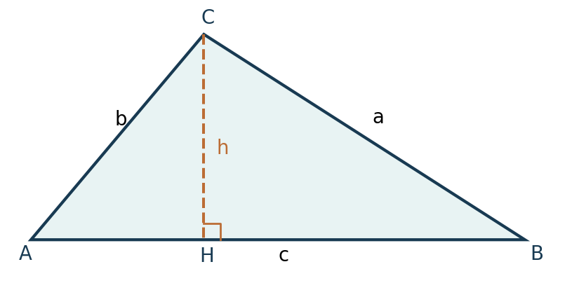
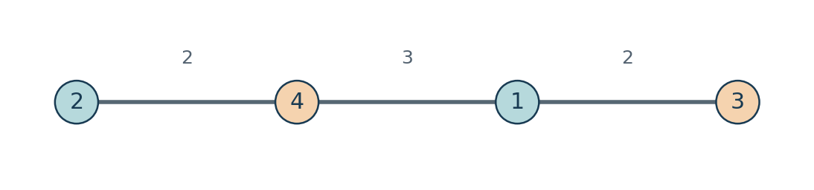
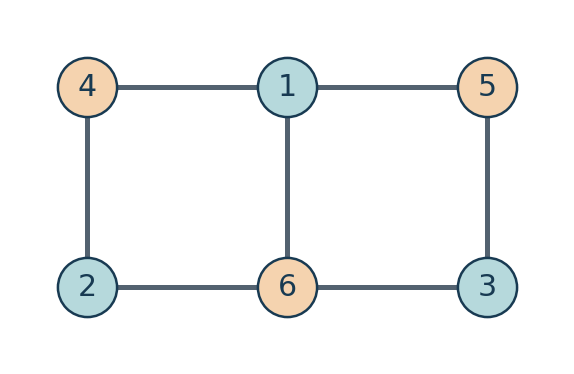

<!-- nav --> [Curriculum](../README.md) · Teaching pilots and acceptance tests

## 5 \| How to make a textbook feel like teaching

The next pages are student-facing mini-units. They model several connected lessons within selected chapters rather than reproduce the entire chapter or impose a universal page template. Each starts from a problem a student can understand. A result is introduced only when it advances the reasoning. Exercises deliberately alternate with worked examples, and the final problems do not announce the method.

| **Teaching move**          | **What an author must show**                                                                                                       |
|----------------------------|------------------------------------------------------------------------------------------------------------------------------------|
| Start with an obstacle     | A familiar approach fails, becomes inefficient or hides the quantity of interest. Let the reader attempt a small case.             |
| Develop one representation | A table, diagram, equation, state or invariant makes the obstacle simpler. Explain why the representation is valid and reversible. |
| Extract the result         | Name the theorem or technique after the reader understands the central idea. State conditions and derive the relation.             |
| Contrast and fade          | Present a case where a superficially similar rule fails; remove one layer of hints at a time.                                      |
| Transfer and revisit       | Assign mixed, unlabeled problems after a delay. Ask students to explain why they chose the approach, not merely report the answer. |

#### Volume-specific expectations

I: students should model accurately, execute fluently, and explain quantities in words. II: they should derive mathematical tools, decide between representations and use them in nonroutine applications. III: they should discover the representation with minimal cues, justify completeness, and compare or reject alternative approaches. The same theorem may appear across volumes, but its learning objective must change.

#### Suggested in-app lesson behavior

Show the opening exploration before the reference links. Allow a learner to attempt a checkpoint before revealing a hint or worked solution. Embed exact diagrams, algebra and questions in the main reading flow. Put the summary theorem and linked cards near the conclusion, and then offer an independent practice sequence. A reference card should never be necessary to understand the primary lesson. These are editorial and interface proposals only; this pass does not alter the repo.

### Pilot A \| Motion without unnecessary equations

Algebra I · A1.3.2 and A1.3.6 · Student-facing sequence

#### 1\. What changes when someone catches up?

Maya walks at 4 miles per hour. One hour later, Theo starts from the same place at 6 miles per hour. They follow the same straight road. How long will Theo have to run to catch Maya?

At the moment Theo starts, Maya is already 4 miles ahead. Over each subsequent hour, Maya advances 4 miles and Theo advances 6 miles. Their separation decreases by 2 miles every hour. So the question is really about a gap of 4 miles that shrinks at 2 miles per hour.

Time to close the gap = 4 ÷ (6 − 4) = 2 hours.

The actual distance traveled by Theo is 12 miles, but we did not need it until after we knew the time. A useful representation often eliminates a quantity that seems necessary in the original wording.

**Try it now.** A walker travels at 5 mph; a cyclist starts 30 minutes later at 15 mph. When does the cyclist catch up? Write the initial gap and the rate of change before computing. Answer: gap 2.5 miles, closing rate 10 mph, time 1/4 hour after the cyclist starts.

#### 2\. Turn a timeline into one equation

Now suppose three runners follow the same route. Runner A starts at speed v, B starts one hour later at speed v+3, and C starts another hour later at speed v+6. All finish together. Can we determine the length of their route without setting up three distance equations?

At B’s start, A leads by v miles; B closes the gap at 3 mph. B runs v/3 hours. At C’s start, B has traveled v+3 miles, so C runs (v+3)/3 hours if the speed difference is 3. These running times cannot differ by one hour in the required direction: C would need longer, not shorter. The conditions are impossible. The contrast matters: a method is useful only when the model is consistent.

Change C’s speed to v+9. Now C closes the gap to B at 6 mph. The two running durations differ by one hour:

v/3 − (v+3)/6 = 1.

Multiplying by 6 gives 2v−v−3=6, hence v=9. B runs for 3 hours at 12 mph, making the route 36 miles. C runs for 2 hours at 18 mph, also 36 miles. A walks for 4 hours at 9 mph. The shared arrival time is confirmed for every participant.

### Pilot A \| From relative speed to model selection

#### 3\. When do we add the speeds instead?

Two cyclists start 30 miles apart and ride toward each other at 8 and 7 mph. Both motions reduce the separation, so the gap closes at 15 mph and the meeting time is 2 hours. If the second cyclist travels away from the first at 7 mph instead, the separation changes by only 1 mph. The operation is not determined by the word “meeting” or “catching”; it follows from the directions of motion.

A reliable habit is to draw a number line, choose a positive direction, mark positions at a common time, and subtract positions. For changing speeds or stops, break the timeline into intervals. Carry the gap forward rather than restarting the problem at the original separation.

#### 4\. Independent practice

**A.** A truck moving at 40 mph leaves a town 45 minutes before a car traveling at 60 mph. When will the car catch the truck, and how far from town?

**B.** Two runners are 400 m apart on a straight path, moving toward each other at 3 m/s and 5 m/s. After 20 seconds the slower runner stops. When do they meet, measured from the initial instant?

**C.** A boat travels 24 miles upstream in 4 hours and downstream in 2 hours. Find its speed in still water and the speed of the current. Explain why averaging the two travel times would not solve this problem.

**D.** 2026 AIME I \#1, linked in the archive. Try the problem without the “relative motion” card or the solution. What single variable represents both head starts? What time difference is known?

#### Check and discuss

**A.** Initial gap 30 miles; closing speed 20 mph. Time 1.5 hours after car starts; distance 90 miles.

**B.** Gap shrinks by 160 m in the first 20 s. The remaining 240 m closes at 5 m/s in 48 s, giving 68 s total.

**C.** Upstream speed 6 mph, downstream 12 mph. Still-water speed (12+6)/2=9 mph; current speed (12−6)/2=3 mph. Average speed over the whole trip is 48/6=8 mph, a different quantity.

**D.** Use the first runner’s speed as the variable and compare successive closing durations. The route audit gives the checked answer 277; defer the solution until after the independent attempt.

Author checkpoint: accept the unit only if a student can correctly identify the common instant and the gap-closing rate in a new motion problem, including a change of direction or stop.

### Pilot B \| Beyond right triangles

Geometry II · G2.7.1–6 and G2.7.9 · Student-facing sequence

#### 1\. The same height, measured twice

In a right triangle, sine connects an angle with the opposite side. What changes when the triangle is not right? Consider triangle ABC with usual notation a=BC, b=CA, c=AB. Drop an altitude from C to the line AB. Its length is b sin A; the same altitude can be found from B as a sin B. This observation remains true for an obtuse angle because sin(180°−θ)=sin θ.

Equating the two expressions for h gives b sin A = a sin B. Repeating the argument with another altitude produces the law of sines:

a/sin A = b/sin B = c/sin C.

This is more than a calculation rule: sides and their opposite sines change in the same proportion. If the triangle’s circumradius is R, a chord of length a subtending angle A has length 2R sin A, so each ratio is 2R. This remains true whether A is acute or obtuse, because the two supplementary inscribed angles subtend the same chord.

**Try it now.** If a=8 and A=30°, what is the circumradius? Since 8/sin 30°=16=2R, R=8. No other side or angle is needed.

#### 2\. What if we know two sides and the angle between them?

The sine law needs a matched opposite side and angle. Suppose instead that b and c and their included angle A are known. Place A at the origin and B=(c,0); then C=(b cos A,b sin A). The distance BC has squared length (b cos A−c)²+(b sin A)². Expand and use sin²A+cos²A=1:

a² = b²+c²−2bc cos A.

The law of cosines is Pythagoras with an adjustment for the included angle. For A=90° the adjustment is zero; for an obtuse A it increases the opposite side length. The sign therefore has a geometric meaning.

### Pilot B \| Choosing the law, not memorizing a trigger

#### 3\. Comparing two different data sets

**SAS.** Two sides of lengths 5 and 7 enclose an angle of 60°. The opposite side has square 25+49−2·5·7·(1/2)=39, so its length is √39. Here no opposite angle-side pair was initially given, which makes LOC a natural first move.

**ASA.** A=30°, B=45° and a=6. Then C=105°, and b=6 sin45°/sin30°=6√2. Use LOS because the known side-angle pair supplies a common scale.

#### 4\. The missing second triangle

Given A=30°, a=7, b=10, the law of sines yields sin B=5/7. Taking an inverse sine provides an acute angle, but another angle, its supplement, has the same sine. Both are geometrically possible because the acute angle is greater than 30° and the supplement therefore leaves a positive C. This is the SSA ambiguity: one known opposite pair and another side need not specify a unique triangle.

Draw a ray AC along a fixed direction and place C at distance b from A. A ray from A at angle A meets the circle centered at C of radius a in zero, one or two positive-distance points. The circle-ray interpretation makes the possibilities visible. When A is acute, the perpendicular height from C to the ray is b sin A; if that height is less than a\<b, the two intersections are both forward. At equality with the height, they merge; if a≥b, only one intersection has positive distance (the other is at or behind A). For obtuse A, use the ray rather than assuming the acute-case rule.

#### 5\. Move from a triangle to a geometric model

A triangle law is useful even when the relevant triangle is not drawn. For example, rotating a segment around one point and rotating another segment back around a different point may produce a triangle with two known lengths and an included angle. First prove the equal lengths and the angle relation; only then apply LOC. The theorem should finish the solution rather than substitute for the construction.

#### Practice with mixed data

**A.** A triangle has sides 7, 8 and 9. Find the cosine of the angle opposite 9.

**B.** A triangle has A=30°, a=4, b=10. How many triangles are possible? Change a to 5 and then to 6; explain what changes.

**C.** A triangle has sides 5 and 8 with an included angle of 120°. Find its third side and area exactly.

**D.** Try 2026 AIME I \#5 without a method label. Sketch the two rotations. Then compare a synthetic law-of-cosines solution with a complex-coordinate solution from the route review.

#### Solutions

**A.** cos C=(49+64−81)/(2·7·8)=2/7.

**B.** The height is 5. No intersection for a=4, one tangent intersection for a=5, and two forward intersections for a=6 because 5\<6\<10.

**C.** Third side √(25+64+40)=√129. Area=(1/2)·5·8·sin120°=10√3.

**D.** The checked result is 65. The decisive move is finding a simple expression for AB′ before invoking the law.

### Pilot C \| Counting divisors without listing them

Number Theory III · N3.1.1 and N3.4.1 · Student-facing sequence

#### 1\. Turn divisibility into a counting model

How many positive divisors of 5³·7³·11³ leave remainder 1 when divided by 12? There are 4³=64 divisors. Listing them is possible but unnecessary. Unique factorization says every divisor corresponds to exactly one exponent triple (a,b,c), with each exponent between 0 and 3. We can solve a smaller problem about exponent patterns.

A number is congruent to 1 modulo 12 exactly when it is congruent to 1 modulo 3 and modulo 4. Why? If both 3 and 4 divide the difference from 1, their coprimality makes 12 divide it. This is the easy direction of the Chinese remainder theorem, and it is the reason we may impose two separate conditions.

| **Prime** | **Mod 3** | **Mod 4** |
|-----------|-----------|-----------|
| 5         | −1        | 1         |
| 7         | 1         | −1        |
| 11        | −1        | −1        |

For d=5ᵃ7ᵇ11ᶜ, the two residues become (−1)^(a+c) and (−1)^(b+c). To obtain 1 in both places, a+c and b+c must be even. Equivalently, a,b,c all have the same parity. There are two even and two odd choices for each exponent; the count is 2³+2³=16.

**Try it now.** Change the required remainder to 5 modulo 12. The new requirements are a+c odd and b+c even. For each parity of c, a has the opposite parity and b has the same parity. The count stays 16, but the admissible patterns differ.

#### 2\. What if one base is not invertible?

Count divisors of 2⁵·5³ with remainder 4 modulo 12. Now 2 is not a unit modulo 12, so it cannot be canceled indiscriminately. If a=0 or 1, the divisor is not divisible by 4; these exponents fail. For a≥2, powers of 2 alternate between 4 and 8 mod 12, and multiplication by 5 interchanges those two residues. Thus a+b must be even, with a∈{2,3,4,5} and b∈{0,1,2,3}. Each a has two valid b values, giving 8 divisors.

The key new idea is to check nonunit factors first. Once the valuation requirement is satisfied, study the remaining periodic residues. Applying a unit-group theorem to a nonunit is not justified.

### Pilot C \| From exponent parity to constrained counting

#### 3\. The state that matters is not the full number

Let primes p₁,…,pₖ occur with exponents e₁,…,eₖ. Each divisor is a choice of one exponent from each range. For a fixed modulus m, we can count choices by their current residue rather than their enormous integer product. Begin with one empty choice of residue 1. For the next prime, append each allowed power and update the product residue. Different exponent choices giving the same residue still count separately. This is the same state-counting idea used for strings and graph walks in C2.5.

Before building a full table, try to find a shortcut: split coprime moduli, exploit short power cycles, or combine parity conditions. The general residue-state method remains a fallback when the simple conditions do not separate. A good solution chooses the smallest sufficient representation, not the largest available theorem.

#### 4\. An unlabeled transfer sequence

**A.** How many divisors of 3⁵·7³ are congruent to 3 modulo 4?

**B.** How many divisors of 5⁴·7⁴·11⁴ are congruent to 1 modulo 12? Explain why the previous answer does not merely scale by (5/4)³.

**C.** Find the number of divisors of 2⁴·3³ that are divisible by 6 but not 12.

**D.** Attempt 2026 AIME I \#8. Factor the base and determine the smallest modulus split that makes both constraints simple. Avoid listing divisors.

#### Solutions and reasoning

**A.** Both bases are −1 modulo 4. Of six choices for the exponent of 3, three are even and three odd; the exponent of 7 has two of each. Opposite parity gives 3·2+3·2=12.

**B.** As before all exponents must have the same parity. Each exponent now has three even and two odd choices, yielding 3³+2³=35. The count depends on actual parity populations, not just total population.

**C.** Divisible by 6 forces exponents of 2 and 3 to be at least 1. Not divisible by 12 forces the exponent of 2 to be exactly 1. The exponent of 3 can be 1,2,3; three divisors.

**D.** The correct exponent-parity conditions and count appear in the route audit. Compare the enumeration check (18⁴ tuples) with the simple product count. The latter is the intended contest route.

Author checkpoint: the student must explain why exponent choices are in bijection with divisors, why CRT conditions are equivalent, and why nonunit residues require separate treatment. A correct count alone is insufficient.

### Pilot D \| Seeing an extremum as many cuts

Combinatorics III · C3.8.5 and C2.4.6 · Student-facing sequence

#### 1\. A path with four labels

Place the numbers 1,2,3,4 along a path of four vertices, using each once. Maximize the sum of absolute differences across the three edges. Trying arrangements is easy here, but a larger graph will defeat brute force. What do these absolute differences actually count?

An edge joining labels 1 and 4 crosses three thresholds: between 1 and 2, between 2 and 3, and between 3 and 4. An edge joining 2 and 4 crosses two thresholds. Define cₖ to be the number of edges between the k largest labels and the remaining vertices. Every edge joining labels i\<j is counted exactly j−i times when k ranges from 1 to n−1. Counting the same contributions in the other order yields:

M = c₁+c₂+⋯+cₙ₋₁.

In the path of four vertices, c₁≤2 and c₃≤2 because each is the degree of a single vertex. Also c₂≤3 because the graph has only three edges. Therefore M≤7. The ordering 2,4,1,3 attains 2+3+2=7. Notice what makes this an extremal proof: we establish a universal bound and then exhibit a configuration attaining it.

**Try it now.** On a 4-cycle, place 1,2,3,4 to maximize the sum. A threshold bound is 2+4+2=8; the cyclic order 1,3,2,4 attains 2+1+2+3=8.

#### 2\. Why a large cut is not enough

A labeling can maximize one threshold cut but fail to maximize the others. A bound on each cut is only an upper bound on the total. Equality requires one labeling that achieves all the selected bounds simultaneously. This is why a construction is not optional.

### Pilot D \| Degree, bipartition and the next obstacle

#### 3\. A two-by-three grid

For a 2×3 rectangular grid of cells with edges between adjacent cells, there are seven edges. Two cells have degree 3; the four corners have degree 2. Place labels 1,…,6. At a cut containing one vertex, at most three edges cross. A two-vertex cut has at most five crossing edges: if both degree-three vertices are chosen, they are adjacent and their internal edge must be subtracted twice; otherwise their degree sum is at most five. Three vertices can cut at most all seven edges. Complementation gives M≤3+5+7+5+3=23.

The displayed checkerboard places high labels on one color and low labels on the other. To maximize the difference, give the highest label on the high side to its degree-three vertex, and the lowest label on the low side to its degree-three vertex. Then every edge goes from high to low, and the sum is the degree-weighted sum of the high labels minus that of the low labels: (2·4+3·6+2·5)−(2·2+3·1+2·3)=23. The bound is attained.

#### 4\. An 8×8 grid raises a new question

In 2026 AIME I \#11, the elementary degree bound 4k becomes insufficient as the chosen set grows. Inside the 8×8 grid there are 36 degree-four vertices. Pair them into 18 adjacent pairs. If a selected set contains I interior vertices, at least max(I−18,0) of those pairs are fully selected. Each such internal edge reduces the crossing count by two. If C selected vertices are corners, the degree sum is 3k+I−C, so

cₖ ≤ 3k+I−C−2 max(I−18,0) ≤ 3k+18.

The boundary k=31 needs a separate argument: a cut of all 112 edges must be the checkerboard bipartition, which has 32 vertices on each side. A cut of 111 edges is impossible because the one noncrossing edge lies in a four-cycle, and any cycle crosses a cut an even number of times. Thus c₃₁≤110. Combine this with cₖ≤4k and c₃₂≤112, use complement symmetry, then construct a labeling that achieves the upper bound.

### Pilot D \| Finish the proof and transfer the strategy

#### 5\. Bound and attainment

The thresholds k=1,…,18 use 4k; k=19,…,30 use 3k+18; k=31 uses 110; the central cut uses 112. Complementation doubles the first 31 terms:

M ≤ 2(4Σ₁¹⁸k + Σ₁₉³⁰(3k+18) + 110) + 112 = 3896.

Place 33–64 on one checkerboard color and 1–32 on the other. Each color has 18 interior, 12 noncorner boundary and two corner vertices. Assign the high labels 47–64 to interior, 35–46 to boundary and 33–34 to corners; assign low labels 1–18, 19–30 and 31–32 respectively. Every edge goes across colors; interior vertices receive the greatest absolute leverage. Computing the degree-weighted difference gives 3896 exactly. Thus the maximum is 3896 and the requested remainder is 896.

The solution did not begin with a specialized theorem. It began by reinterpreting a sum as a count of threshold crossings. The graph structure then supplied bounds, and the labeling supplied a construction. This is the type of reasoning that Volume III should teach.

#### 6\. Independent tasks

**A.** For a star graph with one center and four leaves, assign 1–5 to maximize the sum of absolute edge differences. Does a maximum cut alone determine the answer?

**B.** On a 6-cycle, assign the labels 1–6 to maximize the same sum. Give both an upper bound and a construction.

**C.** For a graph with n vertices and m edges, derive cₖ≤min(m,Δk,Δ(n−k)), where Δ is the maximum degree. Explain why adding these bounds need not yield an attainable maximum.

**D.** Revisit I \#11 a week later without the worked example. Try to reconstruct the threshold identity and explain why 111 crossing edges are impossible.

#### Solutions

**A.** For center label j, sum \|j−i\| over other labels. Values for j=1,2,3,4,5 are 10,7,6,7,10. The maximum is 10; the largest graph cut is 4 edges but the labels determine the weighted sum.

**B.** Degree bound gives 2+4+6+4+2=18. Alternate high 4,5,6 and low 1,2,3 around the cycle; each vertex degree 2, so M=2\[(4+5+6)−(1+2+3)\]=18.

**C.** Count all incident edges on either side of the cut; each is bounded by its side size times Δ, and never more than m edges cross. The selected subsets at successive thresholds must be nested, so independently optimal cuts might not coexist.

Author checkpoint: a learner must be able to derive a counting identity and construct an attainment example, not merely invoke “extremal reasoning.”

## 6 \| Acceptance tests and the next authoring batch

The four mini-units are deliberately of different levels and forms. They do not require every textbook lesson to have the same visible headings; they illustrate the standard of reasoning and the relationship between examples and practice. In the complete curriculum, adopt the following acceptance gates.

| **Gate**                  | **Evidence to collect**                                                                                                                                                              |
|---------------------------|--------------------------------------------------------------------------------------------------------------------------------------------------------------------------------------|
| Prerequisite check        | For each worked example, mark the required concept IDs and the first new step. If a later concept is required, teach the bridge, move the example, or flag it as optional challenge. |
| First-step diagnostic     | Before revealing a solution, ask for the model, construction, representation or invariant. Record whether the learner identified it independently.                                   |
| Faded guidance            | Use one worked example, then a partial example, then a close independent problem; follow with a mixed transfer task. Do not merely change numerical constants.                       |
| Misconception contrast    | Include a nearby problem where the technique fails or needs a new condition. Ask what changed.                                                                                       |
| Exact-answer verification | Check equations, branches, integer bounds, geometry feasibility and exact arithmetic. For counting, verify disjointness and exhaustiveness.                                          |
| Delayed transfer          | After several unrelated lessons, assign an unlabeled problem that needs the earlier idea. Assess method choice separately from computation.                                          |

#### Next batch of chapter pilots

Prioritize G2.2 (power of a point), A2.8 (composite/inverse functions), C2.5 (recursive counting), N2.1 (CRT), and A3.3 (root transformations). Their arcs should be developed from small cases through generalizations to actual contest problems. Retain the Year 2 chapter identities and core concept coverage. For every pilot, use a set of original practice prompts and verified linked contest problems.

#### What has and has not been established

Of the 30 2026 AIME routes, 25 were reconstructed as candidate elementary routes, two were replaced with no-calculus routes, and three have independent numerical checks but need further student-facing enumeration justification. All thirty have a proposed instructional home. This is a small, complete cohort, not a census of the remaining 1,035 AIME appearances. No student performance data have been collected. No repository files have been changed.
